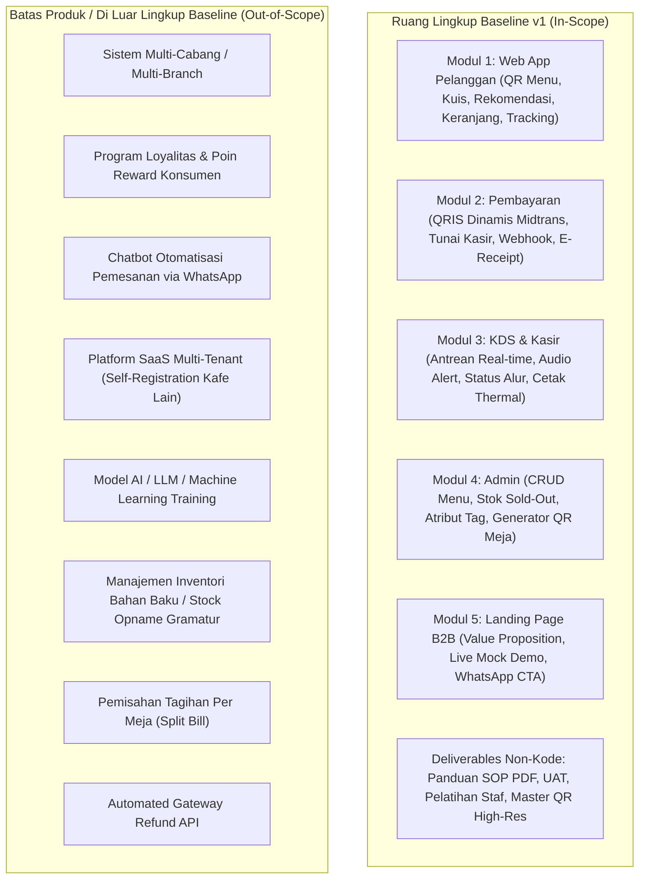
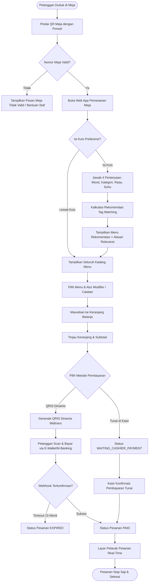
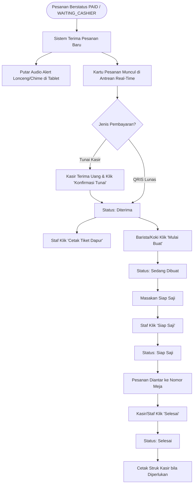
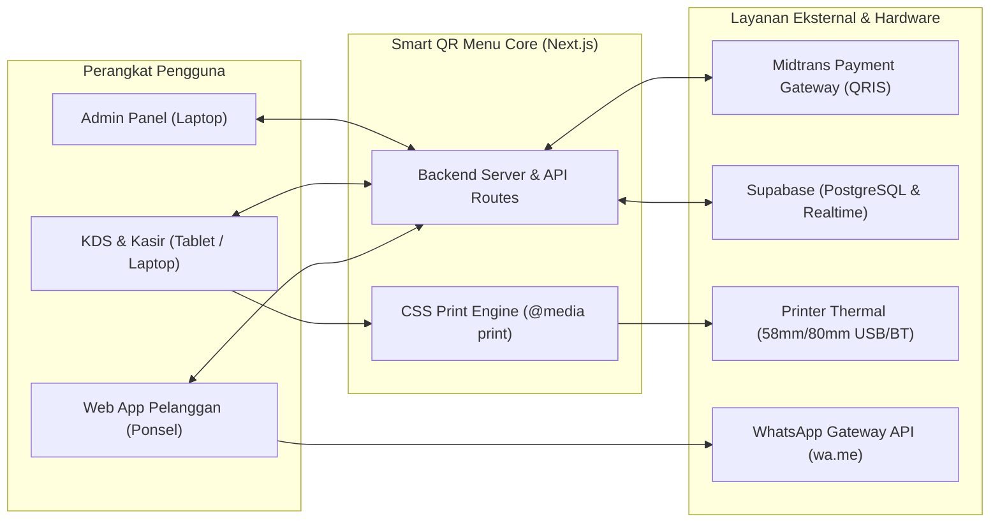

# PRODUCT REQUIREMENTS DOCUMENT (PRD)
# SMART QR MENU & SISTEM REKOMENDASI PREFERENSI KONSUMEN

---

## 1. Identitas dan Status Dokumen

| Parameter Dokumen | Keterangan |
|---|---|
| **Nama Produk** | Smart QR Menu & Sistem Rekomendasi Preferensi Konsumen |
| **Versi Dokumen** | v1.0 (Initial Draft Specification) |
| **Tanggal Pembuatan** | 2026-10-27 |
| **Peran Penyusun** | Senior Product Manager & Business Analyst |
| **Dokumen Sumber Acuan** | 1. `Proposal Pengembangan Website Smart QR Menu.docx`<br>2. `docs/AGENT.md` (Shared Project Context & TRD Baseline) |
| **Status Dokumen** | **DRAFT** (Spesifikasi produk ini disusun sebagai acuan desain, implementasi teknis, dan User Acceptance Testing / UAT. Dokumen ini **belum** menjadi bukti bahwa implementasi perangkat lunak telah selesai atau telah disetujui secara final oleh klien). |

> [!IMPORTANT]
> **Prinsip Dasar Spesifikasi:** Seluruh kebutuhan yang dituangkan dalam dokumen ini bersumber langsung dari proposal resmi dan keputusan terarah yang telah dikonfirmasi pada tahap pra-pengembangan (`DEC-001` s/d `DEC-009` pada `docs/AGENT.md`). Setiap target metrik yang belum memiliki data baseline dari operasional nyata diberi label eksplisit sebagai **Usulan Target (Perlu Konfirmasi Baseline)**.

---

## 2. Ringkasan Produk dan Masalah yang Diselesaikan

### 2.1. Ringkasan Produk
Cravia adalah platform web pemesanan dan personalisasi menu berbasis pemindaian kode QR di meja restoran/kafe (*table ordering system*). Sistem ini dirancang *mobile-first* dan berjalan sepenuhnya di peramban seluler tanpa mewajibkan pelanggan mengunduh aplikasi (*zero-app-install*). 

Sistem mengintegrasikan 5 pilar fungsional:
1. **Web App Pemesanan Pelanggan:** Akses instan nomor meja, kuis preferensi cerdas 4 langkah (dengan tombol lewati), mesin rekomendasi menu berbasis tag (non-AI/LLM), katalog digital interaktif, custom modifier, keranjang belanja, dan pelacak status pesanan real-time.
2. **Sistem Pembayaran Kasir & Digital:** Pembayaran otomatis menggunakan QRIS Dinamis melalui Payment Gateway (Midtrans) serta opsi pembayaran tunai langsung di kasir.
3. **Web Dashboard Kasir & Dapur (Kitchen Display System / KDS):** Layar antrean pesanan real-time multi-tahap, notifikasi audio alert (lonceng/chime), dan tombol cetak tiket dapur/struk kasir thermal 58mm/80mm.
4. **Dashboard Admin & Generator QR Meja:** Manajemen katalog menu, harga, stok biner (*Tersedia / Sold Out*), konfigurasi tag preferensi, pengaturan kuis dinamis, dan generator master file QR meja beresolusi tinggi.
5. **Website Landing Page Promosi B2B:** Satu halaman web pemasaran untuk menawarkan solusi digitalisasi sistem ini kepada pemilik kafe lain, lengkap dengan live preview demo kuis dan tombol CTA WhatsApp.

### 2.2. Masalah yang Diselesaikan

| Masalah yang Dinyatakan Sumber (Fakta Proposal) | Hipotesis Bisnis Tambahan (Perlu Validasi Pengujian) |
|---|---|
| **Antrean dan Kelambatan Pemesanan Konvensional:** Pelanggan harus menunggu staf datang membawa buku menu fisik atau mengantre di kasir saat kafe sedang padat. | Penurunan waktu tunggu pemesanan dari rata-rata 10 menit menjadi < 2 menit per meja. |
| **Hambatan Instalasi Aplikasi:** Pelanggan enggan mengunduh aplikasi native dari App Store/Play Store hanya untuk memesan makanan satu kali. | Tingkat adopsi pemindaian mandiri mencapai > 80% dari total transaksi makan di tempat (*dine-in*). |
| **Kebingungan Memilih Menu (Decision Fatigue):** Buku menu fisik yang panjang sering membuat pelanggan ragu menentukan pilihan sesuai suasana hati. | Kuis preferensi cerdas dapat memandu pelanggan memilih menu dalam waktu < 60 detik. |
| **Pengecekan Mutasi Pembayaran Manual:** Kasir repot memeriksa bukti transfer bank manual atau layar ponsel pelanggan satu per satu yang rentan bukti transfer palsu. | Verifikasi otomatis QRIS dinamis mengeliminasi 100% risiko salah hitung nominal dan bukti transfer manipulatif. |
| **Miskomunikasi Pesanan & Tiket Manual:** Catatan pesanan tulisan tangan staf sering hilang, salah baca (*less sugar/no ice* tertukar), atau terlambat sampai ke barista dapur. | Notifikasi audio instan dan KDS digital mengeliminasi kesalahan interpretasi pesanan khusus pelanggan. |

---

## 3. Tujuan dan Indikator Keberhasilan

### 3.1. Tujuan Produk (Product Outcomes)
1. Mewujudkan alur pemesanan meja nir-unduh aplikasi yang mulus dari pemindaian QR hingga pelacakan pesanan.
2. Menyajikan personalisasi menu instan yang deterministik tanpa beban komputasi model AI pihak ketiga.
3. Menjamin akurasi finansial transaksi pesanan melalui integrasi QRIS dinamis dan pencatatan kasir yang tepercaya di sisi server.
4. Mempercepat sinkronisasi operasional pesanan antara meja pelanggan, kasir, dan dapur dalam hitungan detik.
5. Memberikan kemandirian penuh bagi manajemen kafe untuk memperbarui menu, stok, dan mencetak QR meja.

### 3.2. Indikator Keberhasilan Rilis (Release Acceptance Criteria)
Indikator berikut merupakan syarat kelulusan pengujian sebelum serah terima sistem:
- **Keberhasilan Alur End-to-End:** 100% skenario alur pemesanan (Scan QR $\rightarrow$ Kuis/Skip $\rightarrow$ Keranjang $\rightarrow$ Checkout $\rightarrow$ KDS $\rightarrow$ Status Selesai) berhasil dieksekusi tanpa kegagalan sistem (*blocking defect*).
- **Akurasi Perhitungan Finansial:** 100% total tagihan pada keranjang, kode QRIS, struk digital, dan struk fisik thermal memiliki nominal persis sama dengan hasil kalkulasi server (subtotal + modifier).
- **Kecepatan Refleksi KDS:** Pesanan yang telah terverifikasi (`PAID` atau dikonfirmasi kasir) muncul di dashboard KDS dapur dalam waktu $\le 2$ detik.
- **Keandalan Webhook Gateway:** Callback pembayaran dari simulator/sandbox payment gateway berhasil memperbarui status pesanan secara idempoten tanpa duplikasi.
- **Kemandirian Admin:** Admin dapat menambah menu baru, memperbarui harga, mengubah status *Sold Out*, dan mengunduh berkas master QR meja tanpa intervensi pengembang.

### 3.3. Metrik Pemakaian Pascarilis (Post-Release Metrics — Usulan Target)

> [!NOTE]
> Target di bawah ini merupakan **usulan target operasional** yang perlu dikonfirmasi dan diukur bersama pemilik kafe setelah sistem berjalan secara live:

| Metrik Produk | Definisi & Cara Pengukuran | Target Usulan | Status Target |
|---|---|---|---|
| **Adopsi Scan Meja** | (Jumlah pesanan via QR / Total transaksi makan di tempat) $\times 100\%$ | $\ge 70\%$ | Usulan, perlu validasi baseline |
| **Tingkat Selesai Kuis** | (Sesi menyelesaikan kuis / Total sesi buka kuis) $\times 100\%$ | $\ge 50\%$ | Usulan, perlu konfirmasi |
| **Penggunaan Tombol Lewati** | (Sesi menekan tombol skip / Total sesi buka kuis) $\times 100\%$ | $\le 50\%$ | Usulan, pelacak kenyamanan |
| **Rasio Pembayaran QRIS** | (Transaksi lunas via QRIS / Total transaksi digital & tunai) $\times 100\%$ | $\ge 60\%$ | Usulan, tergantung kebiasaan pelanggan |
| **Keluhan Salah Pesanan** | Jumlah laporan komplain salah varian/modifier pelanggan per bulan | $< 1\%$ dari total order | Usulan target kualitas |

---

## 4. Pengguna dan Matriks Hak Akses

### 4.1. Definisi Persona Pengguna

1. **Pelanggan Kafe (Customer):**
   - **Tujuan:** Memesan makanan/minuman dari meja secara cepat, menemukan menu yang cocok dengan preferensi rasa/suasana hati, membayar dengan praktis (QRIS/Tunai), dan memantau status pembuatan pesanan.
   - **Sifat Akses:** Publik / Guest tanpa akun wajib. Akses terikat pada nomor meja aktif yang valid dari parameter QR code.
2. **Kasir (Cashier):**
   - **Tujuan:** Memantau antrean pembayaran, mengonfirmasi pelunasan pesanan tunai, membatalkan pesanan tunai jika ada kendala sebelum diproses dapur, mencetak struk pelanggan, dan menangani pengembalian dana manual jika diperlukan.
   - **Sifat Akses:** Login cepat berbasis PIN 4-digit atau stasiun kasir terproteksi token sesi (`DEC-005`).
3. **Staf Dapur / Barista (Kitchen Staff):**
   - **Tujuan:** Menerima tiket pesanan baru seketika, mendengar notifikasi audio, melihat instruksi kustomisasi menu secara detail, memajukan status pesanan (*Diterima $\rightarrow$ Dibuat $\rightarrow$ Siap Saji $\rightarrow$ Selesai*), dan mencetak tiket dapur.
   - **Sifat Akses:** Login cepat berbasis PIN 4-digit atau stasiun KDS tablet dapur (`DEC-005`). Tidak memiliki hak akses keuangan atau manajemen menu.
4. **Admin / Pemilik Kafe (Super Admin):**
   - **Tujuan:** Mengelola data katalog menu, harga, stok ketersediaan, konfigurasi kuis preferensi, generate QR code meja, mengatur switch pajak/service charge, serta memonitor riwayat pesanan.
   - **Sifat Akses:** Login kredensial aman (Username/Email + Password terenkripsi).
5. **Calon Klien B2B (Prospect Cafe Owner):**
   - **Tujuan:** Mempelajari solusi Smart QR Menu, mencoba interaksi simulasi demo kuis pada landing page promosi, dan menghubungi kontak penjualan via WhatsApp.
   - **Sifat Akses:** Publik tanpa otentikasi.

### 4.2. Matriks Hak Akses (Role-Based Access Matrix)

| Tindakan / Fitur Sistem | Pelanggan | Kasir | Staf Dapur | Admin / Pemilik | Calon B2B |
|---|:---:|:---:|:---:|:---:|:---:|
| Pindai QR & Buka Menu Meja | **Ya** | Ya | Ya | Ya | Tidak |
| Mengisi / Melewati Kuis Preferensi | **Ya** | Tidak | Tidak | Ya (Preview) | Ya (Demo Mock) |
| Membuat Pesanan & Checkout (QRIS/Tunai) | **Ya** | Tidak | Tidak | Tidak | Tidak |
| Memantau Layar Pelacak Pesanan Sendiri | **Ya** | Ya | Ya | Ya | Tidak |
| Melihat Layar Antrean KDS Real-Time | Tidak | **Ya** | **Ya** | **Ya** | Tidak |
| Menerima Notifikasi Audio Chime | Tidak | **Ya** | **Ya** | Ya (Opsional) | Tidak |
| Mengubah Status (*Diterima $\rightarrow$ Selesai*) | Tidak | **Ya** | **Ya** | **Ya** | Tidak |
| Konfirmasi Pelunasan Pesanan Tunai | Tidak | **Ya** | **Tidak** | **Ya** | Tidak |
| Membatalkan Pesanan Tunai Belum Dibuat | Tidak | **Ya** | **Tidak** | **Ya** | Tidak |
| Cetak Tiket Dapur & Struk Thermal | Tidak | **Ya** | **Ya** | **Ya** | Tidak |
| Mengubah Status Stok (*Tersedia / Sold Out*) | Tidak | **Ya** *(Usulan)* | Tidak | **Ya** | Tidak |
| Tambah / Edit / Hapus Menu & Harga | Tidak | Tidak | Tidak | **Ya** | Tidak |
| Konfigurasi Tag Preferensi & Kuis | Tidak | Tidak | Tidak | **Ya** | Tidak |
| Generate & Unduh Master QR Meja | Tidak | Tidak | Tidak | **Ya** | Tidak |
| Konfigurasi Pajak & Service Charge | Tidak | Tidak | Tidak | **Ya** | Tidak |
| Mencoba Live Demo Kuis di Landing Page | Tidak | Tidak | Tidak | Tidak | **Ya** |
| Menekan Tombol CTA WhatsApp Sales | Tidak | Tidak | Tidak | Tidak | **Ya** |

---

## 5. Ruang Lingkup dan Batas Produk



### 5.1. Batasan Kritis Ruang Lingkup
1. **Single-Tenant Kafe Mandiri:** Sistem dirancang untuk satu kafe klien. Halaman landing page B2B adalah media promosi agensi jasa, bukan arsitektur multi-tenant SaaS dengan database terpisah per tenant (`DEC-001`).
2. **Deterministik Non-AI:** Algoritma rekomendasi sepenuhnya menggunakan pencocokan irisan tag (*flavor, temperature, mood*) dan badge *Best Seller* secara deterministik tanpa API LLM pihak ketiga (`DEC-009`).
3. **Stok Biner Menu:** Pengelolaan stok hanya berupa toggle status biner: `TERSEDIA` atau `SOLD OUT` per item menu. Tidak mencakup pengurangan gramatur stok bahan mentah di gudang.
4. **Pencetakan Berbasis Browser:** Menggunakan CSS `@media print` presisi 58mm & 80mm yang kompatibel universal melalui driver OS tanpa instalasi driver proprietary serial/Bluetooth mentah (`DEC-004`).

---

## 6. User Journey dan Alur Alternatif

### 6.1. Alur Pelanggan (Customer Journey)



### 6.2. Alur Kasir & Dapur (Kitchen & Cashier Journey)



### 6.3. Alur Alternatif dan Penanganan Kondisi Khusus (Edge Cases)

| Skenario Alur | Pemicu / Kondisi | Perilaku Sistem & Penanganan yang Diharapkan |
|---|---|---|
| **Tombol Lewati Kuis (*Skip*)** | Pelanggan terburu-buru atau tidak berminat mengisi kuis. | Sistem langsung menutup modal kuis dan menampilkan seluruh katalog menu tanpa pesan error atau hambatan. |
| **Tidak Ada Rekomendasi yang Cocok Persis** | Kombinasi tag kuis tidak memiliki irisan dengan menu aktif. | Sistem menampilkan menu-menu berstatus *Best Seller* sebagai fallback dengan pesan: *"Berikut menu favorit pelanggan yang wajib dicoba!"*. |
| **Menu Berubah *Sold Out* Saat Dipilih** | Admin menandai item habis saat pelanggan masih membuka halaman menu. | Saat pelanggan menekan tombol tambah keranjang atau checkout, sistem memvalidasi stok real-time, menolak penambahan, dan menampilkan notifikasi: *"Maaf, menu [Nama] baru saja habis"*. |
| **Perubahan Harga Saat Checkout** | Admin mengubah harga menu di dashboard saat pelanggan menyusun keranjang. | Sistem menghitung ulang subtotal di server saat inisiasi checkout, menampilkan harga terbaru, dan meminta konfirmasi pelanggan sebelum pembayaran dibuat. |
| **Modifier Berbayar Dipilih** | Pelanggan memilih ekstra shot / topping ekstra. | Subtotal item bertambah otomatis secara transparan di keranjang dan diverifikasi validitasnya oleh server. |
| **QR Meja Tidak Valid / Tanpa Parameter** | Pelanggan membuka URL menu tanpa query `?table=xx` atau nomor meja tidak terdaftar. | Sistem menampilkan halaman peringatan ramah: *"Nomor meja tidak terdeteksi. Silakan scan ulang kode QR di meja Anda atau hubungi staf kami."* Tombol checkout terkunci. |
| **Keranjang Kosong** | Pelanggan membuka halaman checkout tanpa ada item di keranjang. | Tombol checkout dinonaktifkan (*disabled*) dengan tampilan ilustrasi keranjang kosong dan tombol kembali ke menu. |
| **QRIS Tidak Dibayar dalam 15 Menit** | Pelanggan membuat kode QRIS tetapi tidak menyelesaikan pembayaran. | Sistem menandai pesanan sebagai `EXPIRED`, membatalkan kode QRIS, dan tidak meneruskan pesanan ke antrean dapur (`DEC-007`). |
| **Koneksi Internet Terputus / Reconnect** | Jaringan Wi-Fi/seluler pelanggan atau staf terputus sesaat. | Antarmuka menampilkan banner indikator offline. Begitu koneksi pulih, sistem melakukan sinkronisasi otomatis (*reconnect*) untuk menarik state terkini dari server tanpa menduplikasi data pesanan. |
| **Refresh Halaman Tracking Pesanan** | Pelanggan memuat ulang peramban di tengah proses pelacakan pesanan. | Sistem membaca token/ID pesanan dari URL atau local session, mengambil status terbaru dari server, dan melanjutkan pelacakan secara normal. |

---

## 7. Kebutuhan Fungsional per Modul

### 7.1. Modul 1: Web App QR Menu Pelanggan (`REQ-CUST`)

#### `REQ-CUST-01`: Deteksi Nomor Meja Otomatis via QR Code
- **Referensi Proposal:** Bagian 1 (Langkah 1), Bagian 2 (Modul 1)
- **Aktor:** Pelanggan
- **Tujuan/User Story:** Sebagai pelanggan, saya ingin nomor meja saya langsung dikenali otomatis saat memindai kode QR agar saya tidak perlu mengetikkan nomor meja secara manual.
- **Pemicu & Prasyarat:** Pelanggan memindai QR code fisik di meja menggunakan kamera ponsel.
- **Perilaku & Aturan Bisnis:**
  - URL memuat parameter identifikasi meja (misal: `/order?table=05`).
  - Sistem memvalidasi eksistensi nomor meja terhadap master data meja aktif.
  - Nomor meja disimpan dalam sesi belanja dan dikunci pada pesanan akhir.
- **Alur Alternatif/Gagal:** Jika parameter nomor meja hilang, salah format, atau dinonaktifkan admin, tampilkan pesan peringatan dan blokir tombol checkout.
- **Prioritas:** **P0 (Mandatori)** – Tanpa deteksi meja, pesanan makan di tempat tidak dapat diidentifikasi.
- **Dependensi & Keputusan:** `DEC-001` (Single-tenant).
- **Kriteria Penerimaan:**
  - [ ] Pindai URL dengan nomor meja valid langsung menampilkan halaman pemesanan dengan nomor meja terpampang jelas.
  - [ ] URL tanpa parameter meja menampilkan pesan penolakan dan tidak mengizinkan checkout.

#### `REQ-CUST-02`: Kuis Preferensi Interaktif & Opsi Lewati (*Skip*)
- **Referensi Proposal:** Bagian 1 (Langkah 2), Bagian 2 (Modul 1)
- **Aktor:** Pelanggan
- **Tujuan/User Story:** Sebagai pelanggan, saya ingin disajikan pertanyaan preferensi sederhana atau dapat langsung melewati kuis agar proses pemesanan tetap cepat dan fleksibel sesuai kebutuhan saya.
- **Pemicu & Prasyarat:** Pelanggan membuka web app setelah deteksi meja berhasil.
- **Perilaku & Aturan Bisnis:**
  - Kuis menyajikan 4 tahapan pertanyaan bawaan: Mood, Kategori, Rasa, Suhu (`DEC-009`).
  - Tombol "Lewati Kuis" (*Skip*) tampil mencolok di seluruh tahapan kuis.
  - Pertanyaan dan opsi kuis dikelola dinamis dari Admin (`DEC-009`).
- **Alur Alternatif/Gagal:** Menekan "Lewati Kuis" langsung mengarahkan pengguna ke katalog lengkap.
- **Prioritas:** **P0 (Mandatori)** – Nilai jual utama produk.
- **Dependensi & Keputusan:** `DEC-009` (Engine Kuis Dinamis Admin).
- **Kriteria Penerimaan:**
  - [ ] Pengguna dapat berpindah antar pertanyaan kuis dengan lancar.
  - [ ] Tombol lewati kuis berfungsi seketika di setiap pertanyaan tanpa memunculkan error.

#### `REQ-CUST-03`: Mesin Rekomendasi Menu Berbasis Pencocokan Tag Cerdas
- **Referensi Proposal:** Bagian 1 (Langkah 3), Bagian 2 (Modul 1)
- **Aktor:** Pelanggan / Sistem
- **Tujuan/User Story:** Sebagai pelanggan, saya ingin mendapatkan rekomendasi menu yang cocok beserta alasan daya tariknya agar saya tidak bingung memilih menu.
- **Pemicu & Prasyarat:** Pelanggan menyelesaikan seluruh pertanyaan kuis preferensi.
- **Perilaku & Aturan Bisnis:**
  - Menghitung irisan tag jawaban kuis dengan tag menu aktif.
  - Menampilkan 1–3 rekomendasi teratas yang berstatus *Tersedia*. Item *Sold Out* dilarang direkomendasikan.
  - Menampilkan teks alasan daya tarik yang terformat rapi (misal: *"Cocok untuk mood santai dengan sentuhan rasa manis & dingin"*).
  - Skor seri (*tie-break*) diprioritaskan untuk menu berstatus *Best Seller*.
  - Kalkulasi murni deterministik non-AI/LLM dengan durasi komputasi < 100 ms.
- **Alur Alternatif/Gagal:** Jika tidak ada tag cocok sama sekali, sistem menampilkan daftar menu *Best Seller* sebagai fallback.
- **Prioritas:** **P0 (Mandatori)**.
- **Dependensi & Keputusan:** `DEC-009`.
- **Kriteria Penerimaan:**
  - [ ] Menu yang direkomendasikan memiliki tag yang relevan dengan jawaban kuis.
  - [ ] Menu sold out tidak muncul di daftar rekomendasi utama.
  - [ ] Fallback Best Seller tampil jika irisan tag bernilai nol.

#### `REQ-CUST-04`: Katalog Menu Digital, Kategori, & Pencarian
- **Referensi Proposal:** Bagian 2 (Modul 1)
- **Aktor:** Pelanggan
- **Tujuan/User Story:** Sebagai pelanggan, saya ingin menelusuri seluruh menu berdasarkan kategori atau kata kunci pencarian agar saya dapat menemukan menu favorit dengan cepat.
- **Pemicu & Prasyarat:** Halaman katalog terbuka (baik setelah kuis atau setelah lewati kuis).
- **Perilaku & Aturan Bisnis:**
  - Pengelompokan kategori rapi (misal: Kopi, Non-Kopi, Makanan Utama, Camilan).
  - Pencarian instan menyaring menu berdasarkan nama atau deskripsi.
  - Kartu menu memuat foto, nama, deskripsi singkat, harga IDR, dan badge visual *Best Seller*.
  - Menu berstatus *Sold Out* diberi tampilan abu-abu (*disabled*) dan tombol tambahnya terkunci.
- **Alur Alternatif/Gagal:** Jika hasil pencarian tidak ditemukan, tampilkan pesan: *"Menu tidak ditemukan"*.
- **Prioritas:** **P0 (Mandatori)**.
- **Kriteria Penerimaan:**
  - [ ] Tab kategori menyaring item secara tepat.
  - [ ] Input pencarian merespons secara real-time.
  - [ ] Item Sold Out tidak dapat ditambahkan ke keranjang.

#### `REQ-CUST-05`: Keranjang Belanja, Catatan Kustom, & Modifier
- **Referensi Proposal:** Bagian 1 (Langkah 4), Bagian 2 (Modul 1)
- **Aktor:** Pelanggan
- **Tujuan/User Story:** Sebagai pelanggan, saya ingin menyesuaikan pesanan saya (gula, es, topping ekstra) dan menuliskan catatan khusus agar pesanan sesuai selera saya.
- **Pemicu & Prasyarat:** Pelanggan mengklik tombol tambah atau kartu menu yang memiliki opsi varian.
- **Perilaku & Aturan Bisnis:**
  - Modal modifier menampilkan pilihan level gula (Normal, Less, No), es (Normal, Less, No), dan topping berbayar (jika berlaku).
  - Kolom teks bebas catatan khusus (maksimal 100 karakter).
  - Perhitungan subtotal harga bertambah otomatis secara transparan.
  - Pelanggan dapat mengubah kuantitas atau menghapus item di keranjang.
- **Alur Alternatif/Gagal:** Input catatan melebihi 100 karakter ditolak oleh validasi UI.
- **Prioritas:** **P0 (Mandatori)**.
- **Kriteria Penerimaan:**
  - [ ] Modifier berbayar menambahkan nominal subtotal secara tepat.
  - [ ] Catatan khusus tersimpan dan terbawa sampai ke ringkasan pesanan akhir.

#### `REQ-CUST-06`: Pelacak Status Pesanan Real-Time Pelanggan
- **Referensi Proposal:** Bagian 1 (Langkah 6), Bagian 2 (Modul 1)
- **Aktor:** Pelanggan
- **Tujuan/User Story:** Sebagai pelanggan, saya ingin memantau progres pesanan saya dari layar ponsel agar saya mengetahui kapan pesanan saya sedang dibuat dan siap diantar.
- **Pemicu & Prasyarat:** Checkout berhasil dibuat (QRIS lunas atau tunai terkonfirmasi).
- **Perilaku & Aturan Bisnis:**
  - Menampilkan nomor pesanan, nomor meja, rincian pesanan, dan status saat ini: *Diterima $\rightarrow$ Sedang Dibuat $\rightarrow$ Siap Saji $\rightarrow$ Selesai*.
  - Layar ter-update otomatis secara real-time tanpa reload halaman saat staf mengubah status di KDS.
- **Alur Alternatif/Gagal:** Jika halaman dimuat ulang (*refresh*), state pelacakan tetap terbaca selama sesi pesanan aktif.
- **Prioritas:** **P0 (Mandatori)**.
- **Dependensi & Keputusan:** `DEC-003` (Supabase Realtime).
- **Kriteria Penerimaan:**
  - [ ] Perubahan status di KDS dapur terefleksi pada layar pelanggan dalam waktu $\le 2$ detik.

#### `REQ-CUST-07`: Struk Digital Pelanggan (E-Receipt)
- **Referensi Proposal:** Bagian 2 (Modul 2)
- **Aktor:** Pelanggan
- **Tujuan/User Story:** Sebagai pelanggan, saya ingin memiliki bukti transaksi digital yang rapi dan dapat disimpan di ponsel saya.
- **Pemicu & Prasyarat:** Pesanan telah terkonfirmasi lunas atau selesai.
- **Perilaku & Aturan Bisnis:**
  - Memuat nama kafe, waktu transaksi, nomor pesanan, meja, rincian item, subtotal, total bayar, dan status lunas.
  - Tersedia tombol "Simpan Struk" (ramah screenshot atau unduh tampilan).
- **Prioritas:** **P1 (Penting)**.
- **Kriteria Penerimaan:**
  - [ ] Tampilan struk digital rapi, jelas, dan memuat seluruh data transaksi yang sah.

---

### 7.2. Modul 2: Integrasi Pembayaran Digital & Kasir (`REQ-PAY`)

#### `REQ-PAY-01`: Pembayaran QRIS Dinamis Otomatis via Gateway
- **Referensi Proposal:** Bagian 1 (Langkah 5), Bagian 2 (Modul 2), Bagian 5 (Tabel Biaya No. 2)
- **Aktor:** Pelanggan / Sistem
- **Tujuan/User Story:** Sebagai pelanggan, saya ingin membayar langsung dari meja menggunakan QRIS dengan nominal yang terisi otomatis agar pembayaran praktis dan akurat.
- **Pemicu & Prasyarat:** Pelanggan memilih metode "QRIS Dinamis" pada saat checkout.
- **Perilaku & Aturan Bisnis:**
  - Sistem memanggil API Midtrans untuk membuat transaksi QRIS dinamis sesuai total pesanan server-side (`DEC-002`).
  - Gambar kode QRIS dinamis ditampilkan di layar ponsel pelanggan dengan penghitung waktu mundur 15 menit (`DEC-007`).
- **Alur Alternatif/Gagal:** Jika panggilan API gateway gagal/timeout, tampilkan tombol coba lagi atau tawarkan opsi bayar tunai di kasir.
- **Prioritas:** **P0 (Mandatori)**.
- **Dependensi & Keputusan:** `DEC-002` (Midtrans Adapter), `DEC-007` (Expiry 15 Menit).
- **Kriteria Penerimaan:**
  - [ ] Kode QRIS dinamis muncul dengan nominal yang persis sama dengan total belanja.
  - [ ] Timer kedaluwarsa 15 menit berjalan mundur.

#### `REQ-PAY-02`: Verifikasi Pembayaran Otomatis & Callback Webhook
- **Referensi Proposal:** Bagian 2 (Modul 2), Bagian 4.1 (Garansi Akurasi Pembayaran)
- **Aktor:** Sistem (Payment Gateway)
- **Tujuan/User Story:** Sebagai kasir dan sistem, saya ingin status pembayaran terverifikasi otomatis begitu pelanggan mentransfer dana agar pesanan langsung diteruskan ke dapur tanpa cek manual.
- **Pemicu & Prasyarat:** Payment gateway mengirimkan webhook notification POST saat dana diterima.
- **Perilaku & Aturan Bisnis:**
  - Sistem memverifikasi signature key webhook Midtrans.
  - Saat status `settlement` atau `capture` diterima, status pembayaran berubah menjadi `PAID` dan pesanan langsung masuk ke antrean KDS.
  - Mekanisme idempoten: Webhook berulang tidak menduplikasi order atau mengubah alur kerja ganda.
- **Alur Alternatif/Gagal:** Signature key tidak valid ditolak dengan HTTP 401/403.
- **Prioritas:** **P0 (Mandatori)**.
- **Kriteria Penerimaan:**
  - [ ] Webhook valid mengubah status pesanan dari `PENDING_PAYMENT` ke `PAID` secara instan.
  - [ ] Callback duplikat tidak memicu efek samping ganda.

#### `REQ-PAY-03`: Opsi Bayar Tunai di Kasir
- **Referensi Proposal:** Bagian 1 (Langkah 5), Bagian 2 (Modul 2)
- **Aktor:** Pelanggan & Kasir
- **Tujuan/User Story:** Sebagai pelanggan yang tidak memiliki uang elektronik, saya ingin opsi membayar tunai di kasir agar saya tetap dapat memesan makanan dari meja.
- **Pemicu & Prasyarat:** Pelanggan memilih metode "Bayar Tunai di Kasir" saat checkout.
- **Perilaku & Aturan Bisnis:**
  - Pesanan dibuat dengan status awal `WAITING_CASHIER_PAYMENT`.
  - Pesanan muncul di dashboard kasir dengan tanda visual menunggu pelunasan tunai.
  - Kasir menekan tombol "Konfirmasi Pembayaran Tunai" setelah menerima uang fisik. Status berubah menjadi `PAID / DITERIMA` dan diteruskan ke dapur.
- **Alur Alternatif/Gagal:** Jika pelanggan membatalkan pesanan tunai sebelum membayar, kasir memiliki tombol "Batalkan Pesanan".
- **Prioritas:** **P0 (Mandatori)**.
- **Kriteria Penerimaan:**
  - [ ] Pesanan tunai muncul di kasir dengan badge "Menunggu Pembayaran Kasir".
  - [ ] Klik konfirmasi oleh kasir memindahkan pesanan ke antrean dapur aktif.

---

### 7.3. Modul 3: Web Dashboard Kasir & Dapur / KDS (`REQ-OPS`)

#### `REQ-OPS-01`: Layar Antrean Pesanan Real-Time
- **Referensi Proposal:** Bagian 2 (Modul 3), Bagian 5 (Tabel Biaya No. 3)
- **Aktor:** Kasir & Barista Dapur
- **Tujuan/User Story:** Sebagai staf dapur dan kasir, saya ingin pesanan yang masuk langsung muncul seketika di layar tablet tanpa refresh peramban agar kami dapat segera memproses pesanan.
- **Pemicu & Prasyarat:** Pesanan baru berstatus sah masuk ke sistem.
- **Perilaku & Aturan Bisnis:**
  - Kartu pesanan baru muncul dalam waktu $\le 2$ detik di layar KDS.
  - Kartu pesanan memuat nomor meja tebal/besar, nomor antrean, timestamp, rincian item, kuantitas, varian modifier, dan catatan khusus.
  - Terdapat filter tab status: Semua, Antrean, Sedang Dibuat, Siap Saji, Selesai.
- **Prioritas:** **P0 (Mandatori)**.
- **Dependensi & Keputusan:** `DEC-003` (Supabase Realtime).
- **Kriteria Penerimaan:**
  - [ ] Kartu pesanan muncul seketika di KDS begitu pembayaran diverifikasi.
  - [ ] Catatan kustom pelanggan (*less sugar*) terlihat mencolok.

#### `REQ-OPS-02`: Notifikasi Suara (Audio Alert) Pesanan Masuk
- **Referensi Proposal:** Bagian 2 (Modul 3), Bagian 5 (Tabel Biaya No. 3)
- **Aktor:** Staf Dapur / Kasir
- **Tujuan/User Story:** Sebagai staf dapur, saya ingin mendengar bunyi lonceng/chime otomatis saat ada pesanan baru masuk agar saya tidak melewatkan pesanan meski sedang sibuk meracik.
- **Pemicu & Prasyarat:** Event pesanan baru masuk ke antrean KDS.
- **Perilaku & Aturan Bisnis:**
  - Sistem memutar file suara lonceng/chime durasi 1–2 detik secara otomatis.
  - Terdapat tombol "Mulai Shift / Aktifkan Audio" saat pertama kali membuka dashboard untuk memenuhi kebijakan *Autoplay Policy* browser modern.
  - Tersedia kontrol toggle mute/unmute suara di dashboard.
- **Prioritas:** **P0 (Mandatori)**.
- **Kriteria Penerimaan:**
  - [ ] Bunyi lonceng berdentang saat kartu pesanan baru muncul.
  - [ ] Tombol mute berhasil membisukan suara audio alert.

#### `REQ-OPS-03`: Manajemen Status Alur Pesanan Multi-Tahap
- **Referensi Proposal:** Bagian 2 (Modul 3)
- **Aktor:** Staf Dapur & Kasir
- **Tujuan/User Story:** Sebagai staf dapur, saya ingin memperbarui status alur pesanan dengan satu klik agar alur kerja teratur dan pelanggan mengetahui progres masakannya.
- **Pemicu & Prasyarat:** Staf mengklik tombol aksi status pada kartu pesanan.
- **Perilaku & Aturan Bisnis:**
  - Transisi status bergerak maju secara bertahap: `Diterima` $\rightarrow$ `Sedang Dibuat` $\rightarrow$ `Siap Saji` $\rightarrow$ `Selesai`.
  - Warna dan kolom kartu pesanan berubah sesuai status aktif.
  - Status tersinkronisasi langsung ke layar pelacak pesanan pelanggan (`REQ-CUST-06`).
- **Prioritas:** **P0 (Mandatori)**.
- **Kriteria Penerimaan:**
  - [ ] Klik tombol status memindahkan kartu pesanan ke status berikutnya secara konsisten.
  - [ ] Status di layar pelanggan berubah secara real-time.

#### `REQ-OPS-04`: Dukungan Cetak Struk Thermal 58mm & 80mm
- **Referensi Proposal:** Bagian 2 (Modul 3), Bagian 4.1 (Garansi Cetak Struk Thermal)
- **Aktor:** Kasir & Staf Dapur
- **Tujuan/User Story:** Sebagai kasir dan staf dapur, saya ingin mencetak struk kasir dan tiket pesanan dapur langsung ke printer thermal 58mm atau 80mm agar staf fisik memiliki pegangan kerja tertulis.
- **Pemicu & Prasyarat:** Staf menekan tombol "Cetak Tiket Dapur" atau "Cetak Struk Kasir".
- **Perilaku & Aturan Bisnis:**
  - Sistem membuka dialog cetak peramban dengan styling CSS khusus `@media print` (`DEC-004`).
  - Lebar cetak presisi: 58mm ($\approx 384$ px) atau 80mm ($\approx 576$ px) dengan font monospaced.
  - Tiket dapur menonjolkan nomor meja dan catatan kustom; struk kasir memuat rincian nominal pembayaran.
  - Cetak ulang wajib memuat penanda teks jelas: `** CETAK ULANG (REPRINT) **` untuk mencegah dapur memasak dua kali (`BR-12`).
- **Prioritas:** **P0 (Mandatori)**.
- **Dependensi & Keputusan:** `DEC-004` (Browser Print `@media print` CSS).
- **Kriteria Penerimaan:**
  - [ ] Hasil cetak rapi, margin nol, tidak terpotong ke samping pada kertas 58mm dan 80mm.
  - [ ] Tiket cetak ulang memiliki tanda *REPRINT*.

---

### 7.4. Modul 4: Dashboard Admin & Generator QR Meja (`REQ-ADMIN`)

#### `REQ-ADMIN-01`: Manajemen Menu, Kategori, Harga, & Foto
- **Referensi Proposal:** Bagian 2 (Modul 4), Bagian 4.3 (Hak Akses Penuh Super Admin)
- **Aktor:** Admin / Pemilik Kafe
- **Tujuan/User Story:** Sebagai pemilik kafe, saya ingin menambah, mengubah, atau menghapus menu, harga, dan foto secara mandiri tanpa harus meminta bantuan programmer.
- **Pemicu & Prasyarat:** Admin login ke panel admin.
- **Perilaku & Aturan Bisnis:**
  - CRUD item menu: Nama, Kategori, Harga Dasar, Deskripsi, Unggah Foto (maks 2MB, format JPG/PNG/WebP), status *Best Seller*.
  - Perubahan data menu langsung tercermin pada katalog pelanggan.
- **Prioritas:** **P0 (Mandatori)**.
- **Kriteria Penerimaan:**
  - [ ] Tambah menu baru berhasil dan langsung muncul di katalog pelanggan.
  - [ ] Edit harga berhasil dan tervalidasi numerik positif.

#### `REQ-ADMIN-02`: Pengelolaan Stok Menu (*Tersedia / Sold Out*)
- **Referensi Proposal:** Bagian 2 (Modul 4)
- **Aktor:** Admin (dan Kasir jika diizinkan)
- **Tujuan/User Story:** Sebagai pengelola kafe, saya ingin menandai menu yang habis dengan satu klik cepat agar pelanggan tidak memesan item yang bahannya sedang kosong.
- **Pemicu & Prasyarat:** Stok menu di dapur habis.
- **Perilaku & Aturan Bisnis:**
  - Toggle switch cepat: `TERSEDIA` $\leftrightarrow$ `SOLD OUT`.
  - Item *Sold Out* seketika terkunci di katalog pelanggan dan dieksklusikan dari kuis rekomendasi.
- **Prioritas:** **P0 (Mandatori)**.
- **Kriteria Penerimaan:**
  - [ ] Mengubah item ke Sold Out langsung mengunci tombol tambah di katalog pelanggan.

#### `REQ-ADMIN-03`: Pengaturan Atribut Tag Preferensi Menu
- **Referensi Proposal:** Bagian 2 (Modul 4)
- **Aktor:** Admin
- **Tujuan/User Story:** Sebagai admin, saya ingin mengatur tag rasa, suhu, dan mood pada setiap item menu agar menu tersebut dapat direkomendasikan secara tepat oleh kuis cerdas.
- **Pemicu & Prasyarat:** Admin mengedit atau membuat item menu.
- **Perilaku & Aturan Bisnis:**
  - Selector tag multi-pilihan terstruktur (Rasa: manis, gurih, segar, pahit; Suhu: dingin, panas; Mood: santai, fokus, dll.).
  - Tag tersimpan dan langsung dibaca oleh algoritma kuis (`REQ-CUST-03`).
- **Prioritas:** **P0 (Mandatori)**.
- **Kriteria Penerimaan:**
  - [ ] Item menu dengan tag tertentu muncul di kuis rekomendasi yang memilih tag bersangkutan.

#### `REQ-ADMIN-04`: Generator & Unduh Master QR Code Meja Siap Cetak
- **Referensi Proposal:** Bagian 2 (Modul 4), Bagian 4.3 (Penyerahan File Master QR Meja)
- **Aktor:** Admin
- **Tujuan/User Story:** Sebagai pemilik kafe, saya ingin menghasilkan kode QR untuk seluruh meja kafe dan mengunduhnya dalam format gambar siap cetak resolusi tinggi agar dapat langsung dipasang di meja.
- **Pemicu & Prasyarat:** Admin menentukan jumlah dan daftar nomor meja.
- **Perilaku & Aturan Bisnis:**
  - Sistem men-generate gambar QR code beresolusi tinggi (minimal $600 \times 600$ px) yang memuat URL valid per meja.
  - Gambar QR memuat label teks nomor meja di bagian bawah agar tidak tertukar saat dicetak fisik.
  - Tersedia opsi unduh satuan (PNG) atau unduh massal seluruh meja sekaligus (ZIP / Sheet PDF).
- **Prioritas:** **P0 (Mandatori)**.
- **Kriteria Penerimaan:**
  - [ ] Hasil scan QR meja unduhan mengarahkan ponsel ke nomor meja yang tepat.
  - [ ] Unduh massal menghasilkan seluruh file QR meja kafe secara lengkap.

#### `REQ-ADMIN-05`: Konfigurasi Dinamis Pajak & Biaya Layanan *(Kebutuhan Turunan)*
- **Referensi:** Kesepakatan `DEC-006`
- **Aktor:** Admin
- **Tujuan/User Story:** Sebagai pemilik kafe, saya ingin mengaktifkan atau menonaktifkan pengaturan pajak PB1 dan service charge secara fleksibel jika kebijakan keuangan kafe berubah di masa depan.
- **Perilaku & Aturan Bisnis:**
  - Nilai default sistem: Pajak 0% dan Service Charge 0% (Harga Nett All-Inclusive).
  - Admin dapat mengisi persentase pajak (misal 10%) dan service charge (misal 5%) serta memilih mode inklusif atau eksklusif.
- **Prioritas:** **P1 (Penting)**.
- **Kriteria Penerimaan:**
  - [ ] Jika diaktifkan, subtotal kalkulasi server menyertakan komponen pajak/service charge secara akurat.

#### `REQ-ADMIN-06`: Manajemen Pertanyaan & Tag Kuis Dinamis *(Kebutuhan Turunan)*
- **Referensi:** Kesepakatan `DEC-009`
- **Aktor:** Admin
- **Tujuan/User Story:** Sebagai admin, saya ingin mengatur opsi pertanyaan kuis dan mapping tag dari dashboard agar saya dapat menyesuaikan tema kuis musiman tanpa mengubah kode.
- **Perilaku & Aturan Bisnis:**
  - Admin dapat mengaktifkan/menonaktifkan pertanyaan kuis dan mengedit label pilihan jawaban beserta tag relasinya.
- **Prioritas:** **P1 (Penting)**.
- **Kriteria Penerimaan:**
  - [ ] Perubahan pertanyaan di admin langsung tampil pada formulir kuis pelanggan.

---

### 7.5. Modul 5: Website Landing Page Promosi B2B (`REQ-B2B`)

#### `REQ-B2B-01`: Halaman Pemasaran B2B untuk Pemilik Kafe
- **Referensi Proposal:** Bagian 2 (Modul 5), Bagian 5 (Tabel Biaya No. 4)
- **Aktor:** Calon Klien B2B
- **Tujuan/User Story:** Sebagai calon klien pemilik kafe lain, saya ingin melihat keunggulan sistem Smart QR Menu agar saya tertarik mengadopsi sistem ini di kafe saya.
- **Perilaku & Aturan Bisnis:**
  - Halaman web elegan dengan copywriting persuasif: Hero Section, Fitur Utama (KDS, QRIS dinamis, Kuis Cerdas), dan FAQ.
  - Tampilan responsif sempurna di perangkat mobile dan desktop.
  - Tidak memuat data rahasia/transaksi internal kafe mitra (`DEC-001`).
- **Prioritas:** **P0 (Mandatori)**.
- **Kriteria Penerimaan:**
  - [ ] Landing page dimuat cepat (< 2 detik) dan layout rapi di mobile maupun desktop.

#### `REQ-B2B-02`: Widget Interaktif Live Demo Kuis Rekomendasi
- **Referensi Proposal:** Bagian 2 (Modul 5), Bagian 5 (Tabel Biaya No. 4)
- **Aktor:** Calon Klien B2B
- **Tujuan/User Story:** Sebagai calon klien, saya ingin mencoba langsung simulasi kuis rekomendasi di landing page agar saya merasakan pengalaman cerdas yang ditawarkan sistem.
- **Perilaku & Aturan Bisnis:**
  - Widget kuis interaktif disematkan di landing page menggunakan dataset contoh/mock.
  - Pengunjung dapat mengklik opsi kuis dan melihat hasil rekomendasi sampel secara instan.
  - Widget terisolasi dan dilarang membuat transaksi nyata ke database operasional.
- **Prioritas:** **P0 (Mandatori)**.
- **Kriteria Penerimaan:**
  - [ ] Widget demo kuis interaktif berjalan lancar tanpa memicu order nyata.

#### `REQ-B2B-03`: Call to Action (CTA) WhatsApp Terintegrasi
- **Referensi Proposal:** Bagian 2 (Modul 5)
- **Aktor:** Calon Klien B2B
- **Tujuan/User Story:** Sebagai calon klien, saya ingin menghubungi pengembang dengan satu klik tombol agar saya dapat berkonsultasi atau memesan layanan dengan mudah.
- **Perilaku & Aturan Bisnis:**
  - Tombol CTA terpasang di navbar, hero section, bawah widget demo kuis, dan footer.
  - Membuka tautan resmi WhatsApp: `https://wa.me/[Nomor]?text=[Encoded_Message]`.
  - Pesan bawaan sudah terisi ramah dan relevan.
- **Prioritas:** **P0 (Mandatori)**.
- **Kriteria Penerimaan:**
  - [ ] Klik tombol CTA membuka aplikasi WhatsApp dengan nomor tujuan dan pesan template yang benar.

---

## 8. Aturan Bisnis Utama (Core Business Rules)

Berikut adalah aturan bisnis baku yang wajib ditaati pada level perilaku produk:

### `BR-01`: Validasi Nomor Meja & Batasan Kehadiran Fisik
1. Nomor meja diperoleh secara otomatis dari URL parameter kode QR yang divalidasi ke tabel data master meja aktif.
2. Keberadaan kode QR statis di meja **tidak membuktikan secara absolut** bahwa pemesan hadir secara fisik di meja tersebut (misal foto QR dibagikan ke pihak luar). 
3. Sesi pemesanan meja bersifat terisolasi: pelanggan di meja X **tidak memiliki hak** melihat atau mengakses riwayat pesanan pelanggan lain yang sebelumnya pernah memesan di meja X tersebut.

### `BR-02`: Logika Rekomendasi & Konsistensi Alasan
1. Rekomendasi menu dihitung berdasarkan jumlah irisan tag kuis terhadap tag item menu yang stoknya `TERSEDIA`.
2. Item berstatus `SOLD OUT` **dilarang keras** disajikan sebagai rekomendasi utama.
3. Teks alasan daya tarik harus berkorelasi langsung dengan tag kuis yang dipilih (contoh: jika memilih "Manis" dan "Dingin", alasan harus menyebutkan kombinasi rasa manis dan kesegaran dingin).
4. Pelanggan yang menekan tombol "Lewati Kuis" (*Skip*) memiliki hak penuh melihat seluruh menu dan membuat pesanan tanpa diskriminasi alur.

### `BR-03`: Validasi Kuantitas, Modifier, & Catatan Khusus
1. Kuantitas minimum per item pesanan adalah 1 dan maksimum 50 item per baris.
2. Setiap modifier berbayar wajib menampilkan penambahan harga (+Rp x.xxx) sebelum pelanggan memasukkan item ke keranjang.
3. Kolom catatan khusus dibatasi maksimal 100 karakter dan difilter dari karakter berbahaya/HTML tags.

### `BR-04`: Kalkulasi Finansial Sisi Server (Anti-Tampering)
1. Seluruh nominal transaksi menggunakan mata uang Rupiah (IDR) bulat tanpa nilai desimal.
2. **Kalkulasi Final di Server:** Total harga akhir keranjang **wajib dihitung ulang di sisi server** berdasarkan harga master database dan modifier aktif. Sistem **dilarang mempercayai** nominal total yang dikirimkan oleh peramban klien (*browser payload*) untuk mencegah manipulasi harga (*price tampering*).
3. Pajak (PB1) dan Service Charge default bernilai 0% (Nett All-Inclusive) sesuai `DEC-006`.

### `BR-05`: Pemisahan Status Pembayaran vs Status Pemrosesan Dapur
Status pembayaran dan status pemrosesan fisik dapur dipisahkan dalam state machine yang berbeda:

| Status Pembayaran (`payment_status`) | Status Pemrosesan Dapur (`order_status`) | Kondisi & Pemicu | Tampilan di Layar Pelanggan | Tampilan di Layar KDS |
|---|---|---|---|---|
| `UNPAID` | `DRAFT` | Pelanggan masih menyusun keranjang. | Halaman Keranjang | Tidak Muncul |
| `PENDING_PAYMENT` | `WAITING` | Pelanggan memilih QRIS (menunggu transfer). | Layar QRIS + Timer 15 Menit | Tidak Muncul |
| `WAITING_CASHIER` | `WAITING` | Pelanggan memilih Bayar Tunai di Kasir. | Banner: Menunggu Pembayaran di Kasir | Muncul dengan badge kuning "Menunggu Kasir" |
| `PAID` | `DITERIMA` | QRIS lunas atau Kasir klik "Konfirmasi Tunai". | Pelacak: Pesanan Diterima Dapur | Muncul aktif di kolom "Antrean Dapur" + Audio Chime |
| `PAID` | `SEDANG_DIBUAT` | Barista/Koki klik "Mulai Buat". | Pelacak: Sedang Dibuat | Kartu berpindah ke kolom "Sedang Dibuat" |
| `PAID` | `SIAP_SAJI` | Dapur klik "Siap Saji". | Pelacak: Siap Saji / Diantar | Kartu berpindah ke kolom "Siap Saji" |
| `PAID` | `SELESAI` | Pesanan selesai disajikan ke meja. | Pelacak: Selesai + Struk Digital | Kartu masuk riwayat pesanan selesai |
| `EXPIRED` | `DIBATALKAN` | Batas waktu QRIS 15 menit habis tanpa bayar. | Halaman: Pembayaran Kedaluwarsa | Tidak Masuk Antrean |
| `CANCELLED` | `DIBATALKAN` | Pesanan dibatalkan oleh Kasir. | Halaman: Pesanan Dibatalkan | Dihapus dari antrean aktif |

### `BR-06`: Verifikasi Pembayaran Tepercaya di Sisi Server
1. Pembayaran digital QRIS **hanya dianggap sah** apabila telah menerima callback webhook resmi terverifikasi (*signature key matching*) di server atau hasil verifikasi langsung ke API Gateway.
2. Redirect peramban, tangkapan layar bukti transfer, atau klaim sepihak dari tombol pengguna **tidak diakui** sebagai bukti bayar sah.

### `BR-07`: Idempotensi Transaksi & Anti-Double Submission
1. Tombol checkout pada aplikasi pelanggan otomatis dinonaktifkan (*disabled*) dan memunculkan indikator loading seketika saat pertama kali diklik untuk mencegah duplikasi pesanan ganda (*double submit*).
2. Endpoint webhook pembayaran wajib menerapkan logika idempoten: notifikasi berulang untuk ID transaksi yang sama tidak boleh menduplikasi status pesanan atau memicu audio alert berulang di dapur.

### `BR-08`: Kebijakan Alur Pesanan Tunai
1. Pesanan tunai **tidak boleh mulai dimasak oleh dapur** sebelum kasir menerima uang fisik dan mengklik tombol "Konfirmasi Pembayaran Tunai" di dashboard kasir. Hal ini untuk mencegah risiko pemborosan bahan baku (*food waste*) jika pelanggan tiba-tiba meninggalkan meja tanpa membayar.

### `BR-09`: Kedaluwarsa, Pembatalan, & Pengembalian Dana (Refund)
1. **Kedaluwarsa:** Transaksi QRIS memiliki masa aktif 15 menit. Jika lewat waktu, sistem membatalkan pesanan secara otomatis (`DEC-007`).
2. **Pembatalan:** Hanya Kasir yang memiliki wewenang membatalkan pesanan tunai sebelum status dinaikkan menjadi `SEDANG_DIBUAT`.
3. **Refund:** Pada rilis v1, sistem tidak menyediakan fitur otomatisasi refund via gateway API. Jika pesanan QRIS lunas terpaksa dibatalkan (misal bahan mendadak habis), kasir menyelesaikan refund secara manual langsung kepada pelanggan di tempat (`DEC-007`).

### `BR-10`: Pembaruan Status Real-Time & Audit Trail
1. Pembaruan status pesanan hanya dapat dilakukan oleh staf kasir/dapur yang telah login.
2. Setiap perpindahan status mencatat timestamp log audit (`received_at`, `cooking_at`, `ready_at`, `completed_at`).
3. Muat ulang peramban (*refresh*) atau koneksi internet yang terputus-sambung wajib memulihkan state terbaru dari database, bukan mereset atau membuat pesanan baru.

### `BR-11`: Pengelolaan Stok Biner (Tersedia / Sold Out)
1. Sistem menggunakan model stok biner: `TERSEDIA` atau `SOLD OUT`.
2. Tidak ada fitur pengurangan kuantitas inventori bahan mentah otomatis pada rilis v1.
3. Item yang diubah statusnya menjadi `SOLD OUT` langsung hilang dari kuis rekomendasi dan terkunci dari katalog pelanggan seketika.

### `BR-12`: Penanda Cetak Ulang Thermal (*Reprint Marker*)
1. Tombol cetak tiket dapur dan struk kasir dapat ditekan kembali jika kertas printer macet atau sobek.
2. Setiap pencetakan kedua dan seterusnya wajib menyertakan watermark/teks header tebal: `*** CETAK ULANG / REPRINT ***` agar staf dapur tidak mengira ada pesanan ganda baru yang harus dimasak lagi.

---

## 9. Kebutuhan Data dan Konten

### 9.1. Model Data Bisnis Minimum (High-Level Entity Schema)

```
[Table]
- id, table_number, label, qr_code_url, is_active

[Category]
- id, name, display_order, is_active

[MenuItem]
- id, category_id, name, description, base_price, image_url, is_sold_out, is_best_seller

[MenuTag]
- id, menu_item_id, tag_type ('flavor', 'temperature', 'mood'), tag_value

[ModifierGroup]
- id, menu_item_id, name (e.g. 'Sugar Level', 'Extra Topping'), min_selection, max_selection

[ModifierOption]
- id, modifier_group_id, name, additional_price

[QuizQuestion]
- id, question_text, step_order, is_active

[QuizOption]
- id, quiz_question_id, option_label, tag_value

[Order]
- id, order_number, table_id, payment_method ('qris', 'cash'), payment_status, order_status, 
  subtotal_amount, tax_amount, service_amount, total_amount, notes, created_at, updated_at

[OrderItem]
- id, order_id, menu_item_id, item_name_snapshot, base_price_snapshot, quantity, subtotal_price

[OrderItemModifier]
- id, order_item_id, modifier_option_id, option_name_snapshot, additional_price_snapshot

[Staff]
- id, username, role ('admin', 'cashier', 'kitchen'), pin_code, password_hash, is_active
```

> [!IMPORTANT]
> **Kebutuhan Snapshot Harga & Nama:** Saat pesanan dibuat, sistem wajib merekam *snapshot* nama item, harga dasar, dan nama/harga modifier pada tabel `OrderItem` dan `OrderItemModifier`. Hal ini menjamin bahwa perubahan harga menu di masa mendatang tidak akan mengubah riwayat nominal transaksi masa lalu.

### 9.2. Daftar Aset yang Wajib Disediakan Pihak Kafe

| Aset yang Dibutuhkan | Format & Spesifikasi | Status Ketersediaan Saat Ini | Penanganan Sementara (Fallback) |
|---|---|---|---|
| **Identitas & Branding** | Nama resmi, file logo resolusi tinggi (PNG transparan), favicon | *Belum Disediakan* | Gunakan nama generik "Smart QR Cafe" & logo placeholder SVG |
| **Data Katalog Menu Asli** | Daftar menu, kategori, harga resmi, deskripsi | *Belum Disediakan* | Gunakan dummy dataset (15 item kopi, non-kopi, makanan, snack) |
| **Foto Produk Asli** | Berkas foto makanan/minuman rasio 1:1 atau 4:3 (JPG/WebP) | *Belum Disediakan* | Gunakan foto stok bebas royalti beresolusi tinggi (Unsplash food) |
| **Matriks Modifier Kafe** | Pilihan opsi gula (Normal/Less), es (Normal/No), topping | *Belum Disediakan* | Terapkan standar default: Level Gula (100%, 50%, 0%) & Level Es |
| **Jumlah & Nomor Meja** | Total meja fisik dan penamaan (misal Meja 01–20) | *Belum Disediakan* | Siapkan 10 meja default (Meja 01 s/d Meja 10) |
| **Kredensial Midtrans Live** | Server Key, Client Key, Merchant ID terverifikasi KYC | *Belum Disediakan* | Gunakan **Midtrans Sandbox** Simulator selama development & UAT |
| **Perangkat Printer Thermal** | Printer thermal Bluetooth / USB (58mm atau 80mm) | *Belum Disediakan* | Gunakan fitur Browser Print to PDF ukuran kustom 58/80mm |
| **Nama Domain Kafe** | Domain kustom (misal `namakafe.com` atau `namakafe.id`) | *Belum Disediakan* | Gunakan subdomain staging pengembang (Vercel temporary domain) |

### 9.3. Integritas Konten Pemasaran B2B
Konten pada landing page promosi B2B wajib mematuhi prinsip kejujuran informasi:
- Widget live demo kuis wajib diberi label transparan: *"Simulasi / Interactive Preview (Mock Data)"*.
- Tidak boleh membuat testimoni palsu, logo klien fiktif, atau klaim persentase omzet palsu seolah-olah data nyata yang telah terbukti.

---

## 10. Kebutuhan Nonfungsional

Seluruh target nonfungsional berikut disesuaikan dengan lingkungan operasional kafe nyata. Setiap target yang belum diuji secara empiris diberi label **Usulan Konservatif (Perlu Konfirmasi Lingkungan Nyata)**:

| Aspek | Deskripsi Kebutuhan | Metode Verifikasi | Beban / Lingkungan Uji | Target Kinerja | Status Target |
|---|---|---|---|---|---|
| **Responsivitas Perangkat** | Antarmuka beradaptasi mulus di ponsel pelanggan, tablet kasir/dapur, dan desktop admin. | Uji manual & emulasi browser di berbagai viewport. | Viewport $360 \times 640$ px s/d $1920 \times 1080$ px di Android, iOS, Windows. | Tidak ada elemen UI tumpang tindih (*horizontal overflow* nol). | Usulan Konservatif |
| **Performa Pemuatan Menu** | Halaman web menu pelanggan terbuka cepat setelah scan QR. | Audit Google Lighthouse / WebPageTest pada koneksi 4G seluler. | Jaringan 4G standar (throttled 10 Mbps). | LCP (*Largest Contentful Paint*) $\le 2.5$ detik. | Usulan Konservatif |
| **Latensi Real-time KDS** | Pembaruan pesanan baru dan perubahan status tersinkronisasi seketika. | Pengukuran timestamp antara event server dan tampilan klien. | Jaringan Wi-Fi lokal kafe dengan 10 pesanan bersamaan. | Latensi distribusi event $\le 2.0$ detik. | Usulan Konservatif |
| **Keandalan Transaksi** | Transaksi pembayaran dan pencatatan pesanan tidak hilang atau duplikat. | Automated integration test & skenario webhook retry. | Eksekusi 50 transaksi uji berturut-turut di Sandbox. | Tingkat kegagalan pencatatan order = 0%. | Mandatori Proposal |
| **Keamanan Data & Auth** | Kredensial staf terlindungi dan parameter pesanan tervalidasi. | Code review, pengetesan SQL injection, dan proteksi CSRF/CORS. | Pengujian endpoint API dengan input data manipulatif. | Sandi ter-hash aman; manipulasi harga di sisi klien 100% ditolak server. | Mandatori Teknis |
| **Minimisasi Data Pelanggan** | Menjaga privasi konsumen tanpa mengumpulkan data identitas yang tidak perlu. | Audit formulir pemesanan. | Alur pemesanan pelanggan reguler. | Nol data KTP/identitas pribadi yang diminta; pemesanan murni berbasis nomor meja. | Mandatori Regulasi |
| **Audio Alert Browser** | Notifikasi chime berbunyi andal di tablet kasir/dapur saat order masuk. | Pengujian pemutaran berkas audio di browser setelah unlock interaksi. | Chrome/Edge/Safari pada tablet Android & iPad. | Audio lonceng berbunyi 100% saat order baru diterima. | Mandatori Proposal |
| **Kompatibilitas Printer** | Struk tercetak jelas pada lebar kertas 58mm dan 80mm. | Uji cetak fisik pada printer thermal dan ekspor Print to PDF. | Driver printer thermal USB/Bluetooth di Windows/Android. | Teks monospaced terbaca jelas, tidak terpotong tepi margin. | Mandatori Proposal |
| **Pencadangan Data (Backup)** | Data menu dan riwayat transaksi tersimpan aman dan dapat dipulihkan. | Verifikasi fitur snapshot/backup database harian di cloud Supabase. | Lingkungan basis data cloud. | Backup otomatis berkala dengan RPO (*Recovery Point Objective*) $< 24$ jam. | Mandatori Proposal |

---

## 11. Integrasi dan Batas Verifikasi



### 11.1. Penegasan Batas Integrasi & Verifikasi
1. **Payment Gateway (Midtrans):**
   - *Status Implementasi:* Direncanakan menggunakan **Midtrans Core API QRIS Dinamis** (`DEC-002`).
   - *Batas Verifikasi:* Pengujian pengembangan dan UAT menggunakan mode **Midtrans Sandbox**. Beralih ke Midtrans Live Production baru dapat diuji setelah pihak kafe menyerahkan Server Key resmi yang telah disetujui bank/KYC.
2. **Sinkronisasi Real-Time (Supabase Realtime):**
   - Menggunakan channel broadcast / perubahan tabel PostgreSQL Supabase (`DEC-003`). Memerlukan koneksi internet stabil; jika jaringan offline, sistem menampilkan banner peringatan hingga koneksi pulih.
3. **Pencetakan Thermal:**
   - Dibatasi pada standar **Browser Print Engine** (`window.print()` + CSS `@media print`) yang kompatibel di semua printer thermal yang terpasang drivernya di OS perangkat kasir/tablet (`DEC-004`).
   - Sistem **tidak menjanjikan *silent printing*** (cetak tanpa popup preview) pada browser biasa jika browser/OS membatasi izin hardware tanpa extension.
4. **Tautan WhatsApp CTA:**
   - Menggunakan protokol tautan standar URL encode `wa.me`. Ketersediaan pengiriman pesan bergantung pada aplikasi WhatsApp yang terpasang di perangkat pengguna.

---

## 12. Timeline, Biaya, dan Dependensi

### 12.1. Pemetaan Timeline 7 Hari (Rapid Sprint)

| Hari Kerja | Fase Pengembangan Proposal | Deliverables / Hasil Kerja | Pemetaan ID Kebutuhan Terkait | Dependensi Prasyarat |
|---|---|---|---|---|
| **Hari 1** | Fondasi & Desain Database | Struktur data menu, nomor meja, tagging preferensi, inisialisasi antarmuka. | Fondasi `REQ-CUST`, `REQ-ADMIN` | Setup workspace & proyek Next.js / Supabase. |
| **Hari 2** | Kuis Preferensi & Rekomendasi | Logika kuis preferensi, tombol skip, algoritma rekomendasi tag matching. | `REQ-CUST-02`, `REQ-CUST-03`, `REQ-B2B-02` | Ketersediaan struktur master data tag. |
| **Hari 3** | Katalog Menu & Keranjang | Katalog digital, custom notes, modifier, keranjang belanja, deteksi meja QR. | `REQ-CUST-01`, `REQ-CUST-04`, `REQ-CUST-05` | Dataset menu dummy kafe. |
| **Hari 4** | Integrasi Pembayaran QRIS | Penyambungan QRIS dinamis otomatis (Midtrans) & opsi konfirmasi tunai kasir. | `REQ-PAY-01`, `REQ-PAY-02`, `REQ-PAY-03` | Akun Midtrans Sandbox aktif & tunnel webhook. |
| **Hari 5** | Dashboard Kasir & Dapur (KDS) | Layar antrean real-time, audio alert lonceng, tombol status alur, cetak thermal. | `REQ-OPS-01`, `REQ-OPS-02`, `REQ-OPS-03`, `REQ-OPS-04` | Supabase Realtime channel aktif. |
| **Hari 6** | Admin Menu & Landing Page | Landing page promosi B2B berfitur live demo kuis, panel input menu, unduh QR meja. | `REQ-ADMIN-01` s/d `04`, `REQ-B2B-01` s/d `03` | Copywriting landing page & generator library. |
| **Hari 7** | Pengujian (UAT) & Serah Terima | Uji coba transaksi menyeluruh, penyerahan master QR, simulasi staf, serah terima. | Seluruh ID (`REQ-CUST` s/d `REQ-B2B`) | Kesiapan personel kasir/barista kafe. |

### 12.2. Struktur Investasi & Alokasi Biaya Proposal

Sesuai dokumen proposal resmi (Bagian 5), total investasi pengembangan perangkat lunak adalah **Rp 750.000** dengan skema termin pembayaran transparan:

| No | Pilar Modul Pengembangan | Rincian Fitur Utama | Alokasi Biaya Proposal |
|---|---|---|---|
| 1 | **Core Engine** | Deteksi meja via QR, kuis preferensi rasa/mood (tombol skip), rekomendasi menu, katalog digital, keranjang, custom modifier. | Rp 300.000 |
| 2 | **Billing Engine** | Integrasi QRIS dinamis otomatis (Midtrans), opsi bayar tunai di kasir, verifikasi instan, struk digital. | Rp 200.000 |
| 3 | **Operations Engine** | Layar antrean KDS dapur real-time, audio alert lonceng, filter status alur pesanan, cetak thermal 58/80mm. | Rp 150.000 |
| 4 | **Marketing & Growth** | 1 Halaman landing page B2B ke kafe lain, live demo kuis interaktif, panel admin kelola menu, harga, & unduh QR meja. | Rp 100.000 |
| **TOTAL** | **INVESTASI PENGEMBANGAN** |  | **Rp 750.000** |

- **Termin 1 (Uang Muka / DP 50%):** Rp 375.000 saat kick-off pengerjaan dimulai dan persetujuan ruang lingkup kerja.
- **Termin 2 (Pelunasan 50%):** Rp 375.000 setelah seluruh sistem selesai diuji coba (UAT), staf menerima pelatihan, dan sistem siap diserahterimakan.

> [!NOTE]
> **Penegasan Biaya Infrastruktur (`DEC-008`):** Sesuai kesepakatan pra-pengembangan, biaya sewa nama domain kustom dan hosting cloud/database (Vercel & Supabase) untuk **tahun pertama sudah termasuk** dalam paket jasa ini. Potongan MDR perbankan (0,7% per transaksi QRIS) dan pengadaan fisik unit printer thermal/tablet ditanggung oleh pihak kafe.

---

## 13. UAT dan Kriteria Rilis

### 13.1. Matriks Skenario User Acceptance Testing (UAT)

| ID UAT | ID Kebutuhan | Skenario Pengujian | Langkah Pengujian Ringkas | Hasil yang Diharapkan | Bukti Verifikasi | Status Pengujian |
|---|---|---|---|---|---|:---:|
| **UAT-01** | `REQ-CUST-01` | Pindai QR meja valid & tidak valid | 1. Buka URL dengan `?table=01`.<br>2. Buka URL tanpa parameter meja. | Meja 01 langsung terdeteksi; URL tanpa meja menampilkan peringatan ramah. | Tangkapan layar UI & log session | **Belum Diuji** |
| **UAT-02** | `REQ-CUST-02` | Kuis preferensi & tombol lewati | 1. Buka kuis, klik opsi per pertanyaan.<br>2. Klik tombol "Lewati Kuis". | Kuis selesai mengarah ke rekomendasi; tombol lewati langsung membuka katalog lengkap. | Rekaman interaksi UI | **Belum Diuji** |
| **UAT-03** | `REQ-CUST-03` | Akurasi rekomendasi tag matching | 1. Pilih kuis "Santai", "Manis", "Dingin".<br>2. Cek item rekomendasi. | Menampilkan menu manis dingin dengan tag cocok; item sold out tidak muncul. | Data output rekomendasi | **Belum Diuji** |
| **UAT-04** | `REQ-CUST-05` | Custom modifier & catatan khusus | 1. Pilih kopi, pilih 'Less Sugar', ketik 'Ekstra Sedotan'.<br>2. Masukkan keranjang. | Subtotal akurat; catatan khusus tampil di kartu item keranjang. | Tampilan ringkasan keranjang | **Belum Diuji** |
| **UAT-05** | `REQ-PAY-01` | Generate QRIS dinamis otomatis | 1. Pilih metode QRIS.<br>2. Klik Checkout. | Kode QRIS dinamis Midtrans muncul dengan nominal tagihan tepat & timer 15 mnt. | Tangkapan layar QRIS | **Belum Diuji** |
| **UAT-06** | `REQ-PAY-02` | Callback webhook verifikasi otomatis | 1. Eksekusi simulator pembayaran di Midtrans Sandbox.<br>2. Pantau layar pelanggan & KDS. | Status pesanan otomatis berubah jadi `PAID` tanpa refresh halaman. | Log webhook HTTP 200 | **Belum Diuji** |
| **UAT-07** | `REQ-PAY-02` | Ketahanan webhook ganda (Idempoten) | 1. Kirim ulang payload webhook yang sama dua kali. | Webhook kedua tidak menggandakan order atau mengubah status secara salah. | Log database idempotency | **Belum Diuji** |
| **UAT-08** | `REQ-PAY-03` | Alur pembayaran tunai di kasir | 1. Pilih Bayar Tunai.<br>2. Cek dashboard kasir.<br>3. Kasir klik konfirmasi. | Pesanan menunggu verifikasi kasir; setelah dikonfirmasi, pesanan diteruskan ke dapur. | Tampilan status kasir | **Belum Diuji** |
| **UAT-09** | `REQ-OPS-01` | Tampilan kartu pesanan KDS real-time | 1. Selesaikan pembayaran pesanan Meja 03.<br>2. Amati layar tablet KDS dapur. | Kartu pesanan Meja 03 muncul dalam waktu $\le 2$ detik dengan rincian lengkap. | Stopwatch video latensi | **Belum Diuji** |
| **UAT-10** | `REQ-OPS-02` | Notifikasi audio lonceng pesanan masuk | 1. Buka KDS, klik 'Mulai Shift'.<br>2. Buat pesanan baru. | Bunyi lonceng/chime otomatis terdengar jelas dari speaker perangkat. | Rekaman audio perangkat | **Belum Diuji** |
| **UAT-11** | `REQ-OPS-03` | Pembaruan status alur multi-tahap | 1. Klik 'Sedang Dibuat' $\rightarrow$ 'Siap Saji' $\rightarrow$ 'Selesai'.<br>2. Pantau layar pelanggan. | Status di KDS dan status di ponsel pelanggan berubah berurutan secara real-time. | Perbandingan layar berdampingan | **Belum Diuji** |
| **UAT-12** | `REQ-OPS-04` | Cetak thermal tiket dapur & struk | 1. Klik 'Cetak Tiket Dapur'.<br>2. Klik cetak kedua kali (reprint). | Layout cetak presisi 58/80mm; cetakan kedua memiliki teks `*** REPRINT ***`. | Lembar fisik/PDF cetak | **Belum Diuji** |
| **UAT-13** | `REQ-ADMIN-01` | Tambah menu baru & ubah harga | 1. Tambah menu baru via admin.<br>2. Buka katalog pelanggan. | Menu baru langsung muncul dengan harga dan foto yang benar. | Tampilan katalog pelanggan | **Belum Diuji** |
| **UAT-14** | `REQ-ADMIN-02` | Toggle stok Sold Out instan | 1. Ubah menu A menjadi Sold Out.<br>2. Coba tambahkan ke keranjang. | Menu A berstatus abu-abu dan tombol tambah tidak dapat ditekan. | Tangkapan layar katalog | **Belum Diuji** |
| **UAT-15** | `REQ-ADMIN-04` | Generator master QR meja | 1. Masukkan Meja 01–10 di generator QR.<br>2. Unduh berkas ZIP master QR. | Seluruh file gambar QR beresolusi tinggi ($600 \times 600$ px) dengan label nomor meja rapi. | Berkas gambar master QR | **Belum Diuji** |
| **UAT-16** | `REQ-B2B-01` | Live demo kuis di Landing Page B2B | 1. Buka landing page.<br>2. Coba klik widget kuis demo.<br>3. Klik CTA WhatsApp. | Rekomendasi sampel muncul instan; klik WA membuka chat resmi dengan format teks otomatis. | Rekaman navigasi web | **Belum Diuji** |
| **UAT-17** | Nonfungsional | Uji putus koneksi (Offline Reconnect) | 1. Buka pelacak order.<br>2. Matikan koneksi 10 detik lalu aktifkan kembali. | Muncul indikator offline; setelah online, state langsung tersinkronisasi kembali. | Log network reconnect | **Belum Diuji** |

### 13.2. Terjemahan "Zero-Bug Guarantee" & Kriteria Rilis
Klaim garansi teknis proposal diterjemahkan menjadi batas ambang penerimaan rilis yang dapat diukur secara kuantitatif:
- **Kategori Defect Critical (Severity 1):** Kegagalan perhitungan nominal transaksi, webhook pembayaran gagal verifikasi, duplikasi pesanan ganda, atau halaman pemesanan blank/crash $\rightarrow$ **Ambang Kelulusan: 0 Defect (Nol Toleransi).**
- **Kategori Defect Major (Severity 2):** Audio alert gagal berbunyi otomatis, salah satu format cetak 58mm terpotong, atau filter kategori menu tidak menyaring $\rightarrow$ **Ambang Kelulusan: 0 Defect.**
- **Kategori Defect Minor (Severity 3):** Ketidaksempurnaan kosmetik UI/spasi teks yang tidak mengganggu alur operasional $\rightarrow$ **Maksimal 2 defect** yang disepakati untuk diperbaiki pada masa pemeliharaan awal.

### 13.3. Prasyarat Operasional Serah Terima (Operational Handover Checklist)
- [ ] Seluruh skenario UAT-01 s/d UAT-17 telah diuji dan dinyatakan Lulus (*Passed*).
- [ ] Penyerahan Buku Panduan Operasional Kasir & Barista dalam format PDF siap cetak.
- [ ] Penyerahan seluruh file gambar master QR code meja siap cetak resolusi tinggi.
- [ ] Pelaksanaan sesi simulasi langsung (*staff onboarding*) kepada kasir dan barista kafe.
- [ ] Penyerahan hak akses administratif penuh (akun Super Admin) kepada pemilik kafe.

---

## 14. Asumsi, Risiko, dan Pertanyaan Terbuka

### 14.1. Register Asumsi Berlabel (Assumption Register)

| ID Asumsi | Deskripsi Asumsi | Dampak Terhadap Produk | Status Validasi |
|---|---|---|---|
| **ASM-01** | Format nomor meja berupa string numerik 2 digit (`01` s/d `20`). | Mempermudah parsing URL dan tampilan nomor meja besar di kartu KDS. | Asumsi Desain, dapat disesuaikan |
| **ASM-02** | Nilai nominal pesanan dibulatkan ke Rupiah penuh tanpa desimal. | Mencegah selisih pembulatan cent/sen pada verifikasi gateway. | Standar BI / Midtrans |
| **ASM-03** | Audio lonceng alert menggunakan berkas audio chime ringan format MP3/WAV durasi 1.5 detik. | Menghemat bandwidth dan kompatibel diputar oleh HTML5 Audio API. | Asumsi Desain |
| **ASM-04** | Pelanggan memesan dalam satu tagihan per meja (tidak ada split bill otomatis). | Menyederhanakan alur pembayaran digital pada rilis v1. | Sesuai Cakupan Proposal |
| **ASM-05** | Perangkat kasir dan dapur terhubung ke koneksi internet lokal Wi-Fi kafe yang stabil. | Diperlukan untuk mendengarkan channel real-time Supabase. | Kebutuhan Lingkungan Fisik |

### 14.2. Register Risiko & Strategi Mitigasi (Risk Register)

| ID Risiko | Deskripsi Risiko | Tingkat Dampak | Probabilitas | Strategi Mitigasi |
|---|---|:---:|:---:|---|
| **RSK-01** | Proses verifikasi KYC akun merchant Midtrans Production kafe memakan waktu lama dari pihak bank. | Tinggi | Sedang | Gunakan mode **Midtrans Sandbox** selama pengembangan & UAT. Transisi ke live cukup ganti Server Key via environment variable (`DEC-002`). |
| **RSK-02** | Autoplay audio chime diblokir oleh kebijakan peramban tablet kasir/dapur (*browser autoplay policy*). | Sedang | Tinggi | Sediakan tombol interaksi eksplisit "Mulai Shift / Aktifkan Notifikasi Suara" saat staf pertama kali membuka layar dashboard KDS (`REQ-OPS-02`). |
| **RSK-03** | Kertas struk printer thermal macet (*paper jam*) saat jam sibuk kafe. | Sedang | Sedang | Sediakan tombol cetak ulang (*reprint*) dengan watermark khusus agar staf dapur tidak mengira ada pesanan ganda baru (`BR-12`). |
| **RSK-04** | Pelanggan memesan tunai lalu meninggalkan meja sebelum membayar di kasir (*hanging unpaid orders*). | Sedang | Sedang | Terapkan aturan bisnis `BR-08`: Dapur tidak mulai meracik pesanan tunai sebelum kasir menekan tombol konfirmasi pembayaran tunai fisik. |
| **RSK-05** | Foto produk beresolusi terlalu besar memperlambat pemuatan web app di ponsel pelanggan. | Rendah | Tinggi | Sistem otomatis mengompresi gambar yang diunggah admin ke format WebP teroptimasi maksimal 500 KB saat disimpan di Supabase Storage. |

### 14.3. Daftar Pertanyaan Bisnis Terbuka (Open Business Questions)

| ID Pertanyaan | Pertanyaan Bisnis | Dampak Operasional / Finansial | Rekomendasi Technical Lead / PM |
|---|---|---|---|
| **OPN-01** | Berapa batas waktu maksimal toleransi pembayaran tunai di kasir sebelum pesanan otomatis digugurkan? | Jika dibiarkan terlalu lama, antrean kasir menjadi penuh dengan pesanan menggantung. | **Usulan:** 20 menit sejak pesanan tunai dibuat. Jika belum dibayar, pesanan otomatis berstatus batal. |
| **OPN-02** | Apakah barista dapur diizinkan menandai menu *Sold Out* langsung dari tablet dapur saat bahan habis? | Jika barista harus meminjam akun admin kasir untuk tandai sold-out, respon menu habis menjadi lambat saat rush hour. | **Usulan:** Berikan toggle cepat stok sold-out pada header layar KDS dapur yang terproteksi PIN staf. |
| **OPN-03** | Apakah kafe membutuhkan pencetakan otomatis (*auto-print*) setiap kali pesanan baru masuk tanpa staf mengklik tombol cetak? | Mengurangi 1 langkah kerja staf, namun memerlukan driver utilitas print background di PC kasir. | **Usulan:** Gunakan tombol manual 1-klik untuk rilis v1 agar kompatibel di semua tablet Android/iPad. |

---

## 15. Keterlacakan dan Konsistensi Dokumen (Traceability Matrix)

Matriks berikut memastikan setiap poin proposal terlacak secara konsisten ke ID kebutuhan PRD, layar antarmuka terkait, keputusan arsitektur, dan skenario UAT:

| Bagian Dokumen Proposal | ID Kebutuhan PRD | Modul / Layar Antarmuka | Keputusan Terkait | Skenario Verifikasi UAT |
|---|---|---|---|---|
| Bagian 1 (Langkah 1), Bagian 2 (Modul 1) | `REQ-CUST-01` | Halaman Pembuka / Deteksi Meja | `DEC-001` | UAT-01 |
| Bagian 1 (Langkah 2), Bagian 2 (Modul 1) | `REQ-CUST-02` | Modal Kuis Preferensi Konsumen | `DEC-009` | UAT-02 |
| Bagian 1 (Langkah 3), Bagian 2 (Modul 1) | `REQ-CUST-03` | Komponen Menu Rekomendasi | `DEC-009` | UAT-03 |
| Bagian 2 (Modul 1) | `REQ-CUST-04` | Halaman Katalog Menu & Filter | `DEC-001` | UAT-13, UAT-14 |
| Bagian 1 (Langkah 4), Bagian 2 (Modul 1) | `REQ-CUST-05` | Modal Modifier & Keranjang Belanja | `DEC-006` | UAT-04 |
| Bagian 1 (Langkah 6), Bagian 2 (Modul 1) | `REQ-CUST-06` | Layar Pelacak Pesanan Real-Time | `DEC-003` | UAT-11, UAT-17 |
| Bagian 2 (Modul 2) | `REQ-CUST-07` | Halaman Struk Digital Pelanggan | `DEC-006` | UAT-08, UAT-11 |
| Bagian 1 (Langkah 5), Bagian 2 (Modul 2) | `REQ-PAY-01` | Modal Checkout QRIS Dinamis | `DEC-002`, `DEC-007` | UAT-05 |
| Bagian 2 (Modul 2), Bagian 4.1 | `REQ-PAY-02` | Backend Endpoint Webhook Listener | `DEC-002` | UAT-06, UAT-07 |
| Bagian 1 (Langkah 5), Bagian 2 (Modul 2) | `REQ-PAY-03` | Modal Checkout Tunai & Panel Kasir | `DEC-005` | UAT-08 |
| Bagian 2 (Modul 3), Bagian 5 (No. 3) | `REQ-OPS-01` | Layar Antrean KDS Tablet Dapur/Kasir | `DEC-003`, `DEC-005` | UAT-09 |
| Bagian 2 (Modul 3), Bagian 5 (No. 3) | `REQ-OPS-02` | Audio Alert Player Dashboard KDS | `DEC-003` | UAT-10 |
| Bagian 2 (Modul 3) | `REQ-OPS-03` | Tombol Transisi Status Kartu KDS | `DEC-003` | UAT-11 |
| Bagian 2 (Modul 3), Bagian 4.1 | `REQ-OPS-04` | Engine Cetak Struk `@media print` | `DEC-004` | UAT-12 |
| Bagian 2 (Modul 4), Bagian 4.3 | `REQ-ADMIN-01` | Form Manajemen Menu & Kategori | `DEC-005` | UAT-13 |
| Bagian 2 (Modul 4) | `REQ-ADMIN-02` | Switch Toggle Stok Menu | `DEC-005` | UAT-14 |
| Bagian 2 (Modul 4) | `REQ-ADMIN-03` | Input Tag Preferensi Menu | `DEC-009` | UAT-03 |
| Bagian 2 (Modul 4), Bagian 4.3 | `REQ-ADMIN-04` | Panel Generator Master QR Meja | `DEC-001` | UAT-15 |
| Bagian 2 (Modul 5), Bagian 5 (No. 4) | `REQ-B2B-01` | Landing Page Pemasaran Publik | `DEC-001` | UAT-16 |
| Bagian 2 (Modul 5), Bagian 5 (No. 4) | `REQ-B2B-02` | Widget Simulasi Live Demo Kuis | `DEC-009` | UAT-16 |
| Bagian 2 (Modul 5) | `REQ-B2B-03` | Tombol Link CTA WhatsApp | `DEC-001` | UAT-16 |

---

*Dokumen PRD ini mengikat sebagai spesifikasi produk resmi untuk fase perancangan teknis dan pengujian selanjutnya.*
