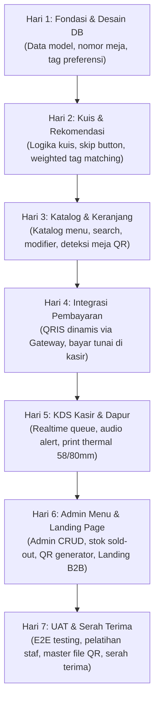

# SMART QR MENU & SISTEM REKOMENDASI PREFERENSI KONSUMEN
## Shared Project Context & Technical Requirement Document (TRD)

> **File:** `docs/TRD.md` (sebelumnya `docs/AGENT.md`)  
> **Status:** Baseline / Phase 1 Complete (Context Setup & Requirements Definition)  
> **Peran:** Product Analyst & Technical Lead  
> **Dokumen Sumber Acuan:** `Proposal Pengembangan Website Smart QR Menu.docx` (dan teks proposal terkait)  
> **Tanggal Rilis Dokumen:** 2026-10-27  

---

## 1. Ringkasan Eksekutif & Pemahaman Konteks Proyek

Proyek **Cravia - Your craving, Perfectly Matched** adalah solusi pemesanan digital (*web-based mobile-first*) terintegrasi untuk kafe/restoran. Sistem ini dirancang untuk memotong hambatan pemesanan konvensional (*table ordering* nir-unduh aplikasi), memberikan pengalaman personalisasi menu melalui kuis preferensi cerdas berbasis pencocokan atribut (tanpa AI/LLM), menyediakan pembayaran digital otomatis melalui QRIS dinamis dan opsi tunai, serta memperlancar operasional dapur dan kasir melalui *Kitchen Display System* (KDS) dan pencetakan struk thermal.

Selain modul operasional kafe, proyek ini mencakup satu halaman *Landing Page Promosi B2B* dengan widget demo kuis interaktif dan *Call to Action* (CTA) WhatsApp untuk menarik calon pemilik kafe/restoran lain.

### Prinsip Utama & Batasan Kritis
1. **Zero-App-Install:** Pelanggan mengakses sistem secara instan via pemindaian kamera standar pada kode QR meja, langsung diarahkan ke URL berbasis nomor meja tanpa instalasi aplikasi native.
2. **Deterministic Recommendation (Non-AI/LLM):** Sistem rekomendasi menggunakan *rule-based weighted tag matching* (rasa, suhu, mood) yang transparan, deterministik, cepat, dan beroperasi tanpa biaya komputasi AI/LLM maupun pelatihan model machine learning.
3. **Single-Tenant Baseline:** Landing page promosi B2B adalah alat pemasaran jasa/solusi, **bukan** representasi bahwa sistem inti harus langsung dibangun sebagai arsitektur multi-tenant SaaS rumit. Baseline v1 difokuskan pada single-tenant operasional 1 kafe klien mitra.
4. **Cakupan Biaya Terbatas pada Jasa Pengembangan:** Nilai investasi proposal merupakan alokasi jasa rekayasa perangkat lunak (*software development*), dan **bukan** bukti bahwa biaya infrastruktur (domain, hosting VPS/cloud), biaya transaksi (*payment gateway MDR* 0,7%), pengadaan unit printer thermal, atau perangkat tablet kasir sudah termasuk.
5. **Timeline 7 Hari sebagai Target Sprint:** Jadwal 7 hari kerja adalah *rapid sprint target* dari sisi pengerjaan kode. Keberhasilan serah terima bergantung pada dependensi pihak ketiga (verifikasi merchant payment gateway, ketersediaan jaringan, dan fisik printer).
6. **Objektivikasi Klaim "Zero-Bug":** Pernyataan "Zero-Bug Guarantee" diterjemahkan secara teknis menjadi *test suite automated unit/integration test*, cakupan skenario *User Acceptance Testing* (UAT), penanganan error terisolasi, dan komitmen masa pemeliharaan bebas biaya untuk cacat kode (*code defects*).

---

## 2. Struktur Workspace & Penjagaan Aset yang Ada

Pemeriksaan direktori proyek saat ini (`d:\project\project-qr`):
- `Proposal Pengembangan Website Smart QR Menu.docx`: Dokumen proposal resmi dalam format Word docx.
- `generate_docx.js`: Skrip generator Node.js yang dipakai untuk menyusun dokumen proposal Word dengan pustaka `docx`.
- `package.json` & `pnpm-lock.yaml`: Mengelola dependensi utilitas generator dokumen (`docx`).
- `node_modules/`: Direktori dependensi yang sudah terpasang.

**Kebijakan Aset:** Seluruh file di atas dipertahankan tanpa modifikasi. Direktori `docs/` ini dibuat sebagai repositori dokumentasi rekayasa teknis dan acuan implementasi.

---

## 3. Ruang Lingkup Sistem & Batasan Modul

### 3.1. Fitur Utama (In-Scope Baseline)
- **Modul 1: Web App QR Menu Pelanggan (Mobile-First)**
  - Deteksi meja otomatis via query parameter / URL QR.
  - Kuis preferensi interaktif (3–4 pertanyaan) + tombol "Lewati Kuis" (Skip).
  - Mesin rekomendasi menu berbasis pencocokan tag preferensi (*flavor, temp, mood*).
  - Katalog menu digital, filter kategori, pencarian cepat, deskripsi, foto produk, dan badge *Best Seller*.
  - Keranjang belanja, catatan pesanan khusus (*less sugar*, *no ice*), dan *custom modifier/add-on*.
  - Halaman pelacak status pesanan (*order tracker*) real-time bagi pelanggan.
- **Modul 2: Sistem Pembayaran Digital & Kasir**
  - Integrasi QRIS dinamis otomatis melalui Payment Gateway (Midtrans/Xendit) dengan generate nominal unik per pesanan.
  - Verifikasi otomatis webhook callback status pembayaran (*settlement confirmation*).
  - Opsi pembayaran "Bayar Tunai di Kasir" dengan alur persetujuan manual oleh kasir.
  - Struk digital (*e-receipt*) untuk diunduh / disimpan di ponsel pelanggan.
- **Modul 3: Web Dashboard Kasir & Dapur (Kitchen Display System / KDS)**
  - Antrean pesanan real-time (tampilan kartu pesanan responsif tablet/laptop tanpa refresh manual).
  - Notifikasi audio alert (lonceng/chime) saat ada pesanan baru masuk.
  - Pembaruan status alur pesanan bertahap: *Diterima* $\rightarrow$ *Sedang Dibuat* $\rightarrow$ *Siap Saji* $\rightarrow$ *Selesai*.
  - Tombol cetak struk thermal standar 58mm & 80mm.
- **Modul 4: Dashboard Admin & Generator QR Meja**
  - Manajemen katalog menu: tambah, edit harga, deskripsi, foto, kategori, dan status stok (*Tersedia / Sold Out*).
  - Manajemen tag preferensi per item menu untuk integrasi kuis.
  - Generator dan unduh file gambar QR Code siap cetak untuk setiap nomor meja kafe.
- **Modul 5: Landing Page Promosi B2B**
  - 1 Halaman web landing page B2B bernuansa profesional untuk penawaran solusi ke kafe lain.
  - Widget simulasi interaktif *live preview demo kuis* rekomendasi.
  - Tombol CTA yang terhubung langsung ke WhatsApp konsultasi/pemesanan.

### 3.2. Fitur Masa Depan / Ekspansi (Explicitly Out-of-Scope Baseline)
Sesuai Bagian 4.2 proposal, hal-hal berikut merupakan contoh perluasan (*scope expansion* masa mendatang dengan addendum terpisah), **bukan** bagian dari baseline v1:
- Integrasi sistem loyalitas pelanggan / poin reward (*loyalty points*).
- Manajemen multi-cabang kafe (*multi-branch management*).
- Chatbot WhatsApp interaktif untuk pemesanan otomatis.
- Arsitektur SaaS multi-tenant dengan *billing subscription self-service* untuk kafe lain.
- Fitur split-bill per meja / pemisahan pembayaran dalam 1 pesanan meja.

---

## 4. Taksonomi Kebutuhan Sistem (System Requirements)

Setiap kebutuhan memiliki identitas unik yang stabil, sumber bagian proposal, modul terkait, ringkasan, dan kriteria penerimaan (*acceptance criteria*) yang dapat diuji secara objektif.

### 4.1. Modul Pelanggan (`REQ-CUST`)

#### `REQ-CUST-01`: Deteksi Nomor Meja Otomatis via QR Code
- **Sumber:** Bagian 1 (Langkah 1), Bagian 2 (Modul 1)
- **Modul:** Modul 1 – Web App QR Menu Pelanggan
- **Ringkasan:** Pelanggan mengakses URL menu melalui pemindaian QR code meja tanpa memasang aplikasi, dan sistem langsung mengenali nomor meja secara otomatis.
- **Kriteria Penerimaan (Acceptance Criteria):**
  1. Diberikan QR code meja dengan payload URL (misal: `https://[domain]/order?table=05`), ketika dipindai dengan kamera ponsel/Google Lens, browser membuka halaman tanpa prompt instalasi aplikasi.
  2. Sistem membaca dan memvalidasi nomor meja dari parameter URL dan menyimpannya di state sesi belanja pelanggan.
  3. Jika parameter nomor meja hilang atau tidak valid dalam database meja aktif, sistem menampilkan peringatan ramah dan mengarahkan ke pemilihan meja atau bantuan staf.
  4. Nomor meja terkunci pada keranjang dan pesanan akhir, sehingga pelanggan tidak perlu memasukkan nomor meja secara manual.

#### `REQ-CUST-02`: Kuis Preferensi Interaktif & Opsi Lewati
- **Sumber:** Bagian 1 (Langkah 2), Bagian 2 (Modul 1)
- **Modul:** Modul 1 – Web App QR Menu Pelanggan
- **Ringkasan:** Menampilkan formulir kuis interaktif 3–4 langkah untuk menangkap preferensi rasa, suhu, dan mood, disertai opsi lewati kuis bagi pelanggan yang ingin langsung melihat katalog.
- **Kriteria Penerimaan (Acceptance Criteria):**
  1. Halaman awal pemesanan menampilkan kuis interaktif yang responsif pada layar ponsel dengan tahapan jelas (misal: Mood $\rightarrow$ Selera Rasa $\rightarrow$ Suhu Penyajian).
  2. Tersedia tombol "Lewati Kuis" (*Skip*) yang terlihat jelas di setiap tahap kuis.
  3. Ketika tombol "Lewati Kuis" ditekan, sistem langsung mengarahkan pelanggan ke tampilan katalog menu lengkap tanpa memblokir akses belanja.
  4. UI kuis mendukung pemilihan satu atau multi-opsi ramah sentuhan (touch-friendly buttons/cards) tanpa input teks bebas yang membingungkan.

#### `REQ-CUST-03`: Mesin Rekomendasi Menu Berbasis Pencocokan Tag Cerdas
- **Sumber:** Bagian 1 (Langkah 3), Bagian 2 (Modul 1)
- **Modul:** Modul 1 – Web App QR Menu Pelanggan
- **Ringkasan:** Algoritma deterministik mencocokkan input kuis dengan atribut/tag menu dan menampilkan daftar rekomendasi terbaik beserta alasan daya tariknya tanpa komputasi AI/LLM.
- **Kriteria Penerimaan (Acceptance Criteria):**
  1. Sistem menghitung skor relevansi item menu berdasarkan irisan tag input kuis dengan tag menu (contoh tag: `mood:santai`, `rasa:manis`, `suhu:dingin`).
  2. Rekomendasi menampilkan 1 hingga 3 item menu dengan skor tertinggi yang stoknya berstatus *Tersedia*. Item *Sold Out* tidak boleh dijadikan rekomendasi utama.
  3. Setiap item rekomendasi menampilkan label alasan daya tarik yang terdefinisi (misal: *"Cocok untuk mood santai dengan sentuhan rasa manis & segar dingin"*).
  4. Eksekusi kalkulasi rekomendasi berlangsung instan (< 100 ms) di sisi klien atau server tanpa ketergantungan API pihak ketiga eksternal.

#### `REQ-CUST-04`: Katalog Menu Digital, Filter Kategori, & Pencarian
- **Sumber:** Bagian 2 (Modul 1)
- **Modul:** Modul 1 – Web App QR Menu Pelanggan
- **Ringkasan:** Menyajikan seluruh menu dalam pengelompokan kategori yang teratur, fitur pencarian cepat, detail harga, deskripsi, foto resolusi tinggi, dan penanda *Best Seller*.
- **Kriteria Penerimaan (Acceptance Criteria):**
  1. Menu dikelompokkan berdasarkan kategori (misal: Kopi, Non-Kopi, Makanan Utama, Camilan).
  2. Fitur pencarian instan menyaring menu berdasarkan nama atau deskripsi secara real-time tanpa reload halaman.
  3. Setiap kartu menu menampilkan nama, foto produk, harga dalam format mata uang IDR (`Rp xx.xxx`), deskripsi singkat, dan badge visual "Best Seller" jika item tersebut ditandai best seller oleh admin.
  4. Menu yang ditandai *Sold Out* menampilkan status disabled/abu-abu dan tombol tambah tidak dapat ditekan.

#### `REQ-CUST-05`: Keranjang Belanja, Catatan Kustom, & Custom Modifier
- **Sumber:** Bagian 1 (Langkah 4), Bagian 2 (Modul 1)
- **Modul:** Modul 1 – Web App QR Menu Pelanggan
- **Ringkasan:** Mengelola item belanja dengan penyesuaian tingkat gula, es, topping ekstra, catatan khusus, dan kalkulasi subtotal yang akurat.
- **Kriteria Penerimaan (Acceptance Criteria):**
  1. Pelanggan dapat membuka modal penyesuaian (*modifier*) saat memilih item (opsi level gula, level es, pilihan susu/topping jika berlaku).
  2. Pelanggan dapat memasukkan catatan teks bebas (maks. 100 karakter, misal: *"Less sugar", "Pisahkan sambal"*).
  3. Subtotal harga item bertambah otomatis sesuai harga dasar ditambah biaya modifier berbayar (jika ada).
  4. Pelanggan dapat menambah, mengurangi kuantitas, atau menghapus item dari keranjang dengan total ringkasan yang selalu terhitung tepat tanpa kesalahan pembulatan.

#### `REQ-CUST-06`: Pelacak Status Pesanan Real-Time Pelanggan
- **Sumber:** Bagian 1 (Langkah 6), Bagian 2 (Modul 1)
- **Modul:** Modul 1 – Web App QR Menu Pelanggan
- **Ringkasan:** Halaman web pelacak status pesanan yang menampilkan progres pesanan pelanggan secara langsung tanpa perlu menyegarkan halaman.
- **Kriteria Penerimaan (Acceptance Criteria):**
  1. Setelah checkout berhasil (atau verifikasi bayar diterima), pelanggan diarahkan ke halaman pelacak pesanan yang memuat nomor pesanan, nomor meja, ringkasan item, dan status berjalan.
  2. Indikator status menampilkan tahapan berurutan: *Menunggu Konfirmasi / Pembayaran* $\rightarrow$ *Diterima* $\rightarrow$ *Sedang Dibuat* $\rightarrow$ *Siap Saji* $\rightarrow$ *Selesai*.
  3. Perubahan status yang dilakukan oleh staf kasir/dapur ter-update secara otomatis di layar ponsel pelanggan (via WebSocket / SSE / Polling berkala interval 3-5 detik).
  4. Jika tab peramban ditutup atau dimuat ulang, sesi pesanan aktif tetap dapat dibuka kembali selama sesi/token lokal masih valid.

#### `REQ-CUST-07`: Struk Digital Pelanggan (E-Receipt)
- **Sumber:** Bagian 2 (Modul 2)
- **Modul:** Modul 2 – Integrasi Pembayaran Digital & Kasir
- **Ringkasan:** Tampilan bukti transaksi digital yang rapi, informatif, dan dapat disimpan atau diunduh oleh pelanggan.
- **Kriteria Penerimaan (Acceptance Criteria):**
  1. Struk digital memuat: Nama Kafe, Tanggal & Jam Transaksi, Nomor Pesanan, Nomor Meja, Rincian Item (nama, varian, harga, qty), Subtotal, Pajak/Service (bila ada), Total Pembayaran, dan Metode Pembayaran (QRIS / Tunai).
  2. Terdapat tombol untuk "Simpan Struk" (unduh gambar/PDF atau tampilan ramah tangkapan layar/screenshot).
  3. Menampilkan status pembayaran yang sah (*LUNAS / Menunggu Pembayaran di Kasir*).

---

### 4.2. Modul Pembayaran (`REQ-PAY`)

#### `REQ-PAY-01`: Integrasi Pembayaran QRIS Dinamis Otomatis
- **Sumber:** Bagian 1 (Langkah 5), Bagian 2 (Modul 2), Bagian 5 (Tabel Biaya No. 2)
- **Modul:** Modul 2 – Integrasi Sistem Pembayaran Digital & Kasir
- **Ringkasan:** Integrasi dengan payment gateway resmi (Midtrans/Xendit) untuk menghasilkan kode QRIS dinamis spesifik sesuai nominal belanja pesanan.
- **Kriteria Penerimaan (Acceptance Criteria):**
  1. Saat pelanggan memilih "Bayar via QRIS", sistem memanggil API payment gateway untuk membuat transaksi dengan tagihan nominal persis sama dengan total belanja.
  2. Sistem menampilkan gambar QR code QRIS dinamis di layar pelanggan disertai nominal rupiah dan penghitung waktu mundur kedaluwarsa (*timer expiry*, misal 15 menit).
  3. Kode QRIS dapat dipindai oleh seluruh aplikasi pembayaran standar nasional (GoPay, OVO, ShopeePay, DANA, BCA Mobile, Livin, dll.).

#### `REQ-PAY-02`: Verifikasi Pembayaran Otomatis & Callback Webhook
- **Sumber:** Bagian 2 (Modul 2), Bagian 4.1 (Garansi Akurasi Pembayaran)
- **Modul:** Modul 2 – Integrasi Sistem Pembayaran Digital & Kasir
- **Ringkasan:** Sistem menerima notifikasi webhook dari gateway dan memverifikasi pelunasan secara instan tanpa pengecekan manual mutasi bank.
- **Kriteria Penerimaan (Acceptance Criteria):**
  1. Endpoint webhook publik yang aman menerima HTTP POST callback dari payment gateway.
  2. Sistem memvalidasi signature key / token otentikasi webhook untuk mencegah callback palsu.
  3. Ketika notifikasi berstatus `settlement` atau `capture` sukses, status pesanan otomatis berubah dari `PENDING_PAYMENT` menjadi `PAID` dan diteruskan ke antrean KDS kasir/dapur secara seketika.
  4. Mekanisme idempoten: Webhook ganda/retry untuk transaksi yang sama tidak menduplikasi pencatatan pesanan atau status.

#### `REQ-PAY-03`: Opsi Pembayaran Tunai di Kasir
- **Sumber:** Bagian 1 (Langkah 5), Bagian 2 (Modul 2)
- **Modul:** Modul 2 – Integrasi Sistem Pembayaran Digital & Kasir
- **Ringkasan:** Memberikan fleksibilitas bagi pelanggan untuk memesan langsung dari meja namun melunasi secara tunai di kasir.
- **Kriteria Penerimaan (Acceptance Criteria):**
  1. Pada halaman checkout tersedia pilihan radio button "Bayar Tunai di Kasir".
  2. Jika dipilih, pesanan dibuat dengan status awal `WAITING_CASHIER_PAYMENT`.
  3. Pesanan muncul di dashboard kasir dengan tanda visual khusus (menunggu pelunasan tunai).
  4. Kasir memiliki tombol tindakan "Konfirmasi Pembayaran Tunai"; setelah ditekan oleh kasir, status berubah menjadi `PAID / DITERIMA` dan pesanan masuk ke antrean aktif dapur.

---

### 4.3. Modul Operasional Kasir & Dapur (`REQ-OPS`)

#### `REQ-OPS-01`: Layar Antrean Pesanan Real-Time (KDS & Kasir)
- **Sumber:** Bagian 2 (Modul 3), Bagian 5 (Tabel Biaya No. 3)
- **Modul:** Modul 3 – Web Dashboard Kasir & Dapur (KDS)
- **Ringkasan:** Tampilan layar antrean pesanan baru dan aktif yang tersinkronisasi seketika di tablet atau laptop kasir/dapur tanpa refresh peramban.
- **Kriteria Penerimaan (Acceptance Criteria):**
  1. Setiap pesanan baru yang berstatus sah (`PAID` atau tunai yang dikonfirmasi) muncul sebagai kartu pesanan baru di layar kasir dan dapur dalam waktu $\le 2$ detik.
  2. Kartu pesanan menampilkan: Nomor Meja (tercetak besar), Nomor Pesanan, Waktu Pesan, Rincian Item berserta modifier dan catatan khusus pelanggan yang disorot jelas.
  3. Tersedia filter status (Semua, Menunggu, Sedang Dibuat, Siap Saji, Selesai).
  4. Tampilan antarmuka responsif dan nyaman dibaca pada layar tablet (orientasi landscape) maupun laptop/PC kasir.

#### `REQ-OPS-02`: Notifikasi Suara (Audio Alert) Pesanan Masuk
- **Sumber:** Bagian 2 (Modul 3), Bagian 5 (Tabel Biaya No. 3)
- **Modul:** Modul 3 – Web Dashboard Kasir & Dapur (KDS)
- **Ringkasan:** Bunyi lonceng/chime otomatis terdengar di perangkat kasir/dapur saat pesanan baru masuk agar staf tidak terlewat.
- **Kriteria Penerimaan (Acceptance Criteria):**
  1. Saat kartu pesanan baru masuk ke antrean, browser memutar berkas audio lonceng/chime secara otomatis.
  2. Disediakan tombol interaksi awal (*Unlock Audio / Start Shift*) saat staf membuka dashboard untuk memenuhi kebijakan *Autoplay Policy* browser modern.
  3. Terdapat tombol kontrol di dashboard untuk menyalakan/mematikan suara (*mute/unmute*) dan mengatur volume suara chime.

#### `REQ-OPS-03`: Manajemen Status Alur Pesanan Multi-Tahap
- **Sumber:** Bagian 2 (Modul 3)
- **Modul:** Modul 3 – Web Dashboard Kasir & Dapur (KDS)
- **Ringkasan:** Staf memperbarui progres pemrosesan pesanan dengan satu klik tombol sesuai alur kerja dapur.
- **Kriteria Penerimaan (Acceptance Criteria):**
  1. Staf dapat memajukan status pesanan secara berurutan: `Diterima` $\rightarrow$ `Sedang Dibuat` $\rightarrow$ `Siap Saji` $\rightarrow$ `Selesai`.
  2. Setiap perubahan status merefleksikan perubahan warna/kolom kartu pesanan pada dashboard staf.
  3. Perubahan status langsung tersinkronisasi ke layar pelacak pesanan pelanggan (`REQ-CUST-06`).
  4. Tersedia riwayat waktu perubahan status (*timestamp log*) untuk audit operasional.

#### `REQ-OPS-04`: Dukungan Cetak Struk Thermal 58mm & 80mm
- **Sumber:** Bagian 2 (Modul 3), Bagian 4.1 (Garansi Cetak Struk Thermal)
- **Modul:** Modul 3 – Web Dashboard Kasir & Dapur (KDS)
- **Ringkasan:** Tombol cetak langsung ke printer struk thermal kasir dan tiket pesanan dapur yang kompatibel dengan lebar kertas 58mm dan 80mm.
- **Kriteria Penerimaan (Acceptance Criteria):**
  1. Pada setiap kartu pesanan dan ringkasan transaksi kasir terdapat tombol "Cetak Struk" dan "Cetak Tiket Dapur".
  2. Saat tombol cetak ditekan, sistem memicu dialog cetak peramban (*browser print dialog*) atau perintah ESC/POS dengan styling layout CSS khusus cetak (`@media print`).
  3. Layout cetak secara otomatis menyesuaikan lebar kertas thermal kasir (58 mm lebar $\approx 384$ px, atau 80 mm lebar $\approx 576$ px) dengan font monospaced yang terbaca jelas, tidak terpotong tepi margin, dan memuat garis pemisah rapi.
  4. Tiket dapur menonjolkan Nomor Meja, Waktu, Item, Kuantitas, dan Catatan Kustom, sementara struk kasir memuat rincian nominal pembayaran penuh.

---

### 4.4. Modul Admin & Konfigurasi (`REQ-ADMIN`)

#### `REQ-ADMIN-01`: Manajemen Menu, Kategori, Harga, & Foto
- **Sumber:** Bagian 2 (Modul 4), Bagian 4.3 (Hak Akses Penuh Super Admin)
- **Modul:** Modul 4 – Dashboard Admin & Generator QR Meja
- **Ringkasan:** Panel pengelolaan data menu lengkap untuk menambah, memperbarui harga, mengunggah foto, dan mengatur kategori menu secara mandiri.
- **Kriteria Penerimaan (Acceptance Criteria):**
  1. Admin dapat membuat item menu baru dengan formulir: Nama Item, Kategori, Harga Dasar, Deskripsi, Unggah Gambar, dan Status Best Seller.
  2. Admin dapat mengedit data item menu yang sudah ada, dan perubahan langsung tercermin pada katalog pelanggan setelah disimpan.
  3. Admin dapat menghapus atau menonaktifkan item menu.
  4. Sistem memvalidasi input harga agar bernilai numerik positif dan berkas foto memiliki format gambar valid (JPG, PNG, WebP) dengan batasan ukuran wajar (maks. 2 MB).

#### `REQ-ADMIN-02`: Pengelolaan Stok Menu (Tersedia / Sold Out)
- **Sumber:** Bagian 2 (Modul 4)
- **Modul:** Modul 4 – Dashboard Admin & Generator QR Meja
- **Ringkasan:** Fitur toggle cepat untuk menandai menu habis (Sold Out) atau tersedia kembali secara instan.
- **Kriteria Penerimaan (Acceptance Criteria):**
  1. Pada tabel/daftar menu admin terdapat tombol *toggle switch* instan untuk mengubah status stok item: `TERSEDIA` $\leftrightarrow$ `SOLD OUT`.
  2. Perubahan status stok langsung memperbarui tampilan katalog pelanggan: item yang berstatus *Sold Out* seketika terkunci dari penambahan keranjang.
  3. Item *Sold Out* tidak disertakan dalam rekomendasi utama kuis cerdas.

#### `REQ-ADMIN-03`: Pengaturan Atribut Tag Preferensi Menu
- **Sumber:** Bagian 2 (Modul 4)
- **Modul:** Modul 4 – Dashboard Admin & Generator QR Meja
- **Ringkasan:** Antarmuka mudah bagi admin untuk menyematkan tag rasa, suhu, dan mood pada setiap item menu agar terhubung dengan kuis preferensi konsumen.
- **Kriteria Penerimaan (Acceptance Criteria):**
  1. Pada formulir menu admin tersedia selector tag preferensi terstruktur:
     - Rasa: `Manis`, `Gurih`, `Segar`, `Pahit`, `Pedas`, `Asam`.
     - Suhu: `Panas`, `Dingin`, `Netral`.
     - Mood: `Santai`, `Fokus/Kerja`, `Semangat/Energi`, `Refreshing`.
  2. Admin dapat memilih satu atau beberapa tag yang relevan untuk setiap item menu.
  3. Tag tersimpan dalam database relasional/JSON atribut item menu dan langsung digunakan oleh logika pencocokan kuis rekomendasi (`REQ-CUST-03`).

#### `REQ-ADMIN-04`: Generator & Unduh QR Code Meja Siap Cetak
- **Sumber:** Bagian 2 (Modul 4), Bagian 4.3 (Penyerahan File Master QR Meja)
- **Modul:** Modul 4 – Dashboard Admin & Generator QR Meja
- **Ringkasan:** Fitur otomatis untuk membuat kode QR meja terenkripsi/berparameter dan mengunduh gambar QR siap cetak beresolusi tinggi untuk seluruh meja kafe.
- **Kriteria Penerimaan (Acceptance Criteria):**
  1. Admin dapat menentukan daftar nomor/label meja (misal: Meja 01 s/d Meja 20).
  2. Sistem men-generate QR code untuk masing-masing meja yang mengarah ke URL pemesanan valid dengan parameter nomor meja terkait.
  3. Admin dapat mengunduh QR code meja secara individual (format PNG) atau mengunduh seluruh meja sekaligus dalam format arsip ZIP / sheet PDF siap cetak.
  4. Gambar QR code beresolusi tinggi (minimal $600 \times 600$ px) dengan teks label nomor meja di bagian bawah agar tidak tertukar saat dicetak fisik.

---

### 4.5. Modul Pemasaran B2B (`REQ-B2B`)

#### `REQ-B2B-01`: Landing Page Promosi B2B
- **Sumber:** Bagian 2 (Modul 5), Bagian 5 (Tabel Biaya No. 4)
- **Modul:** Modul 5 – Website Landing Page Promosi B2B
- **Ringkasan:** Halaman web elegan untuk mempromosikan keunggulan sistem digitalisasi pemesanan dan rekomendasi menu ini kepada pemilik kafe/restoran lain.
- **Kriteria Penerimaan (Acceptance Criteria):**
  1. Landing page memiliki struktur copywriting persuasif: Hero Section (headline penawaran nilai), Keunggulan Sistem (efisiensi staf, kenaikan basket size, kemudahan QRIS), Tangkapan Layar Fitur, dan FAQ.
  2. Desain web modern, responsif sempurna di perangkat mobile maupun desktop, dan cepat dimuat.
  3. Tidak memuat informasi rahasia kafe klien mitra (misal: data transaksi internal atau data sensitif).

#### `REQ-B2B-02`: Widget Interaktif Live Demo Kuis Rekomendasi
- **Sumber:** Bagian 2 (Modul 5), Bagian 5 (Tabel Biaya No. 4)
- **Modul:** Modul 5 – Website Landing Page Promosi B2B
- **Ringkasan:** Simulasi kuis rekomendasi langsung di landing page agar calon klien kafe lain dapat mencoba pengalaman kuis cerdas.
- **Kriteria Penerimaan (Acceptance Criteria):**
  1. Di dalam landing page terdapat komponen widget interaktif demo kuis preferensi (menggunakan data menu contoh/mock).
  2. Pengunjung landing page dapat mengklik opsi preferensi dan langsung melihat hasil rekomendasi sampel secara dinamis.
  3. Widget terisolasi dan tidak mengeksekusi pembuatan pesanan nyata ke database operasional kafe.

#### `REQ-B2B-03`: Call to Action (CTA) WhatsApp Terintegrasi
- **Sumber:** Bagian 2 (Modul 5)
- **Modul:** Modul 5 – Website Landing Page Promosi B2B
- **Ringkasan:** Tombol interaktif yang mengarahkan prospek klien langsung ke chat WhatsApp pengembang/sales dengan teks template otomatis.
- **Kriteria Penerimaan (Acceptance Criteria):**
  1. Tombol CTA WhatsApp ditempatkan strategis (di navbar, setelah hero section, setelah widget demo kuis, dan di footer).
  2. Ketika tombol diklik, peramban membuka URL `https://wa.me/[Nomor_WA]?text=[Encoded_Message]`.
  3. Teks pesan bawaan sudah terisi ramah (contoh: *"Halo, saya tertarik dengan demo Smart QR Menu dan ingin konsultasi penerapan untuk kafe saya."*).

---

## 5. Klasifikasi Informasi: Fakta Proposal vs Rekomendasi Teknis vs Asumsi Sementara

Untuk menjaga integritas kesepakatan dan kejernihan rekayasa sistem, informasi diklasifikasikan secara ketat ke dalam empat kategori:

| Kategori | Definisi & Karakteristik | Contoh dalam Proyek Ini |
|---|---|---|
| **Fakta Proposal** | Hal-hal yang secara eksplisit tertulis dan mengikat dalam dokumen proposal sumber. Tidak boleh diubah sepihak. | Alur 6 langkah customer journey; 5 pilar modul; 4 status KDS (*Diterima $\rightarrow$ Dibuat $\rightarrow$ Siap $\rightarrow$ Selesai*); tombol skip kuis; cetak thermal 58/80mm; audio alert; skema pembayaran DP 50% & pelunasan 50%. |
| **Rekomendasi Teknis** | Usulan standar arsitektur, pola rekayasa, dan praktik terbaik software engineering yang diajukan oleh Technical Lead untuk memenuhi proposal secara optimal. | Penggunaan Next.js/React Fullstack; SQLite/PostgreSQL dengan Prisma ORM; Web Audio API dengan interaksi unlock untuk chime; `@media print` CSS engine untuk printer thermal; WebSocket / SSE untuk realtime KDS. |
| **Asumsi Sementara** | Asumsi kerja yang diadopsi agar tahap perancangan konteks dan dokumen persyaratan ini dapat selesai tanpa terhambat hal-hal mikro non-blocking. | Format nomor meja berupa string numerik 2 digit (01-30); mata uang IDR tanpa desimal; toleransi kedaluwarsa QRIS 15 menit; audio alert memakai file chime format MP3/WAV ringan berdurasi 1-2 detik. |
| **Keputusan Belum Dikonfirmasi** | Keputusan lintas dokumen / arsitektural yang membutuhkan kesepakatan spesifik bersama stakeholder klien atau verifikasi eksternal. Diberi ID formal `DEC-xxx`. | Pemilihan final Midtrans vs Xendit (`DEC-002`); Single-tenant vs Multi-tenant (`DEC-001`); Mekanisme otentikasi staf dapur/kasir (`DEC-005`); Kebijakan pajak/service charge (`DEC-006`). |

---

## 6. Register Keputusan Arsitektur & Produk (Decision Register)

Berikut adalah daftar keputusan arsitektur dan produk yang teridentifikasi beserta status, rekomendasi, dan dampaknya:

### `DEC-001`: Arsitektur Tenant Sistem (Single-Tenant Kafe vs Multi-Tenant B2B SaaS)
- **Status:** **DIKONFIRMASI (CONFIRMED)** – *Disepakati via interview grill-me (2026-10-27)*
- **Keputusan:** **Fokus Single-Tenant** eksklusif untuk 1 kafe klien mitra. Halaman Landing Page B2B berfungsi sebagai portofolio/etalase promosi jasa pengembangan kepada calon kafe lain (dengan live preview mock demo kuis dan tombol CTA WhatsApp), **bukan** sebagai platform registrasi atau billing self-service SaaS multi-tenant.
- **Dampak Implementasi:** Skema database fokus penuh pada entitas `Menu`, `Category`, `Modifier`, `Order`, dan `Table` tanpa kompleksitas partisi multi-tenant, menjamin kepatuhan terhadap timeline sprint 7 hari.

### `DEC-002`: Pemilihan Provider Payment Gateway (Midtrans vs Xendit)
- **Status:** **DIKONFIRMASI (CONFIRMED)** – *Disepakati via interview grill-me (2026-10-27)*
- **Keputusan:** **Midtrans dengan Arsitektur Payment Adapter Terisolasi.**
  - Pengujian pengembangan dan UAT pada Hari 4 & 7 menggunakan **Midtrans Sandbox** (QRIS Simulator).
  - Alur pergantian ke Midtrans Production cukup dilakukan melalui environment variables (`MIDTRANS_SERVER_KEY`, `MIDTRANS_CLIENT_KEY`, `MIDTRANS_IS_PRODUCTION=true`) begitu verifikasi KYC merchant kafe selesai disetujui.
  - Endpoint webhook listener menangani status `settlement`, `pending`, `expire`, dan `cancel` secara idempoten dengan verifikasi `signature_key`.
- **Dampak Implementasi:** Proses development dan UAT tidak terblokir oleh proses verifikasi administrasi perbankan/QRIS eksternal.

### `DEC-003`: Stack Teknologi Aplikasi, Database, & Sinkronisasi Real-Time
- **Status:** **DIKONFIRMASI (CONFIRMED)** – *Disepakati via interview grill-me (2026-10-27)*
- **Keputusan:** **Next.js Fullstack (App Router, TypeScript) + Supabase (PostgreSQL & Supabase Realtime).**
  - **Frontend & API:** Next.js (TypeScript, Tailwind CSS) dalam satu monorepo efisien yang mengelola seluruh modul: Web App Pelanggan, KDS Dapur/Kasir, Admin Panel, dan Landing Page Pemasaran B2B.
  - **Database & Storage:** Supabase PostgreSQL untuk data relasional menu, kategori, modifier, pesanan, dan tabel meja. Supabase Storage untuk penyimpanan foto produk menu.
  - **Sinkronisasi Real-Time:** Supabase Realtime (*Postgres Changes / Channels*) out-of-the-box untuk mendistribusikan pesanan baru ke KDS kasir/dapur dan mengalirkan status pesanan terkini ke layar pelacak pelanggan tanpa beban infrastruktur server socket terpisah.
- **Dampak Implementasi:** Mempercepat siklus pengembangan secara drastis, menjamin keandalan real-time KDS, dan mempermudah deployment ke platform modern (seperti Vercel).

### `DEC-004`: Mekanisme Pencetakan Struk Thermal (Browser Print CSS vs Direct Serial/Bluetooth)
- **Status:** **DIKONFIRMASI (CONFIRMED)** – *Disepakati via interview grill-me (2026-10-27)*
- **Keputusan:** **Universal Browser Print (`@media print` CSS).**
  - Menggunakan engine cetak peramban standar dengan stylesheet khusus `@media print` yang secara presisi mengatur lebar kertas 58 mm ($\approx 384$ px) dan 80 mm ($\approx 576$ px), margin nol, dan tipografi monospaced.
  - Kompatibel secara universal di semua sistem operasi dan browser (Android Chrome, iOS Safari, Windows, macOS) yang terhubung ke printer thermal via driver USB maupun Bluetooth pairing tanpa memerlukan ekstensi atau instalasi driver biner proprietary.
  - Template terbagi dua:
    1. **Tiket Pesanan Dapur:** Menekankan nomor meja tebal/besar, nomor antrean, timestamp, rincian menu, catatan kustom (*less sugar, dsb.*), tanpa informasi harga.
    2. **Struk Pelanggan Kasir:** Memuat kop kafe, nomor meja, rincian item, subtotal, status pembayaran, dan footer ucapan terima kasih.
- **Dampak Implementasi:** Menghilangkan risiko kegagalan koneksi serial/Bluetooth mentah pada variasi merk printer thermal lokal dan memastikan pemenuhan garansi cetak thermal.

### `DEC-005`: Skema Autentikasi & Hak Akses Staf (Kasir, Dapur, Admin)
- **Status:** **DIKONFIRMASI (CONFIRMED)** – *Disepakati via interview grill-me (2026-10-27)*
- **Keputusan:** **Role-Based Auth (Admin Kredensial, Kasir/KDS PIN Cepat / Stasiun).**
  - **Admin Panel:** Dilindungi autentikasi ketat (Username/Email + Password) dengan sesi terenkripsi (Secure HTTP-only Cookie / JWT). Admin memiliki hak penuh untuk manajemen menu, harga, stok, konfigurasi sistem, dan download QR meja.
  - **Kasir & KDS Dapur:** Dirancang khusus untuk kecepatan fisik operasional kafe. Staf kasir dan barista dapur dapat login cepat menggunakan PIN 4-digit atau link stasiun kerja terproteksi token. Tidak mengharuskan input password panjang saat pergantian staf/shift.
- **Dampak Implementasi:** Menjamin keamanan data administratif dan laporan keuangan kafe tanpa mengorbankan kecepatan pemrosesan pesanan di dapur.

### `DEC-006`: Kebijakan Pajak Restoran (PB1) & Biaya Layanan (Service Charge)
- **Status:** **DIKONFIRMASI (CONFIRMED)** – *Disepakati via interview grill-me (2026-10-27)*
- **Keputusan:** **Harga Menu Bersifat Nett (All-Inclusive) Secara Default.**
  - Nominal harga yang tampil pada katalog adalah harga final yang dibayar pelanggan saat checkout tanpa lonjakan biaya tersembunyi.
  - Panel Admin tetap dilengkapi dengan switch konfigurasi dinamis (Pajak PB1 % dan Service Charge %) yang dapat diaktifkan kapan saja oleh pemilik kafe (dengan mode perhitungan inklusif atau eksklusif).
- **Dampak Implementasi:** Pengalaman checkout pelanggan transparan dan mulus (*frictionless*), sementara arsitektur kode billing tetap siap mendukung kafe dengan kebijakan pajak terpisah.

### `DEC-007`: Kebijakan Pembatalan, Kedaluwarsa Pesanan, & Refund
- **Status:** **DIKONFIRMASI (CONFIRMED)** – *Disepakati via interview grill-me (2026-10-27)*
- **Keputusan:** **Aturan Kedaluwarsa 15 Menit & Refund Manual Kasir.**
  - **Batas Waktu QRIS:** Sesi QRIS dinamis memiliki masa aktif 15 menit. Jika tidak ada callback pelunasan dalam 15 menit, pesanan otomatis berstatus `EXPIRED / BATAL` dan tidak diteruskan ke antrean aktif dapur.
  - **Otoritas Pembatalan:** Pelanggan tidak dapat membatalkan pesanan sepihak setelah terkirim. Pesanan hanya dapat dibatalkan melalui tindakan staf Kasir dengan batas toleransi sebelum pesanan berstatus `Sedang Dibuat` di dapur.
  - **Penanganan Refund:** Untuk pesanan QRIS yang sudah lunas tetapi harus dibatalkan (misal bahan baku mendadak habis), pengembalian dana diselesaikan langsung oleh kasir secara manual/tunai/transfer langsung kepada pelanggan di tempat. Tidak mengintegrasikan alur kompleks Automated Gateway Refund pada rilis v1.
- **Dampak Implementasi:** Menghindari penumpukan pesanan menggantung (*hanging orders*), melindungi dapur dari pemborosan bahan baku, dan menyederhanakan alur keuangan.

### `DEC-008`: Alokasi Beban Biaya Infrastruktur, Domain, & Biaya Transaksi
- **Status:** **DIKONFIRMASI (CONFIRMED)** – *Disepakati via interview grill-me (2026-10-27)*
- **Keputusan:** **Hosting & Domain Termasuk untuk 1 Tahun Pertama.**
  - **Ditanggung Tim Pengembang (Termasuk dalam Kontrak Tahun Pertama):** Biaya sewa nama domain kustom (.com / .id) dan biaya hosting aplikasi / database cloud (misal Vercel / Supabase tier proyek) selama 1 tahun pertama.
  - **Ditanggung Pihak Kafe (Di Luar Kontrak Pengembangan):**
    1. Potongan biaya transaksi (*Merchant Discount Rate* / MDR) QRIS sebesar 0,7% per transaksi yang dipotong otomatis oleh payment gateway.
    2. Pengadaan fisik perangkat keras: unit tablet/laptop kasir dan dapur, dudukan akrilik QR code meja, dan unit printer thermal kasir/dapur beserta kertas struknya.
- **Dampak Implementasi:** Menghilangkan kebingungan komersial antara pengembang dan klien, serta memberikan batas tanggung jawab operasional yang transparan.

### `DEC-009`: Skema Parameter & Engine Kuis Rekomendasi
- **Status:** **DIKONFIRMASI (CONFIRMED)** – *Disepakati via interview grill-me (2026-10-27)*
- **Keputusan:** **Engine Kuis Dinamis Terkonfigurasi dari Admin.**
  - **Dinamis & Fleksibel:** Pertanyaan kuis, opsi jawaban, dan pemetaan tag tidak di-hardcode di kode frontend, melainkan disimpan dalam database (Supabase) dan dapat dikonfigurasi secara mandiri oleh Admin kafe.
  - **Struktur Default (Bawaan Awal):** Disediakan set bawaan 4 pertanyaan:
    1. *Mood:* Santai, Fokus/Kerja, Refreshing, Ngobrol Seru.
    2. *Kategori:* Minuman Kopi, Minuman Segar/Non-Kopi, Makanan Berat, Camilan/Snack.
    3. *Rasa Utama:* Manis, Gurih, Pahit, Segar/Asam.
    4. *Suhu Penyajian:* Dingin, Panas, Netral.
  - **Opsi Lewati (Skip):** Di setiap langkah kuis selalu tersedia tombol "Lewati Kuis" agar pelanggan dapat langsung menuju katalog lengkap kapan saja.
  - **Algoritma Rekomendasi:** *Weighted Tag Matching* deterministik. Sistem menjumlahkan kecocokan tag jawaban kuis dengan tag yang melekat pada item menu aktif (non-sold out). Item dengan skor tertinggi disajikan sebagai rekomendasi unggulan dengan tie-breaker berbasis badge *Best Seller*. Tanpa ketergantungan model AI/LLM.
- **Dampak Implementasi:** Fleksibilitas tinggi bagi pemilik kafe untuk menyesuaikan tema kuis musiman atau menu baru tanpa perlu mengubah kode program.

### `DEC-010`: Arsitektur Aplikasi & Runtime Produksi
- **Status:** **DIKONFIRMASI (CONFIRMED)** – *Disepakati pada Dokumen Tech Stack (2026-10-27)*
- **Keputusan:** **Fullstack Monolitik Modular Next.js 15 (App Router, TypeScript) + PostgreSQL (Prisma ORM)**.
  - Memilih arsitektur monolitik modular dalam satu repositori untuk meminimalkan beban pemeliharaan pengembang tunggal dan memastikan kecepatan eksekusi sprint 7 hari.
  - Mengeliminasi setup microservices, message broker, dan dual-deployment terpisah.

### `DEC-011`: Penyedia Payment Gateway Utama
- **Status:** **DIKONFIRMASI (CONFIRMED)** – *Disepakati pada Dokumen Tech Stack (2026-10-27)*
- **Keputusan:** **Midtrans Core API (Charge QRIS)**.
  - Dipilih karena kemudahan pendaftaran merchant perorangan (*individual/sole proprietor*) tanpa syarat badan hukum PT/CV, ketersediaan simulator QRIS interaktif publik di Sandbox untuk pengujian Hari ke-4, dan respon API yang langsung menyertakan URL gambar QR.
  - Fase pengembangan Hari 1–6 menggunakan Sandbox. Akun produksi kafe diaktifkan setelah penyerahan KTP dan rekening kafe.

### `DEC-012`: Strategi Real-time & Kompatibilitas Cetak Thermal
- **Status:** **DIKONFIRMASI (CONFIRMED)** – *Disepakati pada Dokumen Tech Stack (2026-10-27)*
- **Keputusan:** **Server-Sent Events (SSE) / Supabase Realtime + CSS `@media print` 58/80 mm Universal**.
  - Real-time KDS dapur menggunakan pendekatan lightweight SSE / PostgreSQL change capture yang hemat kuota dan tidak membutuhkan server WebSocket daemon mandiri.
  - Baseline cetak thermal menggunakan layout CSS `@media print` melalui dialog print sistem operasi yang dijamin bekerja di semua sistem (Android, iOS, Windows, macOS). Web Bluetooth ESC/POS disediakan sebagai peningkatan opsional (*progressive enhancement*) khusus Chrome Android, tanpa menjanjikan *silent print* otomatis pada seluruh perangkat keras fisik.

### `DEC-013`: Kitchen Gate Policy untuk Pesanan
- **Status:** **DIKONFIRMASI (CONFIRMED)** – *Disepakati via konfirmasi pengguna (2026-10-27)*
- **Keputusan:** **Setelah order, pelanggan langsung bayar**. Dapur HANYA memproses pesanan setelah pembayaran lunas (`PAID`). Tidak ada makanan yang dibuat sebelum ada konfirmasi uang masuk.

### `DEC-014`: Pemisahan Token Rahasia Pesanan dari QR Meja Publik
- **Status:** **DIKONFIRMASI (CONFIRMED)** – *Dokumen Arsitektur (2026-10-27)*
- **Keputusan:** Menggunakan `orderSecretToken` kriptografis acak yang disimpan di penyimpanan lokal peramban pelanggan pemesan untuk akses pelacak pesanan. Karena QR meja fisik bersifat publik, pelanggan baru yang memindai meja yang sama setelahnya tidak akan bisa mengakses riwayat atau tagihan pelanggan sebelumnya.

### `DEC-015`: Batas Waktu Kedaluwarsa & Nir-Bukti Bayar Manual
- **Status:** **DIKONFIRMASI (CONFIRMED)** – *Disepakati via konfirmasi pengguna (2026-10-27)*
- **Keputusan:** **Kedaluwarsa mutlak 15 menit dari Payment Gateway**. Tanpa bukti bayar transfer manual; uang langsung masuk dan tervalidasi 100% otomatis via gateway perbankan. Jika melewati 15 menit, transaksi otomatis kedaluwarsa, pesanan batal, dan tidak diteruskan ke dapur.

---

## 7. Hal-Hal yang Belum Ditentukan (Pending / Unconfirmed Items dari Pihak Kafe)

Berikut adalah daftar variabel bisnis, data spesifik kafe, dan aset fisik yang **belum ditentukan** dalam dokumen sumber atau proposal, tidak boleh diklaim seolah-olah sudah disepakati, dan memerlukan penyediaan resmi dari pemilik kafe sebelum peluncuran live:

1. **Identitas & Branding Kafe:**
   - Nama resmi kafe / restoran mitra.
   - Aset visual: file logo resolusi tinggi, logo transparan, dan favicon.
   - Skema warna merek (*brand palette* – primary/secondary colors).
   - Tautan media sosial (Instagram, TikTok) dan nomor WhatsApp bisnis resmi kafe.
2. **Data Menu Asli:**
   - Daftar lengkap nama item menu, kategori aktual, deskripsi produk, dan harga jual resmi per item.
   - Berkas foto produk asli (sementara pengembangan menggunakan *starter dummy dataset* dengan foto stok bebas royalti).
   - Matriks custom modifier nyata (daftar pilihan level gula, es, opsi susu oat/almond, ekstra shot espresso, atau topping beserta biaya tambahannya).
3. **Data Fisik Meja Kafe:**
   - Jumlah total meja aktif yang beroperasi di kafe.
   - Format penomoran meja fisik (contoh: angka `1 s/d 20`, prefix meja `Meja 01 s/d 20`, atau pembagian zona seperti `Indoor-01`, `Outdoor-05`, `VIP-01`).
4. **Kredensial Akun Payment Gateway Kafe:**
   - Kredensial akun Midtrans Production resmi kafe (*Server Key*, *Client Key*, dan *Merchant ID*) setelah proses verifikasi/KYC bisnis kafe disetujui.
   - Nomor rekening bank penampung pencairan dana (*payout/settlement*) dari Midtrans.
5. **Nama Domain Kustom Kafe:**
   - Pemilihan nama domain utama kafe yang akan didaftarkan/dihubungkan (contoh: `kopikenangan.id` atau `menu.kafestudio.com`).
6. **Detail Fisik Hardware Kafe:**
   - Merk dan model spesifik printer thermal yang sudah dimiliki atau akan dibeli kafe (lebar kertas: 58 mm atau 80 mm).
   - Spesifikasi perangkat tablet/laptop fisik yang akan ditempatkan di kasir dan meja barista dapur.

---

## 8. Batasan Pengujian, Daftar Kompatibilitas Perangkat, & Terjemahan "Zero-Bug Guarantee"

### 8.1. Terjemahan Teknis "Zero-Bug Guarantee"
Dalam rekayasa perangkat lunak modern, sistem deterministik dapat diuji secara ketat, namun klaim "bebas kutu mutlak tanpa batas" (*absolute zero-bug*) harus diterjemahkan ke dalam parameter kontrak teknis yang terukur:
1. **Verifikasi Otomatis (Automated Testing):**
   - *Unit Testing:* Menguji fungsi kalkulasi harga, diskon, modifier, dan algoritma skoring kuis rekomendasi dengan cakupan kasus uji (*edge cases*).
   - *Integration Testing:* Menguji alur pembuatan pesanan, verifikasi webhook signature, mutasi status database, dan response payload.
   - *End-to-End (E2E) Flow:* Menguji siklus penuh: Buka URL meja $\rightarrow$ Kuis $\rightarrow$ Tambah Keranjang $\rightarrow$ Checkout $\rightarrow$ KDS Alert $\rightarrow$ Cetak Struk.
2. **Definisi Cacat Sistem (Bug) yang Dijamin Bebas Biaya:**
   - Kegagalan kalkulasi nominal transaksi atau kesalahan subtotal.
   - Kegagalan pencocokan kuis rekomendasi yang mengakibatkan error/halaman blank.
   - Webhook valid gagal memicu perubahan status pesanan.
   - Tampilan antarmuka rusak/tumpang-tindih pada profil peramban dan perangkat yang masuk dalam daftar kompatibilitas resmi.
3. **Pengecualian Batasan Garansi (Sesuai Bagian 4.4 Proposal):**
   - Gangguan konektivitas internet lokal Wi-Fi kafe atau sinyal seluler pelanggan/staf.
   - Kerusakan fisik perangkat keras (printer macet/paper jam, tablet mati daya, kabel putus).
   - Modifikasi kode sumber atau database oleh pihak ketiga tanpa persetujuan tim pengembang.
   - Gangguan downtime dari sisi penyedia payment gateway (Midtrans/Xendit bank maintenance).

### 8.2. Matriks Kompatibilitas Perangkat & Lingkungan Uji

| Komponen Sistem | Target Perangkat / Platform | Resolusi Layar & Browser Target | Batas Verifikasi |
|---|---|---|---|
| **Web App Pelanggan** | Smartphone Android & iPhone (iOS) | Layar $360 \times 640$ px hingga $430 \times 932$ px. Chrome Mobile (v110+), Safari iOS (v15+), Samsung Internet. | Tampilan responsif mobile-first, tombol ramah sentuhan, tanpa kebutuhan instalasi aplikasi. |
| **KDS Dapur & Kasir** | Tablet Android/iPad, Laptop Windows/macOS | Layar $\ge 10$ inci, resolusi $1280 \times 800$ px hingga $1920 \times 1080$ px. Chrome Desktop, Edge, Safari. | Layout antrean pesanan multi-kartu, dukungan audio alert (HTML5 Audio), tombol navigasi besar. |
| **Cetak Struk Thermal** | Printer Thermal Standar 58mm & 80mm | Antarmuka Bluetooth, USB Driver, atau Network ESC/POS. | Format teks monospaced rapi, tidak terpotong margin, feed line pemotong kertas berfungsi baik. |
| **Landing Page B2B** | Desktop & Mobile Browser | Responsif dari $360$ px hingga $1920$ px. Seluruh modern browser standar. | Fast loading, widget interaktif demo kuis responsif, CTA WhatsApp valid. |

---

## 9. Analisis Timeline 7 Hari, Dependensi Kritis, & Manajemen Risiko

Proposal menetapkan jadwal sprint intensif selama 7 hari kerja. Rencana kerja ini sangat layak dicapai dari sisi implementasi kode perangkat lunak, dengan syarat dependensi eksternal dikelola sejak hari pertama.

### 9.1. Matriks Rencana Kerja Sprint 7 Hari

### 9.2. Tabel Dependensi Kritis & Risiko Penghambat (Blockers)

| Dependensi Eksternal | Pemilik Dependensi | Dampak Jika Terlambat | Strategi Mitigasi (Fallback) |
|---|---|---|---|
| **Aktivasi Merchant Payment Gateway** | Klien / Penyedia PG (Midtrans/Xendit) | Uji coba transaksi nyata dengan QRIS perbankan tertunda. | Gunakan mode **Mock / Sandbox Payment Gateway** pada Hari 4 & 5. UAT fungsional tetap berjalan 100% menggunakan simulator pembayaran resmi. |
| **Data Menu & Foto Resmi Kafe** | Klien Kafe | Katalog kosong atau tampilan menu belum menarik saat demo. | Siapkan dataset menu *dummy* kafe yang realistis (15-20 item populer kopi & makanan beserta foto stok bebas royalti) pada Hari 1-3. Data asli dapat diimpor kapan saja via Admin. |
| **Ketersediaan Fisik Printer Thermal** | Klien Kafe | Pengujian cetak fisik thermal tidak bisa langsung diverifikasi di lokasi. | Lakukan pengujian menggunakan emulator printer thermal / fitur *Print to PDF* dengan ukuran kustom 58mm/80mm. Uji coba fisik dilakukan saat sesi serah terima Hari 7. |
| **Penyediaan Domain & Akses Hosting** | Klien Kafe | Deployment staging publik terhambat. | Deploy staging di lingkungan preview cloud pengembang (Vercel / Railway temporary URL) agar klien dapat meninjau progres harian tanpa hambatan domain. |

---

## 10. Panduan untuk Tahap Pengembangan Berikutnya

Dokumen ini menjadi landasan baku (*single source of truth*) sebelum kode aplikasi mulai ditulis pada tahap berikutnya. 

1. **Aturan Pengembangan:**
   - Jangan menambahkan fitur di luar ID kebutuhan (`REQ-CUST`, `REQ-PAY`, `REQ-OPS`, `REQ-ADMIN`, `REQ-B2B`) tanpa persetujuan penambahan lingkup (*scope expansion*).
   - Jangan menggunakan pustaka AI/LLM pihak ketiga untuk mesin rekomendasi; patuhi algoritma *weighted tag matching* deterministik.
   - Pastikan seluruh parameter nomor meja tervalidasi dengan aman untuk mencegah pesanan tanpa meja yang jelas.
   - Sediakan penanganan status koneksi offline/reconnect pada dashboard KDS dapur.
2. **Kesiapan Eksekusi:**
   - Setelah dokumen ini disepakati dan keputusan fundamental (`DEC-001`, `DEC-002`) dikonfirmasi, tahap perancangan database (Hari 1) dapat segera dieksekusi.
