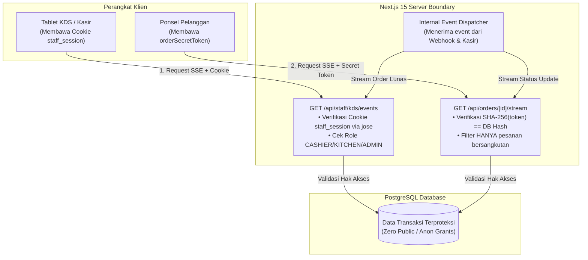

# ADR-0002: Integrasi Autentikasi Staf Cookie HTTP-Only & Server-Mediated SSE

## 1. Status
**ACCEPTED** (28 Oktober 2026)

## 2. Konteks & Masalah
Sistem Cravio membagi pengguna ke dalam dua kategori dengan batas kepercayaan yang sangat berbeda:
1. **Staf Kafe (Kasir, Dapur, Admin):** Terautentikasi melalui login internal (PIN/Password). Sesi dikelola menggunakan cookie terenkripsi HTTP-Only (*stateless JWT session*) yang diverifikasi oleh Next.js Server & Middleware.
2. **Pelanggan Meja (Guest):** Mengakses sistem tanpa login akun. Kepemilikan pesanan diverifikasi melalui token rahasia peramban `orderSecretToken`.

**Celah Keamanan Kritis pada Supabase Realtime Langsung di Client:**
* Jika antarmuka peramban KDS dapur dan kasir menghubungkan koneksi real-time langsung ke server Supabase menggunakan library `supabase-js` dengan `NEXT_PUBLIC_SUPABASE_ANON_KEY`, Supabase RLS (*Row Level Security*) tidak dapat memverifikasi cookie kustom Next.js milik staf (karena Supabase RLS hanya mengenali Supabase Auth JWT bawaan `auth.uid()`).
* Konsekuensinya, jika tabel `orders` dibuka agar dapat didengar oleh role `anon` Supabase, maka **setiap pelanggan atau pihak luar yang membuka browser DevTools dapat mendengarkan seluruh transaksi kafe secara publik**, membocorkan privasi pesanan tamu lain, omzet kafe, dan catatan khusus.

## 3. Keputusan yang Ditetapkan

### 3.1. Larangan Mutlak Akses Anon ke Tabel Transaksi
* Tabel `Order`, `OrderItem`, `PaymentTransaction`, dan `AuditLog` di PostgreSQL **DILARANG KERAS** dibuka untuk akses publik atau role `anon` Supabase.
* Seluruh mutasi dan pembacaan data transaksi wajib melalui layer server Next.js (Prisma Client terproteksi).

### 3.2. Server-Mediated Real-Time via Server-Sent Events (SSE)
Next.js Server ditetapkan sebagai satu-satunya gerbang (*security gateway*) penyalur data real-time:

#### A. Kanal Staf KDS & Kasir: `GET /api/staff/kds/events`
* Klien browser staf membuka koneksi dengan opsi `credentials: 'include'`.
* Server memvalidasi cookie `staff_session` menggunakan pustaka `jose` (`jwtVerify`) dengan secret `STAFF_AUTH_SECRET`.
* Memeriksa apakah `role` bernilai `CASHIER`, `KITCHEN`, atau `ADMIN`.
* **Jika Valid:** Membuka aliran data SSE dan memancarkan event `NEW_PAID_ORDER`, `ORDER_STATUS_CHANGED`, dan `ORDER_VOIDED`.
* **Jika Tidak Valid:** Menolak seketika dengan respon `401 Unauthorized`.

#### B. Kanal Pelanggan: `GET /api/orders/[orderId]/stream?token=[orderSecretToken]`
* Klien browser pelanggan mengirimkan token kepemilikan via query parameter `token` atau header `X-Order-Secret-Token`.
* Server melakukan hashing SHA-256 terhadap token tersebut dan mencocokkannya dengan `orderSecretTokenHash` pada baris order di database.
* **Jika Cocok:** Membuka stream dan **HANYA** memancarkan pembaruan status untuk `orderId` tersebut.
* **Jika Tidak Cocok:** Menolak seketika dengan respon `403 Forbidden`. Pelanggan tidak memiliki celah untuk mendengarkan pesanan meja lain.

### 3.3. Pustaka Autentikasi: `jose` (Zero-Dependency & Edge-Compatible)
* Menggunakan pustaka resmi **`jose`** untuk pembuatan (*sign*) dan verifikasi (*verify*) JWT sesi staf.
* Kompatibel penuh dengan runtime Node.js dan Next.js Middleware (*Edge/Node runtime*), bebas dari kerentanan dependensi usang, dan beroperasi cepat tanpa overhead.

## 4. Konsekuensi & Trade-Off
* **Keuntungan:** Keamanan data kafe 100% terjamin, data omzet dan pesanan tidak pernah bocor ke publik, cookie staf terisolasi dalam mode `HTTP-Only` (kebal serangan XSS pada token peramban).
* **Kelemahan & Mitigasi:** Beban streaming ditangani oleh server Next.js; dimitigasi dengan format event payload yang ringkas (hanya ID dan delta status) serta siklus stream chunked 25–30 detik yang hemat memori.

