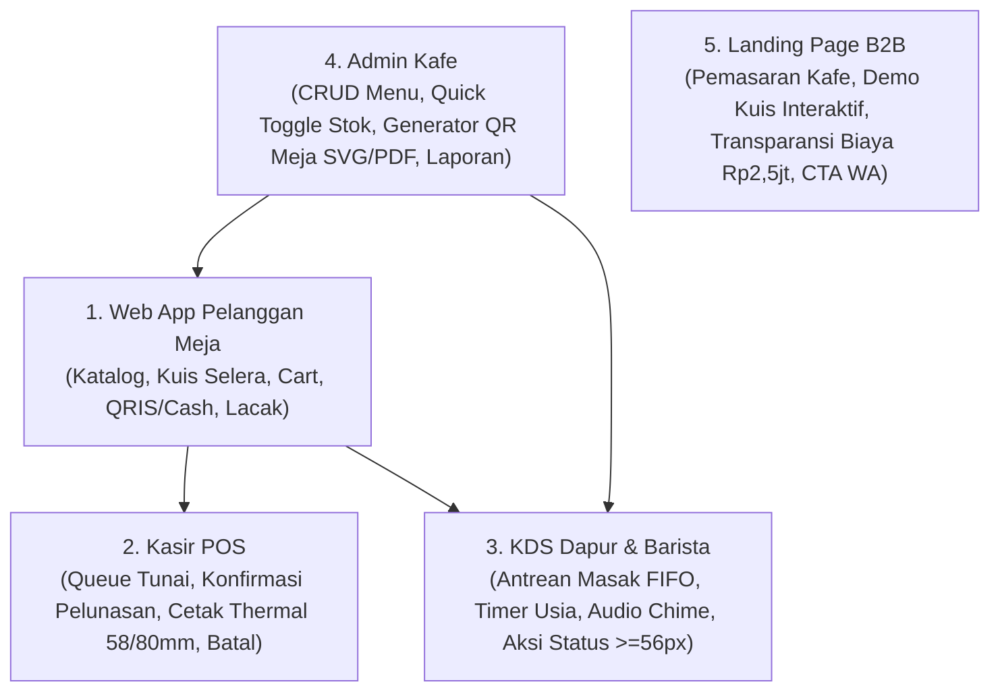
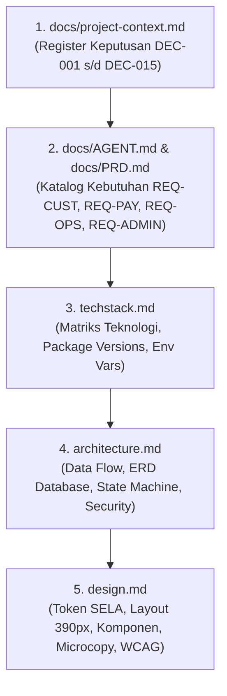
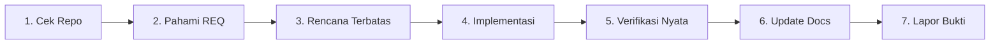
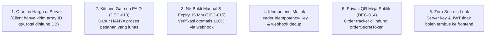

# PANDUAN KERJA & INSTRUKSI REKAYASA AGENT (AGENT.MD)
## SELA Smart QR Menu & Sistem Rekomendasi Preferensi Konsumen

> **Lokasi File:** `agent.md` (Root Repository)  
> **Status:** Panduan Eksekusi Resmi Tim & Agent AI  
> **Terakhir Diperbarui:** 2026-10-27  
> **Peran Penulis:** Engineering Lead / Technical Lead  
> **Lingkungan Operasional:** Node.js 20 LTS, Windows PowerShell, Google Antigravity  

---

## DAFTAR ISI
1. [Identitas Proyek, 5 Pilar Modul, & Batasan Scope](#1-identitas-proyek-5-pilar-modul--batasan-scope)
2. [Status Prototipe vs Aplikasi Produksi](#2-status-prototipe-vs-aplikasi-produksi)
3. [Urutan Wajib Membaca Dokumen (Reading Order)](#3-urutan-wajib-membaca-dokumen-reading-order)
4. [Siklus Kerja Agent (Working Protocol)](#4-siklus-kerja-agent-working-protocol)
5. [Konvensi Kode, Arsitektur Folder, & Batas Server/Client](#5-konvensi-kode-arsitektur-folder--batas-serverclient)
6. [Prinsip Invarian Proyek yang Pantang Dilanggar](#6-prinsip-invarian-proyek-yang-pantang-dilanggar)
7. [Aturan Mesin Rekomendasi Selera (Non-AI / Deterministik)](#7-aturan-mesin-rekomendasi-selera-non-ai--deterministik)
8. [Pedoman Implementasi Antarmuka UI & Keterbatasan Perangkat Keras](#8-pedoman-implementasi-antarmuka-ui--keterbatasan-perangkat-keras)
9. [Perintah Operasional & Tooling (Windows PowerShell)](#9-perintah-operasional--tooling-windows-powershell)
10. [Strategi Pengujian Berdasarkan Risiko (Risk-Based Testing)](#10-strategi-pengujian-berdasarkan-risiko-risk-based-testing)
11. [Batasan Otonomi Agent & Izin Konfirmasi Pengguna](#11-batasan-otonomi-agent--izin-konfirmasi-pengguna)
12. [Kebersihan Repositori & Etika Modifikasi Berkas](#12-kebersihan-repositori--etika-modifikasi-berkas)
13. [Definition of Done (DoD) & Standar Pelaporan](#13-definition-of-done-dod--standar-pelaporan)
14. [Mekanisme Khusus Google Antigravity (Rules & Discovery Engine)](#14-mekanisme-khusus-google-antigravity-rules--discovery-engine)

---

## 1. Identitas Proyek, 5 Pilar Modul, & Batasan Scope

### 1.1. Identitas & Nilai Bisnis
* **Nama Resmi Proyek:** **SELA Smart QR Menu & Sistem Rekomendasi Preferensi Konsumen** (`project-qr`).
* **Identitas Merek:** **SELA** (*Artisanal Coffee & Bake*).
* **Tujuan Produk:** Mengotomasi alur pemesanan di meja kafe (*dine-in ordering*), memangkas waktu tunggu tamu, mempercepat perputaran meja (*table turnover*), mengeliminasi antrean fisik di kasir, serta menyajikan rekomendasi rasa yang terkurasi tanpa mewajibkan tamu mengunduh aplikasi peramban (*frictionless web-based*).

### 1.2. Lima Pilar Modul Utama
Sistem terbagi ke dalam lima modul fungsional sesuai proposal dan PRD:



1. **Modul Pelanggan Meja (`REQ-CUST-01` s/d `REQ-CUST-08`):** Antarmuka web mobile-first (390px baseline) diakses via scan QR akrilik meja. Memuat deteksi nomor meja, kuis kurasi rasa 3 langkah (dengan tombol lewati), rekomendasi menu, kustomisasi modifier & catatan, keranjang pesanan, checkout QRIS dinamis / Tunai, dan pelacak status pesanan realtime.
2. **Modul Kasir POS (`REQ-OPS-04` s/d `REQ-OPS-06`, `REQ-PAY-02`):** Dashboard kasir untuk memvalidasi uang tunai dari tamu meja, mencetak struk thermal kasir (58mm/80mm) dengan tanda *REPRINT*, serta menangani pembatalan darurat/refund dengan pencatatan audit.
3. **Modul Dapur & Barista / KDS (`REQ-OPS-01` s/d `REQ-OPS-03`):** Layar tablet operasional dapur berjarak pandang 1.5–2 meter. Menampilkan kartu pesanan lunas secara FIFO, indikator pewarnaan usia pesanan, alert denting audio lonceng + lampu visual kilat (*flash*), serta tombol transisi status raksasa ($\ge 56$ px).
4. **Modul Panel Admin Kafe (`REQ-ADMIN-01` s/d `REQ-ADMIN-07`):** Manajemen katalog menu, harga rupiah integer, kategori, grup modifier, sakelar toggle cepat status stok (*Sold Out*), generator cetak QR meja multi-format, konfigurasi opsional pajak/service charge, dan ringkasan laporan omzet harian.
5. **Modul Landing Page Pemasaran B2B (`REQ-B2B-01` s/d `REQ-B2B-04`):** Etalase promosi solusi Smart QR Menu untuk pemilik kafe lain, dilengkapi widget simulator kuis selera interaktif, transparansi rincian paket investasi Rp 2.500.000 (all-in tahun pertama), dan tombol konsultasi langsung via WhatsApp.

### 1.3. Batasan Lingkup (*Scope Boundaries*)
* **DALAM LINGKUP (IN-SCOPE):**
  * Single-tenant: Satu kafe operasional (SELA).
  * Pembayaran: QRIS Dinamis otomatis via Midtrans Core API (expiry 15 menit) dan Tunai di Kasir.
  * Sinkronisasi Real-Time: Server-Sent Events (SSE) / Supabase Realtime untuk antrean KDS dapur dan pelacakan pesanan pelanggan.
  * Cetak Thermal: Format universal CSS `@media print` 58 mm dan 80 mm.
* **DI LUAR LINGKUP (STRICTLY OUT-OF-SCOPE):**
  * Multi-cabang / Multi-tenant SaaS (dilarang menambahkan kolom `tenant_id` atau tabel franchise).
  * Agen AI percakapan / Bot WhatsApp cerdas berbasis LLM.
  * Sistem loyalty point, voucher bertingkat rumit, atau kartu keanggotaan VIP.
  * Split-bill otomatis per meja.
  * Integrasi software akuntansi luar (Jurnal/Accurate) atau integrasi ojek online (GoFood/GrabFood).

---

## 2. Status Prototipe vs Aplikasi Produksi

Seluruh agent yang bekerja di repositori ini wajib memahami batas tegas antara prototipe simulasi dan kode produksi:

> [!CAUTION] Dilarang Mencampur Fixture Prototipe dengan Kode Produksi
> * **Folder `design-preview/` adalah PROTOTIPE VISUAL STATIS TERISOLASI.** Berisi mock state in-memory, role switcher publik, dan fixture statis untuk tinjauan desain visual.
> * **Dilarang keras mengimpor file dari `design-preview/` ke dalam direktori produksi `src/`!**
> * Aplikasi produksi dibangun dari nol menggunakan **Next.js 15 App Router + Prisma ORM + PostgreSQL** dengan pemisahan autentikasi dan validasi server-side.

---

## 3. Urutan Wajib Membaca Dokumen (Reading Order)

Sebelum melakukan modifikasi kode, merancang skema database, atau menambahkan endpoint API, agent **WAJIB** membaca dokumen proyek dengan urutan berikut:



### Aturan Resolusi Konflik Dokumen
1. **Kebutuhan Bisnis:** Sumber proposal (`Proposal Pengembangan Website Smart QR Menu.docx`) menetapkan kebutuhan bisnis awal.
2. **Keputusan Arsitektur Terkini:** Dokumen `docs/project-context.md` dan `architecture.md` memuat keputusan teknis resmi (`DEC-001` s/d `DEC-015`) yang telah disepakati bersama pengguna. Keputusan ini memvalidasi atau memperbarui asumsi proposal awal.
3. **Penyelesaian Benturan:** Jika ditemukan pertentangan antara proposal lama dengan keputusan arsitektur (misal: kebijakan verifikasi tunai atau gate pesanan dapur), agent **wajib mengikuti keputusan teknis terkonfirmasi yang lebih aman** dan mencatat rujukannya secara eksplisit. Dilarang diam-diam memilih instruksi yang melemahkan keamanan transaksi.

---

## 4. Siklus Kerja Agent (Working Protocol)

Setiap sesi pengerjaan tugas oleh agent wajib mengikuti 7 langkah terstruktur:



1. **Periksa Repositori:** Periksa `git status`, pastikan cabang kerja bersih, dan telaah perubahan terakhir yang dilakukan pengguna.
2. **Pahami Kebutuhan:** Identifikasi ID kebutuhan spesifik (`REQ-xxx`) dan keputusan terkait (`DEC-xxx`) yang menjadi target tugas.
3. **Rencanakan Perubahan Terbatas:** Buat rencana kerja minimalis. Hindari merombak file di luar batasan tugas (*zero scope creep*).
4. **Implementasi Berkualitas:** Tulis kode TypeScript yang aman, ikuti prinsip invarian proyek, dan gunakan token desain yang konsisten.
5. **Verifikasi Nyata:** Jalankan pengujian, typecheck, atau linter nyata via terminal. Dilarang mengarang hasil output uji.
6. **Perbarui Dokumentasi:** Jika ada keputusan baru atau perubahan kontrak API, perbarui `docs/project-context.md` dan dokumen terkait.
7. **Laporkan Bukti & Batasan:** Sampaikan ringkasan perubahan, sertakan bukti log eksekusi aktual, dan sebutkan keterbatasan yang belum diuji secara fisik.

---

## 5. Konvensi Kode, Arsitektur Folder, & Batas Server/Client

### 5.1. Struktur Folder Standar Produksi (Next.js 15 App Router)
```
project-qr/
├── docs/                             # Dokumentasi Arsitektur, PRD, dan Context
├── design-preview/                   # [TERISOLASI] Prototipe Visual Sesi Desain
├── prisma/
│   ├── schema.prisma                 # Schema Model Relasional Database
│   ├── seed.ts                       # Starter Seed Data Menu Kafe SELA
│   └── migrations/                   # Catatan Migrasi SQL Terkelola
├── public/                           # Aset Statis Publik (Logo, Favicon, Audio Chime)
│   └── audio/
│       └── chime.mp3                 # Lonceng Pesanan Dapur
├── src/
│   ├── app/
│   │   ├── (customer)/               # Rute Pelanggan Meja (Guest)
│   │   │   ├── page.tsx              # Landing & Deteksi Meja (/?table=XX)
│   │   │   ├── quiz/page.tsx         # Kuis Preferensi Selera 3 Langkah
│   │   │   ├── menu/page.tsx         # Katalog Menu & Kategori
│   │   │   ├── cart/page.tsx         # Drawer Keranjang Belanja
│   │   │   └── order/[id]/           # Checkout, Bayar QRIS/Tunai, Tracking
│   │   ├── (staff)/                  # Rute Staf Operasional (Protected Session)
│   │   │   ├── login/page.tsx        # Login Staf (PIN / Password)
│   │   │   ├── pos/page.tsx          # Dashboard Kasir & Antrean Tunai
│   │   │   ├── kitchen/page.tsx      # Antrean KDS Dapur & Barista
│   │   │   └── admin/page.tsx        # Panel Admin Menu, Stok, & Meja
│   │   ├── (b2b)/                    # Rute Publik Landing Page B2B
│   │   │   └── page.tsx              # Beranda Pemasaran Solusi Kafe
│   │   └── api/                      # Route Handlers (REST API Server)
│   │       ├── orders/route.ts       # Kalkulasi & Pembuatan Pesanan
│   │       ├── payments/             # Charge QRIS & Konfirmasi Tunai
│   │       ├── webhooks/midtrans/    # Webhook Callback Settlement Midtrans
│   │       └── sse/kitchen/          # Aliran Real-time Event KDS Dapur
│   ├── components/                   # Komponen Antarmuka React
│   │   ├── customer/                 # Komponen UI Khusus Pelanggan
│   │   ├── staff/                    # Komponen KDS & Kasir
│   │   └── ui/                       # Design System Base (Button, Modal, Input)
│   └── lib/                          # Pustaka & Utilitas Bersama
│       ├── prisma.ts                 # Prisma Client Singleton Instance
│       ├── midtrans.ts               # Klien Midtrans Core API
│       ├── recommendation.ts         # Algoritma Rekomendasi Tag Deterministik
│       └── validations/              # Schema Validasi Zod (Input/Output)
├── agent.md                          # [INI] Panduan Kerja Utama Agent
├── AGENTS.md                         # Titik Masuk Ringkas Antigravity
├── design.md                         # Spesifikasi Design System Resmi
├── techstack.md                      # Matriks Teknologi Produksi
└── architecture.md                   # Spesifikasi Arsitektur Sistem
```

### 5.2. Konvensi Penamaan (Naming Conventions)
* **File & Direktori Rute:** Gunakan format `kebab-case` (Contoh: `order-status/`, `order-details.tsx`).
* **Komponen React:** Gunakan format `PascalCase` (Contoh: `HeaderTableBadge.tsx`, `KitchenOrderCard.tsx`).
* **Fungsi, Hook, & Variabel:** Gunakan format `camelCase` (Contoh: `calculateOrderSubtotal()`, `useKitchenQueue()`).
* **Konstanta & Enum Database:** Gunakan format `UPPER_SNAKE_CASE` (Contoh: `OrderStatus.PAID`, `PaymentMethod.QRIS`).

### 5.3. Batas Tegas Server vs Client (*Server/Client Boundary*)
* **Server Components (Default):** Seluruh fetching data awal, pembacaan database, dan verifikasi role wajib berada di Server Components.
* **Client Components (`"use client"`):** Hanya dideklarasikan pada komponen yang membutuhkan state interaktif, event handler peramban (klik tombol, form input, bottom sheet drawer), pemutaran audio, koneksi SSE, atau akses `localStorage`.
* **Proteksi Mutasi:** Seluruh mutasi database (buat pesanan, ubah status) wajib diproses melalui Server Actions atau API Route Handlers terproteksi.

### 5.4. Validasi, Error Handling, & Logging
1. **Validasi Skema (Zod):** Setiap request yang masuk ke API wajib divalidasi menggunakan Zod schema sebelum menyentuh logika bisnis atau query database.
2. **Format Respon Terstandar:**
   * Sukses: `{ "success": true, "data": { ... } }`
   * Gagal: `{ "success": false, "error": { "code": "VALIDATION_FAILED", "message": "Pesan ramah pengguna" } }`
3. **Pencatatan Log Terstruktur:** Log mencatat timestamp, level (*info/warn/error*), modul, order ID, dan nomor meja. Dilarang mencatat credential, server key, atau data pribadi pelanggan.

---

## 6. Prinsip Invarian Proyek yang Pantang Dilanggar

Seluruh agent wajib menegakkan 6 invarian absolut sistem keuangan dan operasional SELA:



1. **Server-Authoritative Pricing:** Client dilarang mengirimkan nilai total rupiah ke server. Server menghitung ulang seluruh subtotal dari database resmi berdasarkan menu ID, modifier ID, dan kuantitas. Seluruh nominal rupiah disimpan sebagai integer murni (tanpa sen).
2. **Kitchen Gate Policy (`DEC-013`):** Pesanan **HANYA** masuk dan diproses oleh antrean KDS Dapur setelah pembayaran berstatus lunas (`PAID`). Pesanan berstatus `PENDING` atau tunai yang belum dikonfirmasi kasir tidak boleh muncul di dapur.
3. **Nir-Bukti Manual & Batas Expiry 15 Menit (`DEC-015`):** Tidak ada alur upload foto bukti transfer manual. Pembayaran divalidasi instan via webhook payment gateway. Jika melewati batas 15 menit, pesanan otomatis berstatus `EXPIRED` dan dibatalkan.
4. **Idempotensi Transaksi:** Pembuatan pesanan dilindungi header `Idempotency-Key`. Webhook ganda dari Midtrans ditangani secara idempotent: jika status sudah `PAID`, server mencatat log dan langsung merespons `200 OK` tanpa memicu lonceng chime dapur untuk kedua kalinya.
5. **Privasi Pelacak Pesanan (`DEC-014`):** Kode QR meja fisik bersifat publik. Halaman pelacak pesanan pelanggan dilindungi oleh `orderSecretToken` kriptografis acak yang disimpan di `localStorage` peramban pemesan. Pelanggan baru yang memindai meja yang sama setelahnya tidak dapat melihat riwayat atau tagihan pelanggan sebelumnya.
6. **Nir-Rahasia (Zero Secret Leakage):** `MIDTRANS_SERVER_KEY`, `JWT_SECRET`, dan connection string database PostgreSQL tidak boleh diekspos ke client bundle, commit git, atau log peramban. Hanya `NEXT_PUBLIC_MIDTRANS_CLIENT_KEY` yang boleh diakses di sisi peramban.

---

## 7. Aturan Mesin Rekomendasi Selera (Non-AI / Deterministik)

* **Algoritma Murni Berbasis Tag:** Sistem rekomendasi menggunakan pencocokan bobot tag deterministik (*Weighted Tag Matching*).
* **Rumus Perhitungan Skor:**
  $$\text{Skor Menu} = \sum (\text{Tag Cocok} \times \text{Bobot Kategori})$$
* **Aturan Tie-Break:** Jika terdapat beberapa menu dengan skor yang sama, urutkan berdasarkan:
  1. Menu berlabel *Best Seller / Favorit* (`isFeatured: true`).
  2. Jumlah pesanan terbanyak (*popularity count*).
  3. Harga terendah.
* **Filter Ketersediaan:** Hanya menu berstatus tersedia (`isAvailable: true`) yang berhak masuk daftar rekomendasi.
* **Fallback Otomatis:** Jika tidak ada menu yang cocok atau stok menu rekomendasi habis, tampilkan menu *Best Seller* terpopuler yang tersedia hari ini.
* **Larangan Tegas:** **Dilarang keras mengintegrasikan pustaka OpenAI, Gemini, atau model LLM apapun ke dalam alur kalkulasi rekomendasi menu runtime.** Patuhi algoritma deterministik sesuai proposal.

---

## 8. Pedoman Implementasi Antarmuka UI & Keterbatasan Perangkat Keras

### 8.1. Kepatuhan Sistem Desain SELA
* Terapkan seluruh token visual dari [design.md](file:///d:/project/project-qr/design.md): Kanvas `#FBF9F5`, Kartu `#FFFFFF`, Aksen Terakota `#924805`, Espresso `#1B1C1A`, Border `#E7E2DA`.
* Tipografi: *Plus Jakarta Sans* untuk Judul & Brand, *Inter* untuk Konten & Harga Tabular (`tabular-nums`).
* Target Sentuh: Minimal $44 \times 44\text{ px}$ untuk seluruh elemen interaktif mobile pelanggan dan $\ge 56\text{ px}$ untuk tombol KDS dapur.
* Microcopy: Gunakan Bahasa Indonesia santun, format rupiah tanpa spasi (`Rp28.000`), dan sertakan disclaimer alergi bahan pangan pada rekomendasi.

### 8.2. Penanganan Keterbatasan Perangkat Keras Nyata
1. **Kebijakan Autoplay Audio Browser:** Browser memblokir audio otomatis tanpa interaksi fisik. Sediakan banner pembuka izin audio di KDS (`"Aktifkan Suara Dapur"`) serta sediakan **kilatan visual (*visual flash*)** pada layar sebagai cadangan jika audio tidak berbunyi.
2. **Pencetakan Struk Thermal:** Standar garansi kode adalah CSS `@media print` universal 58 mm dan 80 mm melalui dialog print sistem operasi. Integrasi Web Bluetooth ESC/POS bersifat peningkatan progresif opsional dan tidak menjamin *silent print* otomatis pada seluruh perangkat keras printer tanpa pengujian fisik di lokasi.
3. **Koneksi Real-Time:** Gunakan SSE / Supabase Realtime dengan mekanisme reconnection otomatis bertingkat (*exponential backoff*) dan indikator status koneksi yang jelas pada header KDS (*Online* vs *Menghubungkan kembali...*).

---

## 9. Perintah Operasional & Tooling (Windows PowerShell)

> [!NOTE] Status Tooling Saat Ini
> **Aplikasi produksi belum diinisialisasi (scaffolding belum dilakukan).**
> Seluruh perintah dev/build/test/lint di bawah ini berstatus:  
> **"Belum tersedia — tetapkan saat scaffolding"**  
> Berikut adalah perintah standar yang akan diaktifkan setelah inisialisasi Next.js 15:

### 9.1. Inisialisasi Proyek (Scaffolding Hari 1)
```powershell
# Jalankan di Windows PowerShell dengan BypassSandbox: true untuk install pnpm package
pnpm create next-app@latest . --typescript --tailwind --eslint --app --src-dir --import-alias "@/*"
pnpm add @prisma/client midtrans-client zod
pnpm add -D prisma vitest @testing-library/react @testing-library/jest-dom
```

### 9.2. Perintah Operasional Harian
```powershell
# Menjalankan server development lokal
pnpm run dev

# Memeriksa type safety TypeScript
npx tsc --noEmit

# Menjalankan linting kode ESLint
pnpm run lint

# Menjalankan unit test Vitest
pnpm run test

# Menjalankan build produksi Next.js
pnpm run build

# Menjalankan migrasi database PostgreSQL
npx prisma migrate dev --name init_schema

# Menjalankan seeding data katalog menu SELA
npx prisma db seed
```

---

## 10. Strategi Pengujian Berdasarkan Risiko (Risk-Based Testing)

Pengujian kode wajib diprioritaskan pada area dengan risiko finansial dan operasional tertinggi:

1. **Uji Logika Rekomendasi Tag (Unit Test):**
   * Verifikasi normalisasi input kuis (mood, rasa, format).
   * Verifikasi rumus bobot menghasilkan skor yang tepat.
   * Verifikasi menu *Sold Out* tidak pernah direkomendasikan.
   * Verifikasi tombol *Lewati* mengembalikan seluruh katalog secara utuh.
2. **Uji Integritas Finansial & Modifier (Unit & Integration Test):**
   * Verifikasi perhitungan subtotal modifier berbayar (+Oatmilk Rp6.000).
   * Verifikasi manipulasi harga di payload request ditolak mentah-mentah oleh server.
   * Verifikasi grand total selalu integer IDR tanpa nilai negatif.
3. **Uji Konkurensi & Idempotensi (Integration Test):**
   * Simulasi klik ganda (*double-click*) pada tombol checkout hanya membuat 1 pesanan di database.
   * Simulasi webhook callback settlement Midtrans duplikat tidak memicu audio KDS dua kali.
   * Simulasi perubahan stok menjadi *Sold Out* saat pelanggan sedang berada di halaman checkout.
4. **Uji Otorisasi & Hak Akses (Security Test):**
   * Verifikasi pelanggan meja tidak bisa mengakses endpoint `/api/admin/*` atau `/api/kitchen/*`.
   * Verifikasi pelanggan meja tidak bisa melihat pesanan meja lain tanpa `orderSecretToken`.
5. **Uji End-to-End (E2E) Alur Transaksi:**
   * Alur QRIS Sandbox: Scan $\rightarrow$ Checkout $\rightarrow$ Bayar di Simulator Midtrans $\rightarrow$ Webhook Masuk $\rightarrow$ Antrean KDS Muncul $\rightarrow$ Siap Saji $\rightarrow$ Lacak Sukses.
   * Alur Tunai: Scan $\rightarrow$ Checkout Tunai $\rightarrow$ Tunggu Kasir $\rightarrow$ Kasir Klik Konfirmasi $\rightarrow$ Antrean KDS Muncul.

---

## 11. Batasan Otonomi Agent & Izin Konfirmasi Pengguna

### 11.1. Tindakan yang Boleh Dijalankan Secara Otonom
* Membaca dan menganalisis berkas dalam repositori.
* Menulis dan memodifikasi file kode sumber di dalam folder `src/`, `prisma/`, atau `tests/` sesuai scope tugas.
* Menjalankan perintah linter, typecheck, dan unit test non-destruktif.
* Mengoreksi bug lokal dan memperbaiki pesan error validasi.
* Memperbarui dokumentasi teknis agar tetap selaras dengan kode nyata.

### 11.2. Tindakan yang WAJIB Meminta Izin / Konfirmasi Pengguna
* **Penghapusan Destruktif:** Menjalankan `git reset --hard`, `git clean -fd`, atau menghapus skema database aktif.
* **Perubahan Keputusan Bisnis:** Mengubah alur transaksi, mengubah kebijakan kitchen gate, atau menambah biaya/pajak di luar keputusan terdaftar (`DEC-xxx`).
* **Transaksi Finansial Nyata:** Menggunakan kredensial produksi Midtrans atau memicu transaksi uang nyata di luar mode sandbox.
* **Deployment Publik:** Melakukan rilis atau migrasi database ke lingkungan produksi tanpa instruksi tertulis.

---

## 12. Kebersihan Repositori & Etika Modifikasi Berkas

1. **Pertahankan Pekerjaan Pengguna:** Jangan menghapus berkas eksplorasi desain pengguna di `design-preview/`. Prototipe tersebut adalah rujukan visual resmi sistem desain SELA.
2. **Konfigurasi Global & Tooling:** Jangan mengubah konfigurasi global Antigravity (`~/.gemini/config/`), jangan memasang ekstensi/plugin baru, dan jangan memodifikasi pengaturan mesin lokal tanpa permintaan tertulis.
3. **Penyimpanan Berkas Sementara:** Seluruh skrip pembantu atau uji coba sementara wajib disimpan di folder scratch conversation (`scratch/`) dan tidak dicommit ke repositori utama.

---

## 13. Definition of Done (DoD) & Standar Pelaporan

### 13.1. Kriteria Selesai (Definition of Done)
Tugas implementasi dinyatakan selesai (*DONE*) jika dan hanya jika:
- [ ] Seluruh ID kebutuhan fungsional (`REQ-xxx`) yang ditugaskan telah terpenuhi secara fungsional.
- [ ] Pemeriksaan typecheck (`npx tsc --noEmit`) dan linter lulus tanpa error.
- [ ] Pengujian unit/integrasi terkait berhasil dieksekusi dengan status hijau (pass).
- [ ] Tidak ada kredensial, server key, atau data rahasia yang ter-hardcode di kode frontend atau git history.
- [ ] Dokumentasi terkait (`docs/project-context.md`, `architecture.md`, atau `design.md`) telah disinkronkan.
- [ ] Keterbatasan perangkat fisik (printer thermal / audio browser) dilaporkan secara transparan.

### 13.2. Format Pelaporan Hasil Kerja
Setiap laporan kemajuan kepada pengguna wajib disampaikan dalam Bahasa Indonesia dengan format terstruktur:
1. **Apa yang Berubah:** Ringkasan file yang dibuat atau diubah beserta fungsinya.
2. **Mengapa Diubah:** Rujukan ID kebutuhan (`REQ-xxx`) atau keputusan arsitektur (`DEC-xxx`).
3. **Bukti Pemeriksaan Aktual:** Cuplikan log eksekusi terminal nyata (bukan simulasi/karangan).
4. **Hal yang Belum Diuji:** Catatan mengenai aspek yang memerlukan perangkat keras fisik atau dependensi eksternal.
5. **Keputusan Terbuka:** Pertanyaan terfokus jika ditemukan hambatan bisnis yang membutuhkan keputusan pengguna.

---

## 14. Mekanisme Khusus Google Antigravity (Rules & Discovery Engine)

1. **Discovery Hierarchy Resmi Antigravity:**
   * Sesuai dokumentasi Antigravity Customization System, file yang otomatis dimuat sebagai aturan hierarkis proyek (*Project Rules*) adalah `AGENTS.md`, `GEMINI.md`, atau file di dalam `.agents/rules/*.md`.
   * Berkas `agent.md` atau `skills.md` **TIDAK dimuat otomatis oleh Antigravity hanya karena berada di root**. Oleh karena itu, `AGENTS.md` berfungsi sebagai gerbang penunjuk wajib yang memerintahkan agent membaca `agent.md` dan dokumentasi terkait.
2. **Nir-Asumsi Sintaks Import:**
   * Jangan mengandalkan sintaks impor yang belum diverifikasi (seperti `@import` atau referensi otomatis). Akses ke dokumen rujukan dilakukan melalui pembacaan berkas langsung (`read_file` / tool inspeksi).
3. **Isolasi Konfigurasi Pengguna:**
   * Agent dilarang memodifikasi konfigurasi global mesin pengguna di `~/.gemini/config/`. Seluruh aturan dan instruksi harus terlokalisasi di dalam repositori `project-qr`.
4. **Batas Tahapan:**
   * Dokumen ini menetapkan instruksi dan aturan kerja rekayasa; penyusunan dokumen ini tidak boleh diperlakukan sebagai mandat untuk langsung memulai implementasi kode aplikasi sebelum ada instruksi eksplisit dari pengguna.

