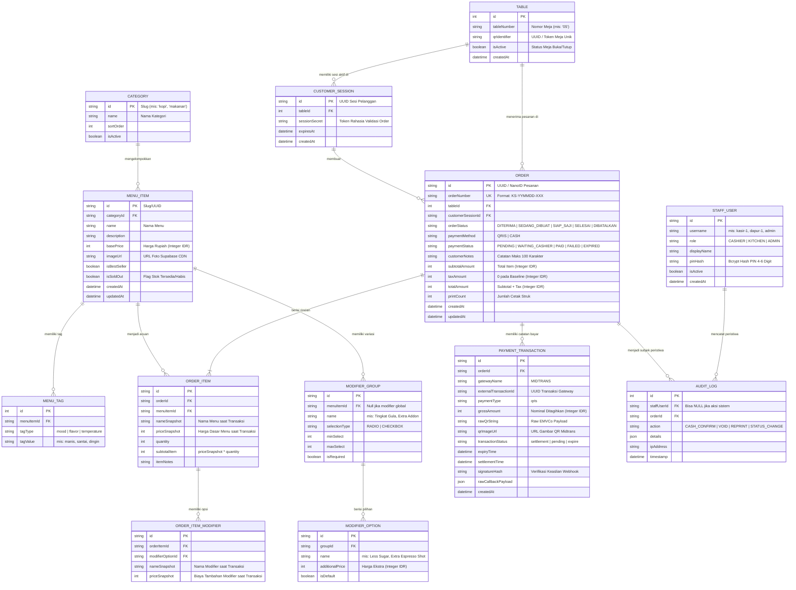
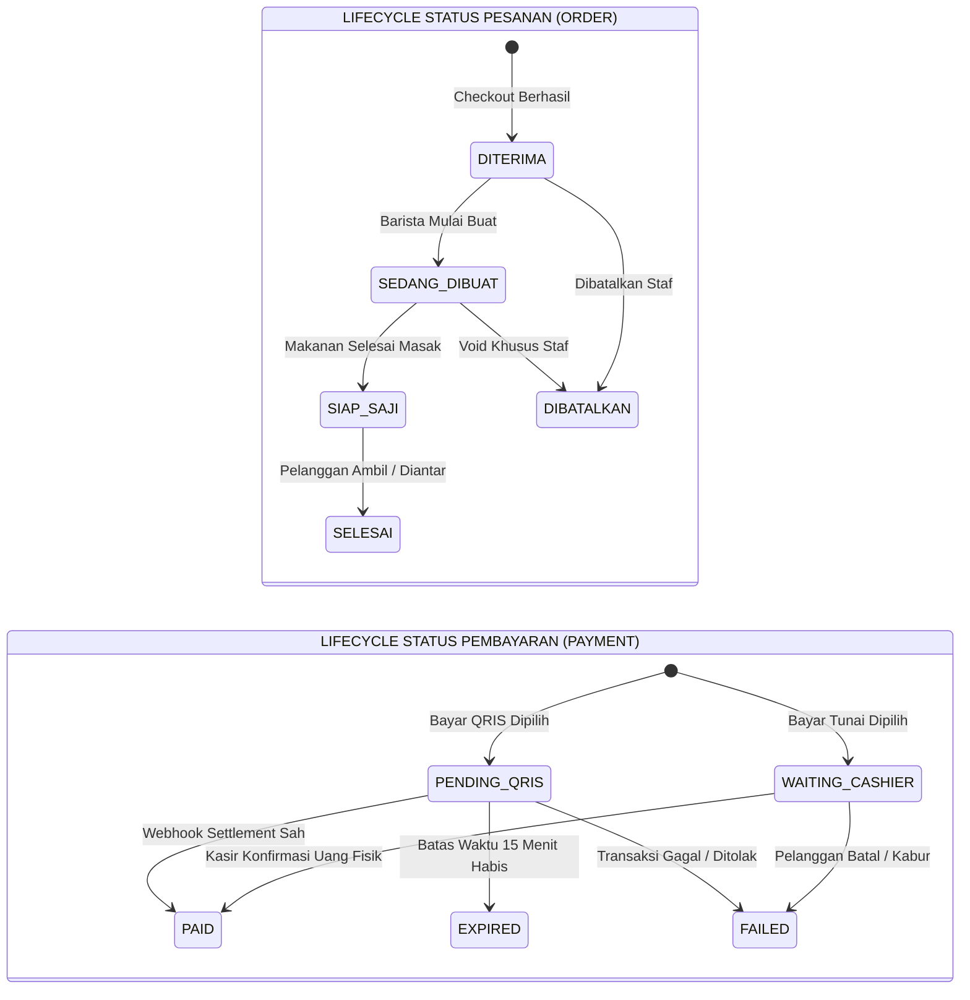
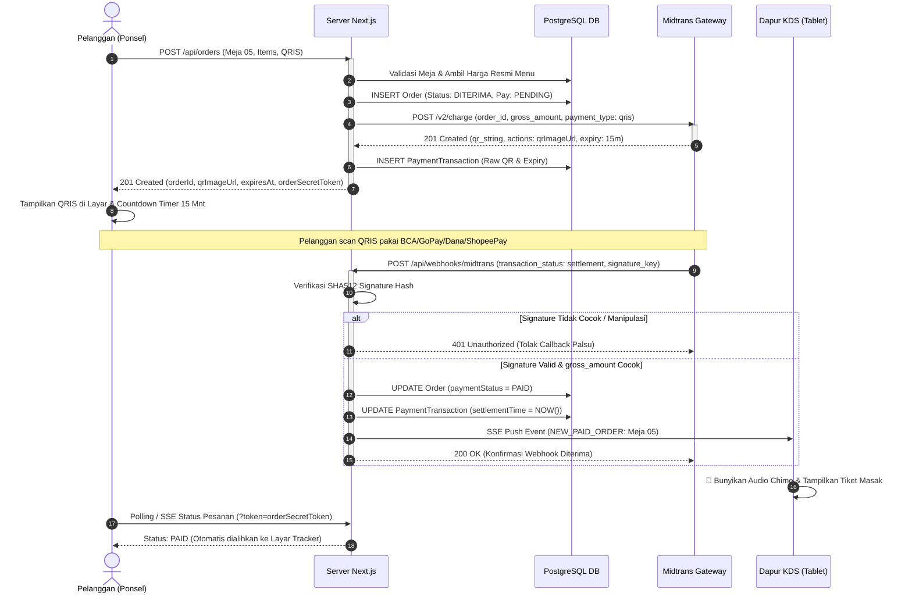
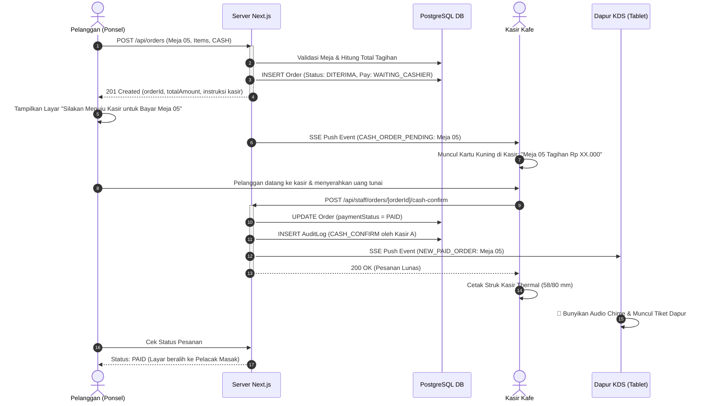
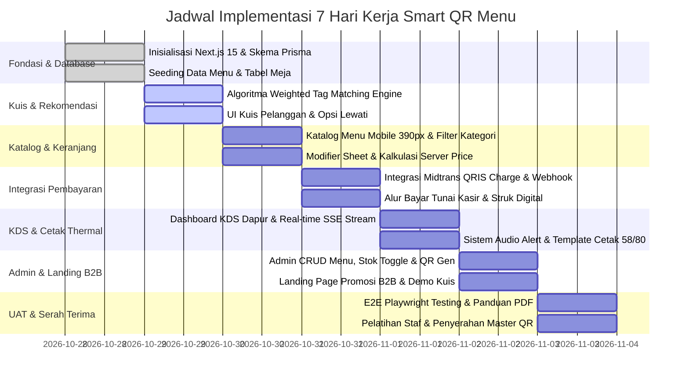

# DOKUMEN ARSITEKTUR SISTEM (SYSTEM ARCHITECTURE DOCUMENT)
## Cravio - Your craving, Perfectly Matched

> **Lokasi Berkas:** `architecture.md` (Root Repositori)  
> **Status Dokumen:** Baseline Engineering Architecture (Siap Implementasi)  
> **Peran:** Software Architect & Technical Lead  
> **Dokumen Referensi:** `Proposal Pengembangan Website Smart QR Menu.docx`, `docs/AGENT.md`, `PRD.md`, `docs/DESIGN.md`, `techstack.md`, dan `docs/project-context.md`  
> **Tanggal Rilis:** 2026-10-27  

---

## 1. Batas Sistem & Lingkup Operasional (Scope & Boundaries)

Smart QR Menu adalah sistem pemesanan mandiri berbasis web (*web-based mobile-first*) yang dirancang khusus untuk satu unit kafe/restoran operasional (**Single-Tenant Cafe Baseline**).

```
+--------------------------------------------------------------------------------------------------+
|                                    BATAS SISTEM (SYSTEM BOUNDARY)                                 |
+-------------------------------------------------+------------------------------------------------+
| LINGKUP AKTIF V1 (IN-SCOPE BASELINE)            | DI LUAR LINGKUP V1 (OUT-OF-SCOPE / FUTURE)     |
+-------------------------------------------------+------------------------------------------------+
| 1. Pelanggan Meja (Nir-Akun / Guest Checkout).  | 1. Multi-Cabang Kafe (Multi-Branch Management).|
| 2. Kasir (Verifikasi Tunai, Monitor, Cetak).    | 2. Arsitektur SaaS Multi-Tenant (Multi-Kafe).  |
| 3. Dapur / KDS (Antrean Masak & Audio Alert).   | 3. Chatbot WhatsApp Otomatis Pemesanan.        |
| 4. Admin Kafe (Menu, Stok, Tag, Generator QR).  | 4. Sistem Poin Loyalitas & Membership Member.  |
| 5. Pengunjung Landing Page Promosi B2B.         | 5. Manajemen Inventori Stok Bahan Baku Gramasi.|
| 6. Integrasi QRIS Dinamis (Midtrans Core API).  | 6. Split-Bill / Pembayaran Parsial per Meja.   |
+-------------------------------------------------+------------------------------------------------+
```

### 1.1. Profil Aktor & Batas Kepercayaan (Trust Boundaries)
1. **Pelanggan Meja (Public Unauthenticated / Guest):**
   * Mengakses sistem melalui pemindaian QR fisik meja kamera ponsel.
   * **Batas Kepercayaan:** Bersifat *Untrusted*. Tidak memiliki akun atau password. Hak akses dibatasi hanya untuk membaca katalog menu aktif, mengikuti kuis rekomendasi, membuat pesanan pada meja yang tervalidasi, dan memantau status pesanan milik sesi belanjanya sendiri via token sesi terenkripsi (*Order Secret Token*).
2. **Pengunjung Landing Page B2B (Public Unauthenticated):**
   * Calon klien kafe lain yang membuka halaman web promosi.
   * **Batas Kepercayaan:** Bersifat *Untrusted*. Hanya memiliki hak baca konten pemasaran, mencoba simulasi *widget demo kuis* lokal, dan mengklik tautan CTA ke WhatsApp resmi pengembang.
3. **Staf Kasir (Authenticated Staff - Role: CASHIER):**
   * Menangani pesanan masuk, mengonfirmasi penerimaan uang tunai fisik, membatalkan pesanan jika diminta, dan mencetak struk thermal kasir.
   * **Batas Kepercayaan:** *Semi-Trusted*. Autentikasi melalui PIN Kasir cepat (4–6 digit) dengan sesi tersimpan pada *HTTP-Only Secure Cookie*.
4. **Staf Dapur / Barista (Authenticated Staff - Role: KITCHEN):**
   * Memantau antrean pesanan masak pada tablet KDS, mendengarkan notifikasi audio lonceng, memperbarui progres alur (*Mulai Buat $\rightarrow$ Siap Saji $\rightarrow$ Selesai*), dan mencetak tiket dapur.
   * **Batas Kepercayaan:** *Semi-Trusted*. Autentikasi melalui PIN Dapur dengan hak ubah status operasional makanan.
5. **Admin / Pemilik Kafe (Authenticated Staff - Role: ADMIN):**
   * Mengelola katalog menu, harga jual, foto, tag kuis preferensi, toggle stok *Sold Out*, konfigurasi kuis, dan mengunduh master QR meja.
   * **Batas Kepercayaan:** *Trusted*. Memiliki hak penuh konfigurasi data bisnis kafe via PIN Admin.

---

## 2. Diagram Arsitektur Komponen & Aliran Data

Sistem dibangun di atas arsitektur **Fullstack Modular Monolith** menggunakan Next.js 15 App Router, memadukan antarmuka klien, logika server (*Route Handlers* & *Server Actions*), database relasional, penyimpanan aset, kanal real-time, dan payment gateway eksternal:

```mermaid
flowchart TB
    subgraph CLIENT_TIER["1. Client Tier (Peramban Pengguna & Perangkat Kafe)"]
        CustDevice["📱 Pelanggan Mobile (Guest)\n[Safari iOS / Chrome Android]\n• Katalog, Kuis, Checkout, Tracker"]
        CashierTab["💵 Tablet/Laptop Kasir\n[Chrome Desktop / Edge]\n• Konfirmasi Tunai, Void, Cetak Struk"]
        KitchenTab["🍳 Tablet Dapur / KDS\n[Chrome Android / iPad]\n• Antrean Masak, Audio Alert, Cetak Tiket"]
        AdminDevice["⚙️ Laptop Admin / Owner\n[Browser Desktop]\n• CRUD Menu, Sold Out, QR Generator"]
        B2BVisitor["🌐 Pengunjung Landing B2B\n• Demo Kuis, CTA WhatsApp"]
    end

    subgraph TRUST_BOUNDARY["=== TRUST BOUNDARY (Next.js Middleware & Route Protection) ==="]
    end

    subgraph SERVER_TIER["2. Serverless Application Tier (Next.js 15 App Router Monolith)"]
        NextRouting["Next.js Router & Middleware\n(Session Cookie Check & Rate Limiter)"]
        
        subgraph MODULES["Modular Logic Domains"]
            ModCust["Domain Pelanggan & Kuis\n• Session Token\n• Weighted Tag Recommender"]
            ModOrder["Domain Transaksi & Order\n• Price Snapshotting\n• Order State Machine"]
            ModPay["Domain Pembayaran\n• Midtrans QRIS Charge\n• Webhook SHA512 Verifier"]
            ModRealtime["Domain Real-time\n• SSE Dispatcher\n• Order Event Bus"]
            ModAdmin["Domain Staf & Menu\n• PIN Auth Validator\n• QR Vector Engine"]
        end
    end

    subgraph DATA_TIER["3. Data & Storage Tier"]
        DB[(PostgreSQL Database\nACID Relational Storage\nvia Prisma ORM 6.1)]
        Storage[(Supabase Object Storage\nCDN Foto Menu & Aset)]
    end

    subgraph EXTERNAL_SERVICES["4. External Services & Hardware Boundaries"]
        Midtrans["💳 Midtrans Payment Gateway\n• Sandbox / Production API\n• QRIS Dynamic Provider\n• Webhook Callback"]
        Printers["🖨️ Thermal Printer (58/80 mm)\n• OS Driver (Browser window.print)\n• Optional Web Bluetooth ESC/POS"]
        WA["💬 WhatsApp Web/App\n(Eksternal CTA Chat)"]
    end

    %% Client Connections
    CustDevice -->|"HTTP/2 HTTPS (Public Access)"| NextRouting
    B2BVisitor -->|"HTTP/2 HTTPS (Public Access)"| NextRouting
    CashierTab -->|"HTTP/2 HTTPS + Staff Cookie"| NextRouting
    KitchenTab -->|"HTTP/2 HTTPS + Staff Cookie"| NextRouting
    AdminDevice -->|"HTTP/2 HTTPS + Staff Cookie"| NextRouting

    %% Routing to Modules
    NextRouting --> ModCust
    NextRouting --> ModOrder
    NextRouting --> ModPay
    NextRouting --> ModRealtime
    NextRouting --> ModAdmin

    %% Internal Data Access
    ModCust & ModOrder & ModPay & ModAdmin -->|"Type-Safe Queries (Prisma)"| DB
    ModAdmin -->|"Upload Foto Menu"| Storage
    Storage -.->|"Public CDN URL"| CustDevice

    %% Realtime Events
    ModOrder -->|"Publish Order Event"| ModRealtime
    ModPay -->|"Publish Payment Event"| ModRealtime
    ModRealtime -->|"Server-Sent Events (SSE Stream)"| KitchenTab
    ModRealtime -->|"Server-Sent Events (SSE Stream)"| CashierTab
    ModRealtime -->|"Order Status Polling/SSE"| CustDevice

    %% External Gateway
    ModPay -->|"POST /v2/charge (HTTPS Basic Auth)"| Midtrans
    Midtrans -->|"HTTP POST Webhook Notification"| ModPay

    %% Hardware & Links
    CashierTab & KitchenTab -->|"Dialog Cetak / ESC/POS Bytes"| Printers
    B2BVisitor -->|"Redirect WhatsApp Link"| WA

    classDef client fill:#E0E7FF,stroke:#4338CA,stroke-width:2px;
    classDef server fill:#F0FDF4,stroke:#15803D,stroke-width:2px;
    classDef data fill:#FEF3C7,stroke:#B45309,stroke-width:2px;
    classDef external fill:#FEE2E2,stroke:#B91C1C,stroke-width:2px;

    class CustDevice,CashierTab,KitchenTab,AdminDevice,B2BVisitor client;
    class NextRouting,ModCust,ModOrder,ModPay,ModRealtime,ModAdmin server;
    class DB,Storage data;
    class Midtrans,Printers,WA external;
```



---

## 3. Struktur Direktori Implementasi Proyek

Struktur folder mengimplementasikan prinsip modularitas tinggi di dalam Next.js 15 App Router, memisahkan domain logika bisnis, route handler, komponen UI, skema Prisma, dan membedakan secara tegas antara *data fixture prototype* dengan *data produksi*:

```
d:/project/project-qr/
├── .github/                        # Workflow CI/CD (Linting, Vitest, Playwright)
├── docs/                           # Dokumentasi Spesifikasi & Arsitektur
│   ├── AGENT.md                    # Konteks Proyek & Taksonomi REQ
│   ├── DESIGN.md                   # Spesifikasi Desain & Panduan Visual
│   └── project-context.md          # Decision Register (DEC-001 s/d DEC-012)
├── design-preview/                 # [TERISOLASI] Prototipe Visual SELA Smart QR Menu
│   ├── DESIGN.md                   # Spesifikasi Desain & Token SELA (Warm Artisanal)
│   ├── contentporary-cafe.html     # Layar Katalog Menu Meja 07 (2-Kolom & Bottom Tray)
│   ├── kuesioner-1.html            # Alur Kurasi Langkah 1 (Suasana)
│   ├── kuesioner-2.html            # Alur Kurasi Langkah 2 (Karakter Rasa)
│   ├── kuesioner-3.html            # Alur Kurasi Langkah 3 (Suhu & Format)
│   ├── result-recommendation.html  # Layar Hasil Kurasi Rekomendasi Menu
│   └── kuesioner-error.html        # Layar Status Memuat & Gangguan Jaringan
├── prisma/                         # Database Schema & Migrations
│   ├── schema.prisma               # Definisi Model Relasional Prisma
│   ├── migrations/                 # Catatan Migrasi SQL Terkelola
│   └── seed.ts                     # Script Starter Seed Data Menu Kafe Produksi
├── public/                         # Aset Publik Web (Logo, Favicon, Sound Chime)
│   └── audio/
│       └── chime.mp3               # Audio lonceng pesanan (fallback Web Audio)
├── src/
│   ├── app/                        # Next.js App Router (Pemisahan Aktor & Route)
│   │   ├── (customer)/             # Route Grup: Pelanggan Meja (Guest)
│   │   │   ├── order/              # Halaman Utama Katalog & Deteksi Meja (?table=)
│   │   │   ├── quiz/               # Alur Kuis Rekomendasi 4 Tahap
│   │   │   ├── cart/               # Review Keranjang Belanja & Form Catatan
│   │   │   ├── payment/[orderId]/  # Tampilan QRIS Dinamis & Instruksi Bayar
│   │   │   ├── tracker/[orderId]/  # Status Pelacak Pesanan Real-Time
│   │   │   └── receipt/[orderId]/  # Struk Digital (E-Receipt) Pelanggan
│   │   ├── (marketing)/            # Route Grup: Penjualan Solusi B2B
│   │   │   └── page.tsx            # Landing Page Penawaran Kafe & CTA WhatsApp
│   │   ├── (staff)/                # Route Grup: Akses Internal Staf (PIN Protected)
│   │   │   ├── login/              # Form Input PIN Cepat Kasir/Dapur/Admin
│   │   │   ├── cashier/            # Dashboard Kasir (Antrean Tunai & Cetak Struk)
│   │   │   ├── kds/                # Kitchen Display System (Antrean Barista & Audio)
│   │   │   └── admin/              # Dashboard Pengelola (Menu, Stok, QR Generator)
│   │   ├── api/                    # Backend Route Handlers (Server-Only Logic)
│   │   │   ├── auth/               # Endpoint Login/Logout PIN Staf (Cookie Set)
│   │   │   ├── menu/               # Query Katalog Menu & Mutasi Admin
│   │   │   ├── orders/             # Pembuatan Pesanan (Server Price Calculation)
│   │   │   ├── recommendations/    # Engine Skoring Tag Rekomendasi
│   │   │   ├── tables/             # Validasi Identifier Meja Aktif
│   │   │   ├── webhooks/
│   │   │   │   └── midtrans/       # Endpoint Penerima Notifikasi Pembayaran QRIS
│   │   │   ├── real-time/
│   │   │   │   └── events/         # SSE Endpoint Streaming Status Pesanan KDS
│   │   │   └── health/             # Health Check Endpoint (DB & Gateway status)
│   │   ├── layout.tsx              # Root Layout Web (Fonts, Metadata, Toast)
│   │   └── globals.css             # Tailwind CSS Base & Theme Setup
│   ├── components/                 # Komponen Antarmuka Reusable
│   │   ├── customer/               # Komponen Khusus Pelanggan (Card, Cart, Quiz)
│   │   ├── staff/                  # Komponen Kasir & KDS (TicketCard, StatusBadge)
│   │   ├── print/                  # Template Layout Cetak Thermal 58/80 mm
│   │   └── ui/                     # Primitif Komponen (Button, Modal, Input, Badge)
│   ├── lib/                        # Pustaka Utilitas & Integrasi Layanan
│   │   ├── db.ts                   # Inisialisasi Prisma Client Singleton
│   │   ├── midtrans.ts             # Client API Midtrans (Charge & Verification)
│   │   ├── recommendation.ts       # Algoritma Weighted Tag Matching Deterministik
│   │   ├── auth.ts                 # Enkripsi & Verifikasi PIN / Session Cookie
│   │   ├── qr-generator.ts         # Utilitas Pembuat File Gambar QR Meja
│   │   ├── audio.ts                # Audio Synthesizer Chime Web Audio API
│   │   └── validators.ts           # Skema Validasi Objek Menggunakan Zod
│   └── types/                      # Definisi Tipe Data TypeScript Global
│       └── index.ts                # Interfase DTO, Response API, & State Model
├── tests/                          # Automated Testing Suite
│   ├── unit/                       # Unit Test (Kuis Skoring, Hash Signature, Math)
│   ├── integration/                # Test Route API & Webhook Processing
│   └── e2e/                        # Playwright Test Alur Penuh (Order -> KDS -> Struk)
├── architecture.md                 # Dokumen Arsitektur Teknis Sistem
├── techstack.md                    # Dokumen Pilihan Teknologi & Biaya
├── PRD.md                          # Product Requirements Document
├── package.json                    # Manifest Dependensi Proyek
└── pnpm-lock.yaml                  # Kunci Versi Dependensi Eksplisit
```

---

## 4. Model Data & Entity Relationship Diagram (ERD)

Database relasional PostgreSQL dirancang dengan pemisahan yang jelas antara konfigurasi master menu, entitas meja, sesi pelanggan, transaksi pesanan dengan *snapshotting*, status pembayaran, dan log audit staf.



---

## 5. Algoritma Rekomendasi Deterministik Berbasis Tag

Sesuai `REQ-CUST-03` dan `DEC-009`, sistem rekomendasi **tidak menggunakan model AI/LLM**, melainkan algoritma pencocokan tag berbobot (*Weighted Tag Matching Engine*) yang cepat, deterministik, transparan, dan dapat dikonfigurasi melalui database.

### 5.1. Normalisasi Jawaban Kuis
Jawaban kuis dinormalisasi ke dalam 4 dimensi kunci:
1. `mood`: `"santai"` | `"fokus"` | `"segar"` | `"sosial"`
2. `category`: `"kopi"` | `"non-kopi"` | `"makanan"` | `"camilan"`
3. `flavor`: `"manis"` | `"pahit"` | `"gurih"` | `"segar"`
4. `temperature`: `"dingin"` | `"panas"` | `"netral"`

### 5.2. Formula Skoring & Bobot Relatif
Setiap item menu aktif dihitung skor kecocokannya ($S$) menggunakan formula:

$$S = (W_{\text{cat}} \cdot M_{\text{cat}}) + (W_{\text{flav}} \cdot M_{\text{flav}}) + (W_{\text{mood}} \cdot M_{\text{mood}}) + (W_{\text{temp}} \cdot M_{\text{temp}}) + B_{\text{seller}}$$

> [!NOTE]
> **Keputusan Teknis Bobot ($W$):**
> * $W_{\text{cat}} = 3$ poin (Kesesuaian jenis produk yang diinginkan: minuman kopi, makanan, dll).
> * $W_{\text{flav}} = 2$ poin (Kesesuaian profil rasa utama yang diharapkan lidah).
> * $W_{\text{mood}} = 2$ poin (Kesesuaian suasana hati / kebutuhan konsumsi).
> * $W_{\text{temp}} = 2$ poin (Kesesuaian suhu: es dingin atau hangat).
> * $B_{\text{seller}} = 1$ poin (Bobot penentu / *tie-breaker bonus* jika menu berstatus *Best Seller*).

### 5.3. Aturan Filter, Tie-Break, & Fallback
1. **Filter Mutlak (Stok Tersedia):** Item menu dengan flag `isSoldOut == true` **wajib diabaikan** dari kalkulasi rekomendasi.
2. **Aturan Tie-Break:** Jika terdapat 2 atau lebih menu dengan skor identik, urutan ditentukan oleh:
   1. Skor total tertinggi ($S$).
   2. Menu berstatus `isBestSeller == true` berada di posisi atas.
   3. Urutan alfabetis nama menu secara konsisten (`name ASC`).
3. **Penyajian Rekomendasi:** Mengambil maksimal **2 menu teratas** dengan ambang batas minimal kecocokan $S \ge 4$.
4. **Fallback (Kondisi Skor Rendah / Kuis Dilewati):**
   * Jika pelanggan menekan tombol *"Lewati Kuis"* (`Skip`), rekomendasi tidak dimunculkan, pelanggan langsung melihat katalog lengkap dengan tab "Semua Menu".
   * Jika kuis diisi namun tidak ada menu yang mencapai skor minimal $S \ge 4$, sistem menampilkan 2 menu *Best Seller* terpopuler dengan label alasan:  
     *"Pilihan favorit best seller kafe yang cocok dinikmati kapan saja."*
5. **Pembuatan Teks Alasan Rekomendasi:**
   Teks alasan dirangkai secara dinamis berdasarkan parameter yang cocok:
   * Contoh: Jika jawaban cocok pada mood `santai`, rasa `manis`, dan suhu `dingin`, teks alasan menampilkan:  
     *“Cocok untuk mood santai, rasa manis, dan suhu dingin yang Anda pilih!”*

---

## 6. Spesifikasi Kontrak API Ringkas (API Contracts)

Semua endpoint API beroperasi melalui protokol HTTPS, memvalidasi input menggunakan skema Zod, dan mengembalikan nominal moneter dalam bentuk **Integer IDR** (tanpa pecahan desimal).

### 6.1. Endpoint Publik (Domain Pelanggan & Meja)

#### 1. Validasi Meja: `GET /api/tables/[tableNumber]`
* **Aktor:** Pelanggan Meja (Unauthenticated).
* **Validasi:** `tableNumber` berupa string alfanumerik 1–10 karakter.
* **Output 200 OK:**
  ```json
  {
    "success": true,
    "table": { "id": 5, "number": "05", "isActive": true },
    "sessionToken": "ey..." // Token sesi terenkripsi untuk validasi order
  }
  ```
* **Error 404:** `{ "success": false, "code": "TABLE_NOT_FOUND", "message": "Nomor meja tidak terdaftar." }`
* **Error 403:** `{ "success": false, "code": "TABLE_INACTIVE", "message": "Meja ini sedang tidak beroperasi." }`

#### 2. Ambil Katalog Menu: `GET /api/menu`
* **Aktor:** Pelanggan Meja & Staf.
* **Input Query:** `?category=kopi&search=latte` (opsional).
* **Output 200 OK:** Daftar kategori dan item menu aktif lengkap dengan modifier opsinya.

#### 3. Buat Pesanan: `POST /api/orders`
* **Aktor:** Pelanggan Meja.
* **Header Wajib:** `X-Table-Session-Token: ey...` (Mencegah pesanan fiktif tanpa meja valid).
* **Input Body (Zod Validated):**
  ```json
  {
    "tableNumber": "05",
    "paymentMethod": "QRIS", // "QRIS" | "CASH"
    "customerNotes": "Tolong es dipisah ya",
    "items": [
      {
        "menuItemId": "ks-01",
        "quantity": 1,
        "selectedModifierOptionIds": ["opt-sugar-50", "opt-addon-oat"]
      }
    ]
  }
  ```
* **Perhitungan Server (Strict Security):**  
  Server **tidak mempercayai harga atau total dari klien**. Server mengambil `basePrice` dan `additionalPrice` langsung dari database, menghitung `subtotalAmount`, memverifikasi bahwa item tidak `isSoldOut`, lalu menyimpannya dalam transaksi atomik (`prisma.$transaction`).
* **Output 201 Created (Alur QRIS):**
  ```json
  {
    "success": true,
    "orderId": "ord_8f91a2bc",
    "orderNumber": "KS-261027-042",
    "totalAmount": 36000,
    "paymentMethod": "QRIS",
    "paymentStatus": "PENDING",
    "qrisData": {
      "qrString": "00020101021226680...",
      "qrImageUrl": "https://api.sandbox.midtrans.com/v2/qris/.../qr-code",
      "expiresAt": "2026-10-27T14:45:00.000Z"
    },
    "orderSecretToken": "sec_99a81c..." // Disimpan di localStorage pelanggan untuk cek status
  }
  ```

#### 4. Webhook Midtrans: `POST /api/webhooks/midtrans`
* **Aktor:** Server Payment Gateway Midtrans.
* **Verifikasi:** Signature Key SHA512: `SHA512(order_id + status_code + gross_amount + MIDTRANS_SERVER_KEY)`.
* **Output 200 OK:** `{ "status": "ok" }` (Wajib merespons 200 cepat untuk mencegah retry loop).

---

### 6.2. Endpoint Staf Terotentikasi (Kasir, Dapur, Admin)

#### 1. Login Staf: `POST /api/staff/login`
* **Input Body:** `{ "role": "CASHIER", "pin": "1234" }`
* **Output 200 OK:** Menyetel `staff_session` pada HTTP-Only Secure Cookie.

#### 2. Streaming Antrean Real-time KDS: `GET /api/staff/kds/events`
* **Header:** `Accept: text/event-stream`
* **Aktor:** Staf Dapur & Kasir (Cookie Valid).
* **Payload SSE:** Mendorong event JSON `NEW_PAID_ORDER`, `ORDER_STATUS_CHANGED`, `ORDER_VOIDED`.

#### 3. Pembaruan Status Alur Dapur: `PATCH /api/staff/orders/[orderId]/status`
* **Input Body:** `{ "status": "SEDANG_DIBUAT" }` // "SEDANG_DIBUAT" | "SIAP_SAJI" | "SELESAI"
* **Output 200 OK:** Status pesanan berhasil diperbarui dan dipancarkan ke event bus real-time.

#### 4. Konfirmasi Penerimaan Tunai Kasir: `POST /api/staff/orders/[orderId]/cash-confirm`
* **Aktor:** Kasir Only.
* **Logika:** Mengubah `paymentStatus` dari `WAITING_CASHIER` menjadi `PAID`, mencatat `cashierId` ke `AUDIT_LOG`, dan memancarkan event agar pesanan resmi masuk antrean KDS Dapur.

---

## 7. Model State Terpisah: Pesanan vs Pembayaran

Untuk mencegah kerancuan alur kerja dapur dan integritas keuangan kasir, sistem memisahkan secara tegas antara **Status Progres Pesanan (*Order Lifecycle*)** dan **Status Transaksi Pembayaran (*Payment Lifecycle*)**:



### 7.1. Kebijakan Masuk Antrean Dapur (Kitchen Gate Policy - Dikonfirmasi DEC-013 & DEC-015)
Sesuai arahan dan konfirmasi operasional: **Setelah pelanggan melakukan order, pelanggan langsung diarahkan untuk membayar**. Sistem menerapkan prinsip tegas: **Dapur HANYA memproses pesanan setelah pembayaran lunas (`PAID`)**:
1. **Untuk Pesanan QRIS (Payment Gateway):**
   * Saat checkout, pesanan berstatus `orderStatus = DITERIMA` dan `paymentStatus = PENDING`.
   * **Pesanan TIDAK DITAMPILKAN di layar KDS Dapur** selama status pembayaran masih `PENDING`. Dapur tidak boleh memasak makanan sebelum uang masuk dan terverifikasi perbankan.
   * **Kedaluwarsa Mutlak 15 Menit:** Payment gateway Midtrans membatasi masa bayar maksimal 15 menit. Jika dalam 15 menit tidak ada webhook settlement, transaksi otomatis menjadi `EXPIRED`, pesanan dibatalkan sistem, dan tidak ada pesanan yang masuk ke dapur.
   * **Nir-Bukti Transfer Manual:** Tidak ada mekanisme upload bukti pembayaran / struk transfer manual. Seluruh verifikasi uang masuk terjadi secara otomatis dan instan dari payment gateway ke server via webhook callback SHA512.
   * Begitu webhook Midtrans mengonfirmasi pembayaran sah (`settlement` / `PAID`), lonceng chime berdentang di dapur dan tiket pesanan seketika muncul di antrean KDS Dapur.
2. **Untuk Pesanan Tunai di Kasir:**
   * Saat opsi tunai dipilih, pelanggan langsung diarahkan ke meja kasir untuk membayar tunai.
   * Pesanan berstatus `orderStatus = DITERIMA` dan `paymentStatus = WAITING_CASHIER`.
   * Pesanan **HANYA diteruskan ke antrean KDS Dapur setelah kasir menerima fisik uang tunai** dan menekan tombol *"Konfirmasi Terima Uang Tunai"* (`PAID`). Makanan tidak dimasak sebelum uang diterima kasir.

---

## 8. Sequence Diagram Alur Checkout (QRIS & Tunai)

### 8.1. Alur Pembayaran Digital QRIS Dinamis



### 8.2. Alur Pembayaran Tunai di Kasir



### 8.3. Penanganan Idempotensi, Webhook Duplikat, & Kasus Batas (Edge Cases)
1. **Idempotensi Pembuatan Pesanan:** Header `Idempotency-Key` (dibuat dari kombinasi `tableNumber + timestamp menit + cartHash`) mencegah pelanggan yang mengklik tombol *Checkout* dua kali secara cepat dari membuat dua pesanan identik di database.
2. **Callback Duplikat dari Midtrans:** Jika Midtrans mengirimkan notifikasi webhook ulang untuk pesanan yang sudah berstatus `PAID`, sistem memeriksa status di database: jika sudah `PAID`, sistem langsung mencatat log dan merespons `200 OK` seketika tanpa memicu event audio KDS untuk kedua kalinya.
3. **Batas Waktu Kedaluwarsa Transaksi 15 Menit:** Payment gateway menerapkan masa aktif QRIS tepat 15 menit. Jika dalam 15 menit tidak ada pembayaran, gateway secara otomatis menolak transaksi dan mengirimkan status `expire`. Sistem menandai pesanan sebagai `EXPIRED`, membatalkan pesanan, dan pesanan tidak masuk ke dapur. Tidak ada mekanisme upload bukti transfer manual, karena seluruh validasi status pembayaran berlangsung 100% otomatis melalui webhook gateway perbankan.

---

## 9. Konsistensi Data & Integritas Transaksi Relasional

1. **Snapshotting Harga & Nama Menu (Price Snapshot):**
   Setiap baris pada tabel `ORDER_ITEM` dan `ORDER_ITEM_MODIFIER` merekam `nameSnapshot` dan `priceSnapshot` pada detik transaksi dibuat. Jika seminggu kemudian pemilik kafe menaikkan harga *"Kopi Susu Aren"* dari Rp 28.000 menjadi Rp 32.000, seluruh data transaksi historis, laporan kasir, dan cetakan ulang struk lama tetap konsisten pada harga Rp 28.000.
2. **Pendeteksian Perubahan Harga saat Checkout:**
   Jika admin mengubah harga menu saat pelanggan sedang memilih menu di keranjang belanja, saat tombol *Checkout* ditekan, server menghitung ulang nilai total. Jika terjadi perbedaan nilai, server menolak transaksi dengan kode error `PRICE_CHANGED` dan menampilkan pembaruan harga resmi untuk disetujui pelanggan.
3. **Pemberian Flag Stok Sederhana (*Anti-Overengineering*):**
   Sesuai `PRD.md`, sistem stok Smart QR Menu adalah **flag ketersediaan menu** (`isSoldOut: boolean`) yang dapat diubah 1-klik oleh Admin atau Kasir. Sistem ini **tidak mengelola pembukuan stok bahan baku gramasi** (misal: sisa biji kopi per gram atau susu per liter), sehingga tidak memerlukan modul *inventory procurement* yang rumit.
4. **Pencegahan Konflik Status Antar-Staf (Optimistic Locking):**
   Saat dua staf kasir atau barista membuka pesanan yang sama, mutasi status pesanan di database menyertakan klausa kondisi `WHERE id = [orderId] AND orderStatus = [expectedCurrentStatus]`. Jika status di database sudah berubah lebih dulu oleh staf lain, sistem mengembalikan konfirmasi status terkini tanpa merusak data.

---

## 10. Arsitektur Real-Time, Audio Alert, & Toleransi Jaringan

### 10.1. Mekanisme Server-Sent Events (SSE)
* **Kanal Komunikasi:** Endpoint HTTP/2 streaming `/api/real-time/events`.
* **Partisi Hak Akses (Channel Authorization):**
  * **Kanal Staf (KDS & Kasir):** Terbuka untuk seluruh pesanan kafe aktif; diverifikasi melalui HTTP-Only cookie staf.
  * **Kanal Pelanggan:** Terbatas hanya untuk mendengarkan pesanan spesifik miliknya (`/api/orders/[orderId]/stream?token=orderSecretToken`). Pelanggan tidak dapat mengakses data meja lain.

### 10.2. Deduplikasi Audio Alert Lonceng (Chime Engine)
* **Masalah:** Jika jaringan WiFi kafe sempat terputus dan terhubung kembali, browser akan menerima ulang daftar pesanan aktif, berisiko membunyikan lonceng berkali-kali untuk pesanan yang sama.
* **Solusi Arsitektur:** Komponen KDS memelihara variabel in-memory `Set<string>` bernama `notifiedOrderIds`. Audio lonceng hanya dibunyikan jika `orderId` belum pernah tercatat dalam memori sesi shift berjalan.

### 10.3. Penanganan Terputus & Sinkronisasi Ulang (Auto-Reconnect)
* KDS mengirimkan sinyal detak jantung (*heartbeat ping*) setiap 20 detik.
* Jika koneksi terputus:
  1. Layar KDS menampilkan banner merah: *"⚠️ Jaringan Lokal Kafe Terputus. Menghubungkan kembali..."*.
  2. Library SSE klien secara otomatis mencoba menyambung ulang (*reconnect backoff* 3s, 6s, 12s).
  3. Begitu koneksi tersambung kembali, klien seketika melakukan pemanggilan `GET /api/staff/kds/orders` untuk mengambil *snapshot state* terbaru dari server, memastikan tidak ada pesanan yang terlewat selama koneksi putus.
* **Tidak Ada Transaksi Offline:** Sistem secara tegas **tidak mendukung pembuatan pesanan saat offline**. Pemesanan di kafe membutuhkan validasi server dan komunikasi gateway.

---

## 11. Arsitektur Kode QR Meja & Batas Keamanan

1. **Format Payload QR Meja:**
   * URL standar: `https://[domain-kafe]/order?table=05`
   * Identifier meja berupa representasi string nomor fisik meja yang telah didaftarkan pada tabel `TABLE`.
2. **Pemisahan Identitas Meja vs Rahasia Pesanan:**
   * **Fakta Keamanan:** Kode QR yang tertempel di atas meja akrilik bersifat **publik** dan dapat difoto oleh siapa saja. Mengetahui nomor meja **bukan bukti** bahwa seseorang hadir secara fisik atau berhak melihat pesanan orang lain.
   * **Mitigasi:** Informasi keranjang belanja dan status pelacakan pesanan dilindungi oleh `orderSecretToken` yang dibuat secara acak kriptografis di server saat pesanan dibuat, lalu disimpan di `localStorage` peramban pelanggan yang memesan. Pelanggan baru yang memindai meja yang sama setelah pelanggan sebelumnya pergi tidak akan dapat melihat riwayat pesanan pelanggan sebelumnya.
3. **Penanganan QR Meja Tidak Aktif / Rusak:**
   * Jika parameter `table` pada URL tidak ditemukan di database atau bernilai `isActive == false`, sistem menampilkan halaman ramah:  
     *“Meja Tidak Terdaftar atau Sedang Ditutup. Silakan hubungi kasir/staf kafe.”* dan mengunci formulir checkout.

---

## 12. Arsitektur Cetak Thermal (Kasir & Dapur)

### 12.1. Template Layout Cetak CSS `@media print` (58 mm & 80 mm)
* **Font Struk:** Monospaced tegas (`font-family: 'Courier New', monospace; font-size: 11px;`).
* **Warna:** Murni monokromatik hitam di atas putih tanpa elemen bayangan (*no shadows*) dan tanpa warna latar (*background: none*).
* **Lebar Roll Kertas:**
  * Mode 58 mm: `@page { size: 58mm auto; margin: 2mm; }`
  * Mode 80 mm: `@page { size: 80mm auto; margin: 4mm; }`
* **Format Pemisah:** Garis putus-putus standar kasir (`--------------------------------`).

### 12.2. Watermark Cetak Ulang (*Reprint Watermark - REQ-OPS-04 / BR-12*)
* Setiap kali tombol cetak ditekan oleh staf kasir atau dapur, server menambahkan penghitung `printCount += 1`.
* Jika nilai `printCount > 1`, template struk otomatis mencetak blok peringatan di bagian paling atas:
  ```
  ================================
  *** CETAK ULANG (REPRINT) ***
  Struk dicetak ulang ke-[N]
  ================================
  ```
  Hal ini vital untuk mencegah kecurangan operasional (staf kasir memberikan pesanan ganda dari satu pembayaran).

### 12.3. Matriks Kompatibilitas Perangkat Cetak
* **Jalur Universal (Semua OS):** Menggunakan driver bawaan OS via `window.print()`. Bekerja pada printer thermal USB/Bluetooth/LAN apapun yang sudah di-pairing ke laptop kasir atau tablet Android/iPad.
* **Batas Nyata Web Bluetooth:** API `navigator.bluetooth` hanya tersedia pada Chrome/Edge di Android dan Windows. **iOS Safari secara resmi TIDAK MENDUKUNG Web Bluetooth**. Oleh karena itu, iPad kasir wajib menggunakan dialog cetak bawaan OS.

---

## 13. Strategi Deployment, Migrasi, & Rencana Sprint 7 Hari

### 13.1. Health Check & Monitoring
* Endpoint: `GET /api/health`
* Memeriksa:
  1. Konektivitas query ke PostgreSQL Database (`prisma.$queryRaw` `SELECT 1`).
  2. Status keterjangkauan Midtrans API sandbox/production.
  3. Waktu aktif server (*uptime*) dan versi aplikasi.

### 13.2. Pemetaan Jadwal Implementasi 7 Hari (Sprint Breakdown)



| Hari | Target Pekerjaan | Dependensi Kritis & Kriteria Penerimaan UAT |
|:---:|---|---|
| **Hari 1** | Inisialisasi Repositori Next.js 15, Setup Tailwind, Desain Skema Prisma PostgreSQL, dan Seed Data Menu Awal. | Koneksi PostgreSQL Supabase/Neon aktif; migrasi skema tabel berhasil dijalankan tanpa error. |
| **Hari 2** | Pembuatan Mesin Rekomendasi Tag Berbobot (`lib/recommendation.ts`) dan Komponen Kuis Interaktif 4 Tahap. | Unit test kuis lulus 100%; pemilihan tag menghasilkan menu rekomendasi relevan; tombol *Skip* langsung membuka katalog. |
| **Hari 3** | Katalog Menu Pelanggan (Viewport 390px), Filter Kategori, Pencarian, Modal Modifier Gula/Es/Topping, dan Validasi Meja QR. | Penambahan modifier memperbarui subtotal dengan tepat; nomor meja terkunci dari parameter URL. |
| **Hari 4** | Integrasi Pembayaran QRIS Dinamis (Midtrans Core API), Endpoint Webhook SHA512, Alur Tunai Kasir, dan Halaman Struk Digital. | Simulator QRIS Midtrans Sandbox memicu webhook sukses; status pesanan beralih ke `PAID`; struk digital dapat diakses. |
| **Hari 5** | Antrean Real-time KDS Dapur (SSE Stream), Audio Alert Lonceng (Web Audio), dan Template Cetak Struk Thermal 58/80 mm. | Pesanan lunas langsung muncul di KDS tanpa refresh manual; lonceng berbunyi 1 kali; dialog cetak menampilkan format struk rapi. |
| **Hari 6** | Dashboard Admin (CRUD Menu, Toggle Stok *Sold Out*, Generator Berkas QR Meja PNG/SVG), dan Landing Page Promosi B2B. | Mengubah menu menjadi *Sold Out* seketika mengunci item di pelanggan; QR code meja valid saat dipindai; CTA WhatsApp B2B aktif. |
| **Hari 7** | UAT Menyeluruh (End-to-End Test Suite), Penyusunan Panduan Operasional PDF, Pelatihan Staf, dan Serah Terima Kunci Akses. | Seluruh 5 modul proposal lulus uji; serah terima master cetak QR meja fisik dan kredensial admin ke pemilik kafe. |

---

## 14. Kesimpulan Arsitektur

Dokumen arsitektur ini menetapkan batasan dan blueprint implementasi yang terukur, aman, dan berorientasi pada penyelesaian nyata dalam target sprint 7 hari kerja. 

Sistem memadukan efisiensi operasional pengembang tunggal dengan keandalan transaksi kelas komersial, memastikan pemilik kafe mendapatkan solusi pemesanan mandiri yang stabil, mudah dioperasikan staf, dan hemat biaya infrastruktur.
