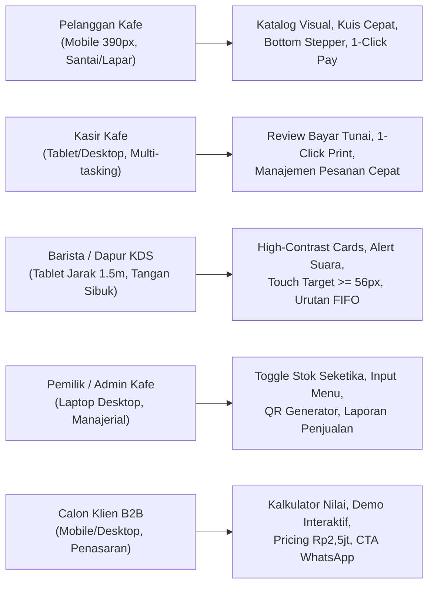
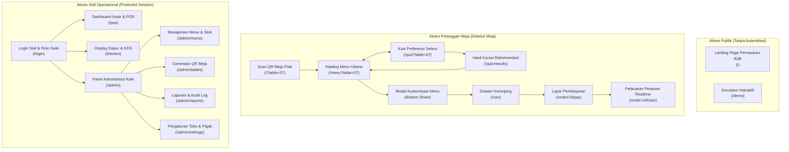
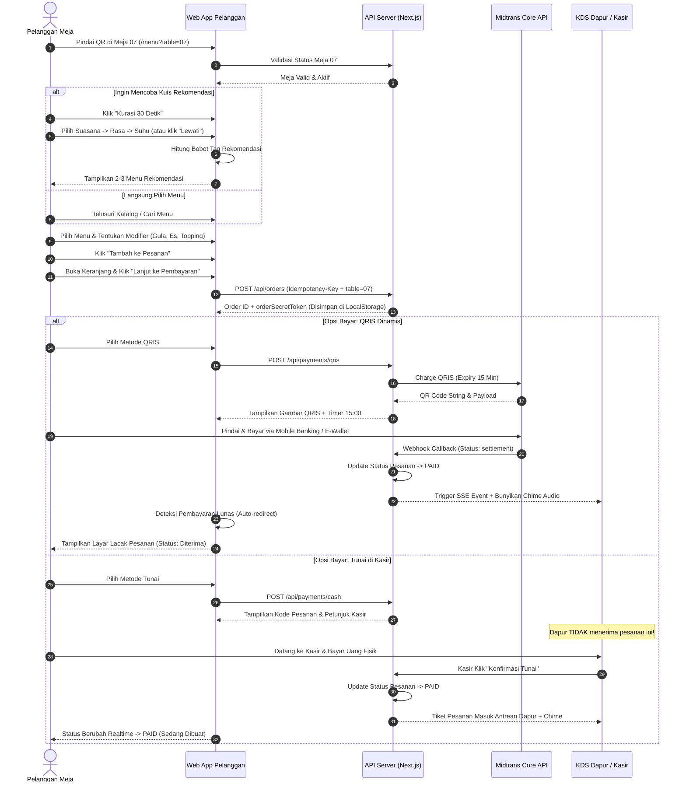
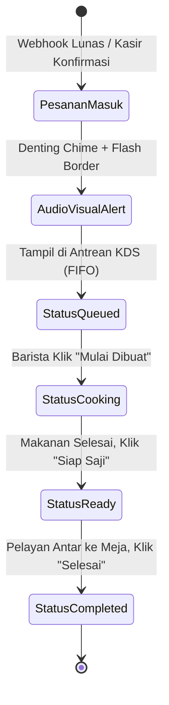
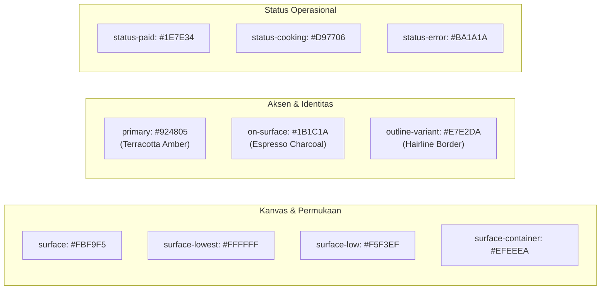
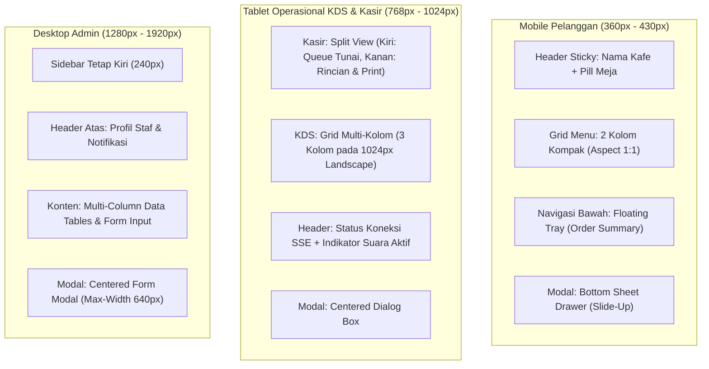
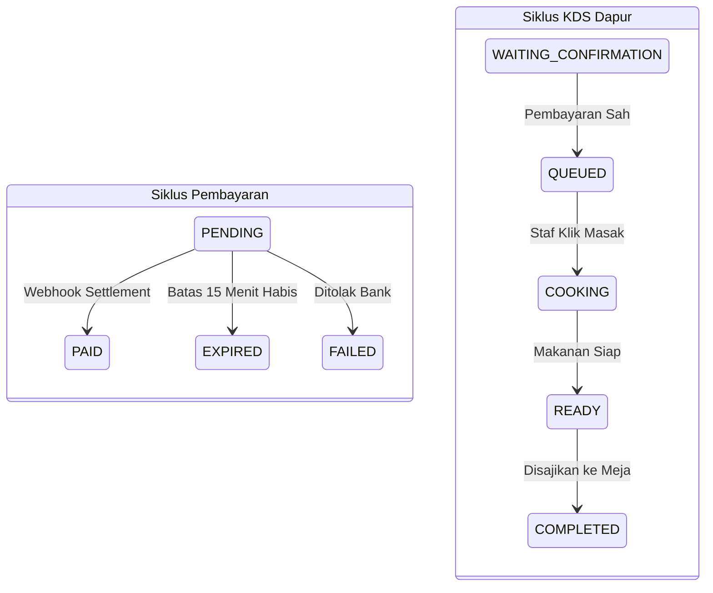
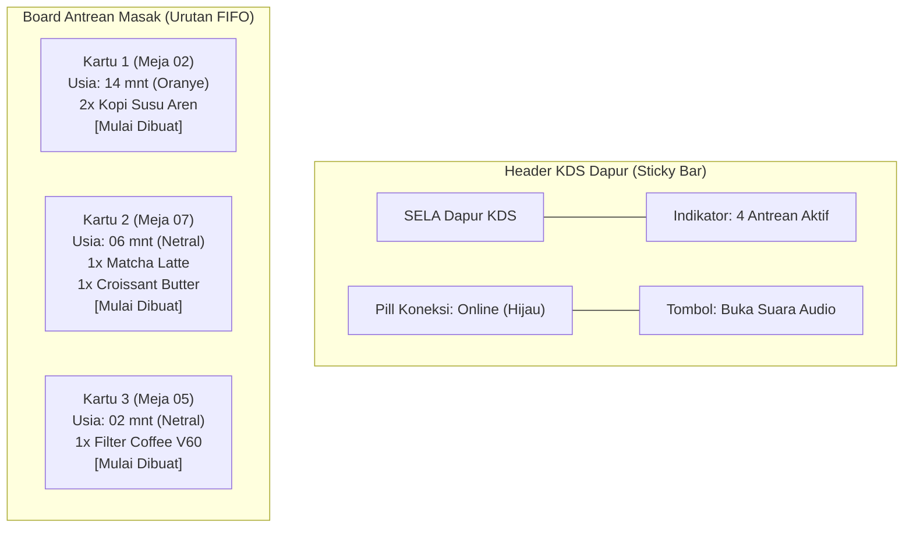

# SPESIFIKASI SISTEM DESAIN & PANDUAN PENGEMBANGAN ANTARMUKA (DESIGN.MD)
## SELA Smart QR Menu & Sistem Rekomendasi Preferensi Konsumen

> **Status Dokumen:** **Lengkap & Siap Implementasi (Production Ready)**  
> **Versi:** 2.0 (Arsitektur Desain SELA Minimalist Artisanal)  
> **Terakhir Diperbarui:** 2026-10-27  
> **Peran:** Senior UX/UI Designer & Design Systems Engineer  
> **Dokumen Rujukan:** `Proposal Pengembangan Website Smart QR Menu.docx`, `docs/AGENT.md`, `docs/PRD.md`, `docs/project-context.md`, `techstack.md`, `architecture.md`, dan prototipe terisolasi `design-preview/`  

---

## DAFTAR ISI
1. [Prinsip UX per Persona & Pemetaan Kebutuhan (REQ) ke Komponen](#1-prinsip-ux-per-persona--pemetaan-kebutuhan-req-ke-komponen)
2. [Sitemap & Diagram Alur Pengguna (User Flow)](#2-sitemap--diagram-alur-pengguna-user-flow)
3. [Design Tokens Konkret (Siap Pakai Tailwind CSS)](#3-design-tokens-konkret-siap-pakai-tailwind-css)
4. [Aturan Responsif & Perilaku Multi-Breakpoint](#4-aturan-responsif--perilaku-multi-breakpoint)
5. [Spesifikasi Komponen Antarmuka (Component Library)](#5-spesifikasi-komponen-antarmuka-component-library)
6. [Spesifikasi Layar demi Layar (Screen-by-Screen Specs)](#6-spesifikasi-layar-demi-layar-screen-by-screen-specs)
7. [Aturan Transaksi & Integritas Status pada UI](#7-aturan-transaksi--integritas-status-pada-ui)
8. [Panduan Microcopy & Tone of Voice Bahasa Indonesia](#8-panduan-microcopy--tone-of-voice-bahasa-indonesia)
9. [Standar Aksesibilitas (WCAG 2.1 AA) & Target Sentuh](#9-standar-aksesibilitas-wcag-21-aa--target-sentuh)
10. [Spesifikasi KDS (Kitchen Display System) & Audio Alert](#10-spesifikasi-kds-kitchen-display-system--audio-alert)
11. [Spesifikasi Struk Digital & Layout Cetak Thermal 58/80 mm](#11-spesifikasi-struk-digital--layout-cetak-thermal-5880-mm)
12. [Daftar Uji Desain & Interaksi (UAT Visual Checklist)](#12-daftar-uji-desain--interaksi-uat-visual-checklist)
13. [Matriks Diskrepansi Prototipe vs Produksi & Tindakan Koreksi](#13-matriks-diskrepansi-prototipe-vs-produksi--tindakan-koreksi)

---

## 1. Prinsip UX per Persona & Pemetaan Kebutuhan (REQ) ke Komponen

### 1.1. Prinsip UX Berdasarkan Karakteristik Persona Pengguna

Sistem antarmuka Smart QR Menu melayani 5 kelompok pengguna yang memiliki konteks lingkungan fisik, tekanan kognitif, dan ekspektasi interaksi yang sangat berbeda:



#### 1. Pelanggan Meja (Dine-in Customer — "Raka, 27")
* **Konteks & Hambatan Fisik:** Memindai kode QR dari stiker/tent-card akrilik meja menggunakan kamera ponsel pintar. Seringkali menggunakan satu tangan sambil duduk, berada di bawah pencahayaan kafe yang hangat, dan tidak ingin menginstal aplikasi apapun (*zero-app-download*).
* **Prinsip UX:**
  1. *Frictionless Mobile-First:* Langsung mengenali nomor meja tanpa registrasi atau input nama wajib.
  2. *Thumb-Zone Ergonomics:* Komponen kritis (kategori, filter, in-cart stepper, tray keranjang belanja) berada di 40% area bawah layar (*natural thumb zone*).
  3. *Sensory Clarity:* Foto produk beresolusi tajam dengan rasio 1:1, deskripsi rasa singkat, serta harga yang transparan tanpa kejutan biaya tersembunyi.
  4. *Quick Curation:* Kuis preferensi selera opsional dapat diselesaikan dalam $\le 30$ detik dengan tombol "Lewati" yang selalu terlihat jelas.

#### 2. Kasir Kafe ("Siti, 23")
* **Konteks & Hambatan Fisik:** Mengoperasikan tablet kasir di meja counter sambil berinteraksi tatap muka dengan tamu yang membayar tunai. Dituntut cepat mencocokkan nominal uang fisik dan mencetak struk thermal tanpa membuat antrean menumpuk.
* **Prinsip UX:**
  1. *Glanceable Cash Queue:* Kartu pesanan tunai tampil terpisah dengan aksen pembeda yang menonjol.
  2. *Defensive Confirmation:* Dialog konfirmasi penerimaan uang tunai meminta konfirmasi 1 ketukan jelas guna mencegah salah klik.
  3. *Reprint Affordance:* Tombol cetak ulang struk thermal selalu siap diakses dengan penanda visual *REPRINT* otomatis.

#### 3. Barista & Staf Dapur KDS ("Budi, 25")
* **Konteks & Hambatan Fisik:** Berada di area bar/dapur dengan tangan sering basah atau mengenakan sarung tangan higienis. Memandang layar tablet KDS dari jarak kerja $1.5 - 2$ meter di tengah kebisingan mesin espresso dan grinder kopi.
* **Prinsip UX:**
  1. *High Contrast at Distance:* Tipografi nomor meja ekstra besar ($\ge 28$ px) dan nama item tebal ($\ge 18$ px) di atas kartu berlatar kontras tinggi.
  2. *Strict FIFO Rhythm:* Pesanan tersusun urut waktu lunas; warna tepi kartu berubah dinamis seiring bertambahnya usia tunggu pesanan.
  3. *Jumbo Touch Targets:* Tombol aksi status pesanan berukuran tinggi $\ge 56$ px agar mudah ditekan dengan bagian samping jari atau tangan yang sibuk.
  4. *Dual Alert Feedback:* Denting audio chime diiringi kilatan visual layar (*visual flash*) saat ada pesanan baru yang lunas masuk antrean.

#### 4. Pemilik Kafe & Manajer Operasional ("Pak Hendra, 42")
* **Konteks & Hambatan Fisik:** Memantau ketersediaan bahan baku, performa omzet harian, dan mencetak QR meja baru melalui laptop kantor atau tablet.
* **Prinsip UX:**
  1. *Instant Stock Toggle:* Sakelar status ketersediaan menu (Tersedia $\leftrightarrow$ Habis) bekerja secara optimistik tanpa proses reload halaman.
  2. *Scannable Data Tables:* Tabel transaksi dilengkapi badge status berwarna konsisten, pencarian instan, dan ekspor data bersih.
  3. *Vector QR Studio:* Generator QR code meja langsung menghasilkan berkas SVG presisi tinggi dan format cetak kartu akrilik standar kafe.

#### 5. Calon Klien Kafe / Pengunjung Landing Page B2B ("Ibu Maya, 36")
* **Konteks & Hambatan Fisik:** Pemilik kedai kopi independen yang sedang mengevaluasi biaya dan kepraktisan Smart QR Menu melalui ponsel atau laptop.
* **Prinsip UX:**
  1. *Proof-over-Promise:* Menampilkan simulator kuis interaktif langsung di halaman depan tanpa meminta pendaftaran akun.
  2. *Transparent Commercials:* Tabel paket investasi Rp 2.500.000 (all-in tahun pertama) disajikan transparan tanpa biaya tersembunyi.
  3. *Direct WhatsApp Access:* Tombol floating chat WhatsApp langsung terisi pesan konsultasi siap kirim.

---

### 1.2. Matriks Pemetaan ID Kebutuhan (REQ) ke Komponen & Layar UI

| ID Kebutuhan | Nama Kebutuhan | Komponen Antarmuka Utama | Layar UI Terkait | Perilaku & Interaksi Kunci |
|---|---|---|---|---|
| `REQ-CUST-01` | Pindai QR & Deteksi Meja | `HeaderTableBadge`, `TableDetectGuard` | Halaman Katalog (`/menu?table=XX`) | Nomor meja terkunci pada header; jika parameter meja hilang, tampilkan dialog input nomor meja. |
| `REQ-CUST-02` | Kuis Preferensi Konsumen | `QuizProgressBar`, `PreferenceChipGroup`, `SkipButton` | Layar Kuis Kurasi (`/quiz`) | 3 langkah rasa & suhu, pilihan chip single-select, tombol lewati melompat langsung ke katalog lengkap. |
| `REQ-CUST-03` | Rekomendasi Menu Cerdas | `RecommendationHeroCard`, `TasteTagBadge`, `ExploreAllCTA` | Layar Hasil Kuis (`/quiz/results`) | Kartu menu terkurasi dengan label alasan ("Karakter hangat & manis seimbang"); fallback jika stok habis. |
| `REQ-CUST-04` | Katalog Menu & Filter | `CategoryTabsScroll`, `MenuCardGrid`, `MenuSearchBar` | Halaman Katalog (`/menu`) | Grid 2 kolom mobile, filter tab melekat (*sticky*), pencarian teks instan nama & deskripsi menu. |
| `REQ-CUST-05` | Kustomisasi Modifier | `ModifierBottomSheet`, `RadioOptionGroup`, `CheckboxAddonGroup`, `NoteTextarea` | Modal Detail Menu | Pilihan level gula/es (radio), add-on berbayar (checkbox), catatan barista, kalkulasi subtotal instan. |
| `REQ-CUST-06` | Keranjang & Ringkasan | `FloatingOrderTray`, `CartDrawerSheet`, `QuantityStepper` | Drawer Keranjang (`/cart`) | Floating tray lengket di bawah, tombol stepper `[-] Qty [+]`, rincian subtotal dan catatan per item. |
| `REQ-CUST-07` | Checkout QRIS & Tunai | `PaymentMethodSelector`, `QRISDisplayCard`, `CashInstructionCard` | Layar Pembayaran (`/order/:id/pay`) | Pilihan tab QRIS (dinamis) atau Tunai di Kasir; tombol bayar dengan pencegah klik ganda (*debounce*). |
| `REQ-CUST-08` | Status Pesanan Real-Time | `OrderStatusTimeline`, `ElapsedBadge`, `SecretTokenStore` | Pelacak Pesanan (`/order/:id/track`) | Alur status 4 tahap (*Menunggu Bayar $\rightarrow$ Diterima $\rightarrow$ Dibuat $\rightarrow$ Siap*), token rahasia peramban. |
| `REQ-PAY-01` | Integrasi QRIS Core API | `QRISImageRenderer`, `WebhookPoller`, `PaymentFeedback` | Layar Bayar QRIS | Tampilan gambar QRIS dinamis resmi, polling status background tiap 3 detik dengan indikator animasi. |
| `REQ-PAY-02` | Pembayaran Tunai di Kasir | `CashWaitingBadge`, `CashStaffNotice` | Layar Bayar Tunai | Informasi nomor meja & total bayar untuk ditunjukkan ke kasir; pesanan tidak masuk ke dapur sebelum disetujui. |
| `REQ-PAY-03` | Idempotensi Transaksi | `StatefulSubmitButton`, `LoadingSpinnerOverlay` | Dialog Konfirmasi Checkout | Tombol submit disable otomatis saat diklik; token idempotensi mencegah duplikasi transaksi. |
| `REQ-PAY-04` | Kedaluwarsa 15 Menit | `CountdownProgressBar`, `SessionExpiredModal`, `RetryCTA` | Layar Bayar QRIS | Timer mundur 15:00 menit; saat habis, QR diblokir dan muncul modal konfirmasi pemesanan ulang. |
| `REQ-OPS-01` | KDS Dapur Antrean Masak | `KitchenBoardGrid`, `KitchenOrderCard`, `AgeTimerPill` | Antrean Dapur (`/kitchen`) | Grid kartu pesanan lunas FIFO; badge waktu tunggu berubah warna jika pesanan $>15$ menit. |
| `REQ-OPS-02` | Transisi Status Pesanan | `KitchenStatusActionBtn`, `OptimisticToast` | Kartu KDS Dapur | Tombol aksi satu ketukan: *Mulai Dibuat* (`COOKING`) $\rightarrow$ *Siap Saji* (`READY`) $\rightarrow$ *Selesai* (`COMPLETED`). |
| `REQ-OPS-03` | Audio Alert & Notifikasi | `AudioPermissionPrompt`, `VisualFlashAlert` | Header KDS & Kasir | Tombol aktivasi audio saat pertama buka layar; denting chime saat pesanan lunas; lampu visual berkedip. |
| `REQ-OPS-04` | Kasir Konfirmasi Tunai | `CashOrderReviewCard`, `CashConfirmModal` | Dashboard Kasir (`/pos`) | Antrean tunai khusus; tombol konfirmasi penerimaan uang mengubah status pesanan menjadi `PAID`. |
| `REQ-OPS-05` | Cetak Struk Thermal | `ThermalPrintBtn`, `ReprintNoticeTag` | Kasir & Detail Pesanan | Tombol cetak memicu dialog browser print media 58/80 mm; cetak ulang otomatis berlabel *REPRINT*. |
| `REQ-OPS-06` | Pembatalan Pesanan Kasir | `CancelOrderDialog`, `RefundReasonSelect` | Modal Opsi Kasir | Pembatalan pesanan sebelum masuk fase *Dibuat*; catatan alasan audit wajib diisi oleh staf kasir. |
| `REQ-ADMIN-01` | Autentikasi Staf & Role | `StaffLoginForm`, `ProtectedLayoutGuard` | Halaman Login (`/login`) | Form login PIN 4-digit / email-password dengan pembagian hak akses (*Admin, Kasir, Dapur*). |
| `REQ-ADMIN-02` | Manajemen Menu & Kategori | `MenuDataTable`, `MenuDrawerEditor`, `ModifierGroupForm` | Panel Admin Menu (`/admin/menu`) | Form input nama, foto, harga integer rupiah, kategori, grup modifier, dan tag rasa kuis. |
| `REQ-ADMIN-03` | Sakelar Stok Sold Out | `QuickSoldOutSwitch`, `StockStatusBadge` | Panel Admin & Menu Grid | Sakelar toggle satu klik untuk mengubah status stok seketika ke seluruh layar pelanggan dan kasir. |
| `REQ-ADMIN-04` | Generator QR Code Meja | `TableQRStudio`, `QRDownloadDropdown` | Panel Admin Meja (`/admin/tables`) | Input nomor meja, pratinjau kartu akrilik, unduh format SVG/PNG dan PDF siap cetak. |
| `REQ-ADMIN-05` | Konfigurasi Pajak/Layanan | `TaxConfigCard`, `PercentageInput` | Pengaturan (`/admin/settings`) | Switch aktivasi PB1 (10%) dan Service Charge (5%) dengan opsi mode inklusif/eksklusif. |
| `REQ-ADMIN-06` | Laporan Penjualan Ringkas | `MetricStatCard`, `TransactionTable`, `ExportCSVBtn` | Laporan (`/admin/reports`) | Kartu ringkasan omzet harian, total cup terjual, rincian pembayaran, dan tombol unduh CSV. |
| `REQ-ADMIN-07` | Audit Log Peristiwa | `AuditTrailTimeline`, `ActorBadge` | Audit (`/admin/audit`) | Pencatatan riwayat siapa yang membatalkan pesanan, mengubah harga menu, atau toggle stok. |
| `REQ-B2B-01` | Landing Page Solusi Kafe | `B2BHeroFold`, `FeaturePillarsGrid` | Beranda Publik (`/`) | Value proposition otomasi pesanan kafe, keterbacaan operasional, dan garansi implementasi 7 hari. |
| `REQ-B2B-02` | Simulator Kuis Demo B2B | `EmbeddedQuizSimulator`, `InteractiveDeviceFrame` | Bagian Demo Landing Page | Widget demo interaktif pelanggan di dalam frame smartphone untuk dicoba langsung oleh calon pembeli. |
| `REQ-B2B-03` | Rincian Paket Rp 2,5 Juta | `TransparentPricingCard`, `IncludedFeatureList` | Bagian Harga Landing Page | Rincian lengkap biaya lisensi, setup sistem, domain/hosting tahun ke-1, dan batasan komersial. |
| `REQ-B2B-04` | Tombol Kontak WhatsApp | `FloatingWhatsAppCTA`, `ConsultationModal` | Seluruh Landing Page B2B | Tombol chat WhatsApp melayang dengan template teks otomatis: *"Halo, saya ingin tanya Smart QR Menu..."*. |

---

## 2. Sitemap & Diagram Alur Pengguna (User Flow)

### 2.1. Sitemap Arsitektur Informasi & Pemisahan Akses



> [!CAUTION] Pemisahan Navigasi Demo vs Produksi
> Kotak pemilih peran (*Role Switcher*) yang ada pada prototipe awal semata-mata merupakan alat simulasi desain (*design simulator fixture*). Pada aplikasi produksi, **tidak boleh ada sakelar role publik**. Akses staf kasir, dapur, dan admin wajib melalui rute autentikasi terproteksi session (`/login`) dengan verifikasi JWT/PIN server.

---

### 2.2. Diagram Alur Pengguna (User Flow)

#### 1. Alur Pelanggan Meja (Customer Journey)


#### 2. Alur Staf Dapur (KDS Flow)


---

## 3. Design Tokens Konkret (Siap Pakai Tailwind CSS)

Sistem token mengadopsi palet **SELA Minimalist Artisanal** dengan nuansa kanvas hangat (*warm canvas*), aksen terakota espresso (*terracotta amber*), dan tipografi humanist modern. Seluruh token dirancang untuk langsung dipetakan ke dalam konfigurasi `tailwind.config.ts`.

### 3.1. Palet Warna Semantik (Hex & Peran)



| Token Semantik | Nilai HEX | Kontras Ratio | Penggunaan & Konteks Antarmuka |
|---|---|---|---|
| `surface` | `#FBF9F5` | 13.8:1 (vs `#1B1C1A`) | Latar belakang kanvas dasar seluruh aplikasi pelanggan & kasir |
| `surface-container-lowest` | `#FFFFFF` | 15.2:1 (vs `#1B1C1A`) | Latar kartu menu, panel modal drawer, formulir, dan pop-up |
| `surface-container-low` | `#F5F3EF` | 13.1:1 (vs `#1B1C1A`) | Kontainer kuis selera, bar pencarian menu, dan kartu sekunder |
| `surface-container` | `#EFEEEA` | 12.3:1 (vs `#1B1C1A`) | Latar pil filter kategori inaktif, badge meja, dan divider |
| `surface-container-high` | `#EAE8E4` | 11.5:1 (vs `#1B1C1A`) | Latar kolom tabel admin selang-seling, input disabled |
| `on-surface` | `#1B1C1A` | 13.8:1 (di `#FBF9F5`) | Warna teks judul, nama menu, harga rupiah, dan icon utama |
| `on-surface-variant` | `#544339` | 6.8:1 (di `#FBF9F5`) | Deskripsi menu, label metadata, volume sajian, teks bantuan |
| `outline` | `#877367` | 4.6:1 (di `#FBF9F5`) | Garis tepi input interaktif, icon sekunder, placeholder |
| `outline-variant` | `#E7E2DA` | N/A (Dekoratif) | Garis pemisah hairline 1px antar kartu dan border tipis komponen |
| `primary` | `#924805` | 5.2:1 (di `#FFFFFF`) | Aksen utama SELA: tombol CTA checkout, bintang favorit, tab aktif |
| `on-primary` | `#FFFFFF` | 5.2:1 (di `#924805`) | Warna teks putih di atas tombol primary dan badge solid |
| `primary-container` | `#B05F20` | 4.5:1 (di `#FFFFFF`) | Warna status hover dan fokus pada tombol utama |
| `primary-fixed` | `#FFDCC7` | 12.1:1 (vs `#311300`) | Latar chip kuis saat terpilih (*selected chip background*) |
| `on-primary-fixed` | `#311300` | 12.1:1 (di `#FFDCC7`) | Teks tajam di atas chip kuis yang terpilih |
| `inverse-surface` | `#241E1B` | 14.8:1 (vs `#FFFFFF`) | Floating order tray di bawah, tombol stepper hitam, dark KDS |
| `inverse-on-surface` | `#FBF9F5` | 14.8:1 (di `#241E1B`) | Teks putih-krem di atas floating tray dan tombol stepper |
| `status-paid` (Sukses) | `#1E7E34` | 4.8:1 (di `#FFFFFF`) | Status Lunas, pesanan Siap Saji di KDS, verifikasi webhook |
| `status-cooking` (Proses) | `#D97706` | 3.8:1 (di `#FFFFFF`) | Status Sedang Dibuat di dapur, timer pesanan sedang berjalan |
| `status-error` (Batal) | `#BA1A1A` | 5.5:1 (di `#FFFFFF`) | Badge *Sold Out*, status Kedaluwarsa, pesan error koneksi |
| `status-pending` (Tunggu) | `#766F66` | 4.5:1 (di `#FFFFFF`) | Status Menunggu Pembayaran, instruksi pembayaran tunai |

---

### 3.2. Skala Tipografi & Penerapan

* **Font Judul & Aksen Merek:** `Plus Jakarta Sans` (Tersedia via Google Fonts, geometris hangat, ramah sentuhan).
* **Font Konten, Form, & Angka:** `Inter` (Tingkat keterbacaan micro-reading tinggi, netral).
* **Aturan Tabular Numerals:** Wajib mengaktifkan `font-variant-numeric: tabular-nums` pada seluruh penulisan harga rupiah dan angka timer agar karakter numerik selalu sejajar rapi.

| Token Tipografi | Font Family | Ukuran / Line-Height | Weight | Tracking | Kasus Penggunaan Antarmuka |
|---|---|---|---|---|---|
| `text-headline-xl` | Plus Jakarta Sans | 32px / 38px (2.0rem) | 700 (Bold) | -0.02em | Hero headline landing page, nomor meja besar di KDS |
| `text-headline-lg` | Plus Jakarta Sans | 24px / 30px (1.5rem) | 600 (Semibold) | -0.015em | Judul halaman utama, nama kafe "SELA" di header, subtotal akhir |
| `text-headline-md` | Plus Jakarta Sans | 20px / 26px (1.25rem) | 600 (Semibold) | -0.01em | Judul kartu rekomendasi, judul modal bottom sheet, total KDS |
| `text-headline-sm` | Plus Jakarta Sans | 16px / 22px (1.0rem) | 600 (Semibold) | 0.0em | Nama produk menu pada kartu katalog, judul pertanyaan kuis |
| `text-body-lg` | Inter | 16px / 24px (1.0rem) | 400 (Regular) | 0.0em | Paragraf deskripsi panjang di landing page, instruksi checkout |
| `text-body-md` | Inter | 14px / 20px (0.875rem) | 400 (Regular) | 0.0em | Teks input form, catatan pelanggan, detail modifier menu |
| `text-body-sm` | Inter | 12px / 16px (0.75rem) | 400 (Regular) | +0.01em | Deskripsi singkat menu pada grid katalog (line-clamp-2) |
| `text-price-tabular` | Inter | 14px / 18px (0.875rem) | 600 (Semibold) | 0.0em | Nominal harga rupiah pada kartu menu (`font-mono-numbers`) |
| `text-price-large` | Inter | 18px / 22px (1.125rem) | 700 (Bold) | 0.0em | Total tagihan keranjang, subtotal pembayaran di floating bar |
| `text-label-md` | Inter | 13px / 16px (0.8125rem) | 500 (Medium) | +0.01em | Pil navigasi kategori, label input form, tab switcher |
| `text-label-sm` | Inter | 11px / 14px (0.6875rem) | 600 (Semibold) | +0.03em | Badge status kapital (*FAVORIT, SOLD OUT, MEJA 07, SIAP*) |

---

### 3.3. Skala Spacing, Radius, Shadow, & Motion

#### 1. Spacing & Grid System
* `space-xs`: `4px` (`0.25rem`) — Jarak icon dengan label teks mikro, gap badge.
* `space-sm`: `8px` (`0.5rem`) — Padding internal badge, gap horizontal input, padding kartu kecil.
* `space-md` / `gutter`: `12px` (`0.75rem`) — Jarak pemisah antar-kartu pada katalog 2 kolom, gap baris opsi.
* `margin`: `16px` (`1.0rem`) — Margin luar layar mobile kiri dan kanan, padding modal.
* `space-lg`: `20px` (`1.25rem`) — Padding internal bottom sheet, margin vertikal antar-seksi.
* `space-xl`: `32px` (`2.0rem`) — Jarak vertikal antar kategori menu pada katalog.
* `space-2xl`: `48px` (`3.0rem`) — Margin atas-bawah seksi hero landing page.

#### 2. Radius Sudut (Corner Geometry)
* `rounded-sm`: `4px` (`0.25rem`) — Checkbox option, tag kecil.
* `rounded-DEFAULT`: `8px` (`0.5rem`) — Foto produk menu, input text, tombol aksi kecil.
* `rounded-md`: `12px` (`0.75rem`) — Kartu produk katalog 2 kolom, kartu KDS dapur.
* `rounded-lg`: `16px` (`1.0rem`) — Modal bottom sheet drawer, kartu kuis preferensi, order tray.
* `rounded-xl`: `24px` (`1.5rem`) — Container promo hero landing page, frame dialog modal.
* `rounded-full`: `9999px` — Pil kategori, badge nomor meja, tombol stepper `[- 1 +]`, CTA pill.

#### 3. Ketinggian Permukaan (Elevation & Shadows)
* **Level 0 (Flat Canvas):** `box-shadow: none;` — Kanvas dasar `#FBF9F5`.
* **Level 1 (Card Outline):** `border: 1px solid #E7E2DA; box-shadow: 0 1px 3px rgba(36, 30, 27, 0.03);` — Kartu menu katalog & kartu antrean KDS.
* **Level 2 (Floating Bar & Header):** `border: 1px solid #E7E2DA; backdrop-filter: blur(12px); box-shadow: 0 8px 24px rgba(36, 30, 27, 0.06);` — Header atas sticky dan floating order tray.
* **Level 3 (Modal Drawer & Sheet):** `box-shadow: 0 -12px 32px rgba(36, 30, 27, 0.12);` di atas overlay backdrop `rgba(36, 30, 27, 0.45)` — Bottom sheet modifier & konfirmasi checkout.

#### 4. Perilaku Animasi & Motion
* **Kurva Easing:** `cubic-bezier(0.16, 1, 0.3, 1)` (Fluid Apple-style ease-out).
* **Durasi Micro-Tap:** `120ms` — Efek tekan tombol (`active:scale-95 transition-transform`).
* **Durasi Drawer Slide-Up:** `280ms` — Masuknya bottom sheet modal dari bawah layar.
* **Durasi Page Fade:** `180ms` — Perpindahan antar-langkah kuis selera.
* **Reduced Motion:** Wajib menyertakan aturan `@media (prefers-reduced-motion: reduce)` yang mematikan transisi transform dan menjadikannya transisi opasitas instan (`0ms`).

---

## 4. Aturan Responsif & Perilaku Multi-Breakpoint

Sistem antarmuka Smart QR Menu beroperasi pada tiga ranah perangkat keras dengan karakteristik tata letak yang didefinisikan secara tegas:



### 4.1. Matriks Breakpoint Tailwind CSS

| Nama Breakpoint | Lebar Minimum | Target Perangkat Utama | Layout Shell & Navigasi | Aturan Khusus Konten |
|---|---|---|---|---|
| `base` (Mobile) | $360\text{ px} - 639\text{ px}$ | Smartphone Android & iOS (Baseline: 390px iPhone) | Single-column flow, max-width wrapper `430px` terpusat, header sticky atas, floating tray bawah dengan `pb-safe`. | Grid menu 2 kolom rasio 1:1, font-size tombol $\ge 14\text{ px}$, modal berupa *Bottom Sheet*. |
| `sm` | $640\text{ px}$ | Smartphone lipat (Foldable) / Phablet | Single-column flow terpusat (max-width `540px`). | Grid menu 2-3 kolom fleksibel. |
| `md` (Tablet Portrait) | $768\text{ px}$ | iPad Mini / Tablet Android $8\text{ inci}$ | Two-column split layout untuk kasir; 2 kolom lebar untuk KDS dapur. | Bottom sheet beralih menjadi centered modal dialog (`max-w-md`). |
| `lg` (Tablet Landscape) | $1024\text{ px}$ | iPad Pro / Tablet Dapur $10.5\text{ inci} - 12\text{ inci}$ | KDS Dapur 3-4 kolom antrean kartu FIFO; Kasir split-screen $40\% : 60\%$. | Touch target tombol KDS minimal $56\text{ px}$, font nama menu $\ge 18\text{ px}$. |
| `xl` (Desktop) | $1280\text{ px}$ | Laptop Kasir, PC Manajer, Layar Monitor Dapur | Fixed Sidebar kiri $240\text{ px}$ + Scrollable content area di kanan. | Tabel data penuh dengan filter inline, pagination, dan pratinjau split. |
| `2xl` | $1536\text{ px}+$ | Monitor Kasir Widescreen / TV Display Bar | KDS Dapur hingga 5-6 kolom antrean pesanan. | Font nomor meja membesar hingga $36\text{ px}$ untuk keterbacaan $3\text{ meter}$. |

---

## 5. Spesifikasi Komponen Antarmuka (Component Library)

### 5.1. Header Nomor Meja (`HeaderTableBadge`)
* **Tampilan Default:** Kontainer pil berlatar `#EFEEEA` dengan dot indikator berkedip hijau lembut (`#1E7E34`), teks `Meja 07` berbobot semibold (`text-label-sm`).
* **State Error/Tidak Terdeteksi:** Dot berubah merah (`#BA1A1A`), teks berubah menjadi `Pilih Meja` dengan ikon panah dropdown. Mengklik badge membuka modal pemilihan nomor meja manual (dengan proteksi konfirmasi staf).
* **Aksesibilitas:** `aria-label="Nomor meja saat ini adalah meja 7"`.

### 5.2. Indikator Progress Kuis (`QuizProgressBar`)
* **Tampilan:** Bar horizontal tersegmentasi 3 bagian dengan celah $4\text{ px}$.
* **Active State:** Segmen terisi warna aksen terakota `#924805` dengan animasi transisi lebar $240\text{ ms}$. Segmen yang belum dilewati berwarna `#E7E2DA`.
* **Tombol Lewati:** Tombol teks di pojok kanan atas berlabel `Lewati` berwarna `#544339` dengan target sentuh $44 \times 44\text{ px}$.

### 5.3. Chip Preferensi Kuis (`PreferenceChipGroup`)
* **Tampilan Default:** Kartu pil rounded-full, border $1\text{ px}$ `#E7E2DA`, latar `#FFFFFF`, teks `#1B1C1A`, padding horizontal $16\text{ px}$, vertikal $12\text{ px}$.
* **State Terpilih (Selected):** Latar berubah menjadi `#241E1B` (Espresso) dengan teks putih `#FFFFFF`, atau latar aksen terakota lembut `#FFDCC7` dengan teks `#311300`. Ikon centang muncul di sebelah kiri label.
* **Perilaku Keyboard:** Navigasi panah kiri/kanan antar chip, tombol `Space` atau `Enter` untuk memilih.

### 5.4. Kartu Menu Katalog 2-Kolom (`MenuCardGrid`)
* **Struktur Kartu:**
  1. *Thumbnail Foto Produk:* Aspek rasio 1:1, `object-fit: cover`, sudut `rounded-DEFAULT` ($8\text{ px}$), latar belakang skeleton abu-krem `#EFEEEA` saat loading.
  2. *Badge Pojok Kiri Atas Foto:* Badge solid `#924805` berlabel bintang emas `Favorit` atau `Best Seller`.
  3. *Nama Menu:* Teks `text-headline-sm` berbobot semibold, warna `#1B1C1A`, dipotong rapi maksimal 1 baris (`line-clamp-1`).
  4. *Deskripsi Singkat:* Teks `text-body-sm`, warna `#544339`, maksimal 2 baris (`line-clamp-2`), tinggi tetap untuk menjaga simetri grid.
  5. *Baris Bawah (Harga & Aksi):* Sebelah kiri harga tabular `Rp28.000` (`text-price-tabular`). Sebelah kanan tombol aksi:
     * *Kondisi Belum Masuk Keranjang:* Tombol bulat $32 \times 32\text{ px}$ bergaris tepi `#E7E2DA` dengan icon `+` berwarna `#924805`.
     * *Kondisi Sudah di Keranjang:* Kapsul pil hitam `#241E1B` berisi tombol minus `[-]`, angka jumlah kuantitas putih `[1]`, dan tombol plus `[+]`.
* **State Sold Out:**
  * Seluruh kartu diturunkan opasitasnya menjadi $45\%$.
  * Foto produk diberikan filter grayscale: `filter: grayscale(80%)`.
  * Badge di atas foto berganti menjadi pil abu-batu berlabel `Habis` berlatar `#EAE8E4` dengan teks `#766F66`.
  * Tombol aksi `+` dinonaktifkan (`cursor-not-allowed`, `disabled`).

### 5.5. Modal Kustomisasi Modifier (`ModifierBottomSheet`)
* **Tipe Komponen:** Drawer bawah (*Bottom Sheet*) dengan handle drag abu-abu di bagian atas.
* **Elemen:**
  * Header modal: Foto kecil produk + Nama menu + Harga dasar.
  * Grup Varian Tunggal (Single Choice): Radio button berlabel `Tingkat Manis` (Normal, Less Sweet 50%, Tanpa Gula). Target baris $44\text{ px}$.
  * Grup Tambahan Bebas (Multi Choice): Checkbox berlabel `Ekstra Topping` (Oatmilk +Rp6.000, Espresso Shot +Rp5.000). Nominal tambahan tampil di sebelah kanan.
  * Textarea Catatan Barista: Placeholder `Contoh: Es dipisah, jangan terlalu manis`, maksimal $120$ karakter dengan counter tersisa.
  * Tombol Footer Melekat (*Sticky Footer*): Tombol lebar penuh berlatar `#924805` berlabel `Tambah ke Pesanan — Rp34.000` (nominal menghitung kalkulasi modifier secara seketika).

### 5.6. Floating Order Tray Melekat (`FloatingOrderTray`)
* **Posisi & Dimensi:** Melayang di bagian bawah viewport mobile pelanggan, inset horizontal `16px`, jarak dari bawah `env(safe-area-inset-bottom, 16px)`.
* **Visual:** Latar solid `#241E1B` (Espresso) sudut `rounded-lg` ($16\text{ px}$), bayangan Level 2.
* **Konten Kiri:** Badge pil oranye terakota berisi angka jumlah item `2 item` + teks tabular subtotal `Rp56.000` berwarna putih.
* **Konten Kanan:** Teks CTA `Lihat Keranjang` berbobot semibold disertai icon panah chevron kanan.
* **Perilaku:** Otomatis muncul dengan animasi slide-up lembut saat keranjang berisi minimal 1 item; otomatis hilang jika keranjang kosong.

### 5.7. Kartu Antrean Pesanan KDS (`KitchenOrderCard`)
* **Struktur:**
  1. *Header Kartu:* Nomor meja ekstra besar (`Meja 04` — `text-headline-md` $20\text{ px}$ bold) + Pil Timer Usia Pesanan (`04:12 mnt`).
  2. *Status Kode & Waktu:* Teks jam masuk `14:23 WIB` + ID Pesanan `#SL-8921`.
  3. *Daftar Item Menu:* Teks nama menu tebal ($16\text{ px}$). Modifier dan catatan kustom diindentasi ke dalam dengan warna pembeda kuning/oranye:
     * `• 2x Kopi Susu Aren`
     * `  ↳ Less Ice (50%), Normal Sweet`
     * `  ↳ [Catatan: Gelas terpisah]` (Latar kuning muda `#FEF3C7` teks `#92400E`).
  4. *Tombol Aksi Bawah:* Tombol lebar penuh tinggi $56\text{ px}$ dengan label status transisi berikutnya (`Mulai Dibuat` $\rightarrow$ `Siap Disajikan`).

---

## 6. Spesifikasi Layar demi Layar (Screen-by-Screen Specs)

### 6.1. Rangkaian Layar Pelanggan Meja

#### Layar 1: Katalog Menu Utama (`SCR-CUST-04` — `/menu?table=07`)
* **Tujuan:** Menampilkan seluruh daftar menu kafe yang dapat dipesan pelanggan pada meja yang aktif.
* **Hierarki Informasi:**
  1. *Header Bar (Sticky Top):* Logo SELA + Badge Meja 07 + Tombol Bantuan Staf.
  2. *Search & Filter Bar:* Input teks pencarian instan + Tombol filter preferensi.
  3. *Promo Kurasi Kuis:* Banner editorial "Bingung tentukan pesanan? Coba kurasi 30 detik".
  4. *Category Nav (Sticky Top 2):* Baris pil kategori (*Semua, Kopi, Non-Kopi, Makanan*).
  5. *Menu Grid Section:* Grid 2 kolom kartu produk.
  6. *Floating Order Tray:* Pinned dock keranjang di bagian bawah.
* **Validasi & State:**
  * *Loading:* Tampilkan 6 kartu skeleton shimmer abu-krem berotasi.
  * *Empty Search:* Tampilkan ilustrasi cangkir kosong dengan teks `"Menu tidak ditemukan. Coba kata kunci lain."`.
  * *Network Offline:* Banner oranye melekat di bawah header: `"Koneksi internet terputus. Mencoba menghubungkan kembali..."`.

#### Layar 2: Alur Kuis Preferensi Selera (`SCR-CUST-02` — `/quiz?table=07`)
* **Tujuan:** Memberikan rekomendasi 2-3 menu paling cocok bagi pelanggan yang bingung atau pemilih baru.
* **Langkah Kuis (3 Pertanyaan):**
  * *Langkah 1 (Suasana / Mood):* Santai menikmati suasana, Butuh dorongan fokus kerja, atau Menyegarkan diri di siang terik.
  * *Langkah 2 (Karakter Rasa):* Manis legit & creamy, Asam segar buah/floral, atau Pahit mantap kopi pekat.
  * *Langkah 3 (Format / Suhu):* Dingin ber-es segar, atau Hangat menenangkan.
* **Aksi Utama:** Tombol pilihan chip langsung menyimpan jawaban dan beralih ke pertanyaan berikutnya secara otomatis; tombol `Lewati` di pojok kanan melompati seluruh kuis dan langsung membuka katalog lengkap.

#### Layar 3: Hasil Kurasi Rekomendasi (`SCR-CUST-03` — `/quiz/results`)
* **Tujuan:** Menampilkan 1 menu rekomendasi utama (*Hero Match*) dan 2 menu alternatif terdekat.
* **Konten Kartu Rekomendasi:**
  * Tag racikan: `"Racikan Santai & Dingin"`.
  * Alasan rekomendasi konkret yang berasal dari tag: `"Dipilih karena memadukan espresso arabika dengan rasa manis aren seimbang dan kesegaran es."`.
  * Tombol aksi instan: `Tambah ke Pesanan` atau `Lihat Semua Menu`.
* **Aturan Fallback:** Jika seluruh menu rekomendasi ternyata berstatus *Sold Out*, sistem menampilkan pesan kurasi alternatif: `"Menu racikan ini sedang habis, berikut opsi favorit serupa yang tersedia hari ini."` dan menampilkan menu best-seller yang masih aktif.

#### Layar 4: Checkout & Pembayaran QRIS Dinamis (`SCR-CUST-07` — `/order/:id/pay`)
* **Tujuan:** Menampilkan kode QRIS dinamis resmi dari Midtrans dan menghitung batas waktu pembayaran 15 menit.
* **Hierarki Informasi:**
  1. *Header:* Judul `Pembayaran Meja 07` + Nominal total harga rupiah `Rp56.000`.
  2. *Card QRIS Dinamis:* Gambar QR code resolusi tinggi dengan logo QRIS resmi di tengah.
  3. *Timer Kedaluwarsa:* Progress bar merah dan counter mundur: `Selesaikan dalam 14:48 menit`.
  4. *Petunjuk Pembayaran:* Ikon e-wallet & m-banking pendukung (BCA, Mandiri, GoPay, OVO, ShopeePay).
  5. *Tombol Unduh QR / Bantuan:* Opsi simpan gambar QR ke galeri ponsel.
* **State Transisi:**
  * *Settlement Webhook Diterima:* Layar otomatis bergetar lembut (*haptic feedback*), menampilkan icon centang hijau besar `Pembayaran Diterima!`, lalu mengarahkan pelanggan ke layar pelacak pesanan dalam tempo $1.5\text{ detik}$.
  * *Waktu Habis (Expired):* QR code digelapkan dengan overlay gembok dan teks: `Waktu Pembayaran Habis. Pesanan dibatalkan otomatis. Silakan pesan ulang.`.

#### Layar 5: Pelacakan Pesanan Realtime (`SCR-CUST-08` — `/order/:id/track`)
* **Tujuan:** Memberikan ketenangan pada pelanggan meja mengenai progres pembuatan hidangan secara transparan.
* **Indikator Progres 4 Tahap:**
  1. `Pembayaran Lunas` (Hijau centang — Timestamp tercatat).
  2. `Pesanan Diterima Dapur` (Hijau centang — Tiket masuk sistem KDS).
  3. `Sedang Diramu Barista` (Oranye animasi berdenyut — Barista menekan tombol masak).
  4. `Siap Disajikan / Selesai` (Hijau solid — Makanan diantar ke meja).
* **Fitur Anti-Bocor (Keamanan):** Halaman hanya dapat dibuka jika peramban memiliki `orderSecretToken` yang cocok. Pelanggan baru yang memindai QR meja 07 tidak akan melihat tagihan atau status pesanan milik pelanggan sebelumnya.

---

### 6.2. Layar Operasional Staf & Dapur

#### Layar KDS Dapur (`SCR-KDS-01` — `/kitchen`)
* **Tujuan:** Antarmuka tablet bar/dapur untuk memproses antrean masak pesanan lunas.
* **Komponen Khusus:**
  * *Top Status Bar:* Jam digital besar, tombol switch tema gelap/terang, pill status koneksi `Online` (hijau), dan tombol `Aktifkan Audio Dapur` (oranye berdenyut jika audio belum di-unlock oleh interaksi pengguna).
  * *Board Antrean:* Kolom kartu pesanan tersusun mendatar (*horizontal scroll* atau *masonry wrap*) berdasarkan urutan FIFO.
  * *Aging Indicator Card:*
    * Usia $< 10\text{ menit}$ $\rightarrow$ Border kartu netral `#E7E2DA`.
    * Usia $10 - 20\text{ menit}$ $\rightarrow$ Border kartu oranye `#D97706` dengan label `Perhatian`.
    * Usia $> 20\text{ menit}$ $\rightarrow$ Border kartu merah berkedip lembut `#BA1A1A` dengan label `Prioritas Segera`.

#### Layar Kasir POS (`SCR-POS-01` — `/pos`)
* **Tujuan:** Memvalidasi pembayaran tunai, mencetak struk thermal, dan menangani pembatalan darurat.
* **Fitur Utama:**
  * *Tab Antrean Tunai (Cash Queue):* Menampilkan pesanan meja yang memilih bayar di kasir. Dilengkapi tombol `Konfirmasi Uang Masuk` yang memerlukan 1 klik verifikasi.
  * *Tab Riwayat Transaksi:* Pencarian pesanan berdasarkan nomor meja atau ID pesanan untuk cetak ulang (*reprint*) struk belanja.
  * *Dialog Batal/Refund:* Tombol pembatalan pesanan yang mewajibkan input alasan (*Bahan Baku Rusak, Pelanggan Pulang, Pesanan Ganda*) dan mencatat ID staf kasir yang bertanggung jawab.

---

## 7. Aturan Transaksi & Integritas Status pada UI

Mengikuti ketetapan pada [architecture.md](file:///d:/project/project-qr/architecture.md) dan standar keamanan sistem finansial, berikut adalah batasan integritas transaksi yang wajib ditegakkan pada tingkat antarmuka pengguna:

### 7.1. Otoritas Kalkulasi Harga Berada di Server (*Server-Authoritative*)
1. Total nominal belanja yang ditampilkan pada keranjang peramban pelanggan hanyalah **proyeksi visual sementara**.
2. Saat tombol *Lanjut ke Pembayaran* ditekan, aplikasi mengirimkan daftar ID menu, ID pilihan modifier, dan kuantitas ke endpoint `/api/orders`.
3. Server menghitung ulang seluruh subtotal berdasarkan harga resmi database PostgreSQL. Nominal final dari server itulah yang dikunci dan dikirimkan ke Midtrans Core API. UI tidak pernah mengirimkan nilai total rupiah dari sisi client.

### 7.2. Perubahan Harga & Stok Saat Checkout Dibuka
* Jika salah satu item di keranjang tiba-tiba diubah statusnya menjadi *Sold Out* oleh admin sebelum pelanggan menekan tombol bayar:
  * Server menolak pembuatan pesanan dengan kode error `ITEM_STOCK_DEPLETED`.
  * UI menampilkan dialog peringatan: `"Maaf, stok [Nama Menu] baru saja habis. Item telah disesuaikan dari keranjang Anda."`.
  * Keranjang secara otomatis memperbarui daftar item dan menghitung ulang total belanja tanpa menyebabkan crash aplikasi.

### 7.3. Pemisahan Mutlak Status Pembayaran vs Status Dapur
Status pembayaran dan progres fisik dapur adalah dua mesin status (*state machine*) terpisah:



* KDS Dapur **TIDAK PERNAH** memunculkan pesanan yang masih berstatus `PENDING`.
* Khusus pesanan tunai, status dapur tertahan pada `WAITING_CONFIRMATION` hingga kasir menekan tombol konfirmasi pembayaran.

### 7.4. Batas Waktu QRIS 15 Menit & Proteksi Idempotensi
1. **Countdown Timer:** Timer berjalan pada interval 1 detik di peramban. Jika waktu mencapai `00:00`, UI secara otomatis menonaktifkan kode QR dengan overlay abu-abu, menghentikan interval polling ke server, dan menampilkan tombol `Pesan Ulang`.
2. **Pencegahan Klik Ganda (Double-Click Prevention):** Tombol submit pembayaran menerapkan debounce ketat dan status loading seketika. Header HTTP `Idempotency-Key` (dihasilkan dari hash keranjang + timestamp) disertakan pada setiap request untuk memastikan pemesanan tidak terduplikasi meskipun jaringan seluler pelanggan lambat atau tombol ditekan berulang kali.

---

## 8. Panduan Microcopy & Tone of Voice Bahasa Indonesia

Seluruh teks antarmuka menggunakan Bahasa Indonesia bernuansa **Artisanal, Ramah, Efisien, dan Menenangkan**, merefleksikan suasana kedai kopi modern yang nyaman tanpa istilah kaku atau bahasa robot.

### 8.1. Kamus Teks Antarmuka (Microcopy Dictionary)

| Konteks Komponen | Teks yang Digunakan | Penjelasan & Alasan Pemilihan |
|---|---|---|
| Prompt Kuis Beranda | *"Bingung tentukan pesanan? Coba kurasi 30 detik"* | Mengajak tanpa memaksa; menonjolkan durasi cepat. |
| Tombol Lewati Kuis | *"Lewati"* | Singkat, tidak menghakimi, berada di pojok kanan atas. |
| Tag Hasil Kurasi | *"Racikan Santai & Dingin"* | Menggabungkan mood dan preferensi format minuman. |
| Alasan Rekomendasi | *"Dipilih karena karakter manis seimbang dan kesegaran es aren."* | Menjelaskan *mengapa* menu ini cocok berdasarkan tag. |
| Batasan Alergi / Medis | *"Rekomendasi disajikan berdasarkan preferensi rasa. Harap konfirmasikan alergi bahan pangan ke staf kami."* | **PENTING:** Menghindari klaim medis/kesehatan sepihak. |
| Placeholder Catatan | *"Contoh: Es sedikit, jangan terlalu manis"* | Memberikan contoh nyata yang relevan bagi barista. |
| Label Menu Habis | *"Habis"* atau *"Sold Out"* | Jelas dan tegas pada badge kartu produk. |
| Tombol Tambah Menu | *"Tambah ke Pesanan"* | Lebih berorientasi tindakan daripada sekadar "Beli". |
| Floating Bar Checkout | *"2 item • Rp56.000 — Lihat Keranjang"* | Langsung menampilkan kuantitas dan total harga. |
| Instruksi Bayar Tunai | *"Silakan menuju meja kasir dan sebutkan Meja 07 untuk pembayaran."* | Mengarahkan tamu fisik dengan langkah yang jelas. |
| Timer Mundur QRIS | *"Selesaikan pembayaran dalam 14:32"* | Memberikan kejelasan batas waktu tanpa panik. |
| Status Pesanan Selesai | *"Pesanan Anda telah diantar. Selamat menikmati!"* | Penutup ramah setelah pesanan tiba di meja tamu. |
| Error Jaringan / Putus | *"Koneksi terputus. Mencoba menghubungkan kembali..."* | Menginfokan proses otomatis sistem tanpa menakuti tamu. |

### 8.2. Standar Format Angka, Mata Uang, & Waktu Operasional
* **Mata Uang Rupiah:** Wajib ditulis dengan format `Rp` tanpa spasi, menggunakan tanda titik sebagai pemisah ribuan, dan **tanpa angka desimal sen** (Contoh: `Rp28.000`, bukan `Rp 28.000,00` atau `IDR 28k`).
* **Format Waktu Jam:** Menggunakan format waktu 24 jam dengan zona waktu lokal kafe (WIB / UTC+7) (Contoh: `14:35 WIB`).
* **Format Waktu Relatif:** Menggunakan satuan menit/jam ringkas yang mudah dipindai mata (Contoh: `3 mnt lalu`, `12 mnt lalu`).

---

## 9. Standar Aksesibilitas (WCAG 2.1 AA) & Target Sentuh

Antarmuka Smart QR Menu dirancang memenuhi standar aksesibilitas web **WCAG 2.1 Level AA** untuk memastikan kenyamanan bagi seluruh kalangan pengguna:

### 9.1. Target Sentuh Minimum ($44 \times 44\text{ px}$)
* Seluruh elemen interaktif pada layar sentuh ponsel (tombol tambah/kurang kuantitas, pil kategori, tombol lewati kuis, checkbox modifier, dan tombol navigasi) memiliki area sentuh (*hit-target*) fisik minimal $44 \times 44\text{ px}$, meskipun ukuran visual ikon dapat berukuran $20 - 24\text{ px}$ dengan bantuan padding transparan.

### 9.2. Rasio Kontras Warna
* Teks reguler ($< 18\text{ px}$) memiliki rasio kontras terhadap latar belakang minimal $4.5 : 1$.
* Teks tebal / besar ($\ge 18\text{ px}$ atau $\ge 14\text{ px}$ bold) memiliki rasio kontras minimal $3.0 : 1$.
* Kombinasi utama: Teks Espresso `#1B1C1A` di atas Kanvas `#FBF9F5` menghasilkan kontras super tajam $13.8 : 1$.

### 9.3. Penandaan Status Ganda (*Dual Encoding*)
* Status pesanan, ketersediaan stok, dan indikator koneksi **tidak boleh hanya dibedakan berdasarkan warna semata** (guna mendukung pengguna dengan gangguan penglihatan warna/buta warna).
* Setiap status wajib menyertakan **Ikon Spesifik + Label Teks Eksplisit**:
  * Sukses/Lunas: Ikon centang bundar `check_circle` + Teks "Lunas".
  * Menunggu: Ikon jam pasir `schedule` + Teks "Menunggu Pembayaran".
  * Habis: Ikon lingkaran silang `block` + Teks "Habis".

### 9.4. Navigasi Papan Ketik & Focus Ring
* Seluruh komponen interaktif di layar staf (Kasir & KDS) dapat dioperasikan penuh menggunakan tombol `Tab`, `Shift+Tab`, `Space`, `Enter`, dan `Escape`.
* Status fokus aktif ditandai secara visual dengan outline tegas: `focus-visible:ring-2 focus-visible:ring-primary focus-visible:ring-offset-2`.

---

## 10. Spesifikasi KDS (Kitchen Display System) & Audio Alert

Antarmuka display dapur dioptimalkan secara khusus untuk lingkungan kerja fisik barista yang dinamis dan bertekanan tinggi:



### 10.1. Keterbacaan dari Jarak Kerja ($1.5 - 2\text{ Meter}$)
* **Nomor Meja:** Ukuran font minimal $28\text{ px}$ berbobot tebal (`font-bold text-on-surface`).
* **Nama Produk:** Ukuran font minimal $18\text{ px}$ berbobot semibold (`font-semibold`).
* **Modifier & Catatan Khusus:** Ditampilkan dengan indentasi $16\text{ px}$, ukuran font $14\text{ px}$, dan dibungkus dalam kontainer berlatar kontras (contoh: `#FEF3C7` untuk catatan khusus pelanggan).

### 10.2. Urutan Antrean FIFO & Pewarnaan Usia Pesanan
Kartu tersusun dari kiri ke kanan berdasarkan waktu lunas (*First-In, First-Out*). Warna border kartu bertransformasi secara dinamis:
1. **Fase Aman ($< 10\text{ menit}$):** Border abu-krem `#E7E2DA`, latar kartu `#FFFFFF`.
2. **Fase Peringatan ($10 - 20\text{ menit}$):** Border amber/oranye `#D97706` dengan aksen tebal $2\text{ px}$, timer berkedip pelan.
3. **Fase Kritis ($> 20\text{ menit}$):** Border merah menyala `#BA1A1A` dengan aksen tebal $3\text{ px}$, memicu badge `Prioritas` di bagian atas kartu.

### 10.3. Penanganan Autoplay Audio Alert & Fallback Visual
* **Kebijakan Browser (*Autoplay Policy*):** Browser modern melarang pemutaran audio otomatis tanpa adanya interaksi pengguna terlebih dahulu pada dokumen.
* **Solusi UI SELA KDS:**
  * Saat dashboard KDS pertama kali dibuka, sistem menampilkan banner oranye di bagian atas: `"Klik tombol ini untuk mengaktifkan lonceng pesanan dapur"` disertai tombol besar `Aktifkan Audio Dapur`.
  * Mengklik tombol tersebut memicu pemutaran silent audio buffer untuk membuka izin Web Audio API pada browser.
* **Fallback Visual:** Jika audio tetap terblokir atau speaker tablet mati di lingkungan dapur yang bising, setiap ada pesanan baru yang lunas, layar KDS akan memicu **kilatan visual (*visual flashing*)** pada header kartu selama $1.5\text{ detik}$.

---

## 11. Spesifikasi Struk Digital & Layout Cetak Thermal 58/80 mm

Sistem menyediakan dua format struk: **Struk Digital Responsif** pada peramban pelanggan dan **Layout Cetak Thermal Fisik** via CSS `@media print` untuk printer thermal kasir berukuran 58 mm dan 80 mm.

### 11.1. Hierarki & Pemenggalan Monospace Struk Thermal

```
================================================
                     SELA                       
            ARTISANAL COFFEE & BAKE             
         Jl. Terusan Senopati No. 12            
================================================
No. Pesanan : #SL-20261027-007
Tanggal     : 27/10/2026 14:28 WIB
Nomor Meja  : MEJA 07
Kasir / POS : Sistem QR (Online)
------------------------------------------------
QTY  ITEM                             HARGA(IDR)
------------------------------------------------
 1   Kopi Susu Aren                      28.000
     - Less Sugar (50%)
     - Normal Ice
 1   Croissant Butter                    24.000
     - Hangatkan
------------------------------------------------
Subtotal                                 52.000
Pajak Restoran (PB1 0%)                       0
Biaya Layanan (0%)                            0
------------------------------------------------
TOTAL AKHIR                              52.000
METODE PEMBAYARAN: QRIS DINAMIS (LUNAS)
------------------------------------------------
*** SIMPAN STRUK INI SEBAGAI BUKTI BAYAR ***
      Terima Kasih Atas Kunjungan Anda!
================================================
```

### 11.2. Aturan Format Khusus Cetak Thermal 58 mm vs 80 mm
* **Ukuran Kertas 58 mm:** Maksimal lebar baris adalah $32\text{ karakter}$ monospace. Teks nama item yang panjang secara otomatis dipotong ke baris berikutnya (*word-wrap*) tanpa memotong angka harga.
* **Ukuran Kertas 80 mm:** Maksimal lebar baris adalah $48\text{ karakter}$ monospace, memberikan ruang lebih lega untuk detail nama modifier dan catatan barista.
* **State Cetak Ulang (*Reprint Notice*):** Jika struk dicetak lebih dari satu kali oleh staf kasir, sistem secara otomatis mencetak teks tebal pembeda di baris paling atas struk:  
  `*** CETAK ULANG (REPRINT) #2 ***`  
  Hal ini vital untuk mencegah terjadinya penyajian makanan ganda di meja bar akibat kesalahpahaman struk fisik.
* **Batas Kompatibilitas Fisik:** Format cetak menggunakan CSS `@media print` universal yang kompatibel dengan seluruh driver dialog OS. Integrasi cetak otomatis tanpa dialog (*silent ESC/POS print*) memerlukan pengujian langsung pada perangkat keras printer spesifik kafe saat serah terima.

---

## 12. Daftar Uji Desain & Interaksi (UAT Visual Checklist)

Checklist ini wajib diverifikasi oleh tim pengembang dan perancang antarmuka sebelum aplikasi diserahkan pada sesi UAT:

### 12.1. Checklist Responsivitas & Viewport
- [ ] **Layar Kecil ($360\text{ px}$ Android):** Grid 2 kolom tidak bertumpuk patah, nama menu terpotong ellipsis rapi, dan tombol stepper tetap berada di dalam kartu.
- [ ] **Layar Standar ($390\text{ px} - 430\text{ px}$ iPhone):** Padding kiri-kanan $16\text{ px}$ konsisten, floating tray tidak menutupi baris navigasi iOS Home Indicator (`pb-safe` aktif).
- [ ] **Layar Tablet Landscape ($1024\text{ px} - 1280\text{ px}$ KDS):** Antrean kartu dapur memuat 3-4 kolom tanpa scroll vertikal yang canggung.

### 12.2. Checklist Konten Dinamis & Kasus Ekstrem (*Edge Cases*)
- [ ] **Nama Menu Ekstra Panjang:** Menu dengan nama $\ge 35$ karakter (contoh: *"Specialty Single Origin Filter Coffee V60 Anaerobic"*) terpotong maksimal 2 baris tanpa merusak tinggi baris kartu.
- [ ] **Item Keranjang Sangat Banyak ($\ge 10\text{ item}$):** Drawer keranjang belanja dapat di-scroll secara independen sementara tombol checkout tetap melekat di dasar drawer.
- [ ] **Pelanggan Melewati Kuis:** Mengklik tombol `Lewati` pada langkah kuis apapun berhasil membuka katalog lengkap dalam waktu $< 300\text{ ms}$ tanpa status error.
- [ ] **Stok Tiba-Tiba Habis:** Menu berstatus *Sold Out* seketika berubah menjadi abu-abu transparan, foto terfilter grayscale, dan tombol add terkunci tidak bisa ditekan.

### 12.3. Checklist Transaksi & Gangguan Jaringan
- [ ] **Pencegahan Klik Ganda:** Mengklik tombol bayar berulang kali secara cepat hanya memicu 1 payload request jaringan, tombol langsung beralih ke state loading spinner.
- [ ] **Kedaluwarsa QRIS 15 Menit:** Menunggu hingga timer habis ($00:00$) berhasil memblokir kode QR dan memunculkan modal instruksi pemesanan ulang.
- [ ] **Koneksi Seluler Terputus:** Saat perangkat offline, muncul banner peringatan jaringan tanpa menghilangkan data keranjang belanja yang telah dipilih.

---

## 13. Matriks Diskrepansi Prototipe vs Produksi & Tindakan Koreksi

Berdasarkan audit komparasi antara prototipe visual awal di folder `design-preview/` dengan ketetapan arsitektur pada `architecture.md` dan `techstack.md`, berikut adalah perbedaan yang diidentifikasi beserta tindakan perbaikannya pada kode produksi:

| No | Fitur / Komponen | Perilaku pada Prototipe Demo (`design-preview/`) | Aturan Standar Produksi (`architecture.md`) | Tindakan Koreksi untuk Kode Produksi |
|---|---|---|---|---|
| 1 | **Navigasi Peran (Role Switcher)** | Terdapat switcher publik di pojok layar untuk berpindah antara Pelanggan, Kasir, Dapur, dan Admin. | **TIDAK BOLEH ADA SWITCHER PUBLIK.** Akses publik hanya untuk pelanggan (`/?table=XX`) dan landing page. | Hapus seluruh komponen role switcher dari layout produksi. Rute staf diproteksi middleware autentikasi JWT (`/login`). |
| 2 | **Penyimpanan Pesanan** | Pesanan dan status keranjang disimpan pada variabel global memori peramban / `localStorage`. | Pesanan wajib memiliki ID terpusat dan diverifikasi ke database PostgreSQL via API Next.js. | Gunakan API endpoint `/api/orders` untuk persistensi data; `localStorage` hanya menyimpan `orderSecretToken` pelacak. |
| 3 | **Kalkulasi Total Belanja** | Dihitung sepenuhnya di JavaScript client browser tanpa verifikasi ulang. | Server-authoritative: Total rupiah dihitung mutlak oleh server dari harga master database. | Frontend hanya menampilkan estimasi visual; payload checkout mengirim array item untuk diverifikasi server. |
| 4 | **Simulasi Pembayaran** | Mengklik "Bayar" langsung mengubah status menjadi lunas secara instan tanpa gateway. | Wajib terintegrasi dengan Midtrans Core API (Charge QRIS) dengan webhook callback SHA512. | Implementasikan dialog QRIS resmi dengan polling status transaksi dan webhook listener di `/api/webhooks/midtrans`. |
| 5 | **Gate Antrean Dapur KDS** | Pesanan langsung muncul di dapur begitu tombol checkout ditekan, meskipun belum bayar. | **DEC-013:** Dapur HANYA memproses pesanan setelah pembayaran lunas (`PAID`). | KDS memfilter antrean query hanya untuk status pesanan `PAID`. Pesanan `PENDING` atau tunai yang belum dikonfirmasi kasir tidak dimunculkan. |
| 6 | **Struk Thermal** | Pratinjau struk hanya berupa elemen HTML statis di dalam kontainer layar. | Layout cetak wajib mendukung CSS `@media print` universal dan teks penanda `REPRINT`. | Buat stylesheet khusus cetak dengan ukuran $58\text{ mm}$ dan $80\text{ mm}$ serta penambahan header otomatis saat cetak ulang. |

---

## 14. Keputusan Terbuka (Open Decisions) Sebelum Implementasi Kode
1. **Penyediaan Font Offline vs Google CDN:** Keputusan apakah font *Plus Jakarta Sans* dan *Inter* diload via Google Fonts CDN atau di-bundle lokal menggunakan `@next/font` (Rekomendasi teknis: gunakan `next/font/google` demi kecepatan load mandiri tanpa dependensi jaringan luar).
2. **Koleksi Foto Aset Menu Asli SELA:** Prototipe menggunakan 15 foto menu kurasi kopi dan pastry beresolusi tinggi dengan lisensi terbuka. Foto asli dari pihak kafe dapat langsung diunggah melalui panel Admin Menu setelah database diinisialisasi.

*(Dokumen ini mengunci seluruh aspek visual dan interaksi UI untuk pengembangan produksi Next.js 15)*
