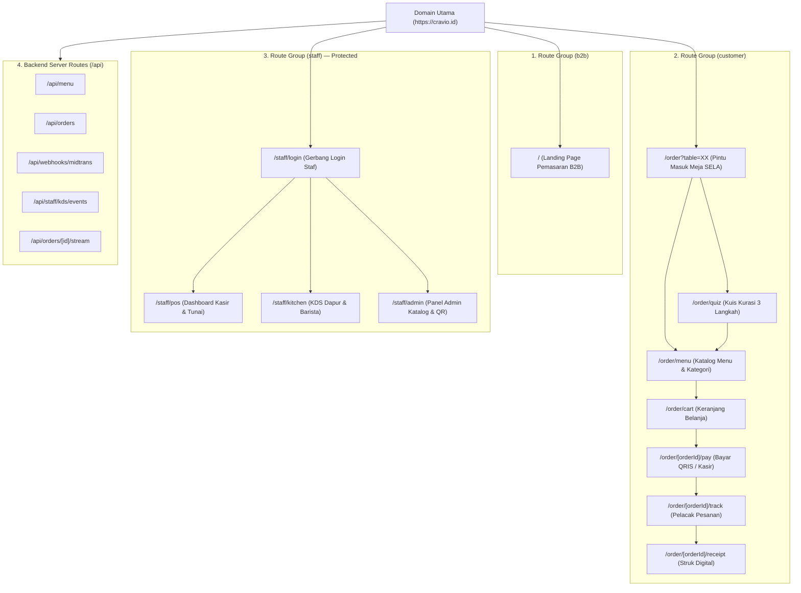

# PETA RUTE KANONIS & ATURAN NAVIGASI (ROUTE-MAP.MD)
## Cravio — Your craving, Perfectly Matched
### Pilot Mitra Kafe: SELA (Artisanal Coffee & Bake)

> **Lokasi Berkas:** `docs/route-map.md`  
> **Status:** Baseline Disetujui (Phase 02 Complete)  
> **Terakhir Diperbarui:** 28 Oktober 2026  
> **Peran Penulis:** Technical Lead & Frontend Architect  
> **Acuan Dokumen:** [`docs/adr/ADR-0003-single-canonical-route-map.md`](file:///d:/project/project-qr/cravio/docs/adr/ADR-0003-single-canonical-route-map.md) dan [`docs/spec-audit.md`](file:///d:/project/project-qr/cravio/docs/spec-audit.md).

---

## 1. Diagram Hierarki Rute Next.js 15 App Router

Arsitektur rute menggunakan fitur *Route Groups* (`(b2b)`, `(customer)`, `(staff)`) untuk mengisolasi layout dan middleware tanpa menambahkan segmen buatan pada URL publik:



---

## 2. Tabel Master Peta Rute Kanonis

| URL Publik | Path Berkas Next.js | Aktor & Peran | Parameter Wajib | Hak Akses & Proteksi | Deskripsi Fungsional & Navigasi |
|---|---|---|---|---|---|
| `/` | `src/app/(b2b)/page.tsx` | Calon Klien B2B | - | Publik (Nir-Autentikasi) | Landing page promosi solusi Cravio, widget demo kuis mock, transparansi paket Rp2,5jt, tombol CTA WhatsApp. |
| `/order` | `src/app/(customer)/order/page.tsx` | Pelanggan Meja | `?table=XX` (string alfanumerik) | Tamu Meja Aktif | Pintu masuk pemindaian QR meja. Memvalidasi nomor meja aktif ke DB, menyetel cookie sesi meja, lalu mengarahkan (*redirect*) ke `/order/menu` atau kuis. |
| `/order/quiz` | `src/app/(customer)/order/quiz/page.tsx` | Pelanggan Meja | Cookie meja aktif | Tamu Meja Aktif | Kuis kurasi preferensi rasa 3 langkah (Suasana $\rightarrow$ Rasa $\rightarrow$ Format). Tombol "Lewati" langsung melompat ke `/order/menu`. |
| `/order/menu` | `src/app/(customer)/order/menu/page.tsx` | Pelanggan Meja | Cookie meja aktif | Tamu Meja Aktif | Halaman katalog menu lengkap SELA, sticky tab kategori (Semua, Kopi, Non-Kopi, Makanan), search bar instan, dan kartu menu grid 2 kolom. |
| `/order/cart` | `src/app/(customer)/order/cart/page.tsx` | Pelanggan Meja | Cookie meja aktif | Tamu Meja Aktif | Drawer/halaman keranjang belanja, pemilihan modifier gula/es, textarea catatan khusus (maks 100 karakter), dan tombol lanjut checkout. |
| `/order/[orderId]/pay` | `src/app/(customer)/order/[orderId]/pay/page.tsx` | Pelanggan Meja | `orderId` (UUID) | Tamu (`orderSecretToken`) | Tampilan pembayaran: QRIS dinamis resmi (gambar QR + timer 15 mnt) atau petunjuk bayar tunai di meja kasir SELA. |
| `/order/[orderId]/track` | `src/app/(customer)/order/[orderId]/track/page.tsx` | Pelanggan Meja | `orderId` (UUID) | Tamu (`orderSecretToken`) | Layar pelacak progres pesanan (*Diterima $\rightarrow$ Dibuat $\rightarrow$ Siap Saji $\rightarrow$ Selesai*). Terhubung ke endpoint SSE pelanggan untuk update seketika $\le 2$ detik. |
| `/order/[orderId]/receipt` | `src/app/(customer)/order/[orderId]/receipt/page.tsx` | Pelanggan Meja | `orderId` (UUID) | Tamu (`orderSecretToken`) | Bukti struk digital (*e-receipt*) resmi yang ramah tangkapan layar dengan rincian harga netto dan tombol simpan gambar. |
| `/staff/login` | `src/app/(staff)/staff/login/page.tsx` | Seluruh Staf Kafe | - | Publik / Tamu Staf | Form login staf terpadu. Input Username + Password untuk Admin; input PIN 4–6 digit untuk Kasir & Barista Dapur. |
| `/staff/pos` | `src/app/(staff)/staff/pos/page.tsx` | Kasir Kafe | Cookie `staff_session` | Role: `CASHIER` atau `ADMIN` | Dashboard kasir operasional: antrean pesanan tunai belum bayar, tombol konfirmasi uang fisik, tombol void, dan tombol cetak struk thermal kasir. |
| `/staff/kitchen` | `src/app/(staff)/staff/kitchen/page.tsx` | Barista / Koki | Cookie `staff_session` | Role: `KITCHEN` atau `ADMIN` | Kitchen Display System (KDS): antrean masak pesanan lunas FIFO, alert denting lonceng audio, kilatan layar visual, tombol aksi transisi raksasa $\ge 56$ px, toggle stok habis. |
| `/staff/admin` | `src/app/(staff)/staff/admin/page.tsx` | Owner / Manager | Cookie `staff_session` | Role: `ADMIN` mutlak | Panel kontrol lengkap: CRUD menu & kategori, input harga integer rupiah, toggle stok biner, konfigurasi kuis, generator master QR meja, laporan omzet harian. |

---

## 3. Aturan Middleware Otorisasi (`src/middleware.ts`)

File middleware Next.js bertindak sebagai benteng pengaman rute serverless di edge runtime:

### 3.1. Matcher Configuration
```typescript
export const config = {
  matcher: [
    '/staff/pos/:path*',
    '/staff/kitchen/:path*',
    '/staff/admin/:path*',
    '/api/staff/:path*',
    '/api/admin/:path*',
  ],
};
```

### 3.2. Logika Verifikasi Sesi Staf
1. Membaca cookie HTTP-Only `staff_session`.
2. Jika cookie tidak ada atau kedaluwarsa:
   * Untuk request halaman (`GET /staff/*`): Alihkan (*redirect 307*) ke `/staff/login?from=[current_path]`.
   * Untuk request API (`/api/staff/*`): Tolak seketika dengan JSON `{ "success": false, "error": { "code": "UNAUTHORIZED" } }` status 401.
3. Memverifikasi signature JWT menggunakan secret `STAFF_AUTH_SECRET` via `jose`.
4. Memeriksa kecocokan role:
   * Akses ke `/staff/admin`: Wajib memiliki klaim `role === 'ADMIN'`. Jika bukan admin, tolak (*redirect atau 403 Forbidden*).
   * Akses ke `/staff/pos`: Wajib memiliki klaim `role === 'CASHIER' || role === 'ADMIN'`.
   * Akses ke `/staff/kitchen`: Wajib memiliki klaim `role === 'KITCHEN' || role === 'ADMIN'`.

### 3.3. Guard Validasi Parameter Meja Pelanggan
* Pelanggan yang mengakses `/order` tanpa query parameter `?table=...` dan belum memiliki cookie sesi meja aktif akan ditampilkan layar peringatan ramah:
  > *"Nomor Meja Tidak Terdeteksi. Silakan pindai ulang kode QR di meja Anda atau hubungi kasir/staf SELA."*
* Tombol checkout dan pemesanan otomatis terkunci jika nomor meja tidak valid atau meja berstatus tutup (`isActive: false`).

---

## 4. Penanganan Halaman Kesalahan Khusus (Error Pages)

* `src/app/not-found.tsx`: Halaman 404 ramah pengguna bertema palet SELA (Kanvas `#FBF9F5` dengan tombol kembali ke beranda).
* `src/app/error.tsx`: Komponen boundary error React untuk menangani exception runtime tak terduga dengan tombol *"Coba Lagi"*.
* `src/app/(customer)/order/error-table.tsx`: Komponen visual jika QR meja fisik rusak atau dinonaktifkan di admin.

