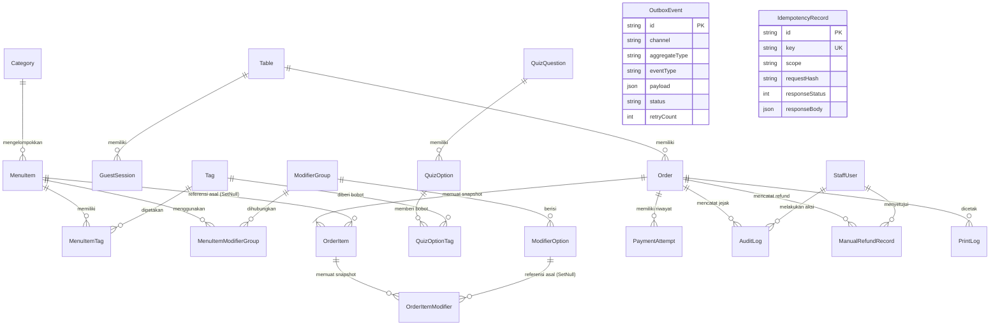

# Plan: Implementasi Skema Prisma PostgreSQL, Isolasi Database, & Seeder Idempoten (Tahap 04)

## 1. Ringkasan & Tujuan
Rencana kerja ini menyusun implementasi skema database relasional PostgreSQL menggunakan **Prisma ORM** untuk sistem **Cravio** (pilot kafe **SELA Artisanal Coffee & Bake**) berdasarkan keputusan arsitektur (ADR-0001 s/d ADR-0007), spesifikasi kontrak (`docs/api-contracts.md`), dan aturan baseline yang telah diaudit.

Rencana ini mencakup perancangan 18 entitas data relasional tanpa multi-tenancy (`tenant_id`) dan tanpa inventori bahan baku, penegakan integer rupiah untuk seluruh nilai moneter, snapshot transaksi permanen, pengarsipan menu (*soft-delete*), hashing token guest SHA-256, indeks performa KDS dan rekonsiliasi kasir, penyimpanan outbox event durabel untuk SSE realtime, kebijakan RLS (*Row Level Security*), isolasi database development vs test, dan seeder idempoten untuk 18 menu SELA, 3 kategori riil, 10 meja, serta konfigurasi kuis 3-langkah.

---

## 2. Hal yang Memerlukan Review Pengguna (*User Review Required*)

> [!IMPORTANT]
> **Strategi Isolasi Database Development vs Test:**
> Sesuai instruksi untuk menggunakan database development dan test terpisah:
> 1. Lingkungan menggunakan PostgreSQL Neon yang telah dikonfigurasi pada `.env`.
> 2. Untuk database pengujian (*test database*), digunakan schema PostgreSQL terisolasi: `cravio_test` (dikonfigurasi via `DATABASE_URL_TEST=".../neondb?schema=cravio_test"`).
> 3. Skema `cravio_test` memungkinkan eksekusi suite pengujian integrasi (*wipe, migrate, seed, constraint check*) secara cepat dan otomatis tanpa mengganggu data kerja development pada skema `public`.

> [!WARNING]
> **Satu Sumber Kebenaran Migrasi & Versioning RLS:**
> Seluruh skema tabel dikelola oleh **Prisma Migrate** (`prisma/schema.prisma`). Untuk kebijakan keamanan PostgreSQL seperti *Row Level Security (RLS)* dan pembatasan izin peran `anon`/`authenticated`, skrip SQL akan dimasukkan sebagai bagian dari file migrasi Prisma versi resmi (`prisma/migrations/`), sehingga riwayat migrasi tetap tunggal, berurutan (*versioned*), dan tidak bertabrakan.

---

## 3. Pertanyaan Terbuka & Keputusan yang Ditetapkan (*Decisions*)

1. **Tab "Semua" pada Katalog:**
   - Sesuai instruksi, kategori riil di database hanya ada 3: `Kopi`, `Non-Kopi`, dan `Makanan`.
   - Tab "Semua" diimplementasikan di layer aplikasi / UI sebagai filter agregat (`category = undefined`), bukan entitas baris kategori di database.
2. **Kredensial Staf Dev vs Produksi:**
   - Seeder database hanya menyertakan akun staf untuk lingkungan development dengan hash dev eksplisit (`admin`, `kasir`, `barista`). Tidak ada pembuatan kredensial default produksi di seeder.
3. **Penyimpanan Nilai Moneter:**
   - Seluruh kolom harga, subtotal, pajak, service fee, dan total disimpan dalam **Integer IDR** (misal: Rp28.000 disimpan sebagai `28000`). Pajak dan service fee default bernilai `0`.

---

## 4. Desain Skema Prisma (`prisma/schema.prisma`)

### A. Matriks 18 Model & Entitas Data

| No | Model / Entitas | Deskripsi & Peran Arsitektur |
|:---:|---|---|
| 1 | `Table` | Meja kafe tamu (10 meja contoh: 01 s/d 10), QR slug unik, status aktif. |
| 2 | `Category` | 3 Kategori riil (`Kopi`, `Non-Kopi`, `Makanan`), slug unik, sortOrder. |
| 3 | `MenuItem` | 18 Menu SELA, harga integer IDR, stok biner `isAvailable`, soft-delete (`deletedAt`, `isArchived`). |
| 4 | `Tag` | Tag selera (Mood, Flavor, Format) untuk kuis dan katalog. |
| 5 | `MenuItemTag` | Relasi many-to-many antara MenuItem dan Tag selera. |
| 6 | `ModifierGroup` | Grup modifier (misal: "Tingkat Kemanisan", "Pilihan Es", "Pilihan Susu", "Extra Shot"). |
| 7 | `ModifierOption` | Opsi pilihan modifier dengan harga integer IDR tambahan dan status ketersediaan. |
| 8 | `MenuItemModifierGroup` | Relasi fleksibel pemetaan grup modifier ke menu tertentu. |
| 9 | `QuizQuestion` | Pertanyaan kuis selera 3-langkah (1: Suasana, 2: Rasa, 3: Format). |
| 10 | `QuizOption` | Pilihan jawaban kuis selera dengan label, icon, dan sortOrder. |
| 11 | `QuizOptionTag` | Pemetaan opsi kuis ke tag selera dengan bobot bobot kurasi ($W_{\text{flav}}=3, W_{\text{format}}=2, W_{\text{mood}}=1$). |
| 12 | `CravioConfig` | Konfigurasi sistem Cravio (nama: "Cravio", tagline: "Your craving, Perfectly Matched", alamat, pajak/service bps = 0, timeout QRIS 15 mnt, timeout tunai 20 mnt). |
| 13 | `StaffUser` | Akun staf (Kasir, Barista, Admin) dengan `role`, `pinHash` (Argon2/bcrypt), `passwordHash`, status aktif. |
| 14 | `GuestSession` | Sesi tamu per meja, token hash SHA-256 (`sessionTokenHash`), masa berlaku (`expiresAt`). |
| 15 | `Order` | Master transaksi pesanan: nomor order unik, SHA-256 guest token hash, status enum terpisah, integer IDR, `version` konkurensi, timestamps lengkap (`paidAt`, `cancelledAt`, `completedAt`). |
| 16 | `OrderItem` & `OrderItemModifier` | Snapshot transaksi permanen (`nameSnapshot`, `priceSnapshot`, subtotal) dengan relasi `onDelete: SetNull` agar struk lama tidak pernah rusak jika menu diubah/dihapus. |
| 17 | `PaymentAttempt` | Riwayat percobaan pembayaran (QRIS Midtrans / Tunai Kasir), transactionId unik gateway, masa kedaluwarsa 15 menit. |
| 18 | `IdempotencyRecord` | Kunci idempoten (`Idempotency-Key` + scope), request hash, status response, dan cached body JSON. |
| 19 | `AuditLog` | Audit trail transisi status pesanan dan tindakan staf operasional. |
| 20 | `ManualRefundRecord` | Pencatatan refund kasir tunai manual (alasan, nominal, otorisasi staf, tanggal). |
| 21 | `PrintLog` | Catatan pencetakan struk thermal 58/80 mm dan riwayat cetak ulang (*reprint counter*). |
| 22 | `OutboxEvent` | Antrean durabel pesan transaksional untuk SSE realtime KDS/Pelacak dan retry resilience (ADR-0001, ADR-0002). |

---

## 5. Diagram Hubungan Entitas (ERD)



---

## 6. Detail Spesifikasi Kolom Kritis & Constraint

### A. Integritas Moneter & Snapshot Transaksi
- **Integer IDR:**
  `price`, `subtotalAmount`, `taxAmount`, `serviceAmount`, `totalAmount`, `grossAmount`, `amount` seluruhnya bertipe `Int` (tanpa angka desimal/koma).
- **Snapshot Kekal:**
  `OrderItem.nameSnapshot` (String) dan `OrderItem.priceSnapshot` (Int).
  `OrderItemModifier.nameSnapshot` (String) dan `OrderItemModifier.priceSnapshot` (Int).
  Jika `MenuItem` atau `ModifierOption` diedit harganya atau diarsip di kemudian hari, nilai pada struk dan laporan keuangan masa lalu **tidak pernah berubah**.
- **Soft-Delete Menu:**
  Kolom `MenuItem.isArchived` (Boolean @default(false)) dan `MenuItem.deletedAt` (DateTime?):
  Menu yang pernah dipesan tidak boleh dihapus dengan `DELETE CASCADE`; penghapusan dilakukan secara *soft-delete* sehingga relasi FK `OrderItem.menuItemId` tetap valid atau di-set `onDelete: SetNull`.

### B. Konkurensi & Optimistic Locking
- Kolom `Order.version` (Int @default(1)):
  Setiap transisi status pesanan (`QUEUED` $\rightarrow$ `COOKING` $\rightarrow$ `READY` $\rightarrow$ `COMPLETED`) melakukan increment `version` dan conditional update:
  `WHERE id = :id AND version = :currentVersion`.
- Kolom timestamp transisi:
  `paidAt: DateTime?`, `cancelledAt: DateTime?`, `completedAt: DateTime?`, `expiresAt: DateTime?`.

### C. Keamanan Token Guest & Meja
- Tamu meja publik tidak menggunakan sesi login password. Akses pesanan dilindungi oleh **Guest Secret Token**.
- Kolom `Order.orderSecretTokenHash` menyimpan nilai hash **SHA-256** dari token rahasia tamu.
- Token asli hanya dipegang di sisi browser tamu saat checkout dan dicocokkan di server via `crypto.createHash('sha256').update(rawToken).digest('hex')`.

### D. Indeks Performa Kritis
1. **Kitchen Display System (KDS):**
   `@@index([orderStatus, paidAt])` — Memungkinkan KDS mengambil pesanan `PAID` aktif dalam urutan waktu bayar secara instan tanpa full table scan.
2. **Antrean Kasir (POS):**
   `@@index([paymentStatus, paymentMethod, createdAt])` — Mempercepat penyajian antrean konfirmasi pembayaran tunai (`UNPAID` + `CASH`).
3. **Rekonsiliasi Kedaluwarsa:**
   `@@index([paymentStatus, expiresAt])` — Digunakan oleh worker server untuk mendeteksi dan menandai pesanan QRIS yang telah melewati batas 15 menit.
4. **Laporan Keuangan & Audit:**
   `@@index([createdAt, orderStatus, paymentStatus])` — Agregasi omzet harian/bulanan.
5. **Idempotensi & Guest Session:**
   `@@index([key, scope])` pada `IdempotencyRecord`.
   `@@index([sessionTokenHash, expiresAt])` pada `GuestSession`.

---

## 7. Rencana Dataset Seeder Idempoten (`prisma/seed.ts`)

Seeder dibuat dengan pola `upsert` pada seluruh tabel agar aman dijalankan berulang kali (*idempotent re-seed*):

1. **Konfigurasi Sistem Cravio (`CravioConfig`):**
   - Nama: `Cravio`
   - Tagline: `Your craving, Perfectly Matched`
   - Alamat: `Jl. Senopati No. 42, Jakarta Selatan`
   - Pajak & Service: 0% (`taxRateBps = 0`, `serviceRateBps = 0`)
   - Batas Waktu Bayar: QRIS 15 menit, Tunai 20 menit.
2. **10 Meja Contoh (`Table`):**
   - Nomor meja: `"01"` s/d `"10"`, QR slug: `"sela-table-01"` s/d `"sela-table-10"`.
3. **3 Kategori Riil (`Category`):**
   - `Kopi` (sortOrder: 1)
   - `Non-Kopi` (sortOrder: 2)
   - `Makanan` (sortOrder: 3)
4. **Tag Selera Kuis (`Tag`):**
   - Mood: `santai`, `fokus`, `segar`
   - Flavor: `manis`, `pahit_bold`, `asam_segar`, `creamy`
   - Format: `dingin`, `panas`, `cemilan`
5. **Pertanyaan & Opsi Kuis 3-Langkah (`QuizQuestion`, `QuizOption`, `QuizOptionTag`):**
   - Pertanyaan 1: Suasana (Santai, Fokus, Segar) $\rightarrow$ bobot $W_{\text{mood}} = 1$
   - Pertanyaan 2: Karakter Rasa (Manis, Pahit & Bold, Asam Segar, Creamy Gurih) $\rightarrow$ bobot $W_{\text{flav}} = 3$
   - Pertanyaan 3: Format Pesanan (Dingin & Segar, Hangat Menenangkan, Cemilan Gurih/Manis) $\rightarrow$ bobot $W_{\text{format}} = 2$
6. **18 Menu Contoh SELA (`MenuItem`):**
   - **Kopi (6 Menu):**
     1. Es Kopi Susu Sela (Rp28.000) [Popular, santai/creamy/dingin]
     2. Americano Robusta/Arabica (Rp24.000) [fokus/pahit_bold/dingin]
     3. Vanilla Latte Artisan (Rp32.000) [santai/manis/dingin]
     4. Caramel Macchiato Sela (Rp34.000) [santai/manis/dingin]
     5. Cold Brew Reserve (Rp30.000) [fokus/pahit_bold/dingin]
     6. Flat White Australian (Rp28.000) [fokus/creamy/panas]
   - **Non-Kopi (6 Menu):**
     7. Kyoto Matcha Latte (Rp32.000) [Popular, santai/manis/dingin]
     8. Artisan Earl Grey Milk Tea (Rp28.000) [santai/creamy/dingin]
     9. Dark Velvet Chocolate (Rp30.000) [santai/manis/panas]
     10. Strawberry Hibiscus Cooler (Rp28.000) [segar/asam_segar/dingin]
     11. Taro Blossom Latte (Rp30.000) [santai/manis/dingin]
     12. Honey Chamomile Relax (Rp26.000) [santai/manis/panas]
   - **Makanan & Bakes (6 Menu):**
     13. French Butter Croissant (Rp26.000) [Popular, santai/manis/cemilan]
     14. Pain Au Chocolat (Rp29.000) [santai/manis/cemilan]
     15. Cinnamon Roll Sela Glaze (Rp28.000) [santai/manis/cemilan]
     16. Almond Danish Pastry (Rp32.000) [santai/manis/cemilan]
     17. Truffle Parmesan Fries (Rp35.000) [santai/pahit_bold/cemilan]
     18. Smoked Beef & Cheese Quiche (Rp36.000) [fokus/creamy/cemilan]
7. **Grup & Opsi Modifier:**
   - Tingkat Kemanisan (Normal Sweet 100%, Less Sweet 70%, Slight Sweet 30%, No Sugar 0%)
   - Pilihan Es (Normal Ice, Less Ice, No Ice)
   - Jenis Susu (Fresh Milk +0, Oat Milk +8000, Almond Milk +8000)
   - Extra Shot Espresso (+6000)
8. **Akun Staf Lingkungan Dev (Non-Produksi):**
   - Admin (`admin` / password dev ter-hash)
   - Kasir (`kasir` / PIN dev: `1234` ter-hash)
   - Barista (`barista` / PIN dev: `5678` ter-hash)

---

## 8. Kebijakan Keamanan Row Level Security (RLS)

Untuk memenuhi instruksi Supabase/PostgreSQL exposed isolation:
- Skrip migrasi SQL akan mengeksekusi:
  ```sql
  -- Aktifkan RLS pada seluruh tabel transaksi dan rahasia
  ALTER TABLE "orders" ENABLE ROW LEVEL SECURITY;
  ALTER TABLE "order_items" ENABLE ROW LEVEL SECURITY;
  ALTER TABLE "order_item_modifiers" ENABLE ROW LEVEL SECURITY;
  ALTER TABLE "payment_attempts" ENABLE ROW LEVEL SECURITY;
  ALTER TABLE "idempotency_records" ENABLE ROW LEVEL SECURITY;
  ALTER TABLE "staff_users" ENABLE ROW LEVEL SECURITY;
  ALTER TABLE "audit_logs" ENABLE ROW LEVEL SECURITY;
  ALTER TABLE "manual_refund_records" ENABLE ROW LEVEL SECURITY;
  ALTER TABLE "print_logs" ENABLE ROW LEVEL SECURITY;
  ALTER TABLE "outbox_events" ENABLE ROW LEVEL SECURITY;

  -- Cabut seluruh hak akses langsung dari peran anon dan public
  REVOKE ALL ON "orders", "order_items", "order_item_modifiers", "payment_attempts", 
                 "idempotency_records", "staff_users", "audit_logs", 
                 "manual_refund_records", "print_logs", "outbox_events" FROM anon, public;
  ```
- Dengan demikian, query langsung dari peramban atau client-side Supabase anon key ke tabel transaksi akan **ditolak 100%**. Seluruh akses wajib melalui Route Handlers Next.js di server yang memverifikasi token kepemilikan.

---

## 9. Rencana Eksekusi & Langkah Kerja

1. **Langkah 1: Update Schema Prisma**
   - Tulis skema lengkap 18 model di `prisma/schema.prisma`.
2. **Langkah 2: Migrasi Database Development & Setup Test Schema**
   - Perbaiki `DIRECT_URL` pada `.env` agar mengarah ke direct connection endpoint Neon (port 5432).
   - Jalankan `pnpm run db:migrate:dev --name init_full_cravio_schema` untuk membuat migrasi resmi dan tabel di database development.
   - Tambahkan skrip SQL RLS pada direktori migrasi Prisma terkait.
3. **Langkah 3: Pembuatan & Eksekusi Seeder Idempoten**
   - Tulis `prisma/seed.ts` lengkap dengan 18 menu SELA, 10 meja, kategori, kuis, modifier, dan akun staf dev.
   - Jalankan `pnpm run db:seed` dua kali berturut-turut untuk membuktikan idempotensi tanpa error duplicate key.
4. **Langkah 4: Pembuatan Suite Uji Integritas Database (Vitest)**
   - Buat berkas `tests/integration/db-schema-integrity.test.ts` untuk memverifikasi:
     - Uniqueness nomor meja dan nomor order.
     - Penolakan duplicate `Idempotency-Key`.
     - Preservasi data `OrderItem` (snapshot nama & harga) saat menu di-soft delete atau diedit.
     - Optimistic locking dengan kolom `version`.
     - Verifikasi token guest tersimpan dalam bentuk hash SHA-256 (bukan raw).
     - Rerata eksekusi query indeks KDS dan antrean kasir.
5. **Langkah 5: Verifikasi Kualitas Keseluruhan**
   - Jalankan `pnpm run typecheck`, `pnpm run lint`, `pnpm run test`, dan `pnpm run build`.
   - Perbarui catatan kemajuan di `docs/implementation-progress.md` (Tahap 04 $\rightarrow$ `PASS`) dan walkthrough artifact.

---

## 10. Rencana Pengujian & Verifikasi (*Verification Plan*)

### Automated Tests
```powershell
# 1. Regenerasi Prisma Client
pnpm run db:generate

# 2. Migrasi Database Skema Bersih
pnpm run db:migrate:deploy

# 3. Eksekusi Seeder Idempoten (Run 1 & Run 2)
pnpm run db:seed
pnpm run db:seed

# 4. Validasi Tipe Statis & Linter
pnpm run typecheck
pnpm run lint

# 5. Eksekusi Test Suite Integritas Database
pnpm run test
```

### Manual Verification
1. Periksa tabel PostgreSQL melalui Prisma Studio (`pnpm exec prisma studio --browser none`) atau query raw untuk memverifikasi 18 menu, 10 meja, 3 kategori, dan konfigurasi sistem Cravio.
2. Verifikasi bahwa eksekusi seeder kedua kali tidak menghasilkan duplikasi baris atau kegagalan constraint.
3. Verifikasi ketiadaan hak akses peran `anon` terhadap tabel `orders` melalui uji RLS.

