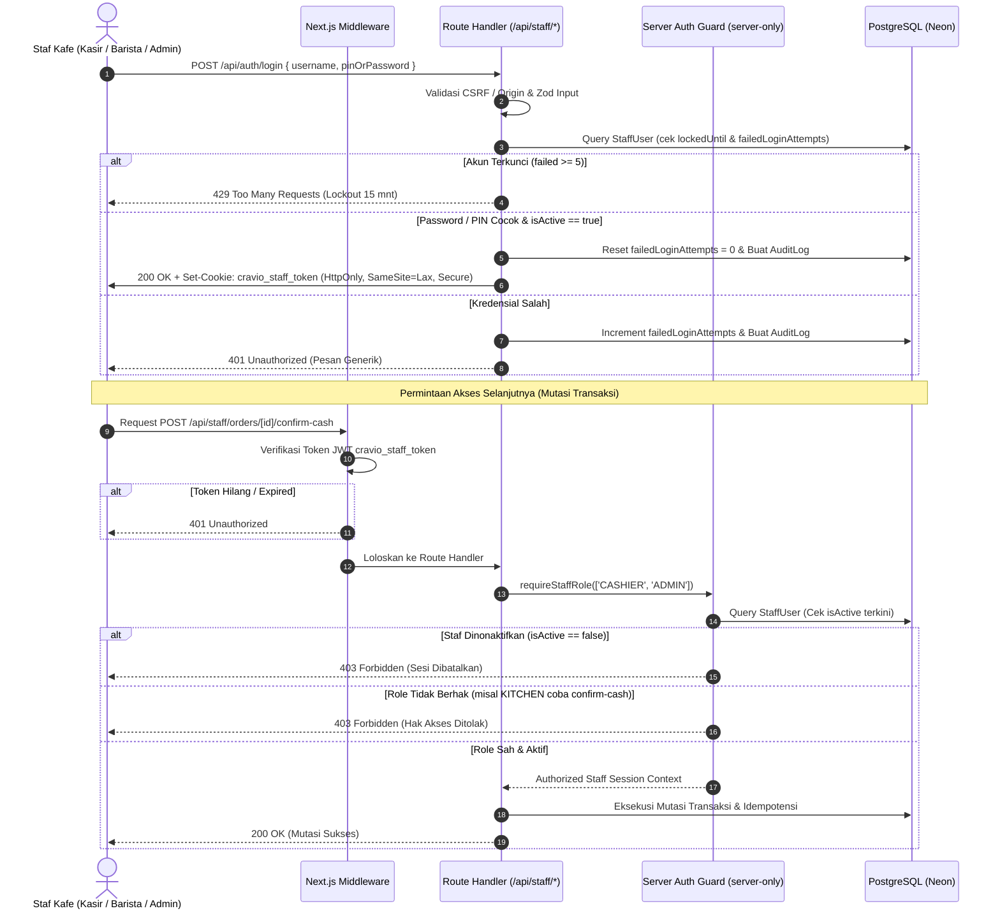

# Plan: Implementasi Autentikasi Staf & Otorisasi Server (RBAC) (Tahap 05)

## 1. Ringkasan & Tujuan
Rencana kerja ini menyusun implementasi sistem autentikasi staf dan otorisasi berbasis peran (*Role-Based Access Control* / RBAC) untuk **Cravio** (pilot kafe **SELA Artisanal Coffee & Bake**) berdasarkan keputusan arsitektur (ADR-0002, ADR-0007), spesifikasi kontrak (`docs/api-contracts.md`), dan standar *defense-in-depth*.

Implementasi ini mencakup login dan logout staf dengan cookie `HttpOnly` beralgoritma `HS256` via `jose`, hashing PIN dan password menggunakan `bcryptjs`, proteksi otomatis terhadap akun staf yang dinonaktifkan (`isActive: false`), matriks otorisasi tiga peran (`ADMIN`, `CASHIER`, `KITCHEN` / `BARISTA`), proteksi rute middleware dan guard server-side pada setiap Route Handler, pembatasan percobaan login persisten lintas instance (*lockout/backoff* 5 kali gagal), validasi CSRF/Origin, serta audit log tanpa kebocoran kredensial.

---

## 2. Hal yang Memerlukan Review Pengguna (*User Review Required*)

> [!IMPORTANT]
> **Keputusan Format Kredensial Admin (Password vs PIN):**
> Sesuai instruksi: *"Jika keputusan admin PIN/password masih belum final, selesaikan fondasi auth dan matriks otorisasi tanpa menyatakan pilihan tersebut sudah disepakati."*
> - Sistem didesain fleksibel (*dual-credential compatible*): Endpoint login menerima `pinOrPassword`.
> - Untuk `ADMIN`, sistem memeriksa `passwordHash` (atau `pinHash` jika dikonfigurasi).
> - Untuk `CASHIER` dan `BARISTA` (Kitchen), sistem memeriksa `pinHash` 4–6 digit.
> - Kredensial diverifikasi di server menggunakan fungsi timing-safe `bcryptjs.compare`.

> [!WARNING]
> **Batas Pertahanan Otorisasi Server vs Middleware:**
> - Next.js Middleware (`src/middleware.ts`) bertindak sebagai **pemeriksaan awal rute (perimeter gate)** untuk kenyamanan navigasi UI browser.
> - **Otorisasi mutlak ditegakkan di server:** Setiap Route Handler mutasi (`/api/staff/*`) dan Server Action melakukan verifikasi session JWT, mengecek database apakah `isActive === true`, dan mencocokkan peran. Peran yang dikirim oleh browser melalui payload tidak pernah dipercayai.

---

## 3. Matriks Otorisasi Berbasis Peran (RBAC Matrix)

| Aksi / Modul Endpoint | Tamu (Guest) | BARISTA (KITCHEN) | CASHIER (Kasir) | ADMIN | Catatan Otoritas |
|:---|:---:|:---:|:---:|:---:|---|
| **Halaman `/staff/admin`** | ❌ 401 | ❌ 403 | ❌ 403 | ✅ 200 | Khusus pemilik / manajer kafe |
| **Halaman `/staff/pos`** | ❌ 401 | ❌ 403 | ✅ 200 | ✅ 200 | Antrean kasir & transaksi |
| **Halaman `/staff/kds`** | ❌ 401 | ✅ 200 | ❌ 403 | ✅ 200 | Antrean pesanan lunas dapur |
| **Konfirmasi Tunai (`POST .../confirm-cash`)** | ❌ 401 | ❌ **403 (Ditolak)** | ✅ 200 | ✅ 200 | Kitchen dilarang konfirmasi uang |
| **Ubah Harga Menu (`PATCH .../price`)** | ❌ 401 | ❌ **403 (Ditolak)** | ❌ **403 (Ditolak)**| ✅ 200 | Kasir & Kitchen dilarang ubah harga |
| **Toggle Stok Habis (`PATCH .../stock`)** | ❌ 401 | ✅ 200 (Stasiun) | ✅ 200 | ✅ 200 | Barista boleh toggle stok (ADR-0007) |
| **Transisi KDS (`PATCH .../kds-status`)** | ❌ 401 | ✅ 200 | ❌ 403 | ✅ 200 | COOKING $\rightarrow$ READY $\rightarrow$ COMPLETED |
| **Cetak Struk Thermal (`POST .../print`)** | ❌ 401 | ❌ 403 | ✅ 200 | ✅ 200 | Dialog browser 58/80 mm |
| **Refund Manual Kasir (`POST .../refund`)**| ❌ 401 | ❌ 403 | ✅ 200 | ✅ 200 | Wajib mencatat alasan & otorisasi |
| **Webhook Gateway (`/api/webhooks/*`)** | ✅ Bebas | ✅ Bebas | ✅ Bebas | ✅ Bebas | **Dikecualikan dari cookie staf; diverifikasi via SHA512** |

---

## 4. Diagram Alur Autentikasi, Sesi, & Pertahanan Server

---

## 5. Rencana Perubahan Komponen & Berkas

### A. Dependensi Kriptografi & Skema
1. **Pemasangan Paket `bcryptjs` & `@types/bcryptjs`:**
   - Library hashing password/PIN murni JavaScript tanpa ketergantungan binary native (kompatibel penuh dengan Node.js dan Next.js).
2. **Pembaruan Skema Prisma (`prisma/schema.prisma`):**
   - Menambahkan kolom `failedLoginAttempts: Int @default(0)` dan `lockedUntil: DateTime?` pada model `StaffUser` untuk pelacakan lockout persisten lintas instance serverless.
   - Eksekusi migrasi Prisma versioned.

### B. Modul Keamanan Server (`src/lib/server/`)
1. **`src/lib/server/auth.ts` [MODIFY]:**
   - Menambahkan fungsi hashing dan verifikasi PIN/password via `bcryptjs`:
     `hashCredential(raw: string): Promise<string>`
     `verifyCredential(raw: string, hash: string): Promise<boolean>`
   - Memperbarui `signStaffToken` dan `verifyStaffToken` dengan penanganan cookie token yang aman.
2. **`src/lib/server/auth-guard.ts` [NEW]:**
   - Modul penjaga server-side (`import 'server-only'`):
     - `getAuthenticatedStaff(request?: Request): Promise<StaffSession>`
     - `requireStaffRole(allowedRoles: StaffRole[]): Promise<StaffSession>`
     - Memeriksa status `isActive` staf langsung ke database untuk setiap aksi mutasi.
     - Memblokir staf yang dinonaktifkan seketika.
3. **`src/lib/server/csrf.ts` [NEW]:**
   - Pemeriksaan keamanan `Origin` dan `Host` header untuk seluruh HTTP request yang mengubah data (`POST`, `PUT`, `PATCH`, `DELETE`).

### C. Middleware Perimeter (`src/middleware.ts`) [NEW]
- Melindungi pola rute `/staff/*` dan `/api/staff/*`.
- Memverifikasi cookie `cravio_staff_token`.
- Mengarahkan peramban tanpa sesi ke `/login`.
- Mengecualikan webhook `/api/webhooks/midtrans` secara eksplisit.

### D. Route Handlers API Staf & Autentikasi (`src/app/api/`)
1. **`src/app/api/auth/login/route.ts` [NEW]:**
   - Input validasi Zod (`StaffLoginInputSchema`).
   - Pengecekan lockout persisten (5 kali gagal $\rightarrow$ kunci 15 menit).
   - Verifikasi hash via `bcryptjs`.
   - Penerbitan cookie `cravio_staff_token` (`httpOnly: true`, `sameSite: 'lax'`, `secure: true`, `maxAge: 8 jam`).
   - Pencatatan `AuditLog` login berhasil / gagal tanpa membocorkan kredensial.
2. **`src/app/api/auth/logout/route.ts` [NEW]:**
   - Pembersihan cookie (invalidation) dan pencatatan audit logout.
3. **`src/app/api/auth/me/route.ts` [NEW]:**
   - Mengembalikan profil staf aktif untuk verifikasi sesi di antarmuka frontend.
4. **`src/app/api/staff/orders/[id]/confirm-cash/route.ts` [NEW]:**
   - Route handler konfirmasi tunai kasir, dilindungi `requireStaffRole(['CASHIER', 'ADMIN'])`.
5. **`src/app/api/staff/menu/[id]/price/route.ts` [NEW]:**
   - Route handler perubahan harga menu, dilindungi `requireStaffRole(['ADMIN'])`.
6. **`src/app/api/staff/menu/[id]/stock/route.ts` [NEW]:**
   - Route handler quick toggle stok, dilindungi `requireStaffRole(['BARISTA', 'CASHIER', 'ADMIN'])`.

---

## 6. Rencana Pengujian Otomatis (*Verification Plan*)

Dibuat berkas pengujian integrasi komprehensif: [`tests/integration/staff-auth-rbac.test.ts`](file:///d:/project/project-qr/cravio/tests/integration/staff-auth-rbac.test.ts) yang menguji skenario nyata:
1. **Login Valid Admin, Kasir, & Barista:**
   - Admin login dengan password $\rightarrow$ sukses, cookie diterbitkan.
   - Kasir login dengan PIN `1234` $\rightarrow$ sukses.
   - Barista login dengan PIN `5678` $\rightarrow$ sukses.
2. **Penolakan Kredensial Salah:**
   - Password / PIN salah $\rightarrow$ ditolak `401 Unauthorized`.
3. **Lockout Persisten 5 Percobaan:**
   - 5 kali percobaan gagal berturut-turut $\rightarrow$ percobaan ke-6 ditolak `429 Too Many Requests`.
4. **Blokir Tamu (Guest Protection):**
   - Request langsung ke `/api/staff/orders/...` tanpa cookie $\rightarrow$ ditolak `401 Unauthorized`.
5. **Blokir Staf Dinonaktifkan (Deactivated Staff Guard):**
   - Mengubah `isActive = false` pada staf yang memegang token valid $\rightarrow$ request mutasi seketika ditolak `403 Forbidden`.
6. **Penegakan Matriks Peran (RBAC Enforcement):**
   - Barista (KITCHEN) mencoba konfirmasi uang tunai $\rightarrow$ ditolak `403 Forbidden`.
   - Barista (KITCHEN) mencoba mengubah harga menu $\rightarrow$ ditolak `403 Forbidden`.
   - Kasir mencoba mengubah harga menu $\rightarrow$ ditolak `403 Forbidden`.
   - Kasir mengonfirmasi uang tunai $\rightarrow$ diizinkan `200 OK`.
   - Admin mengubah harga menu $\rightarrow$ diizinkan `200 OK`.
7. **CSRF / Origin Mismatch:**
   - Request mutasi dengan Origin palsu (`http://evil-site.com`) $\rightarrow$ ditolak `403 Forbidden`.
8. **Pengecualian Webhook Gateway:**
   - Endpoint `/api/webhooks/midtrans` tidak diblokir oleh kewajiban cookie staf.

---

## 7. Rencana Eksekusi Langkah Demi Langkah

1. **Langkah 1:** Pasang paket `bcryptjs` dan `@types/bcryptjs` via `pnpm add`.
2. **Langkah 2:** Tambahkan kolom `failedLoginAttempts` dan `lockedUntil` di `prisma/schema.prisma`, lalu jalankan migrasi database.
3. **Langkah 3:** Implementasikan modul utilitas keamanan: `src/lib/server/auth.ts`, `src/lib/server/csrf.ts`, dan `src/lib/server/auth-guard.ts`.
4. **Langkah 4:** Implementasikan Next.js Middleware di `src/middleware.ts`.
5. **Langkah 5:** Implementasikan Route Handlers autentikasi (`/api/auth/login`, `/api/auth/logout`, `/api/auth/me`) dan endpoint proteksi operasional staf.
6. **Langkah 6:** Perbarui seeder staf dengan hash bcrypt nyata untuk akun testing lokal.
7. **Langkah 7:** Buat suite pengujian integrasi `tests/integration/staff-auth-rbac.test.ts`.
8. **Langkah 8:** Jalankan seluruh pengujian: `pnpm run test`, `pnpm run typecheck`, `pnpm run lint`, dan `pnpm run build`.
9. **Langkah 9:** Perbarui `docs/implementation-progress.md` (Tahap 05 $\rightarrow$ `PASS`) dan walkthrough artifact.

