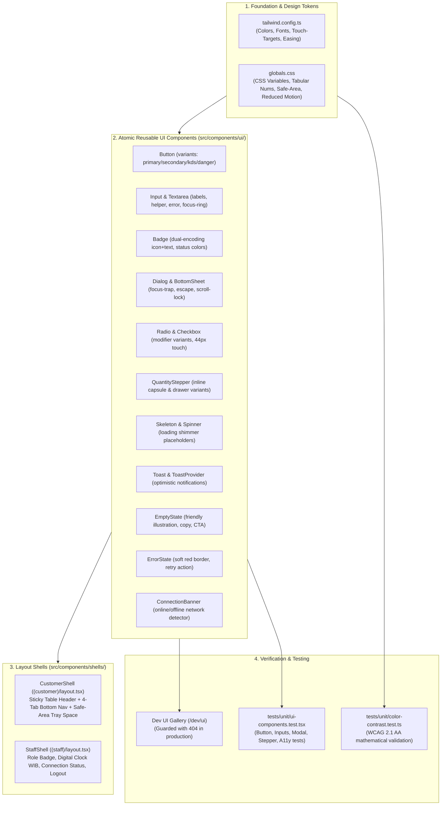

# Rencana Kerja: Sistem Desain SELA & Komponen UI Reusable (Tahap 06)

Rencana kerja ini menetapkan strategi dan arsitektur pengembangan fondasi antarmuka pengguna (UI) yang dapat digunakan kembali (*reusable atomic components*) untuk platform **Cravio — Your craving, Perfectly Matched** (Pilot: **SELA Artisanal Coffee & Bake**), berlandaskan spesifikasi kanonis [`docs/design.md`](file:///d:/project/project-qr/cravio/docs/design.md), [`docs/visual-direction.md`](file:///d:/project/project-qr/cravio/docs/visual-direction.md), dan skill [`smart-menu-ui`](file:///d:/project/project-qr/cravio/.agents/skills/smart-menu-ui/SKILL.md).

---

## 1. Deskripsi Tujuan (Goal Description)

Membangun sistem desain visual dan komponen antarmuka primitif yang kokoh, modular, dan teruji aksesibilitasnya (*WCAG 2.1 AA*) sebelum memasuki perakitan fitur katalog menu, kuis kurasi, kasir POS, dan KDS dapur. Seluruh komponen mengadopsi identitas visual *SELA Minimalist Artisanal* dengan nuansa kanvas hangat (*warm canvas*), aksen terakota amber, tipografi humanist modern, angka tabular, serta kontrol sentuh ergonomis untuk perangkat bergerak ($\ge 44$ px) dan dapur tablet ($\ge 56$ px).

> [!IMPORTANT]
> **Isolasi Prototipe & Standar Kode Produksi:**
> Berkas di `design-preview/` hanya dijadikan referensi visual tata letak. Dilarang keras mengimpor modul, mock memory, atau state simulasi dari folder tersebut ke dalam `src/`.

---

## 2. Hal yang Memerlukan Review Pengguna (User Review Required)

> [!NOTE]
> **1. Strategi Bundling Font & Offline Build Fallback:**
> Lingkungan build terisolasi (sandbox / container tanpa internet) mengalami `ENOTFOUND fonts.googleapis.com` jika memanggil `next/font/google` secara naif saat proses kompilasi. Rencana ini mengonfigurasi variabel CSS `--font-display` (*Plus Jakarta Sans*) dan `--font-sans` (*Inter*) dengan fallback sistem operasi yang mulus (*system-ui, -apple-system, sans-serif*), serta menyematkan link font ber-preconnect di `RootLayout` sehingga peramban daring mengunduh font asli secara instan tanpa membuat proses build lokal/CI gagal.

> [!NOTE]
> **2. Guard Galeri Komponen Dev (`/dev/ui`):**
> Halaman galeri pengujian komponen disiapkan pada rute `/dev/ui`. Rute ini diproteksi oleh guard `if (process.env.NODE_ENV === 'production') notFound();` sehingga di lingkungan produksi tidak akan pernah bisa diakses oleh publik (mengembalikan respon 404).

> [!NOTE]
> **3. Tombol Bantuan Staf Bukan Tautan Mati:**
> Tombol bantuan pada header dan bottom navigation pelanggan tidak menggunakan `href="#"`. Tombol ini membuka `StaffHelpModal` interaktif yang memuat informasi kontak resmi kafe yang terkonfigurasi (WhatsApp kafe, telepon, opsi panggil pelayan ke meja, dan panduan fasilitas).

---

## 3. Pertanyaan Terbuka (Open Questions)

*Tidak ada blocker arsitektur saat ini.* Semua token warna, tipografi, radius, rasio kontras WCAG, dan spesifikasi komponen telah selaras penuh dengan `design.md` dan kontrak ADR sebelumnya.

---

## 4. Diagram Arsitektur Komponen UI



---

## 5. Rencana Perubahan Berkas (Proposed Changes)

### A. Konfigurasi Token Desain, Tailwind, & Tipografi

#### [MODIFY] [`tailwind.config.ts`](file:///d:/project/project-qr/cravio/tailwind.config.ts)
* Memetakan token warna semantik resmi SELA:
  * Kanvas & Permukaan: `surface` (`#FBF9F5`), `surface-lowest` (`#FFFFFF`), `surface-low` (`#F5F3EF`), `surface-container` (`#EFEEEA`), `surface-high` (`#EAE8E4`).
  * Aksen Brand & Teks: `primary` (`#924805`), `primary-container` (`#B05F20`), `primary-fixed` (`#FFDCC7`), `on-primary-fixed` (`#311300`), `on-surface` (`#1B1C1A`), `on-surface-variant` (`#544339`), `inverse-surface` (`#241E1B`), `inverse-on-surface` (`#FBF9F5`), `outline-variant` (`#E7E2DA`), `outline` (`#877367`).
  * Status Semantik: `status-paid` (`#1E7E34`), `status-cooking` (`#D97706`), `status-error` (`#BA1A1A`), `status-pending` (`#766F66`).
* Menambahkan skala tipografi: `font-display` (*Plus Jakarta Sans*) dan `font-sans` (*Inter*).
* Menambahkan batasan ergonomis: `min-h-touch: 44px`, `min-w-touch: 44px`, `min-h-touch-kds: 56px`, `min-w-touch-kds: 56px`.
* Menambahkan animasi SELA: `transitionTimingFunction: { sela: 'cubic-bezier(0.16, 1, 0.3, 1)' }`, durasi tap `120ms`, sheet `280ms`, fade `180ms`.

#### [MODIFY] [`src/app/globals.css`](file:///d:/project/project-qr/cravio/src/app/globals.css)
* Menambahkan CSS variables untuk font stacks dan token SELA.
* Menambahkan aturan utilitas `font-price-tabular` dan `.tabular-nums` (`font-variant-numeric: tabular-nums`).
* Menambahkan penanganan safe-area iOS: `.pb-safe { padding-bottom: max(env(safe-area-inset-bottom, 16px), 16px); }`.
* Menambahkan aturan global `@media (prefers-reduced-motion: reduce)` yang mematikan transisi berat demi kenyamanan pengguna sensitif gerak.

#### [MODIFY] [`src/app/layout.tsx`](file:///d:/project/project-qr/cravio/src/app/layout.tsx)
* Menambahkan preconnect dan Google Fonts stylesheet link (*Plus Jakarta Sans* & *Inter*) di `<head>` untuk memastikan pengunduhan font resolusi tinggi pada peramban daring, sementara build tetap aman dengan fallback font sistem.

---

### B. Komponen Fondasi UI Reusable (`src/components/ui/`)

#### [NEW] `src/components/ui/button.tsx`
* Komponen tombol interaktif dengan 6 varian visual:
  * `primary`: latar `#924805`, teks `#FFFFFF`, hover `#B05F20`.
  * `secondary`: latar `#EFEEEA`, teks `#1B1C1A`, hover `#EAE8E4`.
  * `outline`: garis batas `#E7E2DA`, latar transparan, teks `#1B1C1A`.
  * `ghost`: tanpa border, hover `#EFEEEA`, teks `#1B1C1A`.
  * `danger`: latar `#BA1A1A`, teks `#FFFFFF`.
  * `kds`: tinggi $\ge 56$ px, teks $\ge 18$ px tebal, dirancang khusus untuk layar tablet dapur.
* Efek mikro-tekan fisik: `active:scale-[0.98] transition-transform duration-120`.
* Focus ring tegas: `focus-visible:ring-2 focus-visible:ring-primary focus-visible:ring-offset-2`.
* State `isLoading` dengan SVG spinner putar dan proteksi tombol ganda.

#### [NEW] `src/components/ui/input.tsx` & `src/components/ui/textarea.tsx`
* Kontrol input teks berstandar form ramah sentuhan ($\ge 44$ px tinggi).
* Menyertakan label eksplisit, indikator wajib, teks bantuan (*helperText*), pesan error warna `#BA1A1A`, dan integrasi `aria-invalid` serta `aria-describedby`.
* Ikon awalan (*startIcon*) dan akhiran (*endIcon*) opsional.

#### [NEW] `src/components/ui/badge.tsx`
* Komponen lencana status dengan prinsip **Dual-Encoding** (wajib memadukan ikon + teks agar memenuhi WCAG 2.1 AA bagi pengguna buta warna):
  * `paid` / `success`: Ikon centang hijau + label *"Lunas"* atau *"Siap Saji"*.
  * `cooking` / `warning`: Ikon jam / api oranye + label *"Sedang Dibuat"*.
  * `soldout` / `error`: Ikon silang merah/abu-abu + label *"Habis"* / *"Sold Out"*.
  * `table`: Indikator dot hijau + label nomor meja.
  * `primary`: Aksen terakota untuk badge rekomendasi/favorit.

#### [NEW] `src/components/ui/dialog.tsx` & `src/components/ui/bottom-sheet.tsx`
* Komponen modal responsif:
  * Pada layar mobile ($< 768$ px): muncul sebagai **Bottom Sheet Drawer** dari bawah layar dengan handle drag visual dan animasi slide-up `280ms`.
  * Pada layar tablet / desktop ($\ge 768$ px): beralih menjadi centered dialog box.
* Spesifikasi aksesibilitas ketat:
  * **Focus Trap:** Mengunci navigasi `Tab` dan `Shift+Tab` hanya di dalam modal aktif.
  * **Escape Listener:** Menekan tombol `Escape` otomatis menutup modal.
  * **Body Scroll Lock:** Membekukan scroll background halaman saat modal terbuka (`overflow: hidden`).
  * **Focus Restoration:** Mengembalikan fokus ke elemen pemicu (*trigger*) saat modal ditutup.
  * Label `role="dialog"`, `aria-modal="true"`, `aria-labelledby`, `aria-describedby`.

#### [NEW] `src/components/ui/radio.tsx` & `src/components/ui/checkbox.tsx`
* Dirancang khusus untuk pemilihan varian modifier produk (Tingkat Gula, Pilihan Es, Ekstra Topping).
* Target sentuh baris opsi $\ge 44 \times 44$ px (`min-h-touch`).
* Menampilkan badge nominal harga tambahan di sisi kanan (misal `+Rp6.000`).

#### [NEW] `src/components/ui/quantity-stepper.tsx`
* Kontrol pengatur kuantitas item pesanan:
  * Tombol minus `[-]`, angka kuantitas tabular `[1]`, tombol plus `[+]`.
  * Varian `inline`: kapsul hitam `#241E1B` berteks putih untuk diletakkan pada kartu katalog menu.
  * Varian `drawer`: tombol lebih besar $\ge 44$ px untuk drawer keranjang belanja.
  * Dilengkapi proteksi nilai minimum ($0$ atau $1$) dan label `aria-label` untuk pembaca layar.

#### [NEW] `src/components/ui/skeleton.tsx` & `src/components/ui/spinner.tsx`
* Skeleton shimmer berlatar `#EFEEEA` beranimasi `animate-pulse` lembut untuk mencegah layar kosong saat memuat data katalog atau detail transaksi.
* Komponen pembantu terstruktur: `SkeletonCard` (rasio 1:1), `SkeletonText`, `SkeletonButton`.

#### [NEW] `src/components/ui/toast.tsx`
* Sistem notifikasi toast ringan berbasis React Context / Hook (`useToast()`).
* Menampilkan status aksi sesaat (*"Item ditambahkan ke pesanan"*, *"Koneksi pulih"*).
* Melayang di area atas atau bawah tanpa menutupi floating order tray dan bottom navigation. Auto-dismiss dalam tempo 3 detik.

#### [NEW] `src/components/ui/empty-state.tsx`
* Tampilan visual jika keranjang belanja kosong atau pencarian menu tidak menghasilkan data.
* Dilengkapi ilustrasi/ikon ramah bertema kedai kopi, judul, penjelasan santun Bahasa Indonesia, dan tombol tindakan CTA.

#### [NEW] `src/components/ui/error-state.tsx`
* Tampilan kesalahan visual saat pengambilan data gagal atau terjadi kendala server.
* Dilengkapi aksen merah lembut `#BA1A1A`, pesan panduan, dan tombol *"Coba Lagi"* (`onRetry`).

#### [NEW] `src/components/ui/connection-banner.tsx`
* Indikator status jaringan real-time menggunakan event listener `window.addEventListener('offline')` dan `'online'`.
* Menampilkan banner peringatan melekat di bagian atas layar jika jaringan pelanggan terputus: *"Koneksi internet terputus. Mencoba menghubungkan kembali..."*.

---

### C. Shell Tata Letak (Layout Shells)

#### [NEW] `src/components/shells/customer-header.tsx`
* Header sticky atas untuk halaman pelanggan:
  * Logo merek: `SELA` (Plus Jakarta Sans Semibold).
  * Badge nomor meja aktif: Membaca parameter URL `table=XX` (contoh `Meja 07`). Jika tidak ada parameter meja, menampilkan badge `Pilih Meja` yang memicu dialog pemilihan meja.
  * Tombol Bantuan Staf: Membuka `StaffHelpModal` (bukan link kosong `#`).

#### [NEW] `src/components/shells/customer-bottom-nav.tsx`
* Bar navigasi bawah sticky dengan 4 tab utama:
  1. **Menu** (`/menu?table=XX`) — Ikon Coffee
  2. **Kurasi** (`/quiz?table=XX`) — Ikon Sparkles / Bintang
  3. **Pesanan** (`/cart` atau `/order/[id]/track`) — Ikon ShoppingBag / Receipt
  4. **Bantuan** — Membuka `StaffHelpModal`
* Mempertahankan parameter `table=XX` pada setiap tautan navigasi.
* Masing-masing tab memiliki target sentuh $\ge 44$ px dengan indikator tab aktif berwarna terakota `#924805`.

#### [NEW] `src/components/shells/staff-help-modal.tsx`
* Modal dialog bantuan pelanggan:
  * Menampilkan informasi resmi kafe (nomor WhatsApp resmi terkonfigurasi, nomor telepon kasir).
  * Tombol aksi *"Panggil Pelayan ke Meja"*.
  * Petunjuk cara pembayaran tunai di kasir dan fasilitas kafe (WiFi, stopkontak).
  * Menghilangkan potensi broken link / dead links.

#### [NEW] `src/app/(customer)/layout.tsx`
* Membungkus seluruh rute pelanggan dengan:
  * `CustomerHeader` di bagian atas.
  * Kontainer konten dengan batas lebar `max-w-md mx-auto` terpusat dan padding bawah aman `pb-28 pb-safe` agar floating tray dan bottom navigation tidak menabrak konten halaman.
  * `CustomerBottomNav` di bagian bawah.
  * `ConnectionBanner` untuk memantau status jaringan secara transparan.

#### [NEW] `src/components/shells/staff-header.tsx` & `src/app/(staff)/layout.tsx`
* Membungkus seluruh antarmuka staf (`/staff/pos`, `/staff/kds`, `/staff/admin`):
  * Header staf operasional: Identitas `Cravio Staff • SELA Pilot`, peran staf aktif (`ADMIN`, `CASHIER`, `BARISTA`), jam digital WIB real-time, dan status koneksi live.
  * Tombol Logout aman yang memanggil endpoint `/api/auth/logout`.
  * Navigasi tablet/desktop responsif untuk beralih antar layar staf yang diizinkan sesuai perannya.
  * Bebas dari role switcher publik.

---

### D. Galeri Komponen Development

#### [NEW] `src/app/dev/ui/page.tsx`
* Galeri komponen terisolasi untuk memverifikasi seluruh komponen UI dalam kondisi nyata.
* Diproteksi secara ketat:
  ```tsx
  if (process.env.NODE_ENV === 'production') {
    notFound()
  }
  ```
* Fitur showcase:
  * Palet warna SELA & rasio kontras live.
  * Uji tipografi & angka tabular (`Rp28.000` sejajar).
  * Koleksi Button (seluruh varian, ukuran, state loading, disabled, dan tombol KDS $\ge 56$ px).
  * Form inputs, textareas, checkboxes, radios dengan varian harga.
  * Stepper kuantitas inline & drawer.
  * Badges dual-encoding.
  * Dialog & BottomSheet interaktif (membuktikan Escape, focus trap, body scroll lock, pemulihan fokus).
  * Skeletons & Spinner.
  * Pemicu Toast notifikasi.
  * EmptyState & ErrorState.
  * Simulator viewport responsif (360px, 390px, 430px, 1024px, 1280px).

---

### E. Pengujian Otomatis

#### [NEW] `tests/unit/color-contrast.test.ts`
* Pengujian matematis rasio kontras warna aktual berdasarkan standar WCAG 2.1 AA:
  * Rumus luminansi relatif: $L = 0.2126 \times R + 0.7152 \times G + 0.0722 \times B$.
  * Rumus kontras rasio: $\frac{L_1 + 0.05}{L_2 + 0.05}$.
  * Memverifikasi seluruh kombinasi warna teks dan latar belakang SELA:
    * `#1B1C1A` pada `#FBF9F5` $\rightarrow \ge 4.5:1$ (Target: $13.8:1$).
    * `#1B1C1A` pada `#FFFFFF` $\rightarrow \ge 4.5:1$ (Target: $15.2:1$).
    * `#924805` pada `#FFFFFF` $\rightarrow \ge 4.5:1$ (Target: $5.2:1$).
    * `#924805` pada `#FBF9F5` $\rightarrow \ge 4.5:1$ (Target: $4.7:1$).
    * `#FFFFFF` pada `#924805` $\rightarrow \ge 4.5:1$ (Target: $5.2:1$).
    * `#544339` pada `#FBF9F5` $\rightarrow \ge 4.5:1$ (Target: $6.8:1$).
    * `#FBF9F5` pada `#241E1B` $\rightarrow \ge 4.5:1$ (Target: $14.8:1$).
    * `#1E7E34` pada `#FFFFFF` $\rightarrow \ge 4.5:1$ (Target: $4.8:1$).
    * `#BA1A1A` pada `#FFFFFF` $\rightarrow \ge 4.5:1$ (Target: $5.5:1$).

#### [NEW] `tests/unit/ui-components.test.tsx`
* Pengujian render komponen dan aksesibilitas menggunakan React Testing Library & jsdom:
  * `Button`: Memverifikasi event klik, state `disabled`, rendering spinner saat `isLoading`, kelas target sentuh `min-h-touch` ($\ge 44$ px) dan tombol KDS `min-h-touch-kds` ($\ge 56$ px).
  * `Input` & `Textarea`: Memverifikasi rendering label, atribut `aria-invalid`, pesan error, dan penanganan focus.
  * `Badge`: Memverifikasi dual-encoding (memastikan ikon dan teks selalu dirender bersamaan).
  * `QuantityStepper`: Memverifikasi kenaikan dan penurunan angka kuantitas, pencegahan nilai di bawah batas minimum, serta format angka tabular.
  * `Dialog` / `BottomSheet`: Memverifikasi penutupan via tombol `Escape`, penguncian scroll pada `document.body`, dan pemulihan fokus saat ditutup.
  * `ConnectionBanner`: Memverifikasi visibilitas saat memicu event `offline` dan `online` pada `window`.
  * `Dev UI Guard`: Memverifikasi bahwa rute `/dev/ui` mengembalikan `notFound()` jika dijalankan pada mode produksi.

---

## 6. Rencana Verifikasi (Verification Plan)

### A. Pengujian Otomatis (Automated Tests)
Jalankan rangkaian perintah berikut di terminal:
1. `pnpm run test tests/unit`
   * Memastikan seluruh unit test lama (12 tests) + unit test baru `color-contrast.test.ts` dan `ui-components.test.tsx` lulus 100%.
2. `pnpm run typecheck`
   * Menjamin kepatuhan tipe TypeScript strict (`strict: true`) tanpa kesalahan (`0 errors`).
3. `pnpm run lint`
   * Memverifikasi tidak ada pelanggaran aturan styling atau unescaped entities pada ESLint.
4. `pnpm run build`
   * Memastikan kompilasi produksi Next.js App Router berhasil secara utuh (termasuk kompilasi rute `/dev/ui` dan shell layout baru).

### B. Verifikasi Manual (Manual Verification)
1. **Pemeriksaan Visual Breakpoint:**
   * Akses halaman galeri komponen `/dev/ui` pada browser dev.
   * Uji pada viewport 360px (Android kecil), 390px (iPhone standar), 430px (iPhone Pro Max), 1024px (Tablet POS/KDS), dan 1280px (Desktop Admin).
   * Pastikan tidak ada horizontal scrollbar (*zero horizontal overflow*).
2. **Pemeriksaan Aksesibilitas Keyboard & Fokus:**
   * Buka Bottom Sheet / Dialog menggunakan papan ketik (`Enter` / `Space`).
   * Tekan tombol `Tab` berulang kali dan verifikasi fokus terkunci (*focus trap*) di dalam dialog.
   * Tekan tombol `Escape` dan verifikasi dialog tertutup serta fokus kembali ke tombol pembuka.
3. **Pemeriksaan Kontras & Tabular Numbers:**
   * Amati harga rupiah `Rp28.000` pada kartu dan stepper; pastikan digit numerik menggunakan tabular numerals dan berbaris rapi.
4. **Pemeriksaan Shell & Bantuan:**
   * Buka rute pelanggan `/menu?table=07`. Pastikan header menampilkan nomor Meja 07, bottom navigation menampilkan 4 tab, dan tombol bantuan memunculkan modal bantuan dengan informasi resmi (tanpa tautan mati `#`).
5. **Pemeriksaan Keamanan Rute Dev:**
   * Uji rute `/dev/ui` dengan simulasi `NODE_ENV=production` untuk membuktikan respon 404 muncul otomatis.

---

## 7. Status Tahapan Proyek

Setelah pengerjaan dan verifikasi selesai:
* Status **Tahap 06** di [`docs/implementation-progress.md`](file:///d:/project/project-qr/cravio/docs/implementation-progress.md) akan diubah menjadi **PASS**.
* Walkthrough terperinci akan dimutakhirkan di [`walkthrough.md`](file:///C:/Users/ardhi/.gemini/antigravity/brain/c671d52e-b4af-44b8-8a27-047d47235bad/walkthrough.md).

