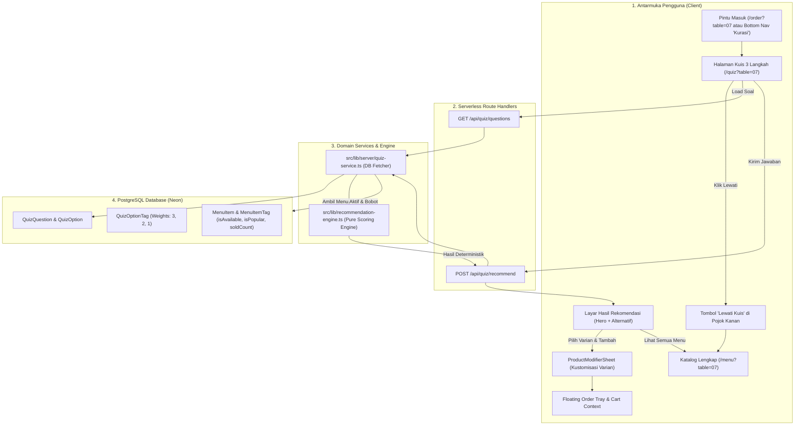

# Rencana Kerja: Implementasi Engine Kuis & Rekomendasi Menu Deterministik (Tahap 08)
## Cravio — Your craving, Perfectly Matched (Pilot: SELA Artisanal Coffee & Bake)

> **Dokumen Rujukan:**
> - [ADR-0006: Mesin Rekomendasi Menu Deterministik 3 Langkah SELA](file:///d:/project/project-qr/cravio/docs/adr/ADR-0006-deterministic-three-step-recommendation-engine.md)
> - [ADR-0003: Peta Rute Kanonis & Aturan Navigasi](file:///d:/project/project-qr/cravio/docs/adr/ADR-0003-single-canonical-route-map.md)
> - [Spesifikasi Kontrak API & Skema Zod](file:///d:/project/project-qr/cravio/docs/api-contracts.md)
> - [Runbook Skill preference-matching](file:///d:/project/project-qr/cravio/.agents/skills/preference-matching/SKILL.md)
> - [Design Specification (SCR-CUST-03 Layar Hasil Kurasi)](file:///d:/project/project-qr/cravio/design.md)

---

## 1. Ringkasan Eksekutif & Tujuan

Tahap 08 bertujuan mengimplementasikan **Engine Kuis Kurasi Preferensi Rasa & Rekomendasi Menu Deterministik** 3 langkah (*Suasana / Mood* $\rightarrow$ *Karakter Rasa / Flavor* $\rightarrow$ *Format & Suhu / Format*) untuk pelanggan meja kafe SELA.

Sesuai ketetapan ADR-0006, standar arsitektur Cravio, dan instruksi non-negotiable:
1. **100% Deterministik Tanpa AI/LLM:** Dilarang keras memanggil OpenAI, Gemini, Claude, model pembelajaran mesin, atau API AI pihak ketiga. Rekomendasi dihitung murni berbasis *Weighted Tag Matching* relasional.
2. **Pemisahan Logika & UI:** Engine scoring dibangun sebagai fungsi TypeScript murni independen (`src/lib/recommendation-engine.ts`) tanpa ketergantungan pada React UI hooks, sehingga 100% dapat diuji secara terisolasi.
3. **Konfigurasi Berbasis Database:** Pertanyaan kuis, opsi jawaban, dan pemetaan bobot tag dibaca langsung dari database PostgreSQL (`QuizQuestion`, `QuizOption`, `QuizOptionTag`, `MenuItemTag`).
4. **Bobot Kanonis Sesuai ADR-0006:**
   - Rasa (*Flavor*): **Bobot 3** (faktor penentu utama kenikmatan).
   - Format/Suhu (*Format*): **Bobot 2** (faktor kenyamanan fisik sajian).
   - Suasana (*Mood*): **Bobot 1** (faktor pengarah kurasi).
   - Bonus Best Seller: $+1$ poin jika `isPopular: true`.
5. **Hierarki Tie-Breaker 5 Tingkat & Stable Key:** Menjamin urutan hasil identik pada 100x pengujian berulang untuk input dan data yang sama.
6. **Integritas Definisi Popularitas (`soldCount`):** Data penjualan hanya menghitung pesanan yang berstatus lunas (`PaymentStatus.PAID`), tidak pernah menghitung pesanan pending atau checkout belum dibayar.
7. **Penyajian Hasil Ramah & Transparan:**
   - 1 Menu Utama (*Hero Match*) + hingga 2 Menu Alternatif (total maksimal 3 menu terbaik).
   - Tag cocok (*Matched Tags*) dengan warna pill semantik.
   - Alasan rekomendasi konkret yang dirangkai dari nama tag aktual (tanpa teks fiktif).
   - **Disclaimer alergi makanan resmi:** *"Rekomendasi disajikan berdasarkan preferensi rasa yang Anda pilih. Harap konfirmasikan alergi bahan pangan ke staf kafe kami."* (Bebas klaim medis).
8. **Mekanisme Fallback Dinamis & Sold-Out Guard:** Menu habis (`isAvailable: false`) dieksklusikan dari perhitungan; jika kandidat habis atau skor $< 3$, fallback ke menu terpopuler yang tersedia; jika seluruh katalog kafe habis, tampilkan `EmptyState` jujur tanpa error crash.
9. **Tombol "Lewati Kuis":** Tampil pada setiap langkah kuis, memungkinkan pelanggan langsung membuka katalog lengkap (`/menu?table=XX`) tanpa hambatan.
10. **Target Latensi Ultra-Rendah:** Waktu eksekusi komputasi engine diuji dan dibuktikan $< 100$ ms (target ADR-0006 $< 10$ ms) pada dataset uji.

---

## 2. Arsitektur Komponen & Alur Data



---

## 3. Rincian Teknis Implementasi

### 3.1. Engine Rekomendasi Murni: `src/lib/recommendation-engine.ts`
Fungsi murni terisolasi tanpa efek samping database/browser:
* **Struktur Tipe Data:**
  - `CandidateTag`: `{ id: string; slug: string; name: string; dimension: 'MOOD' | 'FLAVOR' | 'FORMAT' }`
  - `CandidateMenuItem`: `{ id: string; name: string; description: string; price: number; image: string | null; categoryName: string; categorySlug: string; isAvailable: boolean; isPopular: boolean; soldCount: number; isArchived: boolean; tags: CandidateTag[] }`
  - `SelectedOptionWeight`: `{ optionId: string; tagId: string; tagSlug: string; tagName: string; dimension: 'MOOD' | 'FLAVOR' | 'FORMAT'; weight: number }`
  - `RecommendationResultItem`: `{ menuItem: CandidateMenuItem; score: number; matchedTags: CandidateTag[]; matchReason: string; dimensionMatchCount: number }`
  - `RecommendationResponse`: `{ hero: RecommendationResultItem | null; alternatives: RecommendationResultItem[]; isFallback: boolean; fallbackReason?: string; totalEvaluated: number; executionDurationMs: number; disclaimer: string }`
* **Langkah Kalkulasi Skor:**
  1. Filter kandidat aktif: `isArchived === false` dan `isAvailable === true` (menu sold-out seketika disaring keluar).
  2. Untuk setiap item menu kandidat:
     - Cari irisan tag menu dengan tag yang terhubung ke opsi kuis yang dipilih.
     - Hitung skor: $S = \sum (\text{weight}(t)) + (\text{isPopular} ? 1 : 0)$.
     - Hitung `dimensionMatchCount` (jumlah dimensi unik MOOD, FLAVOR, FORMAT yang cocok).
     - Rangkai `matchReason` transparan berbasis tag konkret yang cocok (contoh: *"Dipilih karena menghadirkan karakter rasa Manis Lembut dengan sajian Dingin & Es untuk suasana Santai Anda."*).
  3. Ambang batas relevansi: $S \ge 3$.
  4. Urutkan dengan **5-Level Tie-Breaker**:
     1. `score` DESC
     2. `dimensionMatchCount` DESC
     3. `isPopular` DESC
     4. `soldCount` DESC (pesanan lunas)
     5. `id` ASC (kunci penentu stabilitas urutan)
  5. Slicing hasil:
     - Urutan ke-1 $\rightarrow$ `hero` (Hero Match).
     - Urutan ke-2 & ke-3 $\rightarrow$ `alternatives` (maksimal 2 alternatif).
  6. Penanganan Fallback:
     - Jika tidak ada menu dengan $S \ge 3$ atau opsi yang dipilih tidak menghasilkan kandidat tersedia:
       - Aktifkan `isFallback = true`.
       - Ambil 3 menu teratas berdasarkan `isPopular DESC`, `soldCount DESC`, `price ASC`, `id ASC`.
       - Tampilkan penjelasan fallback yang jujur dan ramah.
     - Jika seluruh katalog kafe berstatus sold-out (`candidates.length === 0`):
       - Kembalikan `hero = null`, `alternatives = []`, `isFallback = true`, `fallbackReason = "Belum ada menu yang tersedia saat ini."`.
  7. Benchmark Latensi: Catat durasi menggunakan `performance.now()` dalam `executionDurationMs`.

### 3.2. Server Service Database: `src/lib/server/quiz-service.ts`
* Mengambil daftar pertanyaan kuis (`QuizQuestion`), opsi (`QuizOption`), dan pemetaan bobot tag (`QuizOptionTag`) yang terurut berdasarkan `stepNumber` dan `sortOrder`.
* Mengambil kandidat item menu aktif dari PostgreSQL via Prisma Client (`isArchived: false`, `isAvailable: true`).
* Memastikan `soldCount` menu hanya bersumber dari agregasi pesanan dengan status lunas (`PaymentStatus.PAID`), menjaga integritas data tanpa menggelembungkan pesanan batal/pending.
* Memanggil `recommendation-engine.ts` dengan data yang diambil dari DB.

### 3.3. Endpoint API:
1. **`GET /api/quiz/questions`**:
   - Mengembalikan 3 langkah pertanyaan kuis dan opsi jawaban dari database.
   - Format respon terstandar envelope: `{ success: true, data: { questions: [...] } }`.
2. **`POST /api/quiz/recommend`** (dan alias kompatibilitas `/api/recommendations`):
   - Validasi payload via Zod:
     ```typescript
     export const QuizRecommendInputSchema = z.object({
       selectedOptionIds: z.array(z.string().min(1)).min(0).max(10),
       tableNumber: z.string().trim().optional(),
     });
     ```
   - Mengembalikan respon rekomendasi berisi `hero`, `alternatives`, `isFallback`, `executionDurationMs`, dan `disclaimer`.

### 3.4. Antarmuka Pengguna Kuis & Hasil:
* **Halaman Kuis (`src/app/(customer)/quiz/page.tsx` & Client Component):**
  - Segmented Progress Bar 3 langkah dengan transisi warna terakota `#924805`.
  - Tombol **"Lewati Kuis"** di kanan atas header yang langsung menuju ke `/menu?table=XX` pada setiap langkah.
  - Kartu opsi kuis dengan feedback visual seleksi yang jelas, touch target $\ge 44$ px, icon, judul, dan deskripsi singkat.
  - Navigasi bawah: Tombol "← Kembali" (pada langkah 2 & 3) dan "Lanjut ke [Langkah Berikutnya] →" / "Lihat Rekomendasi ✨" (pada langkah 3).
* **Layar Hasil Rekomendasi:**
  - **Hero Match Card:**
    - Badge mencolok *"Pilihan Terbaik Untukmu (Hero Match)"*.
    - Foto produk, nama menu, harga integer rupiah formatted (`Rp28.000`), badge *Favorit / Best Seller*.
    - Pill tag yang cocok dengan warna terakota & sage olive.
    - Kutipan alasan rekomendasi transparan berdasarkan preferensi rasa yang dipilih.
    - Tombol aksi "+ Tambah ke Pesanan" (membuka `ProductModifierSheet` jika ada varian, atau langsung masuk keranjang jika tanpa varian).
  - **Alternative Match Cards (1–2 item):**
    - Kartu ringkas dengan tag cocok dan tombol tambah instan.
  - **Disclaimer Alergi Makanan:**
    - Kotak peringatan resmi dengan ikon perhatian: *"Rekomendasi disajikan berdasarkan preferensi rasa yang Anda pilih. Harap konfirmasikan alergi bahan pangan ke staf kafe kami."*
  - **Action Footer:**
    - Tombol "Ulangi Kuis" (reset kuis) dan "Lihat Semua Menu" (`/menu?table=XX`).
    - `FloatingOrderTray` tetap muncul di bawah bila keranjang belanja telah terisi.

---

## 4. Rencana Pengujian (Test Suite & Verifikasi)

### 4.1. Unit Test Suite (`tests/unit/recommendation-engine.test.ts`)
1. **Determinisme Mutlak:** 100 kali iterasi pengujian dengan dataset dan input yang sama wajib menghasilkan urutan menu dan skor 100% identik.
2. **Kesesuaian Bobot:** Verifikasi bobot Rasa (3), Format (2), Suasana (1), dan Best Seller (1) dihitung secara presisi.
3. **Verifikasi 5-Level Tie-Breaker:**
   - Kasus skor sama $\rightarrow$ diurutkan berdasarkan `dimensionMatchCount` DESC.
   - Kasus dimensi sama $\rightarrow$ diurutkan berdasarkan `isPopular` (Best Seller) DESC.
   - Kasus popularitas sama $\rightarrow$ diurutkan berdasarkan `soldCount` DESC.
   - Kasus penjualan sama $\rightarrow$ diurutkan berdasarkan `id` ASC (stable final key).
4. **Sold-Out Guard:** Menu dengan `isAvailable: false` tidak pernah muncul sebagai rekomendasi meskipun memiliki skor tertinggi.
5. **Archived Guard:** Menu dengan `isArchived: true` tidak pernah diproses oleh engine.
6. **Mekanisme Fallback:**
   - Input dengan kombinasi tag yang tidak ada di menu aktif atau skor $< 3$ otomatis beralih ke fallback menu populer yang tersedia.
   - Mengembalikan `isFallback: true` dan penjelasan fallback yang jujur.
7. **Penanganan Lewati / Payload Kosong:** Input opsi kosong `{ selectedOptionIds: [] }` ditangani secara aman tanpa error dan menyajikan menu favorit yang tersedia.
8. **Katalog Seluruhnya Habis:** Jika seluruh item menu bernilai `isAvailable: false`, engine mengembalikan `hero: null`, `alternatives: []`, `isFallback: true` tanpa melempar runtime exception.
9. **Kepatuhan Konfigurasi Dinamis:** Pengubahan bobot tag pada konfigurasi menghasilkan penilaian yang langsung terefleksi secara deterministik.
10. **Benchmark Kinerja Komputasi:** Mengukur waktu eksekusi pada dataset 20 menu; mencatat durasi dan membuktikan latency $< 100$ ms (target $< 10$ ms).
11. **Integritas Copywriting & Disclaimer:** Memverifikasi kehadiran teks disclaimer alergi makanan resmi pada respon rekomendasi.

### 4.2. Integration Test Suite (`tests/integration/quiz-api.test.ts`)
1. **Endpoint `GET /api/quiz/questions`:** Mengambil 3 pertanyaan kuis terurut beserta opsi dan relasi tag dari database Neon live.
2. **Endpoint `POST /api/quiz/recommend`:** Mengirim payload pilihan opsi kuis yang valid dan menerima respon rekomendasi lengkap (Hero + Alternatif) beserta harga rupiah valid.
3. **Validasi Input Salah / Malformed:** Mengirim payload tidak valid (tipe salah, format string rusak) dan memastikan API mengembalikan HTTP 400 `VALIDATION_FAILED`.

---

## 5. Rencana File yang Dibuat & Dimodifikasi

| No | Path Berkas | Status | Peran & Deskripsi |
|---|---|---|---|
| 1 | `plans/quiz-engine-and-recommendation-plan.md` | Dibuat | Salinan dokumen rencana kerja di folder `plans/` |
| 2 | `src/lib/recommendation-engine.ts` | Dibuat | Pure scoring engine, normalisasi input, 5-level tie-breaker, fallback logic, dan benchmark timer |
| 3 | `src/lib/server/quiz-service.ts` | Dibuat | Service database untuk mengambil pertanyaan kuis, opsi, bobot tag, dan kandidat menu aktif |
| 4 | `src/app/api/quiz/questions/route.ts` | Dibuat | Endpoint publik untuk mengambil daftar 3 langkah pertanyaan kuis |
| 5 | `src/app/api/quiz/recommend/route.ts` | Dibuat | Endpoint publik untuk mengalkulasi rekomendasi menu berdasarkan jawaban kuis |
| 6 | `src/app/(customer)/quiz/page.tsx` | Dimodifikasi | Halaman kuis 3 langkah pelanggan SELA dengan progress bar, navigasi langkah, dan tombol Lewati |
| 7 | `src/app/(customer)/quiz/quiz-stepper.tsx` | Dibuat | Client component interaktif untuk transisi 3 langkah, seleksi opsi, panggilan API rekomendasi, dan tampilan hasil Hero/Alternatif |
| 8 | `src/app/(customer)/quiz/recommendation-results.tsx` | Dibuat | Komponen visual penyaji kartu Hero Match, Alternatif, tag cocok, alasan kurasi, integrasi modal modifier, dan disclaimer alergi |
| 9 | `tests/unit/recommendation-engine.test.ts` | Dibuat | Pengujian unit komprehensif: determinisme, bobot, tie-break, sold-out, fallback, skip, dan benchmark latensi |
| 10 | `tests/integration/quiz-api.test.ts` | Dibuat | Pengujian integrasi live DB untuk endpoint pertanyaan kuis dan kalkulasi rekomendasi |
| 11 | `docs/implementation-progress.md` | Dimodifikasi | Pemutakhiran status kemajuan proyek ke Tahap 08 (Quiz Engine & Recommendation) |

---

## 6. Kriteria Keberhasilan (Definition of Done)

1. [ ] Engine rekomendasi murni terpisah dari komponen UI dan tidak menggunakan dependensi AI/LLM eksternal.
2. [ ] Formula scoring mematuhi ADR-0006 dan konfigurasi bobot database (Rasa = 3, Format = 2, Suasana = 1, Best Seller = 1).
3. [ ] 5-Tingkat tie-breaker deterministik terbukti menghasilkan urutan identik pada 100x pengujian berulang.
4. [ ] Menu habis (*Sold Out*) terbukti disaring keluar dan tidak pernah direkomendasikan.
5. [ ] Tombol "Lewati Kuis" berfungsi pada setiap langkah kuis dan langsung mengarahkan ke katalog menu lengkap.
6. [ ] Tampilan hasil kurasi menyajikan 1 Hero Match + 2 Alternatif, tag cocok, alasan berbasis tag aktual, dan disclaimer alergi resmi tanpa klaim medis.
7. [ ] Mekanisme fallback dan penanganan seluruh katalog habis berfungsi dengan graceful tanpa error.
8. [ ] Durasi eksekusi engine terukur $< 100$ ms (dengan konteks pengukuran dicatat dalam laporan).
9. [ ] Seluruh automated unit test dan integration test lulus (`pnpm run test` & `pnpm run test:integration`).
10. [ ] `pnpm run typecheck`, `pnpm run lint`, dan `pnpm run build` berhasil tanpa error.

