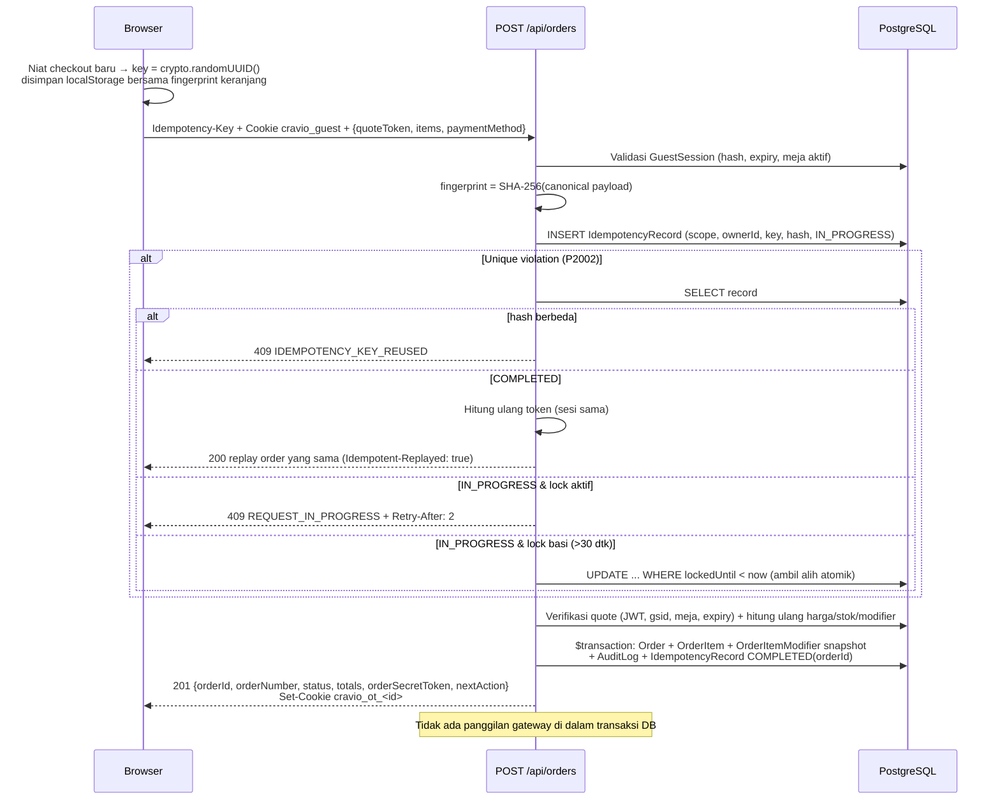

# Rencana Kerja Tahap 10 — Order Service & Checkout Idempoten
## Cravio — Your craving, Perfectly Matched (Pilot: SELA Artisanal Coffee & Bake)

> **Rujukan:** ADR-0004 (state machine terpisah), ADR-0005 (quote, idempotensi, token), DEC-014 (privasi QR meja), skill `order-payment-integrity` & `access-control-review`.

---

## 1. Tujuan

Membangun `POST /api/orders` + service transaksi yang membuat **tepat satu order** per niat checkout dari quote yang disetujui, mengunci snapshot harga, menerbitkan capability `orderSecretToken`, dan melindungi detail/pembayaran/receipt/tracking. Pembuatan order **dipisah** dari panggilan gateway (Tahap 11). Belum ada pembayaran palsu.

### Temuan riset yang memengaruhi desain
| Temuan | Dampak |
|---|---|
| `IdempotencyRecord` hanya `key @unique` + cache respons; tidak ada state, owner, referensi order | Migrasi skema |
| `GuestSession` belum pernah dibuat; `/order` hanya set cookie `cravio_table` non-HttpOnly | Tambah penerbitan sesi tamu HttpOnly |
| `/cart` & `/quiz` membaca cookie `table_number` (salah nama) dan **fallback diam-diam ke `'07'`** | Bug Tahap 08–09, diperbaiki di sini |
| ADR-0004 memakai `WAITING_CASHIER`, enum `PaymentStatus` tidak memilikinya | Tambah nilai enum (lihat Open Question) |
| Quote token Tahap 09 tidak terikat sesi tamu | Tambah klaim `gsid` ke quote |

---

## 2. User Review Required

> [!IMPORTANT]
> **Sesi tamu wajib untuk checkout.** Scan `/order?table=XX` akan membuat `GuestSession` (token acak 256-bit di cookie HttpOnly `cravio_guest`, DB hanya menyimpan SHA-256). Checkout tanpa sesi valid → `401 GUEST_SESSION_REQUIRED`; sesi meja lain → `403 TABLE_MISMATCH`. Katalog tetap bisa dibaca tanpa sesi.

> [!IMPORTANT]
> **Replay token tanpa menyimpan plaintext.** `orderSecretToken` diturunkan secara deterministik:
> `token = base64url(HMAC-SHA256(K_order, "order-cap:v1:" + orderId + ":" + capabilityNonce))`
> dengan `K_order = HMAC(JWT_SECRET, "cravio/order-capability/v1")` (domain-separated). DB menyimpan `capabilityNonce` (acak) + `orderSecretTokenHash`. Bocornya DB saja **tidak** cukup untuk membentuk token. Saat retry, token dihitung ulang **hanya** jika sesi tamu pemanggil = sesi pemilik record idempotensi. Sesi lain tidak bisa melihat key orang lain karena scope unik `(scope, ownerId, key)`.

> [!IMPORTANT]
> **Transport token (bukan URL/log).**
> - Body respons `201` sekali → disimpan klien di `localStorage` (`cravio_orders`), dikirim ke API via header `X-Order-Secret-Token`.
> - Cookie HttpOnly `cravio_ot_<orderId>` (Secure di HTTPS, SameSite=Lax, 24 jam) agar halaman server `/order/[id]/pay|track|receipt` dapat memverifikasi tanpa token di URL.
> - Logger tidak pernah mencetak header/body token; `?token=` **tidak** didukung.

> [!WARNING]
> Perbaikan bug: `/cart` & `/quiz` tidak lagi memilih meja `'07'` diam-diam. Tanpa meja valid, halaman menampilkan instruksi scan ulang dan checkout terkunci.

---

## 3. Open Questions

> [!IMPORTANT]
> **Status awal order.** Rekomendasi saya (default bila tidak ada keberatan):
> - **QRIS:** `paymentStatus = UNPAID`, `orderStatus = QUEUED` (tersembunyi dari KDS), `expiresAt = now + 15 mnt`. Berubah ke `PENDING` baru saat Tahap 11 membuat `PaymentAttempt` nyata — jujur, tanpa charge palsu.
> - **Tunai:** tambah enum `WAITING_CASHIER` sesuai ADR-0004; `expiresAt = now + cashTimeoutMinutes` (default 20 dari `CravioConfig`).
>
> Alternatif: tanpa enum baru, tunai memakai `UNPAID + paymentMethod=CASH`. Mohon konfirmasi bila memilih alternatif.

---

## 4. Alur & Desain



### 4.1 Kontrak `POST /api/orders`
- **Header:** `Idempotency-Key` (UUID v4, wajib), cookie `cravio_guest` (wajib).
- **Body (Zod):** `{ tableNumber, paymentMethod: 'QRIS'|'CASH', customerNotes?: max 100, quoteToken, items: OrderItemInput[] (1–50 baris, qty 1–50, notes ≤100) }`.
- Total/harga dari browser **diabaikan**; field tak dikenal ditolak (`.strict()`).
- **Fingerprint:** SHA-256 atas JSON kanonis `{tableNumber, paymentMethod, customerNotes, quoteId, items: sorted[{menuItemId, sortedOptionIds, quantity, notes}]}`.

### 4.2 Validasi server (urutan)
1. Sesi tamu valid & belum kedaluwarsa; meja sesi = `tableNumber`; meja `isActive`.
2. Quote JWT valid (signature, `exp`), `gsid` = sesi, `tableNumber` cocok → else `QUOTE_EXPIRED` / `QUOTE_INVALID`.
3. Hitung ulang keranjang dengan fungsi bersama `calculateCart()` (direfaktor dari `quote-service.ts`): stok (`ITEM_STOCK_DEPLETED`), kepemilikan & batas modifier (`MODIFIER_*`), harga → `itemsHash`/`totalAmount` harus sama dengan klaim quote, else `PRICE_CHANGED` + detail. **Tidak pernah menagih harga baru diam-diam.**

### 4.3 Transaksi atomik pembuatan order
- `orderNumber`: `SELA-YYMMDD-NNN` (urutan harian zona Asia/Jakarta); bentrok unik → retry ≤3.
- Snapshot: `OrderItem.nameSnapshot/priceSnapshot/quantity/subtotal`, `OrderItemModifier.nameSnapshot/priceSnapshot`; catatan baris disimpan di kolom baru `OrderItem.notes`.
- Order: `subtotalAmount`, `taxAmount=0`, `serviceAmount=0`, `totalAmount` (integer IDR), `quoteId`, `guestSessionId`, `capabilityNonce`, `orderSecretTokenHash`, `version=1`.
- `AuditLog ORDER_CREATED` (tanpa token). `soldCount` **tidak** dinaikkan (hanya saat PAID).
- Record idempotensi → `COMPLETED`, `orderId`, `responseStatus=201`, `responseBody` = respons **tanpa token**.
- Gagal validasi permanen (mis. `PRICE_CHANGED`) → record `FAILED` + respons error dicache (retry identik mendapat error yang sama; niat baru = key baru).

### 4.4 Proteksi akses (capability)
- `src/lib/server/order-access.ts`: `verifyOrderAccess(orderId, token)` → bandingkan SHA-256 dengan `crypto.timingSafeEqual`; ID tidak dikenal & token salah memberi respons seragam `403 FORBIDDEN`.
- `GET /api/orders/[id]`: detail order hanya dengan token (header atau cookie `cravio_ot_<id>`). Nomor meja / ID di URL bukan otorisasi.
- Halaman `/order/[id]/pay|track|receipt`: guard server; tanpa capability → layar "Akses pesanan tidak tersedia di perangkat ini". Halaman pay menampilkan status jujur ("Menunggu pembuatan QRIS" / "Silakan bayar di kasir") — **tanpa QR palsu**.

### 4.5 Klien: satu key per niat checkout
- `src/lib/checkout-intent.ts`: `getOrCreateCheckoutIntent(fingerprint)` → simpan `{key, fingerprint, createdAt}` di `localStorage`. Fingerprint sama → key **sama** (retry, timeout, refresh). Mutasi keranjang/quote/metode bayar → intent dihapus; key baru hanya untuk niat baru.
- Retry otomatis untuk error jaringan/`REQUEST_IN_PROGRESS` (backoff 1s/2s/4s, maks 3) dengan key yang sama. Offline → draft tetap, **tidak** ada order offline.
- Sukses → simpan token, hapus keranjang & intent, navigasi `/order/{id}/pay`.

---

## 5. Perubahan Berkas

### Database
#### [MODIFY] `prisma/schema.prisma` + [NEW] migrasi `20261029_order_idempotency_v2`
```prisma
enum IdempotencyState { IN_PROGRESS COMPLETED FAILED }
enum PaymentStatus { UNPAID PENDING WAITING_CASHIER PAID EXPIRED FAILED }  // + WAITING_CASHIER

model IdempotencyRecord {
  id             String           @id @default(cuid())
  key            String           // UUID v4 dari klien
  scope          String           // "CREATE_ORDER"
  ownerId        String           // guestSessionId
  requestHash    String
  state          IdempotencyState @default(IN_PROGRESS)
  lockedUntil    DateTime?
  orderId        String?
  responseStatus Int?
  responseBody   String?          // tanpa orderSecretToken
  expiresAt      DateTime         // +24 jam
  createdAt      DateTime         @default(now())
  updatedAt      DateTime         @updatedAt
  @@unique([scope, ownerId, key])
  @@index([expiresAt])
}
// Order: + quoteId String?, + capabilityNonce String?
// OrderItem: + notes String?
```
Migrasi dibuat via `prisma migrate diff` lalu `prisma migrate deploy` (menghindari konflik shadow DB yang pernah terjadi). Tetap satu riwayat migrasi Prisma; RLS lockdown berlaku untuk tabel lama.

### Server
| Berkas | Status | Isi |
|---|---|---|
| `src/lib/server/guest-session.ts` | NEW | `createGuestSession(tableId)`, `resolveGuestSession(req)` (hash cookie, expiry, relasi meja) |
| `src/lib/server/order-capability.ts` | NEW | derivasi/verifikasi token HMAC, hash SHA-256, `timingSafeEqual` |
| `src/lib/server/idempotency.ts` | NEW | `claimIdempotencyKey`, `completeRecord`, `failRecord`, takeover lock basi |
| `src/lib/server/quote-service.ts` | MODIFY | ekstrak `calculateCart()`; quote menyertakan `gsid`; `verifyQuoteToken()` |
| `src/lib/server/order-service.ts` | NEW | `createOrderFromQuote()` (validasi + transaksi + nomor order) |
| `src/lib/server/order-access.ts` | NEW | `verifyOrderAccess()`, pembacaan token dari header/cookie |
| `src/app/api/orders/route.ts` | NEW | `POST /api/orders` |
| `src/app/api/orders/[id]/route.ts` | NEW | `GET` detail terproteksi |
| `src/app/api/orders/quote/route.ts` | MODIFY | wajib sesi tamu, ikat `gsid` |
| `src/app/(customer)/order/page.tsx` | MODIFY | buat `GuestSession` + cookie HttpOnly `cravio_guest` |

### Klien & halaman
| Berkas | Status | Isi |
|---|---|---|
| `src/lib/checkout-intent.ts` | NEW | intent + key stabil + penyimpanan token pesanan |
| `src/app/(customer)/cart/cart-client-view.tsx` | MODIFY | langkah "Konfirmasi Pesanan", retry dengan key sama, penanganan 409 |
| `src/app/(customer)/cart/page.tsx`, `quiz/page.tsx` | MODIFY | baca `cravio_table`, hapus fallback `'07'` |
| `src/app/(customer)/order/[id]/pay|track|receipt/page.tsx` | MODIFY | guard capability + status nyata |

---

## 6. Rencana Verifikasi

### Unit (`tests/unit/order-capability.test.ts`, `idempotency-fingerprint.test.ts`)
- Fingerprint kanonis: urutan item/opsi berbeda → hash sama; qty/notes/metode berbeda → hash beda.
- Token deterministik dari (orderId, nonce); nonce beda → token beda; verifikasi salah → false; panjang berbeda tidak melempar.
- Intent klien: fingerprint sama → key sama; fingerprint beda → key baru.

### Integrasi live DB (`tests/integration/order-api.test.ts`)
1. Order valid → `201`, `paymentStatus` sesuai keputusan, `orderStatus=QUEUED`, tidak ada `PaymentAttempt`, tidak lolos predikat KDS (`paymentStatus=PAID`).
2. Retry key sama + payload sama → `200` replay, `orderId` sama, token sama.
3. **5 request paralel** (`Promise.all`) key sama → tepat **1** baris `Order` di DB.
4. Key sama + payload beda → `409 IDEMPOTENCY_KEY_REUSED`.
5. Sesi lain memakai key yang sama → order baru terpisah; token sesi A tidak pernah muncul.
6. Tanpa cookie sesi → `401`; sesi meja lain → `403`; quote kedaluwarsa/dimanipulasi → `409/400`; header key bukan UUID → `400`.
7. Snapshot: ubah harga & nama menu setelah order → `OrderItem` tetap nilai lama (harga dipulihkan setelah tes).
8. `GET /api/orders/[id]`: tanpa token / token salah / token order lain → `403`; token benar → `200` tanpa membocorkan hash.
9. Field `totalAmount: 1` di body → ditolak `400` (strict).
- Data uji dibersihkan setelah suite.

### Perintah
```powershell
pnpm run test tests/unit
pnpm run test:integration   # live Neon (jaringan)
pnpm run typecheck
pnpm run lint
pnpm run build
```

### Verifikasi manual
Scan `/order?table=07` → tambah item → Lanjut → Konfirmasi; matikan jaringan sesaat lalu retry → tetap satu order di Prisma Studio; buka URL `/order/<id>/track` di browser lain → akses ditolak.

---

## 7. Definition of Done
- [ ] Request paralel/retry menghasilkan satu order; key sama + payload beda → 409.
- [ ] Snapshot nama/harga/modifier/total bertahan setelah edit menu.
- [ ] Kepemilikan via capability teruji; ID/nomor meja bukan otorisasi; token tidak di URL/log.
- [ ] Order awal berstatus jelas, tidak masuk KDS, tanpa pembayaran palsu; tidak ada panggilan gateway di transaksi DB.
- [ ] Bug fallback meja `'07'` diperbaiki.
- [ ] Unit + integrasi + typecheck + lint + build lulus; progress log & walkthrough diperbarui.

