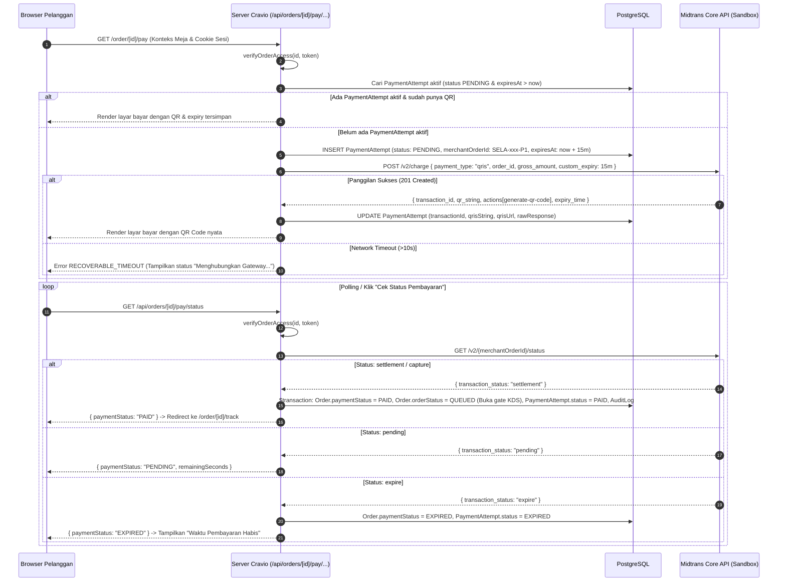

# Rencana Kerja Tahap 11 — Integrasi Charge QRIS Midtrans Core API Sandbox
## Cravio — Your craving, Perfectly Matched (Pilot: SELA Artisanal Coffee & Bake)

> **Rujukan:** ADR-0004 (State Machine & Polling), ADR-0005 (Integritas Pembayaran & Idempotensi), DEC-013 (Kitchen Gate on PAID), DEC-014 (Capability Token Guard), DEC-015 (Nir-Bukti Manual & Expiry 15 Menit), skill `order-payment-integrity`.

---

## 1. Tujuan

Membangun **Payment Adapter Midtrans Core API** dalam mode **Sandbox** murni sisi server (`server-only`) untuk memproses pembayaran QRIS dinamis:
1. Menghubungkan endpoint resmi Midtrans `POST /v2/charge` (`payment_type: "qris"`, acquirer: `"gopay"`, `custom_expiry: 15 menit`).
2. Menggunakan **nominal snapshot server** (`order.totalAmount`), bukan input nominal dari browser.
3. Menjamin satu `merchantOrderId` yang stabil dan unik per attempt (`SELA-YYMMDD-NNN-P1`), dengan **persistensi ke database sebelum memanggil gateway**.
4. Mencegah **charge ganda** saat halaman di-refresh atau di-mount ulang.
5. Menangani **network timeout secara tangguh**: jika gateway timeout, sistem mencari status transaksi via `GET /v2/{merchantOrderId}/status` sebelum mengizinkan transaksi baru (tidak menganggap timeout sebagai gagal bayar).
6. Membangun layar pembayaran interaktif pada `/order/[id]/pay`: QR code dinamis, countdown 15 menit tersinkronisasi server `expiresAt`, instruksi ramah satu ponsel (opsi simpan gambar & scan via galeri e-wallet), tombol bantuan, dan status check terkontrol.
7. Menegakkan invarian mutlak: **Tombol pelanggan tidak pernah dapat menetapkan status `PAID`**; transisi status `PAID` hanya terjadi jika Midtrans Get Status secara resmi mengembalikan `settlement`/`capture`.

---

## 2. User Review Required

> [!IMPORTANT]
> **Format Merchant Order ID Midtrans:**
> Midtrans Core API mensyaratkan `order_id` alfanumerik unik (maks 50 karakter). Kita memformat merchant order ID per attempt pembayaran sebagai:
> `[orderNumber]-P[attemptIndex]` (contoh: `SELA-261029-001-P1`, `SELA-261029-001-P2`).
> Format ini unik di Midtrans, mudah dilacak di Midtrans Merchant Portal, dan stabil untuk satu siklus pembayaran.

> [!IMPORTANT]
> **Prosedur Pemulihan Timeout (Nir-Charge Ganda):**
> Jika panggilan `POST /v2/charge` mengalami timeout jaringan (>10 detik), status attempt tetap disimpan sebagai `PENDING`. Saat klien meminta ulang atau melakukan polling status, server terlebih dahulu memanggil `GET /v2/{merchantOrderId}/status`:
> - Jika transaksi ada di Midtrans (`status_code: 201/200, transaction_status: pending`): server memulihkan data QR (`qr_string`, `qrisUrl`) dan mengembalikannya ke klien tanpa membuat charge baru.
> - Jika transaksi mengembalikan `404 Not Found` (artinya paket tidak pernah sampai ke Midtrans): attempt lama ditandai `FAILED` dan attempt baru diizinkan.

> [!WARNING]
> **Instruksi Satu Ponsel (Same-Device Payment):**
> Banyak pelanggan kafe membuka menu dan membayar dari ponsel yang sama. Kami menyediakan instruksi visual:
> 1. Pindai dari ponsel/perangkat lain (jika ada).
> 2. Pindai dari ponsel yang sama: tombol "Simpan Gambar QR", lalu buka e-wallet / m-banking dan gunakan fitur *"Pindai / Bayar $\rightarrow$ Ambil dari Galeri Foto"*. Disertai catatan jujur bahwa ketersediaan fitur galeri bergantung pada masing-masing aplikasi perbankan pengguna.

---

## 3. Open Questions / Klarifikasi

> [!NOTE]
> **Frekuensi Polling Status:**
> Kami mengimplementasikan polling cerdas di `/order/[id]/pay`: interval 5 detik selama 2 menit pertama, melambat ke interval 10 detik hingga sisa waktu habis (15 menit), serta otomatis *pause* bila tab peramban tidak aktif (`document.hidden`). Tombol manual *"Cek Status Pembayaran"* tetap disediakan bagi pelanggan yang ingin respons instan setelah membayar di aplikasi e-wallet.

---

## 4. Alur & Desain Arsitektur



---

## 5. Rincian Perubahan Berkas

### 5.1 Skema Database (`prisma/schema.prisma`)
#### [MODIFY] `prisma/schema.prisma`
- Tambahkan kolom `merchantOrderId String? @unique` pada `model PaymentAttempt` untuk pengindeksan langsung identifier Midtrans tanpa ambigu:
  ```prisma
  model PaymentAttempt {
    id              String         @id @default(cuid())
    orderId         String
    order           Order          @relation(fields: [orderId], references: [id], onDelete: Cascade)
    gateway         PaymentGateway
    merchantOrderId String?        @unique // SELA-261029-001-P1
    transactionId   String?        @unique // Midtrans UUID
    grossAmount     Int
    qrisString      String?
    qrisUrl         String?
    status          PaymentStatus  @default(PENDING)
    expiresAt       DateTime
    rawResponse     String?
    createdAt       DateTime       @default(now())
    updatedAt       DateTime       @updatedAt

    @@index([orderId])
    @@index([status, expiresAt])
    @@map("payment_attempts")
  }
  ```

### 5.2 Server Core Adapter & Payment Service
#### [NEW] `src/lib/server/midtrans.ts`
- Client murni server-only untuk Midtrans Core API:
  - `getMidtransBaseUrl()`: `https://api.sandbox.midtrans.com` (atau production bila `MIDTRANS_IS_PRODUCTION=true`).
  - `getMidtransAuthHeader()`: `Basic ${Buffer.from(MIDTRANS_SERVER_KEY + ':').toString('base64')}`.
  - `chargeQris(params: { orderId: string, grossAmount: number, expiryMinutes?: number })`:
    - Memanggil `POST /v2/charge`.
    - Timeout terkontrol 10 detik via `AbortSignal.timeout(10000)`.
    - Mengembalikan `{ statusCode, transactionId, orderId, grossAmount, qrString, qrUrl, expiryTime, transactionStatus }`.
  - `getTransactionStatus(merchantOrderId: string)`:
    - Memanggil `GET /v2/${merchantOrderId}/status`.
    - Mengembalikan status aktual dari Midtrans.

#### [NEW] `src/lib/server/payment-service.ts`
- Logika orkestrasi transaksi dan pencegahan duplikasi:
  - `getOrInitiateQrisPayment(orderId: string, token: string)`:
    - Verifikasi kepemilikan via `verifyOrderAccess(orderId, token)`.
    - Tolak jika `order.paymentMethod !== 'QRIS'` atau sudah `PAID`/`CANCELLED`.
    - Cek apakah sudah ada `PaymentAttempt` aktif (`status: PENDING` & `expiresAt > now`):
      - Jika ada dan memiliki QR data $\rightarrow$ langsung kembalikan (*reused*, tidak ada charge ganda).
      - Jika ada tapi belum ada QR data (akibat timeout sebelumnya) $\rightarrow$ panggil `getTransactionStatus` Midtrans untuk memulihkan transaksi.
    - Jika belum ada attempt aktif $\rightarrow$ buat nomor urut attempt `${order.orderNumber}-P${count + 1}`, simpan `PaymentAttempt` ke DB, lalu hubungi Midtrans `chargeQris`.
  - `checkAndUpdatePaymentStatus(orderId: string, token: string)`:
    - Verifikasi kepemilikan order.
    - Panggil Midtrans Get Status.
    - Jika `settlement`: lakukan update atomik DB `Order.paymentStatus = 'PAID'`, `Order.paidAt = new Date()`, `Order.orderStatus = 'QUEUED'` (membuka gate KDS dapur), `PaymentAttempt.status = 'PAID'`, dan catat `AuditLog`.
    - Jika `expire`: perbarui status menjadi `EXPIRED`.
    - Kembalikan data status terkini.

### 5.3 Route Handlers API
#### [NEW] `src/app/api/orders/[id]/pay/qris/route.ts`
- `POST /api/orders/[id]/pay/qris`: Inisialisasi atau pengambilan attempt QRIS yang sedang aktif. Terproteksi capability token.
- `GET /api/orders/[id]/pay/status/route.ts`:
- `GET /api/orders/[id]/pay/status`: Polling status resmi ke Midtrans Gateway. Menerapkan verifikasi kapabilitas dan pembaruan status server-authoritative.

### 5.4 Antarmuka Pengguna Layar Bayar
#### [NEW] `src/app/(customer)/order/[id]/pay/payment-client-view.tsx`
- Komponen interaktif pelanggan:
  - Tampilan nominal resmi Rupiah (`formatIDR`).
  - Rendering QR Code resmi Midtrans (menggunakan URL gambar `qrisUrl` dari gateway dan fallback `qr_string`).
  - Countdown timer mundur 15 menit tersinkronisasi server `expiresAt`.
  - Tombol *"Unduh QR"* (mengunduh gambar QR ke perangkat).
  - Panduan ramah pelanggan satu ponsel (*same-device instructions*).
  - Indikator status menunggu dengan animasi pulsa halus.
  - Tombol manual *"Cek Status Pembayaran"* + polling otomatis berkala (5 detik).
  - Pengalihan otomatis (*auto-redirect*) ke `/order/[id]/track` begitu status berubah menjadi `PAID`.
  - Tampilan ramah bila batas waktu berakhir (status `EXPIRED`).

#### [MODIFY] `src/app/(customer)/order/[id]/pay/page.tsx`
- Menggantikan placeholder Tahap 10 dengan inisialisasi server `getOrInitiateQrisPayment` dan merender `PaymentClientView`.

---

## 6. Rencana Pengujian & Verifikasi

### 6.1 Pengujian Unit (`tests/unit/midtrans-adapter.test.ts`)
1. **Header Autentikasi Basic:** Kunci `MIDTRANS_SERVER_KEY` di-encode dengan benar ke base64 dengan format `key:`.
2. **Kalkulasi Custom Expiry:** Waktu diformat tepat sesuai spesifikasi Midtrans `YYYY-MM-DD HH:mm:ss +0700` dengan durasi 15 menit.
3. **Penanganan Timeout:** AbortSignal memicu `MidtransTimeoutError` tanpa melempar unhandled exception.
4. **Ekstraksi Actions URL:** URL gambar QR code diambil dengan benar dari entri `actions` dengan nama `generate-qr-code`.

### 6.2 Pengujian Integrasi Live Sandbox (`tests/integration/midtrans-qris.test.ts`)
1. **Charge Nyata Sandbox Berhasil:**
   - Membuat order QRIS baru di DB.
   - Menginisialisasi pembayaran $\rightarrow$ berhasil memanggil Midtrans Sandbox API secara nyata (`status_code: 201`, `qr_string` dan `qrisUrl` terisi).
2. **Integritas Nominal Integer IDR:**
   - Memastikan `gross_amount` yang dikirim ke Midtrans persis sama dengan `order.totalAmount` di database (tanpa selisih 1 rupiah pun).
3. **Idempotensi Layar Bayar (Nir-Charge Ganda):**
   - Memanggil inisialisasi pembayaran kedua kali untuk order yang sama $\rightarrow$ mengembalikan data attempt yang sama tanpa membuat transaksi baru di Midtrans.
4. **Pemulihan Status Timeout:**
   - Mensimulasikan attempt yang belum terekam responsnya, lalu memanggil `checkAndUpdatePaymentStatus` $\rightarrow$ berhasil menemukan status di Midtrans dan memulihkan data.
5. **Proteksi Capability Token:**
   - Memanggil endpoint pembayaran dengan token order lain atau token palsu $\rightarrow$ ditolak `403 FORBIDDEN`.
6. **Invarian Tombol Pelanggan (Tidak Pernah Menetapkan PAID):**
   - Verifikasi bahwa klien tidak dapat mengirim payload `{ status: "PAID" }`; transisi ke `PAID` hanya terjadi jika Midtrans Get Status mengonfirmasi `settlement`.

### 6.3 Perintah Pengujian
```powershell
pnpm run test tests/unit
pnpm run test tests/integration/midtrans-qris.test.ts
pnpm run test
pnpm run typecheck
pnpm run lint
pnpm run build
```

---

## 7. Definition of Done (Kriteria Selesai)

- [ ] Charge nyata ke Midtrans Sandbox berhasil mendapatkan `qr_string` dan URL QR code yang valid.
- [ ] Nominal charge persis sama dengan snapshot `order.totalAmount` server.
- [ ] Refresh / navigasi ulang halaman tidak membuat charge kedua di Midtrans.
- [ ] Permintaan timeout dapat dipulihkan melalui `merchantOrderId` via Midtrans Get Status tanpa menganggap timeout sebagai gagal bayar.
- [ ] Pengguna tanpa capability token yang sah ditolak `403 FORBIDDEN`.
- [ ] Tombol pelanggan tidak pernah dapat menetapkan status `PAID`.
- [ ] Layar bayar menampilkan QR, countdown 15 menit, opsi simpan QR, dan panduan satu ponsel.
- [ ] Seluruh unit test, integration test, typecheck, lint, dan production build lulus tanpa error.

