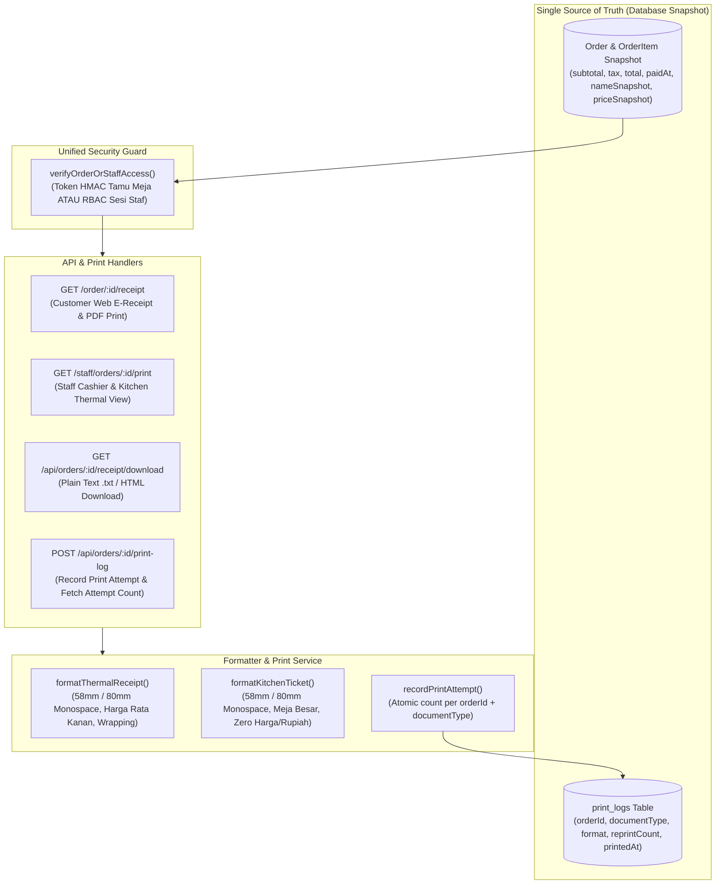

# Rencana Implementasi: Struk Digital & Layout Cetak Thermal 58/80 mm (Tahap 16)

## Ringkasan Tujuan (Goal Description)
Mengimplementasikan sistem struk transaksi lengkap yang bersumber dari snapshot transaksi tunggal yang kekal (*single source of truth*) untuk **Cravio — SELA Artisanal Coffee & Bake**:
1. **E-Receipt Pelanggan (`CUSTOMER_RECEIPT`):** Tampilan responsif digital web di `/order/[id]/receipt` dengan identitas resmi SELA, nomor pesanan/meja, waktu WIB, rincian snapshot item/modifier/qty/catatan, subtotal, pajak/layanan, total, metode bayar, dan status finansial aktual (termasuk label tegas dan tidak ambigu untuk tunai belum bayar agar tidak menyerupai bukti LUNAS).
2. **Struk Thermal Kasir (`CASHIER_RECEIPT`):** Format cetak thermal kasir (58 mm & 80 mm) monokrom monospace dengan metadata kasir, rincian snapshot finansial, dan penanda reprint jika dicetak ulang.
3. **Tiket Thermal Dapur (`KITCHEN_TICKET`):** Format cetak thermal dapur/barista (58 mm & 80 mm) yang **menonjolkan Nomor Meja, Nomor Pesanan, Item, Modifier, dan Catatan**, serta **MUTLAK TANPA NOMINAL HARGA/KEUANGAN**.
4. **Otorisasi Server Ketat:** Seluruh akses (halaman web, HTML print, API pencatatan cetak, dan endpoint unduhan) wajib memverifikasi kepemilikan pesanan (`orderSecretToken`) atau sesi staf berwenang (`BARISTA`, `CASHIER`, `ADMIN`). Tamu publik tanpa token atau dengan token pesanan lain ditolak HTTP 403 Forbidden.
5. **Template CSS `@media print` 58 mm & 80 mm:** Menggunakan dimensi fisik driver printer (`58mm` / `80mm` dengan lebar aman 48mm / 72mm), monokrom murni (`#000000`), monospace font, wrapping nama item panjang (`break-words`), dan angka harga rata kanan yang tidak terpotong (`tabular-nums`, `whitespace-nowrap`).
6. **Pencatatan Permintaan Cetak Atomik (*Print Attempt Tracking*):** Menambahkan enum `PrintDocumentType` pada `PrintLog` sehingga penghitungan reprint dilakukan **independen per jenis dokumen**. Tiket dapur pertama tidak akan dianggap reprint hanya karena kasir sudah mencetak struk belanja. Pencatatan didokumentasikan sebagai *print request/attempt*, bukan bukti fisik kertas keluar dari hardware printer.
7. **Fitur Simpan & Unduh Struk:** Menyediakan tombol Print to PDF via browser dialog, serta endpoint unduhan langsung berkas teks monospaced (`.txt`) dan berkas cetak mandiri (`.html`).

---

## User Review Required
> [!IMPORTANT]
> **Pemisahan Independen Counter Reprint per Jenis Dokumen:**
> Model `PrintLog` di `prisma/schema.prisma` diperluas dengan kolom `documentType PrintDocumentType` (`CUSTOMER_RECEIPT`, `CASHIER_RECEIPT`, `KITCHEN_TICKET`).
> Hal ini memastikan bahwa jika Kasir mencetak Struk Kasir terlebih dahulu (attempt #1), ketika Barista mencetak Tiket Dapur untuk pertama kalinya, Tiket Dapur **TETAP attempt #1 (BUKAN REPRINT)**.
> Label `*** CETAK ULANG (REPRINT) #N ***` hanya muncul jika dokumen dengan jenis yang sama dicetak untuk kedua kali atau lebih.

> [!WARNING]
> **Batasan Kejujuran Teknis Peramban Web (Browser Print Dialog):**
> Peramban web (`window.print()`) tidak memiliki akses level perangkat keras untuk mengetahui apakah pengguna menekan tombol "Print" atau "Cancel" pada dialog cetak OS, atau apakah kertas printer thermal macet (*paper jam*).
> Sistem secara jujur mencatat entri pada `print_logs` sebagai **Print Request / Attempt** (upaya cetak), bukan konfirmasi fisik kertas berhasil keluar. Hal ini sesuai dengan batas kapabilitas arsitektur web modern tanpa driver native.

---

## Open Questions
*Tidak ada pertanyaan pemblokir.* Semua kebutuhan fungsional telah terdefinisi secara jelas pada dokumen baseline (`architecture.md` Seksi 12, `design.md` Seksi 11, `cafe-operations` skill, dan `access-control-review` skill).

---

## Proposed Changes



---

### Komponen 1: Skema Database & Migrasi Prisma

#### [MODIFY] `prisma/schema.prisma`
* Tambahkan enum `PrintDocumentType`:
  ```prisma
  enum PrintDocumentType {
    CUSTOMER_RECEIPT
    CASHIER_RECEIPT
    KITCHEN_TICKET
  }
  ```
* Perbarui model `PrintLog`:
  ```prisma
  model PrintLog {
    id           String            @id @default(cuid())
    orderId      String
    order        Order             @relation(fields: [orderId], references: [id], onDelete: Cascade)
    staffUserId  String?
    staffUser    StaffUser?        @relation(fields: [staffUserId], references: [id], onDelete: SetNull)
    format       PrintFormat       @default(THERMAL_58MM)
    target       PrintTarget       @default(BROWSER_DIALOG)
    documentType PrintDocumentType @default(CUSTOMER_RECEIPT)
    printedAt    DateTime          @default(now())
    reprintCount Int               @default(0)

    @@index([orderId, documentType])
    @@index([orderId])
    @@map("print_logs")
  }
  ```

---

### Komponen 2: Unified Access Control & Print Service

#### [MODIFY] `src/lib/server/order-access.ts`
* Ekstensi fungsi autentikasi ganda `verifyOrderOrStaffAccess()`:
  * Memverifikasi apakah request berasal dari staf terautentikasi (`requireStaffRole(['CASHIER', 'ADMIN', 'BARISTA'])`) ATAU pelanggan pemilik pesanan dengan token HMAC valid (`extractOrderSecretToken()`).
  * Jika bukan staf dan token salah/hilang/mismatch, tolak seragam dengan HTTP 403 Forbidden.
  * Mengembalikan objek `{ order, actorType: 'STAFF' | 'CUSTOMER', staffUser: StaffJWTPayload | null }`.

#### [NEW] `src/lib/server/print-service.ts`
* Layanan atomik pencatatan upaya cetak:
  * `recordPrintAttempt(orderId, documentType, format, staffUserId)`:
    * Menggunakan transaksi Prisma atomik:
      1. Menghitung record sebelumnya: `count = await prisma.printLog.count({ where: { orderId, documentType } })`.
      2. Membuat record `PrintLog`: `reprintCount = count`.
      3. Mencatat `AuditLog` dengan aksi `PRINT_ATTEMPT`.
      4. Mengembalikan `{ attemptNumber: count + 1, isReprint: count > 0, reprintCount: count }`.
  * `getPrintSummary(orderId, documentType)`:
    * Mengambil jumlah attempt yang telah dilakukan untuk dokumen tersebut tanpa mencatat attempt baru.

---

### Komponen 3: Engine Formatter Monospace Struk & Tiket Dapur

#### [NEW] `src/lib/receipt-formatter.ts`
* Utilitas formatting teks monospace murni (dapat dijalankan di sisi client maupun server):
  * **Ukuran Lebar Kertas Fisik:**
    * `58mm`: Target kolom 32 karakter monospace (lebar aman driver ~48mm).
    * `80mm`: Target kolom 48 karakter monospace (lebar aman driver ~72mm).
  * **Fungsi `formatThermalReceipt()` (Struk Pelanggan & Kasir):**
    * Header SELA ("SELA Artisanal Coffee & Bake", Jl. Senopati No. 42, Jakarta Selatan).
    * Metadata: Nomor Order, Meja, Waktu WIB (`Asia/Jakarta`), Kasir (jika dicetak kasir), Metode Bayar, dan Status Finansial.
    * Jika `isReprint`: Watermark tegas `*** CETAK ULANG (REPRINT) #N ***`.
    * Jika `WAITING_CASHIER`: Header & status jelas `*** BELUM LUNAS - MENUNGGU PEMBAYARAN KASIR ***` (dilarang menyerupai bukti LUNAS).
    * Pembagian kolom: `QTY`, `ITEM` (wrapping rapi), `HARGA` (rata kanan, `tabular-nums`, tidak terpotong).
    * Garis putus-putus monospace (`--------------------------------`).
    * Subtotal, Pajak Restoran (PB1), Biaya Layanan, Total Akhir (selalu Integer IDR).
    * Footer ucapan terima kasih.
  * **Fungsi `formatKitchenTicket()` (Tiket Dapur & Barista):**
    * **MUTLAK TANPA NOMINAL HARGA ATAU SIMBOL RUPIAH.**
    * Menonjolkan Nomor Meja besar: `[ MEJA 07 ]` atau `*** MEJA 07 ***`.
    * Nomor Order & Waktu WIB.
    * Catatan global pesanan pelanggan (jika ada).
    * Baris item: `2x Kopi Susu Aren`, modifier dengan indentasi `  [+] Less Sugar (50%)`, catatan baris `  * Catatan: Es sedikit`.
    * Jika `isReprint`: Watermark `*** CETAK ULANG DAPUR (REPRINT) #N ***`.
    * Status: `DAPUR / BARISTA ORDER SLIP`.

---

### Komponen 4: Endpoint API & Unduhan

#### [NEW] `src/app/api/orders/[id]/print-log/route.ts`
* Endpoint `POST /api/orders/[id]/print-log`:
  * Validasi body via Zod: `documentType: z.enum(['CUSTOMER_RECEIPT', 'CASHIER_RECEIPT', 'KITCHEN_TICKET'])`, `format: z.enum(['THERMAL_58MM', 'THERMAL_80MM'])`.
  * Memverifikasi hak akses pemanggil via `verifyOrderOrStaffAccess()`. Pelanggan hanya boleh mencatat `CUSTOMER_RECEIPT`; staf boleh mencatat semua jenis.
  * Memanggil `recordPrintAttempt()` dan mengembalikan `{ success: true, attemptNumber, isReprint, reprintCount }`.

#### [NEW] `src/app/api/orders/[id]/receipt/download/route.ts`
* Endpoint `GET /api/orders/[id]/receipt/download`:
  * Query parameters:
    * `format`: `'txt' | 'html'` (default: `'txt'`).
    * `paper`: `'58mm' | '80mm'` (default: `'58mm'`).
    * `type`: `'customer' | 'cashier' | 'kitchen'` (default: `'customer'`).
  * Memverifikasi hak akses pemanggil via `verifyOrderOrStaffAccess()`. Pelanggan dilarang mengunduh dokumen staf (403 Forbidden).
  * Menghasilkan teks monospace atau HTML mandiri self-contained dengan CSS `@media print`.
  * Mengembalikan respons dengan header:
    * `Content-Type: text/plain; charset=utf-8` atau `text/html; charset=utf-8`.
    * `Content-Disposition: attachment; filename="sela-${type}-${orderNumber}-${paper}.${ext}"`.

---

### Komponen 5: Halaman Antarmuka Cetak Pelanggan & Staf

#### [MODIFY] `src/app/(customer)/order/[id]/receipt/receipt-client-view.tsx` & `page.tsx`
* Mengintegrasikan verifikasi `verifyOrderOrStaffAccess`.
* Menyediakan tab pemilih ukuran: `58 mm` vs `80 mm`.
* Menampilkan status pembayaran aktual:
  * Lunas: Badge hijau `LUNAS (PAID)` + tanggal `paidAt`.
  * Tunai belum bayar: Banner amber tegas `"PESANAN BELUM DIBAYAR — SILAKAN MENUJU KASIR UNTUK MELAKUKAN PEMBAYARAN"`. Dilarang menampilkan kata "LUNAS".
  * QRIS belum bayar: Banner oranye `"MENUNGGU PEMBAYARAN QRIS"`.
  * Refund review: Banner biru `"PESANAN DIBATALKAN — DANA TERCATAT, AMBIL REFUND DI KASIR"`.
* Tombol aksi:
  * `🖨️ Cetak / Simpan PDF`: mencatat print attempt via API lalu memanggil `window.print()`.
  * `⬇️ Unduh Berkas Struk (.txt)` & `⬇️ Unduh Berkas Struk (.html)`.
  * `← Kembali ke Status Pesanan`.
* CSS `@media print` monokrom monospace khusus 58mm/80mm yang menyembunyikan tombol navigasi saat dicetak.

#### [NEW] `src/app/(staff)/staff/orders/[id]/print/page.tsx` & `print-client-view.tsx`
* Halaman cetak terproteksi staf (`requireStaffRole(['CASHIER', 'ADMIN', 'BARISTA'])`).
* Menerima query parameter: `?type=cashier|kitchen&paper=58mm|80mm&auto=true|false`.
* Menyediakan toggle switch:
  * Jenis Dokumen: `Struk Kasir` vs `Tiket Dapur`.
  * Lebar Kertas: `58 mm` vs `80 mm`.
* Pratinjau layout thermal presisi monokrom monospace.
* Tombol `🖨️ Cetak Sekarang` (mencatat attempt, memperbarui reprint banner, dan memanggil `window.print()`).
* Tombol `⬇️ Unduh File Teks (.txt)`.

#### [MODIFY] `src/app/(staff)/staff/pos/pos-client-view.tsx`
* Menambahkan tombol `🖨️ Struk` pada kartu pesanan di tab `Riwayat Lunas` dan `Antrean Tunai`.
* Mengintegrasikan tombol pintas cetak struk kasir dan tiket dapur langsung dari dialog konfirmasi pembayaran tunai.

#### [MODIFY] `src/app/(staff)/staff/kds/kds-client-view.tsx`
* Menambahkan tombol `🖨️ Tiket` di header kartu tiket KDS dapur agar barista dapat mencetak slip fisik jika dibutuhkan untuk pesanan bungkus/meja luar.

---

## Rencana Verifikasi & Bukti Kualitas (Verification Plan)

### Automated Tests
1. **Unit Test Suite Baru (`tests/unit/receipt-formatter.test.ts`):**
   * Verifikasi formatting 58mm (32 kolom) dan 80mm (48 kolom).
   * Verifikasi wrapping nama menu panjang tanpa memotong harga.
   * Verifikasi perataan kanan kolom harga tabular.
   * Verifikasi Tiket Dapur **MUTLAK TANPA SIMBOL RUPIAH ATAU NOMINAL HARGA**.
   * Verifikasi label peringatan tunai belum bayar agar tidak menyerupai lunas.
   * Verifikasi label reprint `*** CETAK ULANG (REPRINT) #2 ***`.
   * Perintah: `pnpm run test tests/unit/receipt-formatter.test.ts`
2. **Integration Test Suite Baru (`tests/integration/receipt-and-thermal-print.test.ts`):**
   * Menguji terhadap live database Neon PostgreSQL:
     * **Snapshot Matching:** Memastikan seluruh item, modifier, subtotal, tax, dan total cocok 100% dengan database snapshot.
     * **Access Control:**
       * Request tanpa token ditolak 403.
       * Request dengan cross-order token ditolak 403.
       * Tamu biasa mengakses rute staf ditolak 403.
       * Tamu pemilik pesanan dapat mengakses e-receipt dan mengunduh.
       * Staf (CASHIER/ADMIN/BARISTA) dapat mengakses struk dan tiket dapur.
     * **Pencatatan Atomik & Independen Reprint:**
       * Cetak Struk Kasir ke-1 $\rightarrow$ `isReprint: false`, `reprintCount: 0`.
       * Cetak Tiket Dapur ke-1 $\rightarrow$ `isReprint: false`, `reprintCount: 0` (terbukti tidak terpengaruh struk kasir).
       * Cetak Struk Kasir ke-2 $\rightarrow$ `isReprint: true`, `reprintCount: 1`.
       * Cetak Tiket Dapur ke-2 $\rightarrow$ `isReprint: true`, `reprintCount: 1`.
     * **Endpoint Unduhan:** Memastikan `GET /api/orders/[id]/receipt/download` mengembalikan status 200 dengan header `Content-Disposition: attachment`.
     * **Status Finansial:** Memastikan pesanan belum bayar menampilkan label peringatan yang sah dan pesanan lunas menampilkan timestamp `paidAt`.
   * Perintah: `pnpm run test tests/integration/receipt-and-thermal-print.test.ts`
3. **Pemeriksaan Regresi Menyeluruh:**
   * `pnpm run test tests/unit` (Semua unit test wajib PASS).
   * `pnpm run test tests/integration --fileParallelism=false` (Semua integration test wajib PASS).
   * `pnpm run typecheck` (`tsc --noEmit` wajib exit code 0).
   * `pnpm exec eslint src tests` (Wajib exit code 0).
   * `pnpm run build` (Next.js production build wajib terkompilasi 100% sukses).

### Manual Verification
1. Buka browser pada rute `/order/[id]/receipt`:
   * Periksa tampilan digital di mode mobile (390px) dan desktop.
   * Coba ganti opsi lebar kertas antara 58mm dan 80mm.
   * Tekan tombol `Cetak / Simpan PDF`: periksa dialog print peramban, pastikan layout monokrom bersih, tombol tidak ikut tercetak, dan format rapi.
   * Tekan tombol `Unduh Berkas Struk (.txt)`: periksa berkas hasil unduhan di teks editor (Notepad), pastikan kolom rapi monospace.
2. Buka dashboard kasir `/staff/pos`:
   * Pilih pesanan lunas, klik `🖨️ Struk`.
   * Cetak pertama kali $\rightarrow$ tidak ada watermark reprint.
   * Cetak kedua kali $\rightarrow$ muncul watermark `*** CETAK ULANG (REPRINT) #2 ***`.
3. Buka KDS dapur `/staff/kds`:
   * Klik tombol `🖨️ Tiket` pada salah satu pesanan.
   * Periksa tiket dapur: pastikan Nomor Meja sangat besar, catatan pelanggan terlihat jelas, dan **TIDAK ADA HARGA / RUPIAH SAMA SEKALI**.

