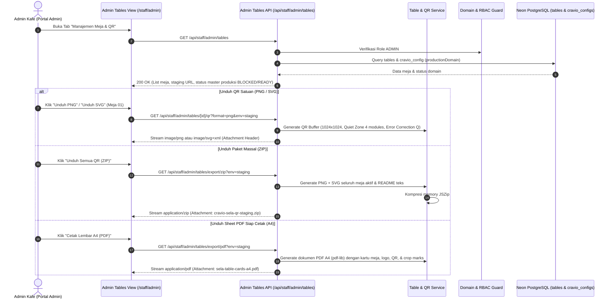

# Rencana Implementasi: Manajemen Meja Kafe & Generator Master QR (Tahap 19)

> **ID Rencana:** `PLN-019`  
> **Target Rilis:** Cravio v0.1.0 (Pilot: SELA Artisanal Coffee & Bake)  
> **Komponen:** Admin Meja, Generator QR Publik (PNG/SVG), Ekspor ZIP Massal, Sheet PDF Siap Cetak A4, Environment Domain Guard  
> **Prasyarat:** Tahap 05 (Auth & RBAC), Tahap 07 (Katalog & Deteksi Meja), Tahap 17 & 18 (Admin & Settings) Selesai (PASS)

---

## 1. Deskripsi Tujuan

Membangun modul **Manajemen Meja Kafe dan Generator Master Kode QR** di portal admin Cravio untuk kafe mitra perdana **SELA Artisanal Coffee & Bake**. Modul ini mencakup:
1. **Administrasi Meja Kafe:** Manajemen nomor meja unik (`tableNumber`, misal "01", "07"), label lokasi kustom (`label`, misal "Area Bar 01", "VIP Indoor 02"), dan status operasional (`isActive`).
2. **Keamanan Konten QR Meja (Zero-Leak Policy):** Kode QR fisik meja kafe bersifat publik dan **HANYA BERISI URL PUBLIK RESMI MEJA** (`${baseUrl}/order?table=XX`). Mutlak dilarang memasukkan `orderSecretToken`, cookie sesi, staf PIN, atau rahasia apapun. Scan QR publik murni menginisiasi sesi belanja baru dan tidak pernah membuka riwayat/tagihan pelanggan sebelumnya.
3. **Pembedaan Lingkungan (Staging vs Master Produksi) & Domain Guard:**
   * **Staging / Preview:** Menggunakan `NEXT_PUBLIC_APP_URL` aktif untuk pengujian operasional, dilengkapi penanda/watermark visual `"STAGING / PREVIEW"`.
   * **Master Produksi (Siap Cetak):** Memeriksa ketersediaan domain produksi permanen (`CravioConfig.productionDomain` / `PRODUCTION_DOMAIN`). Jika domain final belum tersedia, master cetak produksi ditandai **`BLOCKED`** dengan penjelasan protektif agar pihak kafe tidak memboroskan biaya cetak stiker/akrilik permanen pada URL sementara.
4. **Generator Format Cetak Satuan & Massal:**
   * **Satuan:** PNG resolusi tinggi ($\ge 600\times 600$ px, default 1024×1024 px pada 300 DPI) dan SVG murni tanpa degradasi resolusi.
   * **Massal:** Paket ZIP berisi seluruh berkas PNG + SVG terorganisir beserta petunjuk cetak (`README-CETAK-MEJA.txt`), serta berkas **Sheet PDF Siap Cetak format A4** (grid kartu meja siap potong lengkap dengan logo SELA, nomor meja $\ge 28$px, instruksi scan, quiet zone ISO, dan garis potong halus).
5. **Integritas Transaksi & Soft Deactivation:**
   * Meja yang dinonaktifkan (`isActive = false`) seketika memblokir permohonan quote harga baru dan checkout pesanan baru (`TABLE_INACTIVE`).
   * Riwayat pesanan historis, pembayaran, audit log, dan snapshot transaksi masa lalu tetap tersimpan utuh dan tetap dapat diakses oleh kasir dan pelanggan yang memiliki token sah.

---

## 2. User Review Required

> [!IMPORTANT]
> **Kebijakan Pembedaan Domain Staging vs Master Produksi (`DEC-016`):**
> Jika domain produksi permanen belum dikonfigurasi (misal kafe masih menggunakan URL development `http://localhost:3000` atau URL staging preview Vercel), sistem **MEMBLOKIR** unduhan master produksi massal dan hanya mengizinkan unduhan QR berlabel Staging. Hal ini guna mencegah kerugian finansial akibat mencetak ratusan akrilik meja dengan URL sementara yang akan segera usang saat domain final diluncurkan.

> [!WARNING]
> **Keamanan QR Publik Meja (`DEC-014`):**
> Kode QR fisik yang ditempel pada meja kafe hanya berupa tautan navigasi browser biasa: `https://[domain]/order?table=[tableNumber]`. Pembacaan atau pemindaian ulang QR meja yang sama oleh pengunjung baru **TIDAK AKAN PERNAH** memuat pesanan, tagihan, atau status transaksi pengunjung sebelumnya karena data transaksi dilindungi oleh capability token rahasia per-pesanan (`orderSecretToken`).

---

## 3. Arsitektur & Alur Kerja



---

## 4. Rincian Perubahan Kode

### A. Dependensi Pustaka Pihak Ketiga
Untuk menghasilkan QR code beresolusi tinggi, arsip ZIP massal, dan dokumen PDF siap cetak tanpa dependensi biner native yang rapuh di serverless Vercel:
1. `qrcode` & `@types/qrcode`: Generator QR matrix terstandar ISO/IEC 18004 (output buffer PNG 1024px dan vektor SVG murni).
2. `jszip`: Pembuat arsip berkas ZIP terkompresi langsung di memory (bebas penulisan disk serverless `/tmp`).
3. `pdf-lib`: Pustaka manipulasi dan pembuatan PDF murni JavaScript/TypeScript (layout kertas A4, embed PNG QR, teks judul SELA, garis potong potong halus).

```bash
pnpm add qrcode jszip pdf-lib
pnpm add -D @types/qrcode
```

---

### B. Skema Database Prisma (`prisma/schema.prisma`)

#### [MODIFY] `prisma/schema.prisma`
1. Menambahkan field `label String?` pada model `Table` untuk penamaan area meja yang fleksibel (misal "Area Bar 01", "VIP Indoor 02").
2. Menambahkan field `productionDomain String?` pada model `CravioConfig` untuk menyimpan domain produksi permanen kafe yang telah disetujui (misal `https://sela.cravio.id`).

```prisma
model Table {
  id            String         @id @default(cuid())
  tableNumber   String         @unique // e.g. "01", "07"
  label         String?        // e.g. "Area Bar 01", "VIP Indoor 02"
  qrSlug        String         @unique // e.g. "sela-table-01"
  isActive      Boolean        @default(true)
  createdAt     DateTime       @default(now())
  updatedAt     DateTime       @updatedAt
  orders        Order[]
  guestSessions GuestSession[]

  @@map("tables")
}

model CravioConfig {
  id                 String   @id @default(cuid())
  name               String   @default("Cravio")
  // ... field sebelumnya ...
  productionDomain   String?  // Domain produksi permanen (e.g. "https://sela.cravio.id")
  // ...
}
```

---

### C. Server Service & Generator QR

#### [NEW] `src/lib/server/qr-service.ts`
Modul utama generator kode QR publik, resolver domain lingkungan, dan kompresi berkas:
1. `resolveTableTargetUrl(tableNumber: string, env: 'staging' | 'production'): { url: string, isProduction: boolean, isBlocked: boolean, reason?: string }`:
   * Membaca basis URL tervalidasi.
   * Jika memilih `production` namun domain belum ada/tidak valid, mengembalikan `isBlocked: true`.
2. `generateTableQrPng(tableNumber: string, options?: { size?: number, env?: 'staging' | 'production' }): Promise<Buffer>`:
   * Menghasilkan buffer PNG dengan ukuran minimal 600px (default 1024×1024 px pada 300 DPI).
   * Level error correction `Q` (25% redundancy) dan quiet zone 4 modul.
   * Warna modul dark coffee `#261810` / hitam `#000000` di atas latar putih `#FFFFFF`.
3. `generateTableQrSvg(tableNumber: string, options?: { env?: 'staging' | 'production' }): Promise<string>`:
   * Menghasilkan string XML SVG murni dengan viewBox terstandar.
4. `generateTablesZip(tables: Table[], env: 'staging' | 'production'): Promise<Buffer>`:
   * Memasukkan berkas PNG dan SVG untuk setiap meja aktif ke dalam arsip `JSZip`.
   * Menyertakan berkas `README-CETAK-MEJA.txt` yang memuat domain target, daftar nomor meja, spesifikasi ukuran akrilik/stiker yang disarankan (7×10 cm atau 10×15 cm), dan instruksi verifikasi scan sebelum diperbanyak.
5. `generatePrintReadyA4Pdf(tables: Table[], env: 'staging' | 'production', cafeName: string): Promise<Buffer>`:
   * Menggunakan `pdf-lib` untuk membuat dokumen PDF A4 (595.28 × 841.89 pt).
   * Grid kartu meja rapi (4 kartu per lembar A4, ukuran kartu ~90 × 130 mm).
   * Elemen kartu: Logo/Nama "SELA Artisanal Coffee & Bake", label "MEJA 01", gambar PNG QR tajam, instruksi "Pindai untuk Memesan", URL teks cadangan, dan garis potong (*crop marks* abu-abu halus).
   * Menyertakan watermark diagonal samar "STAGING / PREVIEW" jika dicetak dalam mode staging.

---

### D. Route Handlers & API Admin

#### [NEW] `src/app/api/staff/admin/tables/route.ts` (GET, POST)
* `GET`: Mengambil seluruh daftar meja, total pesanan historis, status aktif, serta status konfigurasi domain staging & produksi.
* `POST`: Menambah meja baru (`tableNumber`, `label`, `isActive`). Validasi duplikasi nomor meja dan format alfanumerik.

#### [NEW] `src/app/api/staff/admin/tables/[id]/route.ts` (GET, PUT, PATCH)
* `GET`: Detail meja spesifik beserta metadata QR.
* `PUT`: Memperbarui nomor meja, label, dan status aktif.
* `PATCH`: Toggle cepat status aktif/nonaktif meja.

#### [NEW] `src/app/api/staff/admin/tables/[id]/qr/route.ts` (GET)
* Mengembalikan stream unduhan berkas PNG atau SVG satuan untuk meja tertentu dengan header `Content-Disposition: attachment; filename="sela-meja-[XX]-[env].png"`.

#### [NEW] `src/app/api/staff/admin/tables/export/zip/route.ts` (GET)
* Mengembalikan berkas ZIP terkompresi berisi seluruh QR meja aktif dengan header `Content-Type: application/zip` dan `Content-Disposition: attachment`.

#### [NEW] `src/app/api/staff/admin/tables/export/pdf/route.ts` (GET)
* Mengembalikan berkas PDF A4 siap cetak dengan header `Content-Type: application/pdf` dan `Content-Disposition: attachment; filename="sela-lembar-qr-meja-[env].pdf"`.

---

### E. Antarmuka Pengguna Admin Meja (`/staff/admin`)

#### [MODIFY] `src/app/(staff)/staff/admin/admin-client-view.tsx`
* Menambahkan tab **"Manajemen Meja"** (`tables`) dengan ikon `QrCode`.
* Komponen sub-tampilan meja:
  1. **Banner Status Lingkungan:** Menampilkan Staging URL aktif dan status Master Produksi (`BLOCKED: Domain Belum Dikonfigurasi` atau `READY: Siap Cetak Permanen`).
  2. **Indikator KPI:** Total Meja, Meja Aktif, Meja Nonaktif.
  3. **Toolbar Tindakan:** Tombol "Tambah Meja", "Unduh Massal ZIP", "Cetak Lembar A4 (PDF)", dan Switch Lingkungan (Staging vs Produksi).
  4. **Daftar Kartu Meja:**
     * Preview interaktif QR code meja dengan quiet zone.
     * Nomor meja tebal dan label lokasi (misal: "Meja 01 — Area Bar").
     * Toggle status switch (Aktif / Nonaktif) dengan konfirmasi aman.
     * Tombol aksi cepat: "Unduh PNG", "Unduh SVG", "Uji URL Meja".
  5. **Modal Tambah / Edit Meja:** Form validasi nomor meja, label lokasi, dan status aktif.

#### [NEW] `src/app/(staff)/staff/admin/tables/print-sheet/page.tsx` & `print-sheet-client-view.tsx`
* Halaman pratinjau lembar cetak A4 berbasis CSS `@media print`:
  * Menampilkan pratinjau layout kartu meja persis seperti hasil cetak.
  * Dilengkapi tombol navigasi "Kembali ke Admin" dan tombol aksi utama "Cetak Lembar A4 / Simpan PDF" yang memanggil dialog cetak browser `window.print()`.

---

## 5. Rencana Pengujian & Verifikasi

### A. Pengujian Unit Otomatis (Vitest)
1. **`tests/unit/qr-generator.test.ts`:**
   * Memvalidasi bahwa URL yang dimasukkan ke dalam QR code adalah URL publik murni: `${baseUrl}/order?table=01`.
   * Memvalidasi tidak adanya parameter rahasia (`orderSecretToken`, token auth, dsb.) di dalam konten QR.
   * Memvalidasi dimensi buffer PNG yang dihasilkan memiliki lebar dan tinggi $\ge 600$ px (1024×1024 px).
   * Memvalidasi format string SVG yang dihasilkan merupakan XML valid dengan tag `<svg>` dan `<rect>`.
   * Memvalidasi pembedaan lingkungan: URL staging vs produksi.
   * Memvalidasi bahwa permintaan master produksi berstatus `BLOCKED` jika domain produksi belum terdaftar.
2. **`tests/unit/table-management.test.ts`:**
   * Memvalidasi format nomor meja alfanumerik.
   * Memvalidasi bahwa meja nonaktif (`isActive: false`) menghasilkan status `INACTIVE` pada `validateTableServer`.
   * Memvalidasi bahwa permohonan quote (`createOrderQuote`) menolak meja nonaktif dengan kode error `TABLE_INACTIVE` (403).
   * Memvalidasi bahwa checkout order (`POST /api/orders`) menolak meja nonaktif dengan kode error `TABLE_INACTIVE` (403).

### B. Pengujian Integrasi Otomatis (Vitest Live Neon DB)
1. **`tests/integration/table-admin-and-qr.test.ts`:**
   * **RBAC Guard Enforcement:** Akses tanpa token ditolak 401 Unauthorized; akses role `CASHIER` atau `BARISTA` ke endpoint admin meja ditolak 403 Forbidden; role `ADMIN` diizinkan 200 OK.
   * **CRUD Meja:** Berhasil membuat meja baru, mengubah label, menolak pembuatan nomor meja duplikat dengan 400 Bad Request.
   * **Toggle Status & Proteksi Transaksi:** Menonaktifkan meja (`isActive: false`) berhasil; transaksi masa lalu yang berelasi dengan meja tersebut tetap ada di database dan tetap dapat dibaca oleh staf/pelanggan berwenang.
   * **Unduhan QR Satuan:** Request `GET /api/staff/admin/tables/[id]/qr?format=png` mengembalikan buffer gambar ber-header `image/png` dan `content-disposition: attachment`.
   * **Unduhan Massal ZIP:** Request `GET /api/staff/admin/tables/export/zip` mengembalikan berkas ZIP yang valid, dapat diekstrak, dan memuat file PNG & SVG untuk setiap meja aktif.
   * **Ekspor Sheet PDF:** Request `GET /api/staff/admin/tables/export/pdf` mengembalikan stream berkas PDF valid (`%PDF-1.`) ber-header `application/pdf`.
   * **Verifikasi Scan URL:** URL yang dihasilkan dari QR code dipastikan memuat endpoint pelanggan `/order?table=[tableNumber]` dan membuka sesi baru tanpa memuat data pesanan pelanggan sebelumnya.

### C. Pemeriksaan Mutu Statis & Build
* `pnpm run typecheck` (`tsc --noEmit`) $\rightarrow$ 0 errors.
* `pnpm run lint` (`next lint`) $\rightarrow$ 0 warnings, 0 errors.
* `pnpm run build` $\rightarrow$ Next.js 15 production build terkompilasi 100% sukses.

---

## 6. Pertanyaan / Keputusan Terbuka untuk Pengguna

1. **Ukuran Fisik Kartu Meja:** Rencana layout A4 menggunakan grid 4 kartu per lembar (~90 × 130 mm per kartu) yang ideal untuk stand akrilik meja kafe standar (A6 / 10×15 cm). Apakah format ini sudah sesuai dengan kebutuhan kafe SELA?
2. **Domain Produksi SELA:** Apakah domain produksi permanen SELA sudah ditetapkan (misal `https://sela.cravio.id`), atau kita tetapkan statusnya `BLOCKED` secara default sampai domain final siap diluncurkan? (Rekomendasi teknis: Tetapkan `BLOCKED` secara default dengan opsi konfigurasi di portal admin).

