# Implementation Plan: Landing Page B2B SELA Smart QR Menu & Demo Kuis Interaktif (Tahap 20)

> **Dokumen Kanonis:** `plans/20 - landing-page-and-demo-plan.md`  
> **Target Rute Publik:** `/` (`src/app/(b2b)/page.tsx`)  
> **Peran:** Senior Frontend Engineer, UI/UX Designer, & Motion Designer  
> **Status:** Menunggu Persetujuan Pengguna (*User Approval Required*)  

---

## 1. Goal Description & Scope

Membangun landing page pemasaran B2B untuk platform **Cravio — SELA Smart QR Menu** pada rute publik beranda (`/`). Halaman ini dirancang untuk memamerkan solusi digitalisasi operasional kafe kepada calon pemilik kafe/restoran lain dengan gaya visual *hospitality studio website* yang berkarakter kuat, menggunakan tipografi editorial, ritme ruang yang lapang, serta grafis gerak (*motion graphics*) interaktif yang mendemonstrasikan perjalanan pesanan dari meja pelanggan hingga layar KDS dapur.

### Nilai Utama & Fitur yang Dibangun:
1. **Arah Visual Hospitality Studio (Anti-Slop):**
   - Palet warna hangat SELA: Kanvas `#FBF9F5`, Permukaan Putih `#FFFFFF`, Aksen Terakota `#924805`, Tipografi Espresso `#1B1C1A` & `#241E1B`, Garis Batas `#E7E2DA`.
   - Tipografi: *Plus Jakarta Sans* untuk judul berkarakter dan *Inter* untuk keterbacaan isi.
   - Menghindari tren generik: tidak ada gradien ungu/biru neon, tidak ada *glassmorphism* berlebihan, tidak ada bento grid sembarangan, tidak ada *headline buzzword*, dan tidak ada logo/testimoni/penghargaan fiktif.
2. **Motion Graphics Alur Operasional (Hero Centerpiece):**
   - Komposisi interaktif yang memperagakan 4 fase nyata:
     $$\text{Scan QR Meja} \longrightarrow \text{Pilih Menu \& Modifier} \longrightarrow \text{Pembayaran Terverifikasi} \longrightarrow \text{Tiket Masuk KDS Dapur}$$
   - Memvisualisasikan prinsip *Kitchen Gate*: tiket dapur **hanya** muncul setelah status pesanan berubah menjadi `PAID`.
   - Didukung *interactive phase scrubbers*, kontrol jeda saat kursor diarahkan (*hover/focus*), dan fallback statis untuk `prefers-reduced-motion`.
3. **Demo Kuis Preferensi Interaktif Terisolasi (`REQ-B2B-02` / `DEC-001`):**
   - Calon klien dapat mencoba langsung kuis preferensi 3 langkah (Mood $\rightarrow$ Flavor $\rightarrow$ Format) di dalam simulasi frame perangkat.
   - Label transparan: **"Simulasi / Interactive Preview"**.
   - **Isolasi Mutlak:** Beroperasi 100% *in-memory* menggunakan dataset contoh mandiri (`demo-menu-dataset.ts`). Tidak memanggil database Prisma, tidak membuat pesanan operasional, tidak memanggil Midtrans, dan tidak mengakses kanal *realtime* dapur.
4. **Transparansi Komersial & Rekonsiliasi Finansial (`REQ-B2B-03` / `DEC-016`):**
   - Menjelaskan rekonsiliasi antara nilai kontrak pengembangan pilot perdana (Rp 750.000) dan paket penawaran komersial B2B all-in (Rp 2.500.000) per `ADR-0007` dan `spec-audit.md`.
   - Menolak klaim palsu: tidak menjanjikan hosting gratis seumur hidup, MDR 0.7% universal, tablet gratis, atau live 7 hari tanpa syarat. Menjelaskan secara jujur tanggung jawab domain/hosting tahun ke-2, kepemilikan data kafe, serta ketergantungan verifikasi KYC Midtrans.
5. **Call-to-Action (CTA) WhatsApp Resmi (`REQ-B2B-04`):**
   - Menggunakan nomor bisnis kafe yang dikonfigurasi (`cravioConfig.phone` / `NEXT_PUBLIC_B2B_WHATSAPP`) dengan pesan *URL-encoded* ramah.
   - Membuka percakapan WhatsApp tanpa mengirim pesan otomatis (*no auto-send spam*).
   - Jika nomor resmi belum dikonfigurasi, sistem menyediakan fallback transparan dan menandai status kesiapan tanpa memasang tautan mati `#` atau nomor palsu.

---

## 2. Status Penemuan Skill (Skill Discovery Audit)

> [!IMPORTANT]
> **Pemeriksaan Ketersediaan Skill Wajib (`ui-uix-pro` & `anti-slop`):**
> 1. Telah dilakukan pencarian mendalam pada direktori workspace (`.agents/skills/`), konfigurasi global Antigravity (`C:\Users\ardhi\.gemini\antigravity\builtin\skills\`), dan plugins catalog (`C:\Users\ardhi\.gemini\config\plugins\`).
> 2. **Hasil Temuan:** Skill dengan nama `ui-uix-pro`, `ui-ux-pro`, `ui-ux-pro-max`, maupun `anti-slop` **TIDAK TERPASANG / TIDAK DITEMUKAN** di environment sistem ini.
> 3. **Tindakan Kepatuhan:** Sesuai instruksi pengguna (*"Jika skill tidak tersedia, laporkan keterbatasannya dan gunakan brief ini sebagai acuan. Jangan mengaku telah memakai skill yang tidak ditemukan atau memasang skill tambahan tanpa instruksi"*), kami mendokumentasikan keterbatasan ini secara jujur dan transparan.
> 4. **Acuan Standar yang Diberlakukan:** Kami menerapkan seluruh panduan estetika dan teknis dari instruksi pengguna, didukung skill terpasang [`smart-menu-ui`](file:///d:/project/project-qr/cravio/.agents/skills/smart-menu-ui/SKILL.md) dan [`docs/design.md`](file:///d:/project/project-qr/cravio/docs/design.md) (token warna, skala tipografi, ergonomi sentuh mobile $\ge 44$px, WCAG 2.1 AA contrast, dan zero-bloat animation).

---

## 3. User Review Required

> [!NOTE]
> **1. Strategi Motion Graphics & Kompatibilitas React 19:**
> Dependensi proyek saat ini menggunakan `react: ^19.0.0` dan `next: 15.1.7`. Pustaka animasi eksternal seperti `framer-motion` sering mengalami konflik *peer dependency* dengan React 19. Oleh karena itu, seluruh interaksi gerak dirancang menggunakan **Tailwind CSS Transitions + Pure React State Machine + CSS Hardware-Accelerated Transforms (`transform`, `opacity`)**. Pendekatan ini 100% bebas dependensi luar, *zero bundle weight overhead*, tahan terhadap SSR/Vercel Edge, serta menghormati `@media (prefers-reduced-motion: reduce)`.

> [!WARNING]
> **2. Validasi Nomor WhatsApp & Paket Harga:**
> Pada database live saat ini, nomor telepon pada `cravioConfig` bernilai `'0812-3456-7890'` (nomor *seeder* awal). Tombol WhatsApp akan menggunakan nilai dari `process.env.NEXT_PUBLIC_B2B_WHATSAPP` atau `cravioConfig.phone`. Bila nomor resmi belum disahkan oleh pemilik kafe, tautan akan menampilkan modal dialog *"Jadwalkan Konsultasi"* atau link dengan format konfigurasi terstandar agar tidak mengarahkan pengunjung ke nomor fiktif yang tidak aktif.

---

## 4. Struktur Arsitektur Konten Landing Page (8 Bagian)

```mermaid
flowchart TD
    subgraph PageStructure ["Struktur Halaman Landing B2B (/)"]
        Nav["1. Navigation Bar<br/>SELA Branding, Quick Links, Portal Staf Button"]
        Hero["2. Hero Section<br/>Headline Editorial, CTA WhatsApp, Hero Flow Motion"]
        Problem["3. Masalah Operasional Kafe<br/>Antrean Kasir, Salah Modifier, Dapur Belum Lunas"]
        Workflow["4. Alur Kerja Terintegrasi<br/>Scan Meja -> Kurasi Selera -> Bayar di Meja -> KDS"]
        Features["5. Pilar Fitur Produk<br/>Pelanggan, Kuis Deterministik, QRIS/Tunai, KDS, Struk, Admin"]
        Demo["6. Interactive Quiz Preview<br/>Demo Kuis 3-Langkah Mandiri (100% Terisolasi)"]
        Pricing["7. Rincian Paket Komersial<br/>Paket Rp 2.500.000, Cakupan, Batasan & Tanggung Jawab"]
        FAQ["8. FAQ Operasional Kafe<br/>Printer, Offline Resilience, QRIS Merchant, Aplikasi"]
        Footer["Footer & Final CTA<br/>Kontak Resmi WhatsApp, Meja 07 Test, Copyright"]
    end

    Nav --> Hero
    Hero --> Problem
    Problem --> Workflow
    Workflow --> Features
    Features --> Demo
    Demo --> Pricing
    Pricing --> FAQ
    FAQ --> Footer
```

---

## 5. Rincian Perubahan Berkas (Proposed Changes)

### A. Dataset Demo Mandiri & Utilitas Kuis Terisolasi
#### `[NEW]` [`src/components/b2b/demo-menu-dataset.ts`](file:///d:/project/project-qr/cravio/src/components/b2b/demo-menu-dataset.ts)
* Kumpulan data statis menu contoh SELA yang murni bertindak sebagai aset demo interaktif tanpa menyentuh database operasional:
  * 6 menu sampel: *Es Kopi Susu Sela* (Rp28.000), *V60 Pour Over* (Rp35.000), *Kyoto Matcha Latte* (Rp32.000), *French Butter Croissant* (Rp26.000), *Strawberry Hibiscus Cooler* (Rp28.000), *Cinnamon Roll Sela Glaze* (Rp28.000).
  * Pemetaan tag preferensi (Santai, Fokus, Manis, Pahit & Bold, Dingin, Hangat, Cemilan).
  * Fungsi deterministik murni `calculateDemoRecommendation(mood, flavor, format)` yang mengevaluasi skor kecocokan dalam memori tanpa panggilan API atau database.

### B. Komponen Motion Graphics & Visual Interaktif
#### `[NEW]` [`src/components/b2b/hero-flow-motion.tsx`](file:///d:/project/project-qr/cravio/src/components/b2b/hero-flow-motion.tsx)
* Komposisi gerak utama (*centerpiece*) yang memperagakan perjalanan pesanan kafe dalam 4 fase:
  1. **Fase 1 (Scan):** Stiker akrilik Meja 07 dengan quiet zone, simulasi pemindaian cepat ponsel tanpa unduh aplikasi.
  2. **Fase 2 (Pilih & Personalisasi):** Kartu menu *Es Kopi Susu Sela*, pilihan modifier *Less Sweet 70%* & *Normal Ice*, total harga *Rp28.000*.
  3. **Fase 3 (Bayar Terverifikasi):** QRIS dinamis Midtrans, transisi status lunas hijau, bukti pembayaran terverifikasi.
  4. **Fase 4 (Kitchen Gate Dapur):** Tiket KDS muncul seketika di layar barista dengan timer usia pesanan berdetak (FIFO queue). Menekankan bahwa dapur tidak pernah menerima tiket sebelum status lunas.
* Pengendali interaktif: tombol scrubber fase 1–4, jeda otomatis saat *hover*, dan mode statis bersih saat `prefers-reduced-motion` aktif.

#### `[NEW]` [`src/components/b2b/workflow-storytelling.tsx`](file:///d:/project/project-qr/cravio/src/components/b2b/workflow-storytelling.tsx)
* Komponen narasi alur operasional kafe dengan area visual dinamis (*adaptive visual stage*):
  * Langkah 1: Pelanggan duduk di meja, memindai QR fisik meja resmi.
  * Langkah 2: Kuis 30 detik membantu pelanggan yang bingung memilih tanpa mengantre di kasir.
  * Langkah 3: Bayar langsung di meja via QRIS atau tunai dengan konfirmasi kasir POS.
  * Langkah 4: Pesanan mengalir otomatis ke KDS dapur tanpa kertas bon hilang.

#### `[NEW]` [`src/components/b2b/demo-quiz-simulator.tsx`](file:///d:/project/project-qr/cravio/src/components/b2b/demo-quiz-simulator.tsx)
* Simulator kuis preferensi interaktif langsung di landing page:
  * Label tegas: *"Simulasi / Interactive Preview"*.
  * Tiga pertanyaan: Suasana (*Mood*), Karakter Rasa (*Flavor*), dan Format (*Dingin / Hangat / Cemilan*).
  * Indikator progres langkah, transisi pilihan yang lembut, kalkulasi rekomendasi instan, dan kartu hasil (Hero Recommendation + Alternatif).
  * Tombol *"Ulangi Demo Kuis"* untuk mencoba variasi pilihan lain.
  * Dilengkapi pengujian unit untuk menjamin isolasi mutlak dari order service dan transaksi.

#### `[NEW]` [`src/components/b2b/pricing-breakdown.tsx`](file:///d:/project/project-qr/cravio/src/components/b2b/pricing-breakdown.tsx)
* Presentasi paket penawaran komersial B2B terstruktur:
  * Paket Implementasi All-In: **Rp 2.500.000** (lisensi sistem, setup cloud, hosting & domain tahun ke-1, master berkas cetak QR akrilik, dan pelatihan staf).
  * Penjelasan rekonsiliasi biaya kontrak awal pilot SELA (Rp 750.000) sebagai konteks proyek internal.
  * Daftar transparansi:
    * **Termasuk:** Setup database Neon PostgreSQL, Vercel Serverless deployment, kustomisasi profil kafe, panduan operasional SOP.
    * **Tanggung Jawab Pemilik Kafe:** Perangkat tablet kasir & dapur, printer thermal 58/80mm Bluetooth/USB, pendaftaran akun merchant Midtrans (biaya transaksi MDR reguler dibayar ke Midtrans), perpanjangan domain/hosting tahun kedua.

#### `[NEW]` [`src/components/b2b/operational-faq.tsx`](file:///d:/project/project-qr/cravio/src/components/b2b/operational-faq.tsx)
* Accordion interaktif yang menjawab pertanyaan nyata para pemilik kafe:
  * Dukungan printer thermal 58mm & 80mm tanpa driver khusus (*native browser print*).
  * Penanganan kondisi internet kafe yang lambat (*resilient reconnect & SSE heartbeat*).
  * Alur pesanan tunai (verifikasi kasir di POS sebelum mengalir ke dapur).
  * Pendaftaran QRIS Midtrans merchant dan pencairan dana harian.
  * Kepemilikan data kafe (100% database milik kafe, bebas biaya komisi per pesanan).

#### `[NEW]` [`src/components/b2b/b2b-landing-view.tsx`](file:///d:/project/project-qr/cravio/src/components/b2b/b2b-landing-view.tsx)
* Komponen penyatu (*composite client view*) yang mengintegrasikan seluruh bagian landing page, floating WhatsApp button, navigasi sticky dengan indikator scroll, dan tombol akses cepat Portal Staf / Demo Meja 07.

### C. Halaman Beranda Publik
#### `[MODIFY]` [`src/app/(b2b)/page.tsx`](file:///d:/project/project-qr/cravio/src/app/(b2b)/page.tsx)
* Server Component yang mengambil konfigurasi kafe (`getCafeConfig`) untuk mendapatkan nama resmi, tagline, dan nomor telepon kontak WhatsApp.
* Menyematkan metadata SEO yang kaya: judul *"Cravio — Sistem Smart QR Menu & Operasional Kafe Modern | Pilot: SELA Artisanal Coffee & Bake"*, deskripsi editorial, OpenGraph tags, dan rel canonical.
* Menampilkan antarmuka `B2BLandingView` dengan data konfigurasi yang tervalidasi.

---

## 6. Verification Plan

### A. Pengujian Otomatis (Automated Tests)
1. **Unit Tests — Isolasi Demo Kuis:**
   * Berkas: `tests/unit/b2b-demo-isolation.test.ts`
   * Perintah: `pnpm run test tests/unit/b2b-demo-isolation.test.ts`
   * Verifikasi:
     - Dataset demo statis terisolasi dari model Prisma.
     - Fungsi kalkulasi kuis demo menghasilkan rekomendasi deterministik yang valid.
     - Tidak ada panggilan jaringan (*network calls*) atau mutasi status database saat simulator kuis dijalankan.
2. **Live Integration Tests — Landing Page Rendering & Secret Guard:**
   * Berkas: `tests/integration/b2b-landing-page.test.ts`
   * Perintah: `pnpm run test tests/integration/b2b-landing-page.test.ts`
   * Verifikasi:
     - Rute publik `/` mengembalikan status 200 OK.
     - Struktur HTML memuat 8 bagian konten (Hero, Problem, Workflow, Features, Demo Quiz, Pricing, FAQ, WhatsApp CTA).
     - Tidak ada kredensial sensitif atau token staf (`JWT_SECRET`, `MIDTRANS_SERVER_KEY`, hash PIN/password) yang bocor di HTML landing page.
     - Format link WhatsApp ter-encode dengan aman dan nomor valid.
3. **Pemeriksaan Kualitas Kode Keseluruhan:**
   * TypeScript Strict: `pnpm run typecheck` (`tsc --noEmit`) $\rightarrow$ Target: 0 errors.
   * Linting: `pnpm run lint` (`next lint`) $\rightarrow$ Target: 0 warnings, 0 errors.
   * Production Build: `pnpm run build` (`next build`) $\rightarrow$ Target: Sukses terkompilasi.
   * Full Test Suite: `pnpm run test tests/unit` dan `pnpm run test tests/integration --fileParallelism=false`.

### B. Pemeriksaan Responsivitas & Aksesibilitas Visual
* **Mobile Viewport (360px & 390px):**
  - Pastikan tidak ada horizontal scrollbar (*zero horizontal overflow*).
  - Target sentuh tombol minimal $44\text{ px}$.
  - Tata letak hero flow motion terlipat rapi secara vertikal.
* **Tablet Viewport (768px):**
  - Grid 2-kolom seimbang untuk fitur dan masalah operasional.
* **Desktop Viewport (1280px+):**
  - Komposisi asimetris editorial yang elegan dengan ruang kosong terencana (*deliberate negative space*).
* **Reduced Motion:**
  - Menguji dengan media query `prefers-reduced-motion: reduce`: transisi dinonaktifkan, seluruh status simulator tetap dapat dibaca dan diklik.

