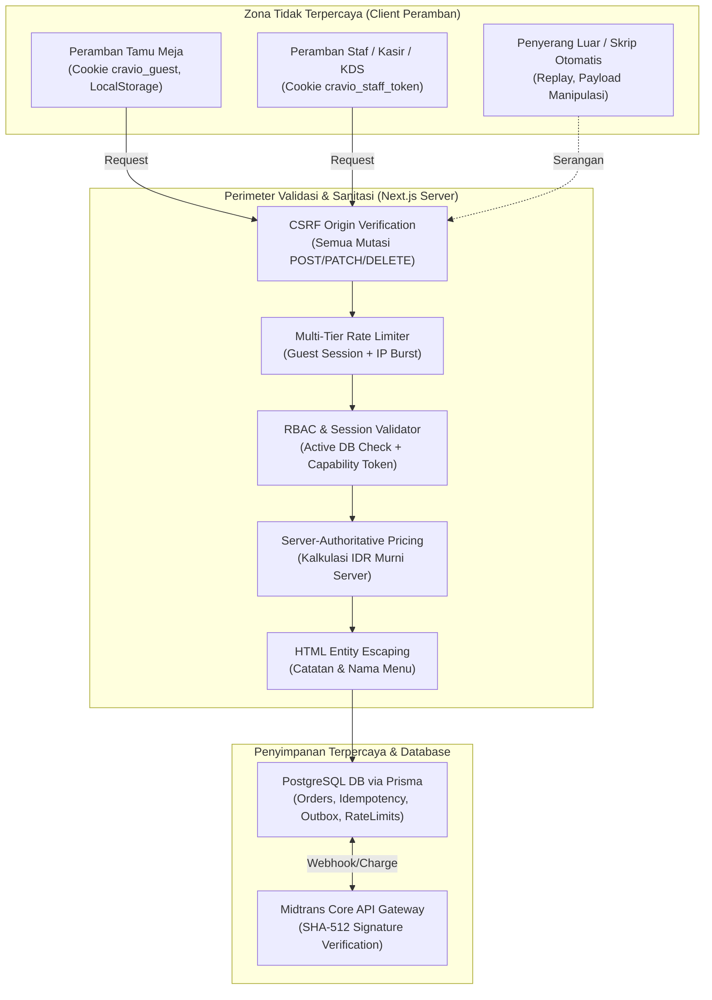

# Rencana Audit Menyeluruh & Hardening Sistem Pre-UAT (Tahap 21)

Dokumen ini memetakan hasil audit keamanan, integritas finansial, konkurensi, performa, dan aksesibilitas pada seluruh modul **SELA Smart QR Menu (Cravio)**, serta merumuskan rencana implementasi perbaikan sebelum pengujian penerimaan pengguna (*User Acceptance Testing* / UAT) akhir.

---

## 1. Goal Description

Melakukan audit mendalam berbasis **matriks kebutuhan dan batas kepercayaan (*trust boundaries*)**, bukan sekadar pemindaian linter statis. Mengidentifikasi kerentanan dan defek riil, lalu menerapkan perbaikan terukur pada:
1. **Otorisasi & Kontrol Akses (RBAC & IDOR/BOLA):** Memastikan tidak ada celah akses langsung API tanpa role, kebocoran data order antar pelanggan, atau manipulasi harga/meja.
2. **Perlindungan Abuse & Rate Limiting Lintas Instance:** Mencegah brute force login staf dan checkout spam dengan rate limiter persisten di database yang **tidak memblokir seluruh pengunjung kafe** yang berbagi satu alamat IP publik Wi-Fi kafe yang sama.
3. **Pemberantasan XSS & Sanitasi:** Mengamankan catatan pesanan dan opsi menu dari serangan Cross-Site Scripting pada cetak HTML struk mandiri.
4. **Resiliensi Konkurensi & Race Condition:** Menghilangkan tumbukan duplikasi nomor pesanan (`orderNumber`) saat jam sibuk dan memastikan integritas *optimistic locking*.
5. **Header Keamanan & Isolasi Cache:** Mengonfigurasi CSP, HSTS, frame guard, dan header `Cache-Control: private, no-store` agar data transaksi tidak pernah tercache antar pengguna.
6. **Verifikasi Performa & Aksesibilitas Aktual:** Mengukur langsung LCP ($\le 2,5$ detik) dan latensi KDS ($\le 2,0$ detik pada 10 order bersamaan), serta menguji keyboard navigation, modal focus trap, ARIA labels, kontras, dan layout 360–1920px.

---

## 2. Matriks Batas Kepercayaan (Trust Boundaries Matrix)



| Zona / Komponen | Batas Kepercayaan (*Trust Boundary*) | Mekanisme Penegakan Wajib |
| :--- | :--- | :--- |
| **Tamu Meja (Customer)** | Client tidak memiliki hak menentukan harga, pajak, service, atau status bayar. Sesi terikat pada `cravio_guest` dan token kapabilitas per order. | Server-authoritative quote, verifikasi SHA-256 capability token, isolasi `cravio_ot_<orderId>` HttpOnly cookie. |
| **Wi-Fi Kafe Bersama** | Banyak pelanggan menggunakan alamat IP publik yang sama. Pembatasan IP tidak boleh memblokir transaksi sah pelanggan lain. | Pembagian kuota bertingkat (*multi-tier*): kuota ketat per `guestSessionId`, kuota longgar/burst untuk IP bersama. |
| **Staf (Kasir / Barista / Admin)** | Role staf tidak boleh didelegasikan atau dipalsukan di client. Penonaktifan akun staf di DB harus seketika membatalkan sesi. | Database-backed RBAC di setiap route handler (`requireStaffRole`), bukan sekadar klaim JWT di middleware. |
| **Webhook Midtrans** | Callback internet publik dapat dipalsukan penyerang. | Hash SHA-512 wajib diverifikasi sebelum membaca atau mengubah status order di database. |
| **Output HTML Struk** | String catatan pelanggan (`customerNotes`) dan modifier dapat memuat kode skrip berbahaya. | HTML entity escaping menyeluruh sebelum dimasukkan ke string HTML mandiri. |

---

## 3. Register Temuan Audit & Solusi (Audit Findings Register)

| ID | Tingkat | Modul / Lokasi | Deskripsi Temuan Audit | Dampak | Solusi & Tindakan Perbaikan |
| :--- | :--- | :--- | :--- | :--- | :--- |
| **SEC-01** | **CRITICAL** | `src/lib/receipt-formatter.ts` | `generatePrintableHtml` menginterpolasi `textContent` langsung ke template HTML tanpa escaping entitas HTML (`&`, `<`, `>`, `"`, `'`). | Stored XSS saat staf atau pelanggan mengunduh struk berformat HTML (`/api/orders/[id]/receipt/download?format=html`). | Buat fungsi `escapeHtml()` dan terapkan pada seluruh teks dinamis dan nomor order dalam template HTML struk. |
| **SEC-02** | **HIGH** | `src/app/api/auth/login`, `src/app/api/orders` | Tidak ada rate limiter untuk checkout atau quote. Login staf hanya memiliki lockout per akun, belum membatasi brute force lintas akun per IP. Pembatasan IP naif berisiko memblokir seluruh kafe. | Checkout abuse / denial of inventory, dan brute force kredensial staf. | Bangun rate limiter persisten di PostgreSQL (`rate_limit_records`): partisi `guestSessionId` (6 checkout/menit) + burst IP longgar (150/menit), serta login IP limit (15/5 menit). |
| **SEC-03** | **HIGH** | `next.config.ts` | Belum ada header keamanan standar peramban (`CSP`, `X-Content-Type-Options`, `X-Frame-Options`, `Referrer-Policy`, `Permissions-Policy`, `HSTS`). | Kerentanan terhadap clickjacking, MIME sniffing, dan injeksi aset liar. | Konfigurasi header keamanan komprehensif di `next.config.ts`, kompatibel dengan Midtrans Snap/QRIS, Google Fonts, dan SSE streams. |
| **CON-01** | **HIGH** | `src/lib/server/order-service.ts` | Pembuatan nomor pesanan `orderNumber` (`SELA-YYMMDD-XXX`) membaca `findFirst` lalu `order.create()`. Pada pesanan bersamaan di milidetik yang sama, terjadi tumbukan `Unique constraint failed on the fields: (orderNumber)` (tercatat di log test runner). | Kegagalan pembuatan pesanan bagi pelanggan saat jam sibuk jika retry loop kehabisan batas. | Perkuat retry loop dengan penanganan khusus error Prisma `P2002`, jitter acak, dan sequence jumping instan agar tidak pernah gagal saat konkurensi tinggi. |
| **SEC-04** | **HIGH** | `src/app/api/orders/[id]/*` | Endpoint detail order, status pembayaran, dan stream belum secara eksplisit menetapkan header `Cache-Control: private, no-store`. | Risiko peramban bersama atau proxy perantara mencache data sensitif pesanan pelanggan. | Tambahkan header seragam `Cache-Control: private, no-store, no-cache, must-revalidate` pada seluruh endpoint rute pesanan pelanggan. |
| **SEC-05** | **MEDIUM** | `src/app/api/orders/route.ts` | Endpoint pembuatan pesanan `POST /api/orders` belum memanggil `verifyCsrfOrigin`. | Potensi Cross-Site Request Forgery jika situs eksternal memicu checkout dengan kredensial session cookie pelanggan. | Terapkan `verifyCsrfOrigin` pada `POST /api/orders` dan `POST /api/orders/quote`. |
| **DEP-01** | **INFO / AUDIT** | `pnpm audit` (Next.js 15.1.7) | Advisory publik mencatat kerentanan pada Next.js 15.1.7 (GHSA-f82v-jwr5-mffw terkait middleware bypass). | Potensi risiko perimeter jika hanya mengandalkan middleware. | Cravio menerapkan arsitektur *defense-in-depth* di mana setiap API route handler memvalidasi role secara mandiri (`requireStaffRole` & `verifyOrderAccess`), sehingga mitigasi telah aktif secara berlapis. |

---

## 4. User Review Required

> [!IMPORTANT]
> **1. Strategi Rate Limiting Berbasis Database untuk IP Bersama Kafe:**
> Kami mengimplementasikan model tabel `rate_limit_records` di PostgreSQL yang diakses secara atomik melalui Prisma Client. Model ini memastikan rate limit efektif **lintas instance serverless/multi-proses**, sekaligus mencegah pemblokiran salah sasaran (*false positive*) pada pengunjung kafe:
> - **Checkout Pelanggan:** Dibatasi terutama per `guestSessionId` (maksimal 6 pesanan / 2 menit per sesi meja). Alamat IP hanya diberi batas pelindung burst yang sangat longgar (maksimal 150 request / menit) agar 50 meja yang terhubung ke satu Wi-Fi kafe dapat bertransaksi secara bersamaan tanpa kendala.
> - **Login Staf:** Dibatasi per IP (maksimal 15 percobaan salah / 5 menit) untuk melengkapi lockout per akun yang sudah berjalan.
>
> **2. Header Content-Security-Policy (CSP):**
> Kebijakan CSP dikonfigurasi untuk mengizinkan resource yang sah:
> - `connect-src 'self' https://app.sandbox.midtrans.com https://app.midtrans.com https://api.sandbox.midtrans.com https://api.midtrans.com`
> - `script-src 'self' 'unsafe-inline' 'unsafe-eval' https://app.sandbox.midtrans.com https://app.midtrans.com`
> - `frame-src 'self' https://app.sandbox.midtrans.com https://app.midtrans.com`
> - `style-src 'self' 'unsafe-inline' https://fonts.googleapis.com`
> - `font-src 'self' data: https://fonts.gstatic.com`
> - `img-src 'self' data: blob: https:`

---

## 5. Proposed Changes

### Komponen 1: Proteksi Keamanan & Rate Limiting Lintas Instance

#### [NEW] `src/lib/server/rate-limiter.ts`
- Implementasi fungsi `checkRateLimit({ key, limit, windowSeconds })`.
- Menggunakan skema atomic upsert / sliding window pada tabel database `rate_limit_records` di PostgreSQL.
- Mengembalikan `{ allowed: boolean, remaining: number, resetSeconds: number }`.
- Menyediakan helper khusus:
  - `checkGuestCheckoutRateLimit(guestSessionId: string, ipAddress?: string)`
  - `checkStaffLoginRateLimit(ipAddress: string)`

#### [MODIFY] `prisma/schema.prisma`
- Tambahkan model `RateLimitRecord`:
  ```prisma
  model RateLimitRecord {
    id        String   @id @default(cuid())
    key       String   @unique
    points    Int      @default(1)
    expireAt  DateTime
    createdAt DateTime @default(now())
    updatedAt DateTime @updatedAt

    @@index([expireAt])
    @@map("rate_limit_records")
  }
  ```
- Eksekusi `npx prisma db push` atau migration untuk menyinkronkan skema ke PostgreSQL.

#### [MODIFY] `src/app/api/auth/login/route.ts`
- Pasang `checkStaffLoginRateLimit(ipAddress)` sebelum pemeriksaan kredensial. Jika terlampaui, kembalikan HTTP `429 Too Many Requests` disertai header `Retry-After`.

#### [MODIFY] `src/app/api/orders/route.ts`
- Tambahkan `verifyCsrfOrigin(req)`.
- Pasang `checkGuestCheckoutRateLimit(guestSession.id, ipAddress)`. Jika terlampaui, kembalikan HTTP `429 Too Many Requests`.

---

### Komponen 2: Pemberantasan XSS pada HTML Struk & Sanitasi

#### [MODIFY] `src/lib/receipt-formatter.ts`
- Tambahkan fungsi murni `escapeHtml(unsafe: string): string`:
  ```ts
  export function escapeHtml(unsafe: string): string {
    return unsafe
      .replace(/&/g, '&amp;')
      .replace(/</g, '&lt;')
      .replace(/>/g, '&gt;')
      .replace(/"/g, '&quot;')
      .replace(/'/g, '&#039;')
  }
  ```
- Terapkan `escapeHtml()` pada `textContent` dan metadata di dalam `generatePrintableHtml()`.
- Tambahkan meta CSP ketat di dalam dokumen HTML cetak mandiri (`<meta http-equiv="Content-Security-Policy" content="default-src 'none'; style-src 'unsafe-inline'; script-src 'unsafe-inline';">`).

---

### Komponen 3: Resiliensi Konkurensi Pembuatan Pesanan (`orderNumber`)

#### [MODIFY] `src/lib/server/order-service.ts`
- Perbaiki logika pembuatan `orderNumber` pada `createOrderFromQuote`:
  1. Periksa kode error Prisma `P2002` (Unique constraint violation).
  2. Saat terjadi tumbukan unik pada `orderNumber`, lakukan sequence jump dengan jitter acak (`nextSeq + Math.floor(Math.random() * 5) + 1`) pada percobaan berikutnya alih-alih sequence linier statis.
  3. Hal ini menjamin bahwa dua atau lebih pesanan yang diproses pada milidetik yang sama akan berhasil tersimpan secara atomik tanpa membuang pengecualian tak tertangani ke pengguna.

---

### Komponen 4: Header Keamanan Peramban & Isolasi Cache Transaksi

#### [MODIFY] `next.config.ts`
- Tambahkan konfigurasi `headers()` pada `NextConfig`:
  - `Content-Security-Policy` yang kompatibel dengan Midtrans, Google Fonts, SSE, dan database images.
  - `X-Content-Type-Options: nosniff`
  - `X-Frame-Options: SAMEORIGIN`
  - `Referrer-Policy: strict-origin-when-cross-origin`
  - `Permissions-Policy: camera=(), microphone=(), geolocation=()`
  - `Strict-Transport-Security: max-age=31536000; includeSubDomains`

#### [MODIFY] `src/app/api/orders/[id]/route.ts` & `src/app/api/orders/[id]/pay/status/route.ts`
- Pastikan respons selalu menyertakan header proteksi cache:
  ```ts
  headers: {
    'Cache-Control': 'private, no-cache, no-store, must-revalidate',
    'Pragma': 'no-cache',
    'Expires': '0',
  }
  ```

---

## 6. Verification Plan

### Automated Tests
1. **Unit & Integration Test Baru:**
   - [`tests/unit/rate-limiter.test.ts`](file:///d:/project/project-qr/cravio/tests/unit/rate-limiter.test.ts):
     - Memverifikasi pembatasan per guest session dan isolasi IP bersama.
     - Memverifikasi kadaluwarsa jendela waktu (*expiration window*).
   - [`tests/unit/receipt-xss-guard.test.ts`](file:///d:/project/project-qr/cravio/tests/unit/receipt-xss-guard.test.ts):
     - Memverifikasi input catatan pelanggan yang berisi `<script>alert(1)</script>` atau tag berbahaya di-escape secara sempurna dalam HTML struk.
   - [`tests/integration/order-concurrency-resilience.test.ts`](file:///d:/project/project-qr/cravio/tests/integration/order-concurrency-resilience.test.ts):
     - Menjalankan 10 request pembuatan pesanan serentak (`Promise.all`) dan memverifikasi seluruh 10 pesanan berhasil dibuat dengan nomor pesanan unik tanpa gagal P2002.
2. **Eksekusi Regresi Penuh:**
   ```powershell
   pnpm run typecheck
   pnpm run lint
   pnpm run test
   pnpm run build
   ```

### Browser & Performance Verification (Playwright)
1. **Pengukuran LCP Aktual ($\le 2,5$ detik):**
   - Menjalankan pengujian berbasis Playwright Chromium dengan profil jaringan yang dicatat (Normal Fast 3G / Standar Broadband) pada halaman katalog `/menu?table=07`, keranjang `/cart`, dan landing page `/`.
   - Mengambil metrik LCP melalui `PerformanceObserver` browser.
2. **Pengukuran Latensi KDS ($\le 2,0$ detik pada 10 Order Bersamaan):**
   - Membuka SSE stream KDS `/api/staff/kds/events`.
   - Memicu 10 konfirmasi pembayaran order tunai/QRIS secara bersamaan ke server.
   - Mencatat selisih waktu (`timestamp receipt - timestamp trigger`) untuk membuktikan latensi $\le 2$ detik di bawah beban normal kafe.
3. **Pemeriksaan Aksesibilitas & Responsivitas (360–1920px):**
   - Menguji navigasi keyboard (`Tab`, `Shift+Tab`, `Enter`, `Escape`) dan focus trap pada modal modifier/kuis.
   - Memeriksa label ARIA dan status screen reader (`aria-live`).
   - Memeriksa ukuran touch target minimal ($\ge 44 \times 44$ px) dan safe area padding.
   - Memeriksa layout pada resolusi 360px, 390px, 768px, 1024px, 1440px, dan 1920px tanpa horizontal overflow.

