# Rencana Kerja: Redesain Tata Letak, Desain Visual, & Motion Graphics Menyeluruh Landing Page B2B SELA

Dokumen rencana teknis ini diperbarui sesuai arahan pengguna untuk merancang dan mengimplementasikan **redesain komprehensif tata letak (*layout*), hierarki visual, dan *motion graphics* menyeluruh pada seluruh halaman landing page B2B SELA Smart QR Menu** (bukan hanya pada simulasi alur hero, melainkan di setiap seksi halaman) dengan memanfaatkan library animasi modern **Framer Motion (`framer-motion`)**, mengacu secara presisi pada prototipe [`design-preview/landing-page.html`](file:///d:/project/project-qr/cravio/design-preview/landing-page.html) dan panduan sistem desain [`docs/design.md`](file:///d:/project/project-qr/cravio/docs/design.md), **tanpa mengubah isi konten teks faktual, nomor verifikasi, maupun kontrak integritas yang telah divalidasi**.

---

## 1. Deskripsi Tujuan & Arsitektur Motion Graphics Halaman Penuh

Pengguna menghendaki pengalaman visual berstandar *hospitality design studio* yang hidup, luwes, dan berkarakter, di mana elemen *motion graphics* mengalir di seluruh bagian halaman untuk memperjelas narasi produk:
1. **Motion Graphics Hero & Mockup Jendela:**
   - Animasi kemunculan bertahap (*staggered entrance*) pada micro-badge, headline tipografi editorial, deskripsi, dan tombol CTA pill.
   - Efek pernapasan cahaya hangat (*ambient warm breathing glow*) pada kanvas latar belakang.
   - Bingkai jendela peramban (*high-craft browser frame* dengan 3 titik Mac, judul sesi Meja 07, dan bayangan `shadow-frame`) yang membungkus panggung simulasi flow motion 5-scene dengan kontrol jeda/putar yang aksesibel.
2. **Motion Graphics Customer Journey 5 Langkah (`#cara-kerja`):**
   - Transisi *scroll-triggered reveal* bertingkat (*staggered cascade* $0.1\text{s}$) pada 5 kartu editorial saat memasuki viewport (`whileInView`).
   - Efek interaksi hover halus (`whileHover={{ y: -4 }}`) dengan aksen garis hairline yang bereaksi dinamis.
3. **Motion Graphics Alur Operasional & Diagram Proses (`WorkflowStorytelling`):**
   - Animasi jalur penghubung berurutan antar-tahap (Tahap 01 s/d 04).
   - Kartu resolusi friksi yang muncul dengan transisi opasitas dan translasi vertikal yang halus.
4. **Motion Graphics Widget Kuis Interaktif 3 Langkah (`#demo-kuis`):**
   - Transisi antar-langkah kuis (Suasana $\rightarrow$ Rasa $\rightarrow$ Format/Suhu) menggunakan `<AnimatePresence mode="wait">` dengan pergeseran horizontal/fade yang mulus ($180\text{ms}$).
   - Animasi kemunculan kartu hasil rekomendasi: skor kecocokan persentase ("98% Cocok") dan kartu produk rekomendasi yang terangkat elegan.
5. **Motion Graphics KDS Dapur & Kasir Kontras Tinggi (`#operasional`):**
   - Radar hijau berdenyut (*pulsing radar dot*) pada indikator status "Online" dan antrean aktif.
   - Efek denyut kontras batas amber (*amber border glow pulse*) pada Tiket #042 (Sedang Dibuat).
   - Animasi gelombang visual denting suara (*audio chime wave ripple*) yang mensimulasikan notifikasi audio barista.
6. **Motion Graphics Manajemen Menu & Generator QR Meja (`#kelola-menu`):**
   - Animasi sakelar toggle stok real-time (transisi halus sakelar *Tersedia* $\leftrightarrow$ *Sold Out*).
   - Efek perspektif melayang (*subtle 3D hover tilt*) pada kartu akrilik Meja 07 resolusi tinggi 300 DPI.
7. **Motion Graphics Transaksi & Struk Thermal (`#pembayaran`):**
   - Animasi timer countdown QRIS dinamis.
   - Animasi tanda centang verifikasi kasir.
   - Animasi kertas struk thermal yang keluar meluncur ke bawah (*sliding receipt paper drop*).
8. **Motion Graphics FAQ Accordion (`#faq`):**
   - Transisi buka-tutup akordion berbasis pegas (*spring-based smooth height expansion*) dengan `<AnimatePresence>` tanpa patahan tata letak (*zero CLS*).
9. **Motion Graphics Bottom Editorial CTA:**
   - Pencahayaan radial terakota dinamis yang bernapas lembut di balik kartu deep charcoal `#111110`.
   - Micro-interaction tombol sentuh (`whileTap={{ scale: 0.98 }}`).
10. **Motion Graphics Modal Konsultasi:**
    - Transisi fade-in backdrop kaca buram dan animasi pop-up skala pegas (*spring scale-up*).

---

## 2. User Review Required

> [!IMPORTANT]
> **Penambahan Paket Animasi `framer-motion`:**
> Untuk menghadirkan motion graphics menyeluruh yang tangguh, kompatibel penuh dengan React 19 / Next.js 15 App Router, dan memiliki manajemen memori serta optimasi performa 60fps tanpa layout shift (*CLS = 0*), kita akan memasang dependency produksi `framer-motion` via perintah:
> ```powershell
> pnpm add framer-motion
> ```
> *(Dijalankan dengan `BypassSandbox: true` sesuai aturan pemasangan paket pnpm pada lingkungan Windows).*

> [!NOTE]
> **Aksesibilitas & Kepatuhan WCAG AA (`prefers-reduced-motion`):**
> Framer Motion memiliki integrasi bawaan terhadap setelan OS pengguna `prefers-reduced-motion: reduce`. Saat mode hemat gerak aktif, seluruh translasi posisi secara otomatis ditiadakan menjadi transisi opasitas instan, sehingga memenuhi kepatuhan aksesibilitas penuh.

> [!IMPORTANT]
> **Integritas Konten Teks Tetap 100% Terjaga:**
> Sesuai instruksi *"tanpa mengubah isi kontennya"*, seluruh teks judul hero, label alur pemesanan, pertanyaan kuis selera, opsi jawaban, hasil rekomendasi contoh, FAQ operasional, dan proteksi nomor WhatsApp tetap dipertahankan persis kata demi kata. Seluruh 42 berkas pengujian Vitest (365 tests) dijamin tetap lulus.

---

## 3. Rencana Komponen & Perubahan Berkas

```mermaid
flowchart TD
    subgraph PackageInstall["1. Dependensi & Styling"]
        P1["pnpm add framer-motion"]
        T1["tailwind.config.ts\n(sand, charcoal, terracotta, shadow-frame, shadow-subtle)"]
        T2["src/app/globals.css\n(Instrument Serif, grid-pattern, font-editorial)"]
    end

    subgraph MotionComponents["2. Komponen Antarmuka & Motion Graphics"]
        V1["src/components/b2b/b2b-landing-view.tsx\n(Orkestrasi Motion Halaman Penuh & Staggered Sections)"]
        V2["src/components/b2b/hero-flow-motion.tsx\n(Panggung Motion Dibingkai Jendela Browser Meja 07)"]
        V3["src/components/b2b/customer-journey-section.tsx\n(Scroll-Triggered Reveal 5 Langkah 01 s/d 05)"]
        V4["src/components/b2b/kds-preview-section.tsx\n(KDS Gelap Kontras Tinggi + Pulsing Radar & Chime Ripple)"]
        V5["src/components/b2b/catalog-and-qr-section.tsx\n(Toggle Stok Interaktif + 3D Hover Akrilik QR 300 DPI)"]
        V6["src/components/b2b/payment-receipt-section.tsx\n(3 Kartu Fitur + Animasi Struk Kertas Meluncur)"]
        V7["src/components/b2b/demo-quiz-simulator.tsx\n(Slide/Fade Step Transitions via AnimatePresence)"]
        V8["src/components/b2b/operational-faq.tsx\n(Smooth Spring Height Accordion via AnimatePresence)"]
        V9["src/components/b2b/consultation-modal.tsx\n(Spring Scale-Up & Backdrop Fade Modal)"]
    end

    subgraph Verification["3. Verifikasi & Pengujian"]
        U1["vitest run tests/integration/b2b-landing-page.test.ts"]
        U2["vitest run (Seluruh 42 Berkas Pengujian)"]
        U3["npx tsc --noEmit && pnpm run lint && pnpm run build"]
    end

    PackageInstall --> MotionComponents
    MotionComponents --> Verification
```



---

### [Component 1] Dependensi & Konfigurasi Token Desain

#### [NEW DEPENDENCY] `package.json`
- Menambahkan dependensi `framer-motion`:
  ```json
  "dependencies": {
    "framer-motion": "^12.4.7"
  }
  ```

#### [MODIFY] [`tailwind.config.ts`](file:///d:/project/project-qr/cravio/tailwind.config.ts)
- Menambahkan token palet dan bayangan dari `design-preview/landing-page.html`:
  - `sand`: `{ 50: '#FDFBF7', 100: '#F7F4EE', 200: '#EFEAE0', 300: '#E3DCce', 400: '#C8BEAF', 800: '#2A2621', 900: '#1A1815' }`
  - `charcoal`: `{ 950: '#111110', 900: '#181816', 850: '#20201E', 800: '#2B2B28', 700: '#3D3D39' }`
  - `terracotta`: `{ 500: '#C25E2B', 600: '#A94E20' }`
  - Bayangan: `subtle`, `frame`, `card`, `glow`.

#### [MODIFY] [`src/app/globals.css`](file:///d:/project/project-qr/cravio/src/app/globals.css)
- Menambahkan font `Instrument Serif` pada `@import` Google Fonts untuk aksen editorial italic (`.font-editorial`).
- Menambahkan kelas utilitas `.grid-pattern` untuk tekstur grid studio arsitektur.

---

### [Component 2] Rekayasa Komposisi & Animasi Halaman Landing B2B

#### [MODIFY] [`src/components/b2b/b2b-landing-view.tsx`](file:///d:/project/project-qr/cravio/src/components/b2b/b2b-landing-view.tsx)
- Menyelaraskan tata letak secara holistik dengan seksi-seksi motion:
  1. **Top Micro-banner:** Bar gelap `#111110` dengan green pulsing beacon dan teks identitas platform B2B.
  2. **Minimalist Sticky Navbar:** Header kaca hangat `#FBF9F5]/90` dengan logo `s` SELA, navigasi anchor, dan tombol aksi.
  3. **Hero Section:**
     - Motion fade/slide masuk untuk micro-badge kategori, headline editorial, deskripsi, tombol CTA, dan 3 kolom technical guarantees.
     - Membungkus panggung simulasi flow motion ke dalam **High-Craft Product Preview Frame** (Forge-style window dengan 3 titik Mac, judul sesi Meja 07 aktif, bayangan `shadow-frame`, label permanen *Simulasi alur pemesanan*, dan tombol jeda/putar).
  4. **Customer Journey 5 Langkah (`#cara-kerja`):**
     - Memuat komponen [`CustomerJourneySection`](file:///d:/project/project-qr/cravio/src/components/b2b/customer-journey-section.tsx) dengan motion cascade entrance.
  5. **Alur Kerja & Cerita Operasional (`WorkflowStorytelling`):**
     - Diperkaya dengan animasi garis penghubung antar-tahap dan transisi kartu friksi.
  6. **Modul Sistem Transaksi (`#modul-sistem`):**
     - 4 modul sistem dengan transisi stagger saat digulir ke viewport.
  7. **Demo Kuis Interaktif 3 Langkah (`#demo-kuis`):**
     - Memuat [`DemoQuizSimulator`](file:///d:/project/project-qr/cravio/src/components/b2b/demo-quiz-simulator.tsx) beranimasi `<AnimatePresence>`.
  8. **Visibilitas Barista & Dapur Kontras Tinggi (`#operasional`):**
     - Memuat [`KdsPreviewSection`](file:///d:/project/project-qr/cravio/src/components/b2b/kds-preview-section.tsx).
  9. **Manajemen Menu & Generator QR 300 DPI (`#kelola-menu`):**
     - Memuat [`CatalogAndQrSection`](file:///d:/project/project-qr/cravio/src/components/b2b/catalog-and-qr-section.tsx).
  10. **Pembayaran & Struk Thermal (`#pembayaran`):**
      - Memuat [`PaymentReceiptSection`](file:///d:/project/project-qr/cravio/src/components/b2b/payment-receipt-section.tsx).
  11. **Rincian Paket & Ruang Lingkup (`PricingBreakdown`):**
      - Tabel ruang lingkup dan batas tanggung jawab operasional.
  12. **FAQ Operasional Kafe (`#faq`):**
      - Memuat [`OperationalFaq`](file:///d:/project/project-qr/cravio/src/components/b2b/operational-faq.tsx) dengan akordion animasi.
  13. **Bottom Editorial CTA Banner:**
      - Kotak rounded-3xl `#111110` dengan efek cahaya radial ambient yang bernapas lembut.
  14. **Clean Minimal Footer:**
      - Footer gelap bersih dengan tautan dan status pilot kafe SELA.
  15. **Consultation Modal:**
      - Memuat [`ConsultationModal`](file:///d:/project/project-qr/cravio/src/components/b2b/consultation-modal.tsx).

#### [NEW] [`src/components/b2b/customer-journey-section.tsx`](file:///d:/project/project-qr/cravio/src/components/b2b/customer-journey-section.tsx)
- Grid 5 langkah (*01 Scan QR Meja, 02 Isi/Lewati Kuis, 03 Pilih & Modifikasi, 04 QRIS/Tunai Kasir, 05 Pantau Progres*) menggunakan `motion.div` dengan varian `staggerChildren: 0.1` dan `whileHover={{ y: -4 }}`.

#### [NEW] [`src/components/b2b/kds-preview-section.tsx`](file:///d:/project/project-qr/cravio/src/components/b2b/kds-preview-section.tsx)
- Kanvas gelap kontras tinggi `#141311` dengan 3 kartu fitur operasional di kiri dan tampilan KDS nyata di kanan.
- Fitur motion: pulsing radar green dot, animated audio chime waves, dan tiket amber border breathing pulse.

#### [NEW] [`src/components/b2b/catalog-and-qr-section.tsx`](file:///d:/project/project-qr/cravio/src/components/b2b/catalog-and-qr-section.tsx)
- Tabel katalog stok real-time dengan tombol sakelar ketersediaan beranimasi optimistik.
- Kartu akrilik QR 300 DPI dengan efek tilt melayang halus saat disentuh/di-hover.

#### [NEW] [`src/components/b2b/payment-receipt-section.tsx`](file:///d:/project/project-qr/cravio/src/components/b2b/payment-receipt-section.tsx)
- Tiga kartu fitur (QRIS Dinamis, Bayar Tunai Kasir, Struk 58/80 mm) dengan animasi ilustrasi struk thermal meluncur ke bawah.

#### [MODIFY] [`src/components/b2b/demo-quiz-simulator.tsx`](file:///d:/project/project-qr/cravio/src/components/b2b/demo-quiz-simulator.tsx)
- Mempercantik transisi antar-langkah 1, 2, dan 3 menggunakan `<AnimatePresence mode="wait">` dari Framer Motion.
- Menghadirkan bingkai widget dari `design-preview/landing-page.html` dengan badge *"Interaktif • Kafe SELA"* dan tampilan kartu hasil rekomendasi yang memikat.

#### [MODIFY] [`src/components/b2b/operational-faq.tsx`](file:///d:/project/project-qr/cravio/src/components/b2b/operational-faq.tsx)
- Mengonversi item FAQ menjadi akordion interaktif halus dengan animasi tinggi `<AnimatePresence>` dan rotasi ikon chevron $180^\circ$.

#### [NEW] [`src/components/b2b/consultation-modal.tsx`](file:///d:/project/project-qr/cravio/src/components/b2b/consultation-modal.tsx)
- Dialog modal interaktif konsultasi WhatsApp dengan transisi pop-up pegas dan integrasi tautan WhatsApp yang tervalidasi aman.

---

## 4. Rencana Verifikasi Kualitas & Regresi Penuh

### A. Pengujian Otomatis
1. **Verifikasi Suite B2B Landing Page & Demo Isolation:**
   ```powershell
   pnpm exec vitest run tests/integration/b2b-landing-page.test.ts
   pnpm exec vitest run tests/unit/b2b-demo-isolation.test.ts
   ```
   *Target:* 100% PASS.

2. **Verifikasi Seluruh Test Suite Proyek (42 Test Files, 365+ Tests):**
   ```powershell
   pnpm run test
   ```
   *Target:* 42 passed (42), 365 passed (365).

3. **Pemeriksaan Type Safety TypeScript:**
   ```powershell
   npx tsc --noEmit
   ```
   *Target:* Exit code 0 (tanpa error tipe).

4. **Pemeriksaan Linter ESLint:**
   ```powershell
   pnpm run lint
   ```
   *Target:* Exit code 0 ("No ESLint warnings or errors").

5. **Pemeriksaan Build Produksi:**
   ```powershell
   pnpm run build
   ```
   *Target:* Exit code 0 (seluruh 18 rute Next.js terkompilasi bersih).

### B. Verifikasi Performa Motion Graphics & Aksesibilitas
1. **Frame Rate 60 FPS:** Menggunakan GPU-accelerated CSS properties (`transform: translate3d`, `opacity`) agar animasi berjalan tanpa *jank* atau komputasi layout ulang (*reflow*).
2. **Kepatuhan `prefers-reduced-motion`:** Menjamin pengguna yang mengaktifkan pengurangan gerak di sistem operasi mendapatkan diagram statis dan transisi opasitas tanpa pergeseran posisi.
3. **Pemeriksaan Multi-Breakpoint (360px s/d 1920px):** Bebas horizontal overflow (`scrollWidth === innerWidth`) dan touch targets $\ge 44$ px.

---

## 5. Konfirmasi Sebelum Eksekusi

Mohon tinjau pembaruan rencana kerja di atas. Setelah Anda menyetujui (*Approve*) dokumen ini, saya akan segera memasang dependensi `framer-motion`, memperbarui berkas komponen dengan motion graphics menyeluruh, dan memverifikasi kualitasnya secara penuh.
