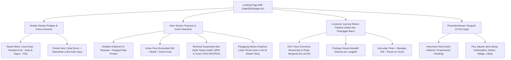

# Rencana Teknis: Penyesuaian Landing Page B2B SELA (Fokus Iklan, Tata Letak Hero Tunggal, 2 Font, & Motion Graphics Alur Pelanggan)

## Ringkasan Tujuan
Rencana ini merinci penyesuaian visual, struktural, dan interaksi pada Landing Page B2B SELA Smart QR Menu berdasarkan 5 poin masukan pengguna:
1. **Fokus Iklan & Konversi pada Navbar:** Mengurangi menu navigasi yang terlalu padat menjadi 4 tautan utama bernilai konversi tinggi dan menonjolkan tombol aksi utama (*"Diskusikan untuk Kafe Saya"* dan *"Coba Demo"*).
2. **Hero Section 1-Kolom Terpusat:** Mengubah tata letak Hero dari 2-kolom (*split*) menjadi tata letak editorial terpusat bertingkat (*single-column stacked layout*) mengacu pada [`design-preview/landing-page.html`](file:///d:/project/project-qr/cravio/design-preview/landing-page.html), di mana teks headline dan CTA berada di atas secara terpusat, dan panggung *motion graphics* alur pesanan berada tepat di bawahnya dengan lebar optimal (`max-w-5xl`).
3. **Standarisasi Menjadi 2 Jenis Font:** Menghilangkan font redundan (*Inter*) dan mengonsolidasikan sistem tipografi menjadi hanya **2 jenis font**:
   - **Font 1 (Editorial Serif):** *Instrument Serif* untuk judul editorial utama (`font-editorial` / `font-serif`).
   - **Font 2 (Modern Sans-serif):** *Plus Jakarta Sans* untuk seluruh body copy, UI, kartu, tabel, angka, dan tombol navigasi (`font-sans` / `font-display`).
4. **Pembersihan Hero Badge:** Menghapus teks `"SELA · Sistem Pemesanan Meja ke Dapur"` dari hero section agar headline editorial langsung memegang hierarki visual pertama.
5. **Transformasi Motion Graphics pada Alur Pengalaman Pelanggan:** Mengubah seksi alur pelanggan dari kartu statis menjadi **interactive motion graphics pipeline**:
   - Jalur penghubung SVG beranimasi dengan berkas pulsa cahaya bergerak antar-langkah (01 s/d 05).
   - Siklus otomatis dengan visualisasi mikro interaktif pada tiap langkah (animasi laser scan QR $\rightarrow$ chips kuis preferensi $\rightarrow$ modifier counter $\rightarrow$ QRIS timer $\rightarrow$ radar pelacak dapur).
   - Kontrol interaksi (klik lompat langkah, jeda saat kursor hover, dan dukungan penuh *prefers-reduced-motion*).

---

## User Review Required

> [!IMPORTANT]
> **Preservasi Kontrak Pengujian Otomatis:**
> Seluruh assertion teks wajib pada [`tests/integration/b2b-landing-page.test.ts`](file:///d:/project/project-qr/cravio/tests/integration/b2b-landing-page.test.ts) tetap dipertahankan utuh:
> - Headline H1: `/pesanan dari meja\.\s*alurnya sampai ke dapur\./i`
> - Paragraf: `/pelanggan memilih menu dan membayar dari ponsel\. kasir dan dapur menerima informasi yang jelas untuk melanjutkan pesanan\./i`
> - Label panggung hero: `/simulasi alur pemesanan/i` & tombol jeda/putar.
> - Heading friksi: `/menjaga koordinasi antara meja, kasir, dan bar kopi\./i`
> - Heading proses: `/empat tahap berurutan dari meja hingga penyajian\./i`
> - Keempat modul sistem: *Menu Meja*, *Midtrans Core API*, *Operasional Kasir*, *Panel Admin*.
> - Label preview kuis & FAQ operasional kafe.

---

## Rincian Perubahan yang Diusulkan



---

### 1. Penyederhanaan Tipografi Menjadi 2 Jenis Font

#### [MODIFY] [`src/app/globals.css`](file:///d:/project/project-qr/cravio/src/app/globals.css)
- Hapus impor font `Inter` dari Google Fonts, hanya mengimpor **Instrument Serif** dan **Plus Jakarta Sans**:
  ```css
  @import url('https://fonts.googleapis.com/css2?family=Instrument+Serif:ital@0;1&family=Plus+Jakarta+Sans:wght@400;500;600;700&display=swap');
  ```
- Perbarui variabel CSS root:
  ```css
  --font-display: 'Plus Jakarta Sans', system-ui, -apple-system, sans-serif;
  --font-serif: 'Instrument Serif', Georgia, serif;
  --font-sans: 'Plus Jakarta Sans', system-ui, -apple-system, sans-serif;
  ```

#### [MODIFY] [`tailwind.config.ts`](file:///d:/project/project-qr/cravio/tailwind.config.ts)
- Samakan konfigurasi `fontFamily` agar `sans` dan `display` merujuk ke `'Plus Jakarta Sans'`, dan `serif` merujuk ke `'Instrument Serif'`:
  ```ts
  fontFamily: {
    display: ['var(--font-display)', '"Plus Jakarta Sans"', 'system-ui', 'sans-serif'],
    serif: ['var(--font-serif)', '"Instrument Serif"', 'Georgia', 'serif'],
    sans: ['var(--font-sans)', '"Plus Jakarta Sans"', 'system-ui', 'sans-serif'],
    mono: ['var(--font-mono)', 'monospace'],
  }
  ```

---

### 2. Restrukturisasi Navbar: Ringkas, Bersih, Berorientasi Iklan & Konversi

#### [MODIFY] [`src/components/b2b/b2b-landing-view.tsx`](file:///d:/project/project-qr/cravio/src/components/b2b/b2b-landing-view.tsx)
- Pangkas 9 tautan menu yang padat menjadi **4 tautan utama**:
  1. `Cara Kerja` (`#cara-kerja`)
  2. `Simulasi Kuis` (`#demo-kuis`)
  3. `Kasir & Dapur` (`#operasional`)
  4. `FAQ` (`#faq`)
- Fokuskan elemen sebelah kanan pada pemicu konversi calon klien:
  - Tautan *"Coba Demo"* (ke `#demo-kuis`)
  - Tombol utama pill *"Diskusikan untuk Kafe Saya"* (`onClick={() => setIsConsultModalOpen(true)}`)
  - Tombol sekunder *"Portal Staf"* (`/login`)
- Tampilan navbar menjadi bersih, elegan, dan langsung mengarahkan pemilik kafe ke penawaran produk tanpa kebingungan pilihan.

---

### 3. Restrukturisasi Hero Section: 1-Kolom Terpusat ala `design-preview/landing-page.html`

#### [MODIFY] [`src/components/b2b/b2b-landing-view.tsx`](file:///d:/project/project-qr/cravio/src/components/b2b/b2b-landing-view.tsx)
- Hapus baris teks `"SELA · Sistem Pemesanan Meja ke Dapur"` yang tidak diinginkan di hero section.
- Ubah grid 2-kolom (`lg:grid-cols-12`, 5-col / 7-col) menjadi **tata letak editorial terpusat (single-column vertical flow)**:
  1. **Blok Teks Terpusat (`max-w-4xl mx-auto px-6 text-center space-y-6`):**
     - Kategori badge bersih: `Platform Pemesanan Mandiri Meja Kafe & Restoran`
     - Headline H1 Editorial:
       ```tsx
       <h1
         id="hero-heading"
         className="font-editorial text-5xl sm:text-6xl md:text-7xl lg:text-[4.5rem] font-normal leading-[1.05] tracking-tight text-charcoal-950"
       >
         <span>Pesanan dari meja.</span> <br className="hidden sm:inline" />
         <span className="italic font-normal">Alurnya sampai ke dapur.</span>
       </h1>
       ```
     - Subheadline terpusat yang seimbang (`max-w-2xl mx-auto text-base sm:text-lg text-stone-600 leading-relaxed`).
     - Action Row terpusat (Tombol *"Konsultasi via WhatsApp"*, *"Diskusikan untuk Kafe Saya"*, dan *"Coba Demo Kuis"*).
     - *Technical Guarantees Bar* 3 kolom terpusat (`Web Tanpa Install` | `QRIS & Tunai Kasir` | `KDS & Tiket ESC/POS`).
  2. **Panggung Motion Graphics Lebar Penuh di Bawah Teks (`max-w-5xl mx-auto px-4 md:px-8 mt-12 md:mt-16`):**
     - Memposisikan `<HeroFlowMotion />` tepat di bawah blok teks dalam bingkai jendela peramban Mac-style (*Meja 07 · Sesi Aktif*).
     - Menjadikan simulasi alur 12 detik sebagai panggung visual utama berukuran megah dan nyaman dinikmati.

---

### 4. Transformasi Motion Graphics Alur Pengalaman Pelanggan

#### [MODIFY] [`src/components/b2b/customer-journey-section.tsx`](file:///d:/project/project-qr/cravio/src/components/b2b/customer-journey-section.tsx)
Ganti tata letak kartu statis dengan **Customer Journey Motion Pipeline**:
1. **Interactive Flow Track (SVG Animated Pipeline):**
   - Menghubungkan 5 langkah (`01 Scan QR Meja`, `02 Isi / Lewati Kuis`, `03 Pilih & Modifikasi`, `04 QRIS / Tunai Kasir`, `05 Pantau Progres`).
   - Garis konektor SVG dengan pulsa cahaya (`terracotta-500` moving gradient dot) yang berjalan dari simpul langkah aktif ke langkah berikutnya.
2. **Auto-cycling Timeline dengan Pause on Hover & Click to Jump:**
   - Secara dinamis mengulang alur secara halus tiap ~3.5 detik.
   - Memberikan tombol kontrol jeda/putar serta indikator progres horizontal.
   - Pengunjung kafe dapat mengeklik simpul nomor langkah (01–05) kapan saja untuk langsung melihat simulasi langkah tersebut.
3. **Panggung Pratinjau Interaktif per Langkah (Interactive Visual Stage):**
   - **Langkah 01 (Scan QR):** Animasi sweep laser pemindai kamera ponsel pada kartu akrilik meja 07.
   - **Langkah 02 (Kuis):** Animasi pemilihan pill preferensi (Suasana Santai $\rightarrow$ Rasa Creamy $\rightarrow$ Format Pastry).
   - **Langkah 03 (Modifier):** Animasi interaktif penyesuaian catatan pesanan (*Less Sugar*, *Susu Oat*) & penghitung kuantitas.
   - **Langkah 04 (Pembayaran):** Animasi timer hitung mundur QRIS 15 menit dan transisi stempel verifikasi lunas hijau.
   - **Langkah 05 (Pantau Progres):** Animasi denyut radar 3 tahap KDS (*Diterima* $\rightarrow$ *Sedang Dibuat* $\rightarrow$ *Siap Saji*).
4. **Dukungan Aksesibilitas Penuh:**
   - Mematuhi `prefers-reduced-motion` dengan menampilkan diagram alur statis yang jelas tanpa animasi looping berlebihan.

---

## Rencana Verifikasi

### 1. Pengujian Otomatis
```powershell
# 1. Pengecekan Type Safety TypeScript
npx tsc --noEmit

# 2. Pengecekan Linter ESLint
pnpm run lint

# 3. Unit Test Isolasi Demo & Hero Motion
pnpm exec vitest run tests/unit/b2b-demo-isolation.test.ts

# 4. Pengujian Integrasi Landing Page B2B SELA
pnpm exec vitest run tests/integration/b2b-landing-page.test.ts

# 5. Seluruh Test Suites Proyek
pnpm run test

# 6. Kompilasi Build Produksi Next.js
pnpm run build
```

### 2. Verifikasi Visual & Interaksi Manual
- **Navbar:** Verifikasi bahwa navigasi hanya memiliki 4 tautan utama, tombol CTA *"Diskusikan untuk Kafe Saya"* membuka dialog modal dengan mulus, dan tampilan mobile navbar ringkas.
- **Hero Section:** Verifikasi bahwa headline dan teks berada di posisi terpusat di atas, teks badge `"SELA · Sistem Pemesanan Meja ke Dapur"` telah hilang, dan panggung motion graphics tampil megah di bawah teks.
- **Tipografi:** Verifikasi di Inspector/DevTools bahwa hanya 2 keluarga font yang di-load dan digunakan: *Instrument Serif* dan *Plus Jakarta Sans*.
- **Motion Graphics Alur Pelanggan:** Verifikasi bahwa alur 5 langkah memiliki animasi konektor pulsa bergerak, pratinjau langkah bereaksi terhadap pergantian langkah, tombol jeda/putar berfungsi, dan klik simpul dapat berpindah langkah seketika.

