# Rencana Teknis: Perbaikan Garis Alur Pelanggan, Resolusi Error Cookie /order, dan Penyembunyian Portal Staf (Tahap 24)

## Ringkasan Tujuan
Rencana ini merinci solusi teknis untuk 3 temuan pada implementasi landing page dan alur pesanan meja:
1. **Penyelarasan Garis Alur Pengalaman Pelanggan:** Garis konektor horizontal saat ini terpotong di bagian bawah lingkaran angka karena penghitungan `top-1/2` mengambil tinggi seluruh tombol (lingkaran 36px + label teks). Garis dan pulsa cahaya akan diposisikan ulang dengan presisi tinggi pada sumbu tengah geometris lingkaran (`top-[18px]`, `left-[18px]`, `right-[18px]`).
2. **Resolusi Error Cookie pada Tombol "Buka Contoh Meja 07" (`/order?table=07`):** Next.js 15 App Router melarang mutasi cookie (`cookieStore.set()`) di dalam Server Component (`page.tsx`), yang memicu error fatal `Cookies can only be modified in a Server Action or Route Handler`. Rute `/order` akan ditransformasikan menjadi **Next.js Route Handler resmi (`route.ts`)** yang memiliki wewenang penuh menyetel cookie HTTP (`cravio_guest` & `cravio_table`) pada respons pengalihan (`NextResponse.redirect('/menu?table=07')`). Kondisi meja tidak valid/tutup dipisahkan ke rute panduan `/order/status`.
3. **Penyembunyian Tautan "Portal Staf":** Menghilangkan tombol "Portal Staf" dari header navbar dan tautan "Login Staf" dari footer landing page B2B, agar website landing page publik murni berfokus pada materi iklan penawaran kemitraan kafe baru tanpa mengekspos pintu masuk staf internal.

---

## User Review Required

> [!IMPORTANT]
> **Arsitektur Next.js 15 untuk Cookie Resolusi Meja (`/order?table=XX`):**
> Sesuai spesifikasi Next.js 15 App Router, operasi mutasi cookie (`Set-Cookie`) hanya diperbolehkan pada **Route Handler** (`route.ts`) atau **Server Action**. Mengubah `src/app/(customer)/order/page.tsx` menjadi `src/app/(customer)/order/route.ts` memberikan keuntungan:
> - Penanganan permintaan `GET /order?table=07` langsung di tingkat HTTP server sebelum rendering komponen.
> - Respons `307 Temporary Redirect` menyertakan header `Set-Cookie` resmi, sehingga saat pelanggan mendarat di `/menu?table=07`, sesi tamu telah aktif sepenuhnya tanpa flicker atau jeda klien.
> - Tidak mengubah format URL QR code fisik (`/order?table=XX`), sehingga seluruh QR stiker/akrilik tetap valid 100%.

---

## Rincian Perubahan yang Diusulkan

```mermaid
flowchart TD
    subgraph "Masalah 1: Garis Alur Pelanggan"
        A1["Tombol Langkah (36px Circle + 8px Gap + 16px Text = 60px)"] --> B1["top-1/2 = 30px (12px di Bawah Tengah Lingkaran)"]
        B1 --> C1["SOLUSI: Kunci Garis ke top-[18px] Sumbu Tengah Lingkaran"]
    end

    subgraph "Masalah 2: Error Cookie /order?table=07"
        A2["GET /order?table=07 (Server Component page.tsx)"] --> B2["cookieStore.set() dilarang di RSC Next.js 15"]
        B2 --> C2["SOLUSI: Ganti ke Route Handler route.ts"]
        C2 --> D2["NextResponse.redirect(/menu?table=07) + cookies.set()"]
        C2 --> E2["Meja Tidak Valid -> Redirect ke /order/status"]
    end

    subgraph "Masalah 3: Portal Staf di Landing Page Iklan"
        A3["Landing Page B2B untuk Publik Calon Mitra"] --> B3["Tombol 'Portal Staf' di Navbar & Footer"]
        B3 --> C3["SOLUSI: Hapus dari Navbar & Footer (Login staf lewat rute langsung /login)"]
    end
```



---

### 1. Penyelarasan Garis & Pulsa Alur Pengalaman Pelanggan

#### [MODIFY] [`src/components/b2b/customer-journey-section.tsx`](file:///d:/project/project-qr/cravio/src/components/b2b/customer-journey-section.tsx)
- Masalah visual pada screenshot: Garis latar dan garis terakota berjalan di `top-1/2` dari pembungkus tombol (yang memuat lingkaran + label teks), sehingga garis tampak melintang di tepi bawah lingkaran angka (30px vs 18px).
- **Perbaikan Presisi Geometris:**
  1. Lingkaran nomor memiliki ukuran tetap `w-9 h-9` (36px $\times$ 36px) dan berada di puncak tombol (`top: 0`).
  2. Titik tengah vertikal lingkaran berada pada `top-[18px]`.
  3. Garis dasar (`Base Line`):
     ```tsx
     <div className="absolute top-[18px] left-[18px] right-[18px] h-1 -translate-y-1/2 bg-sand-200 rounded-full" />
     ```
  4. Garis aktif berwarna (`Active Line`):
     ```tsx
     <motion.div
       className="absolute top-[18px] left-[18px] h-1 -translate-y-1/2 bg-gradient-to-r from-terracotta-500 to-amber-500 rounded-full"
       initial={false}
       animate={{
         width: `calc((100% - 36px) * (${activeStepIndex} / ${JOURNEY_STEPS.length - 1}))`,
       }}
       transition={{ duration: 0.4, ease: [0.16, 1, 0.3, 1] }}
     />
     ```
  5. Pulsa cahaya bergerak (`Traveling Light Pulse`):
     ```tsx
     <motion.div
       className="absolute top-[18px] -translate-y-1/2 -translate-x-1/2 w-3.5 h-3.5 rounded-full bg-terracotta-500 shadow-[0_0_12px_#C25E2B] border-2 border-white pointer-events-none z-20"
       initial={false}
       animate={{
         left: `calc(18px + (100% - 36px) * (${activeStepIndex} / ${JOURNEY_STEPS.length - 1}))`,
       }}
       transition={{ duration: 0.4, ease: [0.16, 1, 0.3, 1] }}
     />
     ```
  6. Hasilnya: Pada langkah 01, titik pulsa berada tepat di pusat lingkaran 01. Pada langkah 05, titik pulsa berada tepat di pusat lingkaran 05. Garis menghubungkan tepat dari pusat lingkaran pertama hingga pusat lingkaran terakhir secara horizontal dan simetris sempurna.

---

### 2. Transformasi Rute `/order` Menjadi Route Handler & Resolusi Cookie

#### [DELETE] [`src/app/(customer)/order/page.tsx`](file:///d:/project/project-qr/cravio/src/app/(customer)/order/page.tsx)
- Dihapus karena Server Component `page.tsx` tidak diizinkan memodifikasi cookie di Next.js 15 dan menimbulkan benturan rute jika berdampingan dengan `route.ts`.

#### [NEW] [`src/app/(customer)/order/route.ts`](file:///d:/project/project-qr/cravio/src/app/(customer)/order/route.ts)
- Mengimplementasikan `export async function GET(request: NextRequest)`:
  ```ts
  import { NextResponse, type NextRequest } from 'next/server'
  import { validateTableServer } from '@/lib/server/table-service'
  import { createGuestSession } from '@/lib/server/guest-session'

  export async function GET(request: NextRequest) {
    const searchParams = request.nextUrl.searchParams
    const tableParam = searchParams.get('table')

    const result = await validateTableServer(tableParam)

    // 1. MEJA VALID: Buat sesi tamu, set cookie HTTP-only, redirect ke /menu
    if (result.status === 'VALID' && result.table) {
      const session = await createGuestSession(result.table.id)
      const isProduction = process.env.NODE_ENV === 'production'

      const targetUrl = new URL(
        `/menu?table=${encodeURIComponent(result.table.tableNumber)}`,
        request.url
      )
      const response = NextResponse.redirect(targetUrl, 307)

      response.cookies.set('cravio_guest', session.token, {
        path: '/',
        httpOnly: true,
        sameSite: 'lax',
        secure: isProduction,
        maxAge: 60 * 60 * 12, // 12 jam
      })

      response.cookies.set('cravio_table', result.table.tableNumber, {
        path: '/',
        httpOnly: false,
        sameSite: 'lax',
        maxAge: 60 * 60 * 12, // 12 jam
      })

      return response
    }

    // 2. MEJA TIDAK VALID / TUTUP / KOSONG: Arahkan ke layar panduan ramah pelanggan
    const invalidUrl = new URL('/order/status', request.url)
    invalidUrl.searchParams.set('status', result.status)
    if (tableParam) invalidUrl.searchParams.set('table', tableParam)
    invalidUrl.searchParams.set('message', result.message)

    return NextResponse.redirect(invalidUrl, 307)
  }
  ```

#### [NEW] [`src/app/(customer)/order/status/page.tsx`](file:///d:/project/project-qr/cravio/src/app/(customer)/order/status/page.tsx)
- Halaman panduan pelanggan yang menangani kasus meja tidak aktif, tidak ditemukan, atau format salah (memindahkan UI ramah dari `page.tsx` lama).
- Membaca parameter pencarian `status`, `table`, dan `message` tanpa mutasi cookie.

---

### 3. Penghapusan Tombol & Tautan "Portal Staf" dari Landing Page Iklan

#### [MODIFY] [`src/components/b2b/b2b-landing-view.tsx`](file:///d:/project/project-qr/cravio/src/components/b2b/b2b-landing-view.tsx)
- **Header Navbar:** Hapus elemen `<Link href="/login">Portal Staf</Link>`.
  Sisi kanan navbar kini hanya berisi tautan *"Coba Demo"* dan tombol aksi utama *"Diskusikan untuk Kafe Saya"*.
- **Footer Navigation:** Hapus item menu `<li><Link href="/login">Login Staf (Kasir, Dapur, Admin)</Link></li>`.
  Footer kini murni memuat tautan navigasi seksi produk dan contoh menu pelanggan. Staf internal kafe mengakses rute `/login` secara terpisah tanpa tautan publik di landing page iklan.

---

## Rencana Verifikasi

### 1. Pengujian Otomatis
```powershell
# 1. Pengecekan Type Safety TypeScript
npx tsc --noEmit

# 2. Pengecekan Linter ESLint
pnpm run lint

# 3. Unit Test Isolasi Demo B2B & Hero Motion
pnpm exec vitest run tests/unit/b2b-demo-isolation.test.ts

# 4. Pengujian Integrasi Landing Page B2B SELA
pnpm exec vitest run tests/integration/b2b-landing-page.test.ts

# 5. Seluruh Test Suites Proyek
pnpm run test

# 6. Kompilasi Build Produksi Next.js
pnpm run build
```

### 2. Verifikasi Manual
1. **Verifikasi Posisi Garis Alur Pelanggan:**
   - Buka seksi "Alur Pengalaman Pelanggan" di browser.
   - Amati bahwa garis abu-abu latar, garis oranye aktif, dan pulsa cahaya melintang **persis di tengah-tengah lingkaran nomor 01 s/d 05** (bukan di tepi bawah lingkaran).
2. **Verifikasi Tombol "Buka Contoh Meja 07":**
   - Klik tombol *"Buka Contoh Meja 07"* dari hero section.
   - Periksa bahwa browser langsung teralihkan ke `/menu?table=07` secara instan tanpa error `Cookies can only be modified in a Server Action or Route Handler`.
   - Periksa di Application/Cookies DevTools bahwa cookie `cravio_guest` (HttpOnly) dan `cravio_table=07` terpasang dengan benar.
3. **Verifikasi Portal Staf:**
   - Periksa header navbar dan footer: tombol dan tautan "Portal Staf" / "Login Staf" tidak lagi terlihat.

