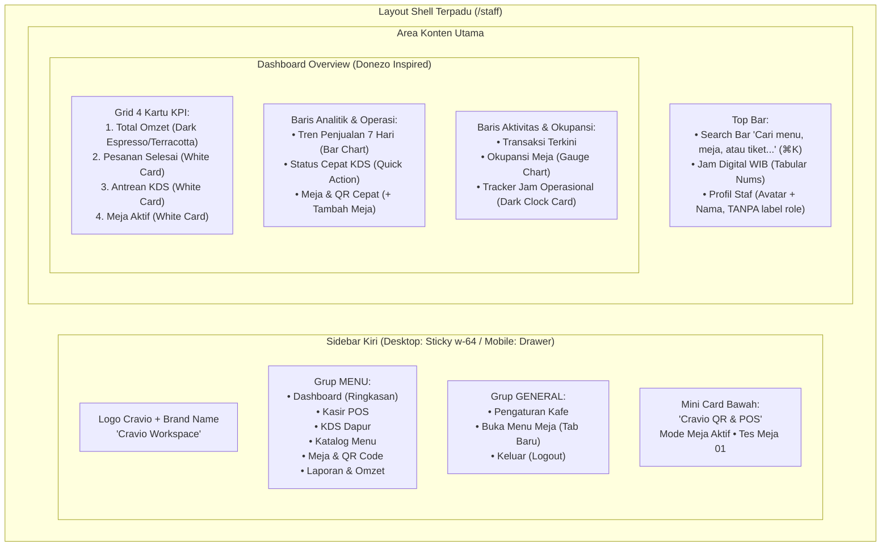
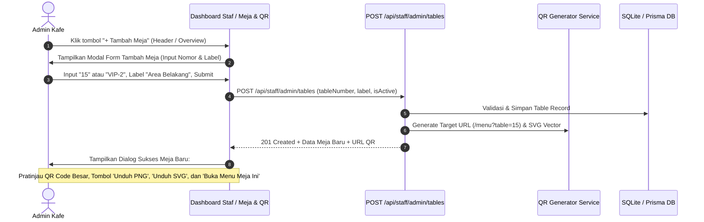

# Rencana Redesain Dashboard Staf Cravio, Tipografi Editorial Serif, Perbaikan Meja & QR Studio, serta Nama Kafe Dinamis

Dokumen ini menjabarkan spesifikasi arsitektur dan langkah eksekusi teknis untuk merombak antarmuka Dashboard Staf (`/staff/admin`, `/staff/pos`, `/staff/kds`), memperbaiki alur penambahan meja & master QR code, serta mengintegrasikan pengaturan nama kafe ke halaman pemesanan pelanggan dengan penanda mikro-iklan Cravio.

---

## 1. Analisis Kebutuhan & Hasil Temuan Audit

Berdasarkan 8 poin revisi pengguna dan analisis terhadap basis kode saat ini (`src/app/(staff)/...`, `src/components/shells/...`, serta dokumen referensi `media_1793361771844_bf4a32c2.jpg` dan `docs/design.md`):

| Poin Revisi Pengguna | Kondisi Saat Ini | Desain Target (Solusi) |
|---|---|---|
| **1. Layout Dashboard Referensi (Donezo)** | Tab horizontal di dalam halaman admin, tata letak flat dan monoton | Sidebar kiri terpadu, Top Bar pencarian `⌘K` + avatar, 4 kartu KPI atas (1 kartu gelap primer terakota/espresso, 3 kartu putih ber-hairline), grid analitik & widget operasional taktil. |
| **2. Larangan Font Sans-Serif di Staf** | Menggunakan font sans-serif umum (`Plus Jakarta Sans`) | Terapkan tipografi editorial serif (`Instrument Serif` / `font-serif`) untuk judul, metrik KPI, kartu, navigasi, dan tombol aksi pada seluruh portal staf. |
| **3. Sidebar Mirip Referensi** | Header atas tunggal (`StaffHeader`) dengan menu tab kecil | Sidebar vertikal kiri: Logo Cravio (`/logo/only-logo.jpeg`) + Brand Name, grup `MENU` (Dashboard, POS Kasir, KDS Dapur, Katalog Menu, Meja & QR, Laporan), grup `GENERAL` (Pengaturan Kafe, Buka Menu Pelanggan, Keluar), dan mini card widget taktil di kaki sidebar. |
| **4. Responsif Desktop hingga Mobile** | Tampilan admin desktop melebar dan tab bertumpuk di layar kecil | Mobile-first drawer navigation: hamburger button di layar $\le 1024$px dengan slide-over panel, layout kartu KPI yang melipat dari 4 kolom ke 2 kolom (tablet) dan 1 kolom (mobile), target sentuh $\ge 44$px. |
| **5. Hapus Teks "Role: admin"** | Terdapat badge `ROLE: ADMIN` mencolok di header admin dan `StaffHeader` | Hapus seluruh badge dan teks role. Gantikan dengan avatar staf, display name pengguna (e.g. "Admin Kafe" / nama admin), dan handle toko tanpa penanda label role. |
| **6. Anti-Slop Design (Sesuai Skill)** | Kartu dengan border gelap keras atau styling bawaan tanpa hierarki halus | Kartu squircle ber-radius `rounded-3xl`, bayangan mikro-elevasi `shadow-[0_2px_8px_rgba(27,28,26,0.04)]`, border hairline `border-[#E7E2DA]`, palet hangat `#FBF9F5` & `#FFFFFF`, aksen `#924805` (Terracotta) & `#1B1C1A` (Espresso), pil status translusen. |
| **7. Kendala Tambah Meja & QR** | Tombol tersembunyi di tab ke-6, validasi regex ketat tanpa spasi, API tidak mereturn error `message`, tidak ada preview QR instan setelah simpan | Sediakan tombol `+ Tambah Meja` di header & overview, perbaiki pesan error validasi di API, sanitasi input, dan tampilkan dialog sukses dengan pratinjau gambar QR instan, tombol unduh PNG/SVG, dan link tes pemesanan meja. |
| **8. Pengaturan Nama Kafe Dinamis** | Teks `"SELA Coffee"` di header pelanggan di-hardcode | Hubungkan form pengaturan kafe di admin ke database `CravioConfig.name`, teruskan prop nama kafe dinamis ke `/menu?table=XX`, dan sematkan penanda iklan mikro *"powered by cravio"* dengan link ke beranda. |

---

## 2. Arsitektur Antarmuka & Diagram Struktur

### 2.1. Hierarki Layout Baru Portal Staf (`StaffSidebarLayout`)

### 2.2. Alur Penambahan Meja & Pembuatan QR Code Instan

---

## 3. Rencana Perubahan Berkas (File Modifications)

### A. Navigasi & Shell Terpadu
1. **`src/components/shells/staff-sidebar-layout.tsx` (Baru / Refactor Komponen):**
   - Menggantikan `StaffHeader` ganda dengan layout sidebar modern ala Donezo.
   - Menyediakan sidebar vertikal desktop (sticky, `w-64`) dan drawer mobile/tablet dengan tombol hamburger.
   - Menampilkan logo Cravio (`/logo/only-logo.jpeg`), navigasi grup `MENU`, grup `GENERAL`, dan mini promo card di kaki sidebar.
   - Top bar: Search pill `⌘K`, jam digital WIB, tombol notifikasi, dan avatar profil staf **tanpa badge `Role: admin`**.
   - Menerapkan `font-serif` (`Instrument Serif`) sebagai font dasar layout staf.

2. **`src/app/(staff)/layout.tsx`:**
   - Membungkus seluruh rute `(staff)` dengan `StaffSidebarLayout` baru.
   - Mempertahankan `ToastProvider` dan `ConnectionBanner` untuk integritas SSE.

### B. Dashboard Overview & Manajemen Admin
3. **`src/app/(staff)/staff/admin/admin-client-view.tsx`:**
   - Hapus header lama yang memuat teks dan badge `ROLE: ADMIN`.
   - Rombak tampilan tab overview menjadi Dashboard Donezo yang memuat:
     - Header halaman dengan judul editorial serif: *"Dashboard Kafe"*, deskripsi singkat, tombol primer `+ Tambah Meja`, `+ Tambah Menu`, dan `Unduh Laporan`.
     - 4 KPI Cards:
       1. Kartu Gelap Primer (Espresso Charcoal `#1B1C1A` / Terracotta `#924805`): Omzet Hari Ini (`formatIDR`), icon ↗, perbandingan hari sebelumnya.
       2. Kartu Putih Hairline: Pesanan Selesai (`count`), icon ↗.
       3. Kartu Putih Hairline: Antrean Dapur & KDS aktif (`count`), icon ↗.
       4. Kartu Putih Hairline: Meja Aktif (`aktif / total`), icon ↗.
     - Widget Analitik Bar 7 Hari (Senin - Minggu dengan bar terakota taktil).
     - Widget Pengingat Antrean KDS Cepat dengan tombol satu-klik menuju layar KDS.
     - Widget Quick Meja & QR Studio dengan list meja dan tombol cepat pratinjau/cetak.
     - Widget Transaksi Terkini (tabel aktivitas bergaya tim pada gambar referensi).
     - Widget Okupansi Meja (gauge lingkaran/semi-donut persentase meja terisi).
     - Widget Jam Operasional Toko (kartu squircle gelap dengan live digital clock dan status toko buka).
   - Terapkan `font-serif` pada seluruh angka metrik, judul widget, dan badge status.

### C. Perbaikan Penambahan Meja & QR Studio
4. **`src/app/api/staff/admin/tables/route.ts`:**
   - Perbaiki penanganan validasi agar mengembalikan pesan error jelas (`message: 'Nomor meja tidak valid...'`).
   - Sanitasi input `tableNumber`: hapus spasi berlebih, ubah format otomatis jika diperlukan (e.g. `"Meja 08"` $\rightarrow$ `"08"` atau `"MEJA-08"`), dan berikan pesan error spesifik jika nomor meja telah digunakan.
   - Pastikan endpoint `POST` dan `GET` mengembalikan URL target QR yang akurat.

5. **Modal Tambah Meja & Dialog Sukses di `admin-client-view.tsx`:**
   - Sediakan tombol `+ Tambah Meja` di header dashboard utama, tab Meja & QR, dan widget ringkasan meja.
   - Buat formulir penambahan meja dengan validasi ramah pengguna (contoh preset nomor: `01`, `02`, `10`, `VIP-1`, `BAR-1`).
   - Tambahkan **Modal Sukses Meja & QR**: Setelah meja berhasil disimpan, modal langsung menampilkan QR Code besar beresolusi tinggi, nomor meja, tombol `Unduh PNG`, tombol `Unduh SVG`, serta tombol `Buka Menu Meja Ini` (`/menu?table=XX`) untuk verifikasi langsung.

### D. Pengaturan Nama Kafe Dinamis & Iklan Mikro Cravio
6. **`src/app/(customer)/layout.tsx` & `src/components/shells/customer-header.tsx`:**
   - Server Component `(customer)/layout.tsx` memanggil `prisma.cravioConfig.findUnique(...)` untuk mengambil nama kafe tersimpan (fallback: `'Cravio'`).
   - Teruskan prop `cafeName` ke `CustomerHeader`.
   - Pada `CustomerHeader`:
     - Tampilkan `{cafeName}` di sisi kiri atas dengan gaya branding yang elegan.
     - Tepat di samping atau di bawahnya, sematkan tag/link iklan mikro:
       `powered by cravio` dengan icon Cravio mini (`/logo/only-logo.jpeg`) dan tautan ke halaman beranda B2B (`/`).
   - Pada form Pengaturan Admin (`activeTab === 'settings'`), pastikan input `Nama Kafe` tersinkronisasi dan tersimpan sempurna ke basis data melalui `PUT /api/staff/admin/config`.

---

## 4. Rincian Desain Visual & Anti-Slop (Design Specification)

Mengikuti prinsip `docs/design.md` dan standar anti-slop:
* **Palet Warna:**
  - Latar Kanvas: `#FBF9F5` (Warm Cream Surface).
  - Latar Kartu: `#FFFFFF` (Surface Lowest).
  - Garis Tepi: `1px solid #E7E2DA` (Hairline Border tipis, bukan border abu-abu tebal).
  - Kartu Aksen Primer: `#1B1C1A` (Espresso Charcoal) dengan teks putih krem `#FBF9F5` dan aksen terakota `#924805`.
  - Teks Utama: `#1B1C1A` (Espresso).
  - Teks Muted: `#544339` (Warm Muted Brown).
* **Tipografi:**
  - Judul & Angka: `Instrument Serif` (`font-serif`) dengan tracking ketat (`tracking-tight`).
  - Teks Numerik Harga & Jam: `tabular-nums` untuk perataan vertikal sempurna.
  - **TIDAK ada teks biasa sans-serif yang mendominasi** dashboard staf.
* **Geometri & Bayangan:**
  - Radius sudut: `rounded-3xl` (24px) untuk kartu kontainer besar, `rounded-2xl` (16px) untuk widget internal, `rounded-xl` (12px) untuk tombol dan input.
  - Bayangan: `shadow-[0_2px_12px_rgba(27,28,26,0.03)]` halus tanpa efek glow neon murah.

---

## 5. Rencana Verifikasi & Uji Kualitas (Verification Plan)

| No | Pengujian | Metode & Alat | Kriteria Sukses |
|---|---|---|---|
| 1 | **TypeScript Compile Check** | `npx tsc --noEmit` | $0$ error kompilasi TypeScript. |
| 2 | **ESLint Check** | `pnpm run lint` | Lolos linting tanpa warning syntax. |
| 3 | **RBAC & Auth Test** | `pnpm exec vitest run tests/integration/staff-auth-rbac.test.ts` | Seluruh tes autentikasi staf dan hak akses lulus $100\%$. |
| 4 | **Uji Tambah Meja & Unduh QR** | Panggil API & Uji form modal | Meja baru (e.g. `15`) berhasil dibuat, QR code SVG/PNG dapat diunduh, dan link `/menu?table=15` dapat dibuka. |
| 5 | **Uji Ubah Nama Kafe** | Ubah nama kafe di Pengaturan Admin menjadi *"Kedai Kopi Cravio"* | Nama kafe di `/menu?table=07` langsung terupdate menjadi *"Kedai Kopi Cravio"* dengan badge mikro *"powered by cravio"*. |
| 6 | **Uji Visual Responsif** | Buka di desktop ($1280$px), tablet ($768$px), dan mobile ($390$px) | Sidebar kolaps ke drawer di mobile, tombol hamburger bekerja lancar, target sentuh $\ge 44$px. |
| 7 | **Uji Privasi Role** | Inspeksi DOM saat login sebagai Admin | Tidak ada teks atau badge `Role: admin` / `ROLE: ADMIN` pada tampilan. |

