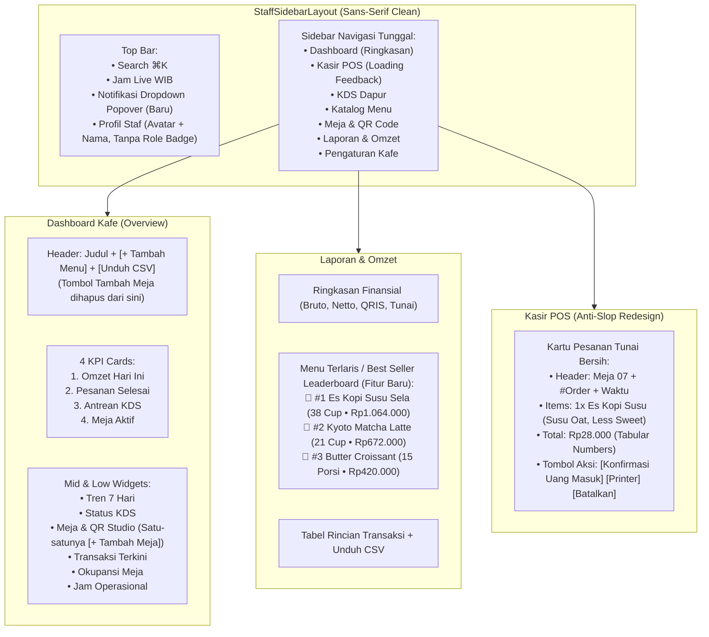

# Rencana Implementasi: 10 Revisi Antarmuka Portal Staf, Desain Anti-Slop, dan Fitur Menu Terlaris

Dokumen rencana kerja ini merinci perbaikan dan penyempurnaan pada portal `/staff` (`/staff/admin`, `/staff/pos`, `/staff/kds`) berdasarkan 10 masukan pengguna, gambar lampiran visual, serta panduan desain artisanal pada [`docs/design.md`](file:///d:/project/project-qr/cravio/docs/design.md).

---

## 1. Analisis Kebutuhan & Diagnosis Masalah

| No | Poin Revisi Pengguna | Diagnosis Masalah Saat Ini | Solusi & Target Implementasi |
|---|---|---|---|
| **1** | **Duplikasi Sidebar vs Navbar Pill Bar** | Terdapat *horizontal pill bar* di atas area konten admin yang menduplikasi menu sidebar (*Ringkasan, Katalog, Kategori, Meja & QR, Laporan, Pengaturan, Kuis, Audit*). | Hapus *horizontal pill bar* duplikat dari `AdminClientView`. Jadikan sidebar vertikal kiri sebagai navigasi utama tunggal. Di dalam halaman katalog, cukup sediakan filter kontekstual. |
| **2** | **Ganti Font ke Sans-Serif Bersih** | Penggunaan font editorial serif (`Instrument Serif`) dinilai pengguna terlalu "bergaya" / dekoratif untuk antarmuka operasional staf kasir & dapur. | Ganti seluruh tipografi portal staf ke **Sans-Serif modern & bersih** (`Plus Jakarta Sans` / `Inter` via `font-sans`), dengan perataan numerik `tabular-nums` untuk harga dan waktu. |
| **3** | **Double Plus pada Tombol** | Tombol memuat icon SVG `<Plus />` sekaligus teks `+ Tambah Meja` sehingga menghasilkan tampilan `+ + Tambah Meja`. | Hapus karakter `+` dari string teks: jadikan `<Plus className="w-4 h-4" /> Tambah Meja` dan `<Plus className="w-4 h-4" /> Tambah Menu`. |
| **4** | **Tulisan "Simpan Meja" Tidak Terlihat (Kontras Warna)** | Kelas Tailwind `bg-terracotta` tidak terdefinisi di `tailwind.config.ts` (hanya ada `terracotta-500`), menyebabkan tombol berlatar transparan/putih dengan teks putih `text-white` (kontras 1:1, tidak terbaca). | 1. Daftarkan `DEFAULT: '#924805'` pada `terracotta` di `tailwind.config.ts`. 2. Standarisasi seluruh tombol primer menjadi `bg-primary text-white hover:bg-primary-container shadow-sm font-semibold`. 3. Audit seluruh modal dan tombol aksi agar teks memiliki kontras tinggi ($\ge 4.5:1$). |
| **5** | **Duplikasi Tombol Tambah Meja di Overview** | Tombol Tambah Meja muncul di 2 tempat di Dashboard Kafe: di header atas dan di card Meja & QR Studio. | Hapus tombol "Tambah Meja" dari header atas Dashboard Kafe (sisakan hanya `Tambah Menu` dan `Unduh CSV`). Pertahankan tombol `+ Tambah Meja` di kartu *Meja & QR Studio*. |
| **6** | **Delay & Ketiadaan Feedback Pindah Menu** | Saat mengklik menu di sidebar (misal dari Dashboard ke Kasir POS), peramban menunggu kompilasi/fetching tanpa indikator visual, membingungkan pengguna. | 1. Tambahkan **Top Navigation Progress Bar** animasi instan di `StaffSidebarLayout` saat link diklik. 2. Sediakan file `loading.tsx` untuk rute `/staff/pos`, `/staff/kds`, dan `/staff/admin` agar Next.js langsung menampilkan kerangka *skeleton loading* seketika. |
| **7** | **Tombol Notifikasi Tidak Berfungsi** | Tombol lonceng di *top bar* hanya berupa elemen statis tanpa aksi. | Buat **Notification Popover Modal** mengambang di bawah tombol lonceng: menampilkan daftar pesanan baru, antrean tunai menunggu konfirmasi, status koneksi KDS, tombol *Tandai Semua Dibaca*, dan klik luar untuk menutup. |
| **8** | **Kartu Kasir POS & Katalog Tampak "AI Slop"** | Kartu pesanan kasir memiliki border kuning tebal, badge kuning keras, tombol hijau dengan icon emoji `✓` dan `🖨️` yang berantakan, serta label debug teknis (`REQ-ADMIN-XX`). | Redesain kartu kasir POS & katalog menu sesuai skill `smart-menu-ui` & `docs/design.md`: squircle `rounded-2xl`, border hairline `border-[#E7E2DA]`, bayangan mikro-elevasi halus `shadow-xs hover:shadow-md`, badge status translusen, tombol aksi terstruktur bersih dengan icon Lucide (`Check`, `Printer`, `X`). Hapus semua teks `REQ-ADMIN-XX`. |
| **9** | **Tombol Tambah Meja Tidak Ada di Meja & QR Code** | Tombol di tab Meja & QR sebenarnya ada di kode, tetapi menggunakan kelas broken `bg-terracotta text-white` sehingga tak terlihat (transparan). | Perbaiki kelas tombol menjadi `bg-primary text-white hover:bg-primary-container shadow-sm font-semibold`. Tambahkan juga tombol `+ Tambah Meja` di atas tabel daftar meja dan di tampilan data kosong (*empty state*). |
| **10** | **Fitur Menu Terlaris (Makanan/Minuman Sering Dibeli)** | Pengguna membutuhkan fitur untuk memantau menu mana yang paling laku di kafe. | Tambahkan kartu analitik **"Menu Terlaris & Paling Sering Dibeli" (Best Seller Leaderboard)** pada tab Laporan (`/staff/admin?tab=reports`): menampilkan peringkat 1–10, nama produk, porsi terjual, omzet terkumpul, dan *progress bar* visual pangsa penjualan. |

---

## 2. Arsitektur Antarmuka & Perubahan Komponen

### 2.1. Alur Interaksi Baru Portal Staf

---

## 3. Rencana Perubahan Berkas (Proposed Changes)

### Component 1: Design Tokens & Typography
#### [MODIFY] `tailwind.config.ts`
- Tambahkan `DEFAULT: '#924805'` dan `dark: '#7A3B04'` pada konfigurasi warna `terracotta` agar utility class `bg-terracotta`, `text-terracotta`, dan `hover:bg-terracotta-dark` selalu valid dan memiliki kontras warna penuh.

#### [MODIFY] `src/app/(staff)/layout.tsx`
- Ganti kelas `font-serif` menjadi `font-sans antialiased text-on-surface bg-surface` sehingga seluruh portal staf menggunakan tipografi sans-serif bersih (`Plus Jakarta Sans` / `Inter`).

---

### Component 2: Shell, Sidebar, Notifikasi & Indikator Loading
#### [MODIFY] `src/components/shells/staff-sidebar-layout.tsx`
- Ganti seluruh kelas `font-serif` menjadi `font-sans`.
- **Top Bar Notifikasi Popover**:
  - Ubah tombol lonceng agar membuka popover dropdown mengambang di bawah icon bell (`isNotifOpen` state).
  - Tampilkan daftar notifikasi operasional: pesanan tunai menunggu konfirmasi, status koneksi KDS, dan kondisi stok menu.
  - Sediakan tombol *"Tandai Semua Dibaca"* dan tombol navigasi langsung ke Kasir/KDS.
- **Loading Transition**:
  - Tambahkan indikator *top progress bar* tipis beranimasi terakota ketika rute sedang berpindah.
  - Tambahkan state indikator aktif seketika pada menu sidebar yang diklik.

#### [NEW] `src/app/(staff)/staff/pos/loading.tsx`
- Buat komponen skeleton loading responsif untuk layar Kasir POS.

#### [NEW] `src/app/(staff)/staff/kds/loading.tsx`
- Buat komponen skeleton loading responsif untuk layar KDS Dapur.

#### [NEW] `src/app/(staff)/staff/admin/loading.tsx`
- Buat komponen skeleton loading responsif untuk panel Admin.

---

### Component 3: Admin Dashboard Overview & Manajemen Meja
#### [MODIFY] `src/app/(staff)/staff/admin/admin-client-view.tsx`
- **Hapus Duplikasi Navigasi**: Hapus elemen *horizontal pill bar* di atas konten admin (`Ringkasan Dashboard | Katalog Menu | ...`).
- **Ganti Font ke Sans-Serif**: Hapus semua kelas `font-serif` pada judul, metrik KPI, kartu, tabel, dan form input, ganti dengan `font-sans font-bold` dan `tabular-nums`.
- **Perbaiki Tombol Double Plus**:
  - Ubah `<Plus className="w-4 h-4" /> + Tambah Menu` menjadi `<Plus className="w-4 h-4" /> Tambah Menu`.
- **Hapus Tombol Tambah Meja dari Header Overview**:
  - Hapus tombol "Tambah Meja" di bagian header atas Dashboard Kafe.
  - Pertahankan satu-satunya tombol `+ Tambah Meja` di kartu widget *Meja & QR Studio*.
- **Perbaiki Kontras Tombol Form & Modal**:
  - Perbaiki tombol modal Tambah Meja: `bg-primary text-white hover:bg-primary-container font-semibold shadow-sm active:scale-95`.
  - Pastikan teks "Simpan Meja" dan "Batal" memiliki kontras tajam terbaca jelas.
- **Tombol Tambah Meja di Tab Meja & QR Code**:
  - Pastikan tombol `+ Tambah Meja` di header tab `tables` dan di area daftar meja menggunakan styling `bg-primary text-white hover:bg-primary-container shadow-sm font-semibold`.
- **Fitur Baru di Tab Laporan: Menu Terlaris (Best Seller Leaderboard)**:
  - Di tab `reports`, tambahkan seksi **"Menu Terlaris & Paling Sering Dibeli"**:
    - Kartu berbingkai hairline dengan daftar 10 menu teratas dari `turnoverReport.topSellingItems`.
    - Lencana peringkat: 🥇 #1 (emas), 🥈 #2 (perak), 🥉 #3 (perunggu), #4 dst.
    - Menampilkan nama item, jumlah porsi terjual (*cup/porsi*), total omzet rupiah, serta bar persentase visual.
    - Sediakan status kosong yang ramah jika belum ada data transaksi pada rentang tanggal yang dipilih.

---

### Component 4: Kasir POS Anti-Slop Redesign
#### [MODIFY] `src/app/(staff)/staff/pos/pos-client-view.tsx`
- Ganti tipografi dari `font-serif` menjadi `font-sans`.
- Hapus border kuning tebal dan badge kuning tajam.
- Terapkan kartu anti-slop:
  - Kontainer kartu: `bg-white rounded-2xl border border-outline-variant shadow-xs hover:shadow-md transition-all p-5`.
  - Header: Pill meja `bg-surface-container text-on-surface px-2.5 py-1 rounded-lg text-xs font-bold`, nomor order `#SELA-XXXXXX`, dan waktu tunggu.
  - Rincian item: Indikator kuantitas tebal `text-primary font-bold`, nama produk, daftar modifier yang rapi, dan kotak kutipan catatan pelanggan `bg-amber-50/60 border border-amber-200/60 rounded-xl p-2.5 text-xs`.
  - Nominal harga total: Sans-serif tebal dengan `tabular-nums`.
  - Tombol aksi kasir:
    - `Konfirmasi Uang Masuk`: `bg-emerald-700 hover:bg-emerald-800 text-white rounded-xl py-2.5 px-4 font-bold text-xs flex items-center justify-center gap-1.5 shadow-sm active:scale-95 flex-1`.
    - `Cetak Struk`: Ganti emoji `🖨️` dengan icon Lucide `<Printer className="w-4 h-4" />` dalam button squircle yang proporsional.
    - `Batalkan`: Tombol outline `border-red-200 text-red-600 hover:bg-red-50 rounded-xl px-3 text-xs font-semibold`.

---

## 4. Rencana Verifikasi & Uji Kualitas

| No | Pengujian | Perintah / Metode | Kriteria Keberhasilan |
|---|---|---|---|
| 1 | **TypeScript Compile Check** | `npx tsc --noEmit` | Exit code 0, nol error tipe data. |
| 2 | **ESLint Check** | `pnpm run lint` | Lolos tanpa peringatan atau error unused variable. |
| 3 | **RBAC & Auth Test** | `pnpm exec vitest run tests/integration/staff-auth-rbac.test.ts` | 14/14 pengujian lulus $100\%$. |
| 4 | **Verifikasi Visual Font & Hilangnya Duplikasi** | Buka `/staff/admin` | 1. Tidak ada horizontal pill bar duplikat di atas konten. 2. Seluruh teks menggunakan font sans-serif bersih, tidak bergaya serif lagi. |
| 5 | **Verifikasi Tombol Tambah Meja** | Buka Dashboard & Tab Meja | 1. Di Dashboard atas hanya ada `Tambah Menu` dan `Unduh CSV` (tanpa double `+`). 2. Tombol `+ Tambah Meja` ada di kartu Meja & QR Studio dan di dalam tab Meja & QR. 3. Tombol "Simpan Meja" di modal terlihat jelas berlatar terakota solid dengan teks putih tajam. |
| 6 | **Verifikasi Loading Transition** | Klik menu sidebar (Kasir POS $\leftrightarrow$ Dashboard) | Terlihat animasi progress bar / skeleton loading seketika tanpa kebingungan delay. |
| 7 | **Verifikasi Modal Notifikasi** | Klik icon lonceng di top bar | Muncul popover notifikasi di bawah icon dengan rincian status operasional. |
| 8 | **Verifikasi Kartu Kasir POS Anti-Slop** | Buka `/staff/pos` | Kartu tampil rapi, proporsional, tanpa border kuning kasar, icon printer modern, tombol konfirmasi hijau solid. |
| 9 | **Verifikasi Fitur Menu Terlaris** | Buka `/staff/admin?tab=reports` | Tampil tabel/kartu peringkat Best Seller dengan nama menu, porsi terjual, dan total omzet. |

---

> [!NOTE]
> Setelah rencana ini disetujui, perubahan kode akan segera diterapkan secara berurutan sesuai rincian di atas.

