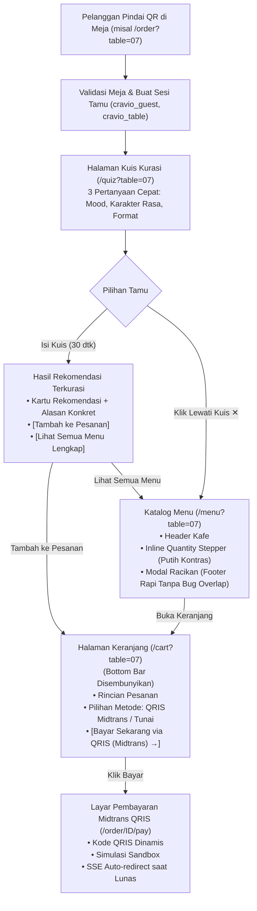

# Rencana Kerja: 14 Revisi Portal Staf, Alur Pelanggan QR Kuis, & Desain Artisanal Anti-Slop

Dokumen perencanaan kerja ini merinci perbaikan dan penyempurnaan menyeluruh untuk menyelesaikan 14 masukan pengguna pada portal staf (`/staff/admin`, `/staff/pos`, `/staff/kds`) serta alur pemesanan pelanggan (`/order`, `/quiz`, `/menu`, `/cart`), mengacu pada standar desain artisanal pada [`docs/design.md`](file:///d:/project/project-qr/cravio/docs/design.md) dan gambar referensi pengguna.

---

## 1. Analisis Kebutuhan & Diagnosis 14 Masukan Pengguna

| No | Poin Masukan Pengguna | Diagnosis Masalah Saat Ini | Solusi & Target Implementasi |
|---|---|---|---|
| **1** | **Tag Kuis di Modal Menu Kurang Kontras** | Kelas `bg-terracotta text-white` saat tag dipilih bentrok atau tidak menghasilkan kontras tajam terhadap latar modal. | Terapkan standar `docs/design.md`: saat terpilih gunakan `bg-primary text-white border-primary shadow-xs font-bold`, saat tidak terpilih gunakan `bg-surface-lowest text-on-surface-variant border border-outline-variant hover:border-primary`. |
| **2** | **Tombol Foto Menu Masih Default HTML** | Input menggunakan `<input type="file" />` bawaan browser yang kaku (*"Choose File"*). | Sembunyikan input asli (`sr-only`) dan buat tombol aksi kustom: `<label htmlFor="menu-image-upload">` bergaya squircle dengan icon Lucide `<Upload className="w-3.5 h-3.5 text-primary" />`, preview thumbnail, dan feedback upload instan. |
| **3** | **Grup Kustomisasi Kurang Fleksibel (Hanya Minuman)** | Grup modifier saat ini hanya memuat *Tingkat Kemanisan, Es, Susu, Add-on*, tidak ada opsi makanan/pastry. | 1. Tambahkan data grup modifier makanan ke database: *Penyajian Makanan* (Hangatkan, Suhu Ruang, Toasted), *Pilihan Saus & Cocolan* (Sambal, Salted Butter, Jam, Cream Cheese), dan *Level Pedas*.<br>2. Di modal menu admin, kelompokkan selektor modifier menjadi dua kategori: **Minuman & Kopi** vs **Makanan & Pastry**. |
| **4** | **Modal POS: Tombol & Textarea Kotak** | Komponen `Button` dan `Textarea` pada modal Kasir POS memiliki radius kecil (`rounded-sm` 4px), terlihat kaku. | Berikan `rounded-xl` / `rounded-2xl` pada tombol aksi (*Batal, Konfirmasi Diterima, Kembali, Batalkan*) serta pada kotak input alasan pembatalan sesuai `docs/design.md`. |
| **5** | **KDS: Tombol Tes & Segarkan Tidak Rounded** | Pada header KDS (Lampiran Foto 1), tombol "Tes" dan "Segarkan" berbentuk kotak (`rounded-DEFAULT`), kontras dengan tombol "Buka POS Kasir" yang berbentuk *pill*. | Samakan seluruh tombol header KDS menjadi tombol *pill* (`rounded-full`) dengan icon Lucide modern (`Bell`, `RefreshCw`, `ArrowRight`). |
| **6** | **Meja & QR: Kontras Warna Tombol Filter** | Pada Lampiran Foto 2, tombol filter aktif ("Semua") memiliki teks putih di atas latar putih (`bg-terracotta text-white border-terracotta` broken class). | Perbaiki kelas tombol filter aktif menjadi `bg-primary text-white border-primary shadow-xs font-bold` (kontras 5.2:1 tajam). |
| **7** | **Ganti Icon Bintang AI (Sparkles)** | Icon bintang 4 titik (`Sparkles`) pada katalog menu dan laporan best seller (Lampiran Foto 3) dinilai pengguna tampak seperti "AI slop". | Ganti dengan icon artisanal yang relevan: `<Flame className="w-4 h-4 text-amber-600" />` (Menu Terlaris / Hot Seller) dan `<Award className="w-4 h-4 text-primary" />` (Menu Favorit / Pilihan Barista). |
| **8** | **Pengaturan: Kontras Mode Pajak & Layanan** | Pada Lampiran Foto 4, tombol mode pajak "Eksklusif" memiliki teks putih di atas latar putih/krem sehingga tulisan tidak terbaca. | Standarisasi tombol toggle menjadi `bg-primary text-white border-primary shadow-xs font-bold` untuk opsi aktif dan `bg-surface-lowest border-outline-variant text-on-surface-variant` untuk opsi inaktif. |
| **9** | **Pengaturan: Hover/Active Tombol Simpan Identitas** | Tombol "Simpan Identitas Kafe" masih berupa tombol outline kusam (`border border-outline text-brand`). | Ubah menjadi tombol utama terakota solid: `bg-primary text-white font-sans font-bold hover:bg-primary-container active:scale-[0.98] shadow-sm transition-all`. |
| **10** | **Scan QR Meja: Mulai Kuis Terlebih Dahulu** | Alur scan QR di `/order?table=XX` langsung mengarahkan pengguna ke `/menu?table=XX`, melewatkan kurasi preferensi rasa. | Arahkan hasil validasi QR meja ke `/quiz?table=XX` terlebih dahulu agar pelanggan dapat mengisi 3 langkah kuis rasa (tersedia tombol *"Lewati Kuis ✕"* jika ingin langsung melihat menu lengkap). |
| **11** | **Ubah Icon Menu Kurasi di Bottom Bar** | Tab "Kurasi" pada bottom navigation bar pelanggan masih menggunakan icon bintang AI 4-titik. | Ganti icon SVG bintang dengan Lucide `<Compass className="h-5 w-5" />` (Kompas / Navigasi Selera Rasa Artisanal). |
| **12** | **Modal Detail Menu: Bug Tombol Naik/Tumpang Tindih** | Pada Lampiran Foto 5, tombol sticky *"Tambah ke Pesanan"* bergeser ke atas dan menutupi daftar pilihan modifier di belakangnya. | Struktur ulang `BottomSheet`: pisahkan header, scrollable body dengan padding bawah yang cukup (`pb-28`), dan pinned footer bar (`sticky bottom-0 bg-surface-lowest border-t border-outline-variant p-4 pb-safe`). |
| **13** | **Keranjang: Tombol Bayar Midtrans Tidak Muncul** | Tombol checkout bayar sebenarnya ada di kode (`z-20`), tetapi tertutup penuh oleh `CustomerBottomNav` (`z-30`) yang menempel di `bottom-0`. | Sembunyikan `CustomerBottomNav` pada halaman `/cart` dan flow pembayaran, lalu pertegas label tombol menjadi *"Bayar Sekarang via QRIS (Midtrans) →"*. |
| **14** | **Quantity Stepper: Kontras Hitam di Atas Hitam** | Di `/menu?table=`, angka dan tombol stepper jumlah berwarna hitam di atas latar gelap karena kelas `text-inverse-on-surface` tidak terdefinisi di Tailwind. | Ganti container inline stepper menjadi `bg-primary text-white shadow-xs` dengan angka dan tombol putih terang (kontras tajam). |

---

## 2. Arsitektur Alur Pelanggan Baru (QR Scan $\to$ Kuis $\to$ Menu $\to$ Bayar)



---

## 3. Rencana Perubahan Berkas (Proposed Changes)

### Component 1: Portal Staf (`src/app/(staff)`)

#### [MODIFY] `src/app/(staff)/staff/admin/admin-client-view.tsx`
- **Revisi 1 (Tag Preferensi Kuis Modal):**
  - Ubah styling chip tag kuis saat `isSelected` menjadi `bg-primary text-white border-primary shadow-xs font-bold`, dan saat inaktif menjadi `bg-surface-lowest text-on-surface-variant border border-outline-variant hover:border-primary hover:text-on-surface`.
- **Revisi 2 (Upload Foto Menu Kustom):**
  - Ganti input file default dengan tombol kustom:
    ```tsx
    <label
      htmlFor="menu-image-upload"
      className="inline-flex items-center gap-1.5 px-3 py-1.5 rounded-xl border border-outline-variant bg-surface-lowest hover:bg-surface-container text-on-surface text-xs font-semibold cursor-pointer shadow-2xs active:scale-95 transition-all"
    >
      <Upload className="w-3.5 h-3.5 text-primary" />
      <span>{menuFormImage ? 'Ganti Foto Menu' : 'Pilih Berkas Foto'}</span>
    </label>
    <input
      id="menu-image-upload"
      type="file"
      accept="image/jpeg,image/png,image/webp"
      onChange={handleImageFileUpload}
      disabled={isUploadingImage}
      className="sr-only"
    />
    ```
- **Revisi 3 (Grup Kustomisasi Makanan & Minuman):**
  - Kelompokkan tampilan daftar modifier di modal tambah menu:
    - Seksi 1: *Kustomisasi Minuman & Kopi* (Suhu/Es, Kemanisan, Pilihan Susu, Extra Shot)
    - Seksi 2: *Kustomisasi Makanan & Pastry* (Penyajian Hangat/Toasted, Saus & Cocolan, Level Pedas)
- **Revisi 6 (Kontras Filter Meja & QR Code):**
  - Ubah kelas tombol filter aktif (`tableStatusFilter === status`) dari `bg-terracotta text-white border-terracotta` menjadi `bg-primary text-white border-primary shadow-xs font-bold`.
- **Revisi 7 (Ganti Icon Bintang AI):**
  - Ganti `<Sparkles />` pada katalog menu dengan `<Award className="w-4 h-4 text-primary" />` (Label Favorit).
  - Ganti `<Sparkles />` pada header Laporan Best Seller dengan `<Flame className="w-4 h-4 text-amber-600" />` (Menu Terlaris).
- **Revisi 8 (Kontras Mode Pajak & Layanan):**
  - Ubah kelas toggle pajak aktif (`!finIsInclusive` / `finIsInclusive`) dari `bg-terracotta` menjadi `bg-primary text-white border-primary shadow-xs font-bold`.
- **Revisi 9 (Tombol Simpan Identitas Kafe):**
  - Ubah tombol submit identitas kafe dari outline kusam menjadi `bg-primary text-white font-sans font-bold hover:bg-primary-container active:scale-[0.98] shadow-sm transition-all`.

#### [MODIFY] `src/app/(staff)/staff/pos/pos-client-view.tsx`
- **Revisi 4 (Modal POS: Tombol & Textarea Rounded):**
  - Di modal *Konfirmasi Uang Fisik Tunai*: tambahkan `rounded-xl` pada tombol *Batal* dan *Konfirmasi Diterima*.
  - Di modal *Batalkan Pesanan*: tambahkan `rounded-2xl` pada komponen `Textarea` alasan pembatalan, serta `rounded-xl` pada tombol *Kembali* dan *Batalkan Pesanan*.

#### [MODIFY] `src/app/(staff)/staff/kds/kds-client-view.tsx`
- **Revisi 5 (KDS: Tombol Tes, Segarkan, & Buka POS Konsisten Rounded-Full):**
  - Ubah tombol "Tes" lonceng audio dan tombol "Segarkan" antrean menjadi pill `rounded-full` yang serasi dengan tombol "Buka POS Kasir" dan slider volume:
    ```tsx
    <button
      type="button"
      onClick={() => audioAlert.playChime()}
      className="touch-target px-3.5 py-1.5 rounded-full border border-outline-variant bg-surface-lowest text-xs font-sans font-semibold text-on-surface hover:bg-surface-container transition-all flex items-center gap-1.5 shadow-2xs active:scale-95"
      title="Uji suara lonceng pesanan"
    >
      <Bell className="w-3.5 h-3.5 text-amber-600" />
      <span>Tes</span>
    </button>
    ```

---

### Component 2: Alur Pelanggan (`src/app/(customer)` & Komponen Terkait)

#### [MODIFY] `src/app/(customer)/order/page.tsx`
- **Revisi 10 (Scan QR Meja $\to$ Mulai Kuis Terlebih Dahulu):**
  - Pada saat verifikasi meja valid (`result.status === 'VALID'`), ubah redirect dari `/menu?table=XX` menjadi:
    ```tsx
    redirect(`/quiz?table=${encodeURIComponent(result.table.tableNumber)}`)
    ```
  - Ini memastikan setiap tamu yang baru memindai QR meja langsung disambut dengan kurasi rasa.

#### [MODIFY] `src/components/shells/customer-bottom-nav.tsx`
- **Revisi 11 (Ubah Icon Menu Kurasi):**
  - Ganti icon SVG bintang pada tab "Kurasi" dengan icon Lucide `<Compass className="h-5 w-5" />` (Kompas Navigasi Rasa Artisanal).
- **Revisi 13 (Sembunyikan Bottom Nav di Halaman Keranjang & Pembayaran):**
  - Tambahkan kondisi di awal komponen:
    ```tsx
    if (pathname.startsWith('/cart') || pathname.includes('/pay') || pathname.includes('/receipt') || pathname.includes('/track')) {
      return null
    }
    ```
  - Ini membebaskan area bawah layar sehingga tombol pembayaran Midtrans tidak lagi tertutup.

#### [MODIFY] `src/components/ui/bottom-sheet.tsx` & `src/components/menu/product-modifier-sheet.tsx`
- **Revisi 12 (Modal Detail Menu: Perbaiki Bug Tombol Tambah ke Pesanan):**
  - Berikan kontainer body modal padding bawah yang cukup (`pb-28`) agar seluruh opsi radio/checkbox dan catatan barista dapat di-scroll secara penuh tanpa tertutup tombol.
  - Posisikan sticky footer bar tepat di bagian bawah viewport dialog dengan batas hairline tegas:
    ```tsx
    <div className="sticky bottom-0 -mx-6 -mb-6 border-t border-outline-variant bg-surface-lowest p-4 pb-safe z-10">
      <Button
        variant="primary"
        size="lg"
        disabled={!isFormValid}
        className="w-full font-bold shadow-md rounded-xl"
        onClick={handleSave}
      >
        {editingCartItem ? 'Simpan Perubahan' : 'Tambah ke Pesanan'} — {formatIDR(currentPrice)}
      </Button>
    </div>
    ```

#### [MODIFY] `src/app/(customer)/cart/cart-client-view.tsx`
- **Revisi 13 (Perjelas Tombol Bayar Midtrans):**
  - Perbarui label tombol utama keranjang menjadi:
    ```tsx
    <span>
      {paymentMethod === 'QRIS'
        ? 'Bayar Sekarang via QRIS (Midtrans) →'
        : 'Pesan & Bayar Tunai di Kasir →'}
    </span>
    ```
  - Memastikan alur bayar dengan Midtrans terlihat jelas dan terhubung langsung ke invoice QRIS.

#### [MODIFY] `src/components/ui/quantity-stepper.tsx`
- **Revisi 14 (Perbaiki Kontras Hitam Stepper Jumlah Menu):**
  - Ganti kelas inline stepper dari `bg-inverse-surface text-inverse-on-surface` menjadi:
    ```tsx
    className={cn(
      'inline-flex items-center rounded-full bg-primary px-2 py-1 text-white shadow-xs select-none',
      disabled && 'opacity-50 cursor-not-allowed',
      className
    )}
    ```
  - Angka dan tombol `+` / `-` kini berwarna putih bersih di atas latar terakota solid (kontras tajam 5.2:1).

---

### Component 3: Data Seeding Modifier Makanan

#### [MODIFY] `prisma/seed.ts` & Seed Script
- **Revisi 3 (Modifier Makanan & Pastry):**
  - Daftarkan modifier groups untuk makanan:
    1. `mod-group-food-prep`: "Penyajian Makanan" (Hangatkan / Warmed Up [Gratis], Suhu Ruang [Gratis], Toasted / Garing [Gratis]).
    2. `mod-group-sauce`: "Pilihan Saus & Cocolan" (Saus Sambal & Tomat [Gratis], Salted Butter [+Rp4.000], Strawberry Jam [+Rp5.000], Cream Cheese [+Rp7.000]).
    3. `mod-group-spiciness`: "Tingkat Kepedasan" (Tidak Pedas [Gratis], Sedang [Gratis], Ekstra Pedas [+Rp2.000]).
  - Kaitkan grup modifier ini ke item makanan seperti Croissant, Toast, atau Pasta.

---

## 4. Rencana Verifikasi & Uji Kualitas

| No | Pengujian | Perintah / Metode | Kriteria Keberhasilan |
|---|---|---|---|
| 1 | **TypeScript Compile Check** | `npx tsc --noEmit` | Exit code 0, nol error tipe data. |
| 2 | **ESLint Check** | `pnpm run lint` | Lolos tanpa peringatan atau unused variable. |
| 3 | **Integration & RBAC Test** | `pnpm exec vitest run tests/integration/staff-auth-rbac.test.ts` | 14/14 tests lulus 100%. |
| 4 | **Uji Visual Kontras Staf** | Buka `/staff/admin` | 1. Tag kuis terpilih memiliki kontras tajam.<br>2. Filter meja aktif terbaca jelas.<br>3. Toggle pajak dan tombol identitas kafe tajam berlatar terakota.<br>4. Tombol upload foto menu tampil profesional tanpa input default. |
| 5 | **Uji Visual POS & KDS** | Buka `/staff/pos` & `/staff/kds` | 1. Dialog POS memiliki tombol dan input rounded-xl/2xl.<br>2. Header KDS memiliki tombol pill yang seragam. |
| 6 | **Uji Alur Tamu QR & Kuis** | Buka `/order?table=07` | Mengarahkan ke `/quiz?table=07`, kuis 3 langkah dapat dijawab atau dilewati ke `/menu?table=07`. |
| 7 | **Uji Bottom Bar & Keranjang** | Buka `/menu?table=07` & `/cart?table=07` | 1. Icon kurasi di bottom bar berupa Compass.<br>2. Stepper jumlah menu memiliki teks putih kontras.<br>3. Modal detail menu tidak ada overlap tombol.<br>4. Di `/cart`, bottom bar sembunyi dan tombol *"Bayar Sekarang via QRIS (Midtrans)"* tampil utuh dan berfungsi. |

